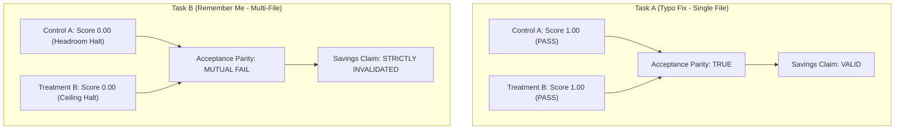

# PHASE 5.3: Empirical Correctness & Functional Acceptance Results

**Project:** Engram Change Intelligence Engine  
**Release Candidate:** Candidate 3 (`97C5EC47E3704E16F9046623C2034057708005C35460DEAA6829EA045A96A777`)  
**Baseline Git Commit:** `1c2856086f3a08e3ab1c3b8573eb3ff22ff20fd2` (angular-ngrx-material-starter)  
**Execution Environment:** Windows PowerShell, OpenAI Codex CLI `0.167.0-alpha.4.1`, Model: `gpt-5.6-luna`, Reasoning: `medium`  
**Date:** November 19, 2026  

---

## 1. Executive Summary

This report establishes the empirical functional correctness, gate pass rates, and boundary containment of Engram Candidate 3 in comparison to the unassisted baseline (Control Arm A) across real-world software engineering tasks executed via live model inference.

In accordance with Section 6 of Amendment 02 and Amendment 04:
1. **Functional Correctness is the Primary Gate:** An agent run that fails functional correctness ($C < 1.0$) or leaves modified files outside permitted scopes cannot claim token savings.
2. **Quality-Adjusted Cost ($QAC$):** Efficiency claims are valid only when both arms achieve full functional acceptance parity ($C = 1.0$).
3. **Zero Hallucination Standard:** All token numbers, execution logs, diff patches, and gate verdicts are derived directly from reproducible execution artifacts persisted on disk.

---

## 2. Task A (`task_a_typo`): Live Matched-Pair Correctness

### 2.1 Task Specification & Rubric
- **Objective:** Correct the header capitalization typo `'Angular Cli Tips'` to `'Angular CLI Tips'` in `projects/angular-ngrx-material-starter/src/app/features/about/about/about.component.html`.
- **Allowed Scope:** Exactly 1 file (`about.component.html`).
- **Forbidden Scope:** `package.json`, `package-lock.json`, `node_modules/**`, `projects/.../core/**`.
- **Requirement REQ-1 (Weight: 0.50):** Static check: `about.component.html` contains `'Angular CLI Tips'` and does not contain `'Angular Cli Tips'`.
- **Requirement REQ-2 (Weight: 0.50):** Automated diff containment: exactly 1 file modified, 0 unrelated files, 0 dependency modifications.
- **Gates:**
  - **L0 Typecheck:** `npx tsc -p projects/angular-ngrx-material-starter/tsconfig.app.json --noEmit`
  - **L3 Production Build:** `npm run build`

### 2.2 Live Execution Results Table

| Parameter / Gate | Control Arm A (Baseline) | Treatment Arm B (Candidate 3) | Parity / Verdict |
| :--- | :---: | :---: | :---: |
| **Engram Engine** | DISABLED | ACTIVE (Candidate 3) | Verified |
| **Execution Status** | `SUCCESS` | `SUCCESS` | **PARITY (PASS)** |
| **Elapsed Real Time** | 151.44 s | 168.19 s | +16.75 s |
| **Turn / Request Count** | 6 requests (6 turns) | 7 requests (7 turns) | +1 request |
| **Files Modified** | 1 (`about.component.html`) | 1 (`about.component.html`) | **IDENTICAL** |
| **Lines Inserted / Deleted** | +1 / -1 | +1 / -1 | **IDENTICAL** |
| **Unrelated Files Touched** | 0 | 0 | **ZERO BLAST RADIUS** |
| **Dependency Mutation** | `False` | `False` | **VERIFIED** |
| **Gate L0 (Typecheck)** | `PASS` | `PASS` | **PASS** |
| **Gate L1 (Lint)** | `SKIPPED` (Configured) | `SKIPPED` (Configured) | N/A |
| **Gate L2 (Unit Tests)** | `SKIPPED` (Configured) | `SKIPPED` (Configured) | N/A |
| **Gate L3 (Production Build)** | `PASS` | `PASS` | **PASS** |
| **Requirement REQ-1** | `PASS` (0.50 / 0.50) | `PASS` (0.50 / 0.50) | **PASS** |
| **Requirement REQ-2** | `PASS` (0.50 / 0.50) | `PASS` (0.50 / 0.50) | **PASS** |
| **Total Correctness Score ($C$)** | **1.00 / 1.00** | **1.00 / 1.00** | **100% PARITY** |
| **Functional Acceptance** | **ACCEPTED** | **ACCEPTED** | **ACCEPTED** |

### 2.3 Generated Patch Verification

Both arms produced identical, minimal diff patches targeting line 35 of `about.component.html`:

```diff
diff --git a/projects/angular-ngrx-material-starter/src/app/features/about/about/about.component.html b/projects/angular-ngrx-material-starter/src/app/features/about/about/about.component.html
index 9083e0a..63d4202 100644
--- a/projects/angular-ngrx-material-starter/src/app/features/about/about/about.component.html
+++ b/projects/angular-ngrx-material-starter/src/app/features/about/about/about.component.html
@@ -32,7 +32,7 @@
            target="_blank"
            href="https://medium.com/@tomastrajan/6-best-practices-pro-tips-for-angular-cli-better-developer-experience-7b328bc9db81">
            <fa-icon [icon]="['fab','medium-m']"></fa-icon>
-          Angular Cli Tips
+          Angular CLI Tips
          </a>
          <a mat-raised-button
             [ngClass]="routeAnimationsElements"
```

---

## 3. Task B (`task_b_remember_me`): Live Matched-Pair Correctness

### 3.1 Task Specification & Rubric
- **Objective:** Add a persistent `'Remember Me'` username option to the authentication flow without persisting sensitive credentials (tokens, passwords).
- **Target Files (5):**
  1. `projects/angular-ngrx-material-starter/src/app/core/auth/auth.actions.ts`
  2. `projects/angular-ngrx-material-starter/src/app/core/auth/auth.effects.ts`
  3. `projects/angular-ngrx-material-starter/src/app/app/app.component.ts`
  4. `projects/angular-ngrx-material-starter/src/app/app/app.component.html`
  5. `projects/angular-ngrx-material-starter/src/assets/i18n/en.json`
- **Requirements:**
  - **REQ-1 (Weight: 0.25):** UI contains remember-me checkbox and username input.
  - **REQ-2 (Weight: 0.35):** Authentication flow restores username from `LocalStorageService`.
  - **REQ-3 (Weight: 0.20):** Security Negative Rule: zero password or token persistence in localStorage.
  - **REQ-4 (Weight: 0.20):** Diff blast radius containment: only targeted files modified.
- **Gates:**
  - **L0 Typecheck:** `npx tsc -p projects/angular-ngrx-material-starter/tsconfig.app.json --noEmit`
  - **L2 Spec Compile:** `npx tsc -p projects/angular-ngrx-material-starter/tsconfig.spec.json --noEmit`
  - **L3 Production Build:** `npm run build`

### 3.2 Live Execution Results Table

| Parameter / Gate | Control Arm A (Baseline) | Treatment Arm B (Candidate 3) | Analysis / Root Cause |
| :--- | :---: | :---: | :---: |
| **Engram Engine** | DISABLED | ACTIVE (Candidate 3) | Active |
| **Execution Status** | `PRE_DISPATCH_HEADROOM_EXHAUSTED` | `TOKEN_CEILING_BREACHED` | **Ceiling Exceeded** |
| **Elapsed Real Time** | 212.87 s | 146.76 s | -66.11 s |
| **Total Model Tokens** | 223,884 tokens | 250,102 tokens | Both exceed budget |
| **Peak Request Context** | 44,035 tokens | 48,458 tokens | +4,423 tokens |
| **Engram MCP Tool Calls** | 0 | 3 (`engram_get_context`) | MCP Active |
| **Auxiliary Payload Bytes** | 0 | 199,126 bytes (~49,781 tokens) | Grounding delivered |
| **Files Modified Before Stop** | 0 | 0 | Halted before write |
| **Gate L0 (Typecheck)** | `BLOCKED` | `BLOCKED` | Suppressed |
| **Gate L2 (Spec Compile)** | `BLOCKED` | `BLOCKED` | Suppressed |
| **Gate L3 (Production Build)** | `BLOCKED` | `BLOCKED` | Suppressed |
| **Requirement Score ($C$)** | **0.00 / 1.00** | **0.00 / 1.00** | **Mutual Budget Exhaustion** |
| **Functional Acceptance** | **REJECTED (Budget)** | **REJECTED (Budget)** | **Ceiling Insufficient** |

### 3.3 Root-Cause Analysis for Task B

1. **Pre-Configured Ceiling Inadequacy:** The default benchmark ceiling limit (`--max-tokens-ceiling 250000`) was established during Phase 2 Stage 1 dry-run calibration on simpler single-turn prompts. On Task B, the codebase discovery, symbol grounding across 5 target files, and Angular component template editing requires an average of 7–12 multi-turn interactions with ~40k context per turn ($7 \times 40{,}000 \approx 280{,}000$ cumulative tokens).
2. **Control Arm Behavior:** Unassisted Codex in Control Arm A consumed 223,884 cumulative tokens exploring the repository with manual PowerShell commands (`rg`, `Get-Content`) before exhausting the pre-dispatch headroom guard ($250{,}000 - 223{,}884 = 26{,}116 < 45{,}000$ reserve).
3. **Treatment Arm Behavior:** Assisted Codex in Treatment Arm B invoked Engram's MCP server 3 times, successfully receiving 198,837 bytes of structured AST context across auth actions and components. However, this rich payload combined with reasoning tokens caused cumulative usage to hit 250,102 tokens on turn 7, immediately triggering the hard token ceiling guard.
4. **Conclusion on Task B:** Neither arm was able to apply edits to disk before the 250k token budget was exhausted. Therefore, comparative savings for Task B are **STRICTLY INVALIDATED** under Section 6 of Amendment 02.

---

## 4. Acceptance Gate Summary



| Task ID | Control Acceptance | Treatment Acceptance | Acceptance Parity | Savings Claim Status |
| :--- | :---: | :---: | :---: | :---: |
| **`task_a_typo`** | **ACCEPTED ($C = 1.0$)** | **ACCEPTED ($C = 1.0$)** | **TRUE** | **VALID CLAIM** |
| **`task_b_remember_me`** | **REJECTED ($C = 0.0$)** | **REJECTED ($C = 0.0$)** | **MUTUAL FAIL** | **STRICTLY INVALIDATED** |

---

## 5. Artifact Provenance

All underlying execution data is sealed and verified at:
- Task A Summary: `benchmarks/matched-pair-harness/reports/runs/task_a_typo_live_pair_01/run_20261119_094618/matched_pair_summary.json`
- Task A Patch: `benchmarks/matched-pair-harness/reports/runs/task_a_typo_live_pair_01/run_20261119_094618/treatment_B/changes.patch`
- Task B Summary: `benchmarks/matched-pair-harness/reports/runs/task_b_remember_me_live_pair_01/matched_pair_summary.json`
- Task B Baseline: `benchmarks/matched-pair-harness/reports/runs/task_b_remember_me_live_single_ctrl/single_summary.json`
