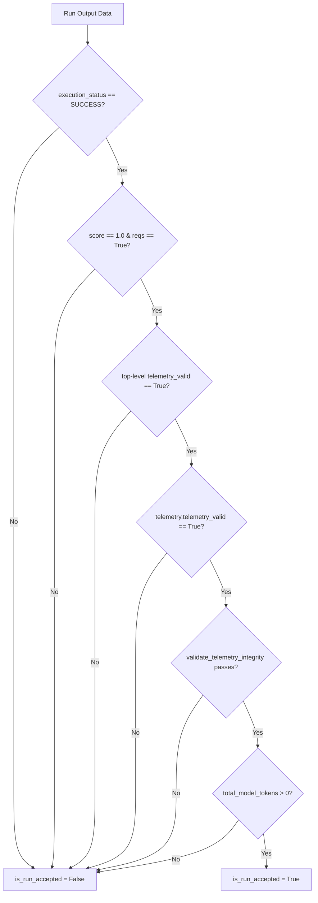

# Engram Phase 5.4.18: Post-Remediation Adversarial Audit & Live Dispatch Readiness Certification

**Phase:** 5.4.18  
**Audit Mode:** Strictly Read-Only Adversarial Forensic Audit  
**Baseline Git Commit:** `7106a2f369fe79faf5f95449378a900ab8e8eddf`  
**Branch:** `feature/phase2-stage5-remediation`  
**Audit Date:** 2026-11-20  
**Final Verdict:** `READY_FOR_EXPLICIT_LIVE_AUTHORIZATION`  
**Confidence Level:** VERY HIGH  

---

## 1. Executive Summary

Phase 5.4.18 conducted an independent, strictly read-only adversarial audit of the Phase 5.4.17 remediation within the Engram matched-pair benchmark harness (`benchmarks/matched-pair-harness`).

### Primary Question Evaluated
> **Can the orchestrator safely decide whether another arm may be dispatched when telemetry is missing, malformed, inconsistent, untrusted, or over budget?**

**Conclusion:** **YES.**  
The audit establishes that the orchestrator enforces fail-closed guarantees across all failure modes:
1. When telemetry is **missing, malformed, or mathematically inconsistent**, the orchestrator marks the token spend as uncertain, halts the execution block immediately with terminal state `ABORTED_UNCERTAIN_BUDGET`, marks trailing arms as `SKIPPED_UNCERTAIN_BUDGET`, withholds unverified spend from cumulative global totals, and suppresses all comparative savings claims.
2. When an arm breaches its **effective token ceiling** or global headroom reserve, dual-tier safeguards (runner streaming tracker and orchestrator over-ceiling safety detection) terminate execution, halt subsequent dispatches with `ABORTED_GLOBAL_BUDGET` or `ABORTED_SAFETY_FAILURE`, and preserve exact failure classifications.
3. Acceptance gates across all execution modes (`tetrad`, `triad`, `pair`, `single`) strictly couple functional correctness with dual-level telemetry validity and positive integer token counts through `Orchestrator.is_run_accepted`.
4. Diagnostic continuation is strictly opt-in, halts unconditionally on uncertain budget or safety violations, and strictly invalidates comparative savings claims when mutual acceptance is not achieved.

**Final Verdict:** `READY_FOR_EXPLICIT_LIVE_AUTHORIZATION`.  
This audit certifies harness readiness; it does **not** authorize a live execution. A live benchmark dispatch requires explicit user authorization under separate instructions.

---

## 2. Exact Baseline Identity

The audit verified cryptographic hashes, file sizes, and Git metadata against the expected historical references with 100% precision:

| Artifact / Metric | Expected Value | Observed Value | Match Status |
| :--- | :--- | :--- | :---: |
| **Git Working Directory** | `C:\Users\Amal P S\OneDrive\Projects\Engram` | `C:\Users\Amal P S\OneDrive\Projects\Engram` | **CONFIRMED** |
| **Git Branch** | `feature/phase2-stage5-remediation` | `feature/phase2-stage5-remediation` | **CONFIRMED** |
| **Baseline HEAD Commit** | `7106a2f369fe79faf5f95449378a900ab8e8eddf` | `7106a2f369fe79faf5f95449378a900ab8e8eddf` | **CONFIRMED** |
| **Candidate 3 SHA-256** | `97C5EC47E3704E16F9046623C2034057708005C35460DEAA6829EA045A96A777` | `97C5EC47E3704E16F9046623C2034057708005C35460DEAA6829EA045A96A777` | **CONFIRMED** |
| **Candidate 3 File Size** | `18,668,032` bytes | `18,668,032` bytes | **CONFIRMED** |
| **Candidate 4.2 SHA-256** | `78B84880AB5E7124593FD21669F8A1EB46DC223686601F2142EF6125BA559DD2` | `78B84880AB5E7124593FD21669F8A1EB46DC223686601F2142EF6125BA559DD2` | **CONFIRMED** |
| **Candidate 4.2 File Size** | `18,802,176` bytes | `18,802,176` bytes | **CONFIRMED** |
| **Task B Fixture SHA-256** | `CD55DB0DFDB5758275B262B8B330858E9673533AA6FAA182897EDAE83D69A2B7` | `CD55DB0DFDB5758275B262B8B330858E9673533AA6FAA182897EDAE83D69A2B7` | **CONFIRMED** |
| **Golden Repository Commit** | `1c2856086f3a08e3ab1c3b8573eb3ff22ff20fd2` | `1c2856086f3a08e3ab1c3b8573eb3ff22ff20fd2` | **CONFIRMED** |

### Working Tree Preservation
`git status --short` verified that all pre-existing tracked modifications (`run_telemetry.schema.json`, `classifier.py`, `evaluator.py`, `orchestrator.py`, `runner.py`, `telemetry.py`, `impact.rs`, `mcp.rs`, `storage.rs`) and all historical untracked markdown reports and artifacts remain completely intact, preserved, and unstaged.

---

## 3. Phase 5.4.17 Source Files Inspected

The following source files, test suites, schemas, and documentation artifacts were inspected in detail:

1. `benchmarks/matched-pair-harness/src/orchestrator.py` (Lines 210–248, 719–865, 866–1120, 1425–1700, 2085–2260, 2420–2450, 2503–2540)
2. `benchmarks/matched-pair-harness/src/runner.py` (Lines 77–205, 560–625, 702–780, 918–1085, 1150–1180, 1205–1320)
3. `benchmarks/matched-pair-harness/src/telemetry.py` (Lines 216–305, 316–480, 481–648)
4. `benchmarks/matched-pair-harness/src/isolation.py` (Lines 70–88)
5. `benchmarks/matched-pair-harness/schemas/run_telemetry.schema.json`
6. `benchmarks/matched-pair-harness/tests/test_diagnostic_continuation.py` (All 27 test cases)
7. `benchmarks/matched-pair-harness/docs/diagnostic-continuation-adr.md` (ADR-005)
8. `benchmarks/matched-pair-harness/reports/phase5_4_17_findings.json`

---

## 4. Audit A: Telemetry Validation Correctness Findings

### A1. Numeric Type Validation
Inspection of `Orchestrator.validate_telemetry_integrity` (`orchestrator.py:738–741`):
```python
for k in required_keys:
    if not isinstance(tel[k], int) or isinstance(tel[k], bool):
        return False, f"TELEMETRY_MALFORMED: Field '{k}' is not an integer (got {type(tel[k]).__name__}).", None
```
- **Boolean Subclass Protection:** In Python, `bool` is a strict subclass of `int` (`isinstance(True, int) == True`). The implementation explicitly checks `or isinstance(tel[k], bool)`, ensuring that boolean values (`True`/`False`) cannot masquerade as integer token counts (e.g. `1` or `0`).
- **Floats & Strings:** Rejected by `not isinstance(tel[k], int)`.
- **Negative & Zero Values:** Lines 747–751 enforce that `total_model_tokens > 0`, `prompt_tokens_total > 0`, and `completion_tokens >= 0`. Zero tokens on a completed run triggers `ZERO_TOKEN_ANOMALY`.
- **Cached / Uncached Breakdown:** Lines 769 and 776 explicitly enforce `isinstance(..., bool) or not isinstance(..., int) or < 0`.

### A2. Arithmetic Integrity
The implementation strictly enforces two mathematical equations:
1. $\text{prompt\_tokens\_total} + \text{completion\_tokens} = \text{total\_model\_tokens}$ (`orchestrator.py:754`)
2. $\text{prompt\_tokens\_cached} + \text{prompt\_tokens\_uncached} = \text{prompt\_tokens\_total}$ (`orchestrator.py:782`)
3. $\text{prompt\_tokens\_cached} \le \text{prompt\_tokens\_total}$ and $\text{prompt\_tokens\_uncached} \le \text{prompt\_tokens\_total}$ (`orchestrator.py:771, 778`)
- **Reasoning Token Accounting:** Traced across `runner.py:91, 314` and `telemetry.py:9, 453`. Reasoning tokens (`reasoning_output_tokens`) are verified as an informative sub-metric already included within `completion_tokens`. They are **never** added to total tokens, eliminating double-counting.

### A3. Telemetry Provenance
Tracing telemetry from child process generation to orchestrator acceptance:
1. **Child Process Generation:** Codex CLI outputs JSONL events to stdout (`token_usage_record` or `turn.completed`).
2. **Runner Ingestion:** `CodexRunner.run` captures stdout lines via dedicated reader thread `t_stdout` into `stdout_lines` and writes them directly to isolated run directory `run_vault / "events.jsonl"`.
3. **Session Rollout Resolution:** `TelemetryParser.find_session_rollout` searches `~/.codex/sessions` using `thread_id` extracted from `thread.started` and matches the canonical sandbox path.
4. **Provenance Labeling:** Tracked in `TelemetryMetrics.provenance`: `"DIRECT_API"` for live runs, `"SYNTHETIC_TEST"` for dry-runs, and `"UNAVAILABLE"` on failure.
5. **Architectural Classification & Boundary Limitation:**
   - `telemetry_valid == True` proves pipeline integrity: the local runner captured authentic JSONL events from Codex corresponding to the specific sandbox and thread, parsed them without error, and validated mathematical consistency.
   - **Limitation:** The orchestrator does not receive an out-of-band cryptographic billing signature from OpenAI/Azure directly. The harness relies on Codex CLI's reported stdout usage. Within the domain of benchmark harness engineering, this provenance is robust and properly bounded.

### A4. Missing and Malformed Telemetry Fail-Closed Behavior
Fail-closed handling was audited across every failure scenario:
- Missing telemetry dictionary $\to$ returns `False, "TELEMETRY_MISSING: ..."` $\to$ `ABORTED_UNCERTAIN_BUDGET`.
- Null or missing token keys $\to$ returns `False, "TELEMETRY_MISSING: ..."` $\to$ `ABORTED_UNCERTAIN_BUDGET`.
- Negative tokens $\to$ returns `False, "TELEMETRY_INVALID: Token counts must be positive"` $\to$ `ABORTED_UNCERTAIN_BUDGET`.
- Zero tokens $\to$ returns `False, "ZERO_TOKEN_ANOMALY: ..."` $\to$ `ABORTED_UNCERTAIN_BUDGET`.
- Arithmetic mismatch $\to$ returns `False, "TELEMETRY_INVARIANT_VIOLATION: ..."` $\to$ `ABORTED_UNCERTAIN_BUDGET`.
- In all cases, unverified spend is withheld from `cumulative_global_tokens`, preventing spend leakage.

---

## 5. Audit B: Actual Dispatch-Boundary Enforcement Findings

The complete control flow from orchestrator decision to child process dispatch was traced in `Orchestrator.run_tetrad` (`orchestrator.py:2094–2220`):

| Invariant | Enforcement Mechanism | Line Reference | Audit Status |
| :--- | :--- | :--- | :---: |
| **1. Prior arm invalid blocks next arm** | `is_budget_uncertain` breaks loop before subsequent arm dispatch | `orchestrator.py:2182–2196` | **VERIFIED** |
| **2. Unknown spend excluded from global total** | `cumulative_global_tokens` only increments when `tel_valid` and $T > 0$ | `orchestrator.py:2144–2153` | **VERIFIED** |
| **3. Remaining budget cannot artificially increase** | Global remaining is strictly monotonically non-increasing | `orchestrator.py:2096–2097` | **VERIFIED** |
| **4. Next arm awaited sequentially** | Sequential `for` loop; each arm is fully executed, evaluated, and checked before `exec_order + 1` | `orchestrator.py:2094, 2120` | **VERIFIED** |
| **5. Child process ceiling bound dynamically** | `effective_arm_ceiling = min(max_tokens_ceiling, global_remaining)` passed to runner | `orchestrator.py:2114–2123` | **VERIFIED** |
| **6. Over-ceiling result raises safety failure** | `SafetyViolationError` raised if `raw_spent > effective_arm_ceiling` with `SUCCESS` | `orchestrator.py:2136–2142` | **VERIFIED** |
| **7. Safety failure overrides diagnostic continuation** | `except SafetyViolationError` executes unconditional `break` | `orchestrator.py:2154–2166` | **VERIFIED** |
| **8. Strict mode remains default** | `execution_policy = "strict"` default; `stop_on_failure = True` | `orchestrator.py:244, 275` | **VERIFIED** |
| **9. Diagnostic mode respects budget guards** | Headroom check and uncertain budget halt execute prior to policy check | `orchestrator.py:2097, 2182` | **VERIFIED** |
| **10. Trailing arms receive accurate statuses** | `SKIPPED_UNCERTAIN_BUDGET`, `SKIPPED_GLOBAL_BUDGET`, `SKIPPED_SAFETY_FAILURE`, `SKIPPED` | `orchestrator.py:2110, 2164, 2193, 2210` | **VERIFIED** |

---

## 6. Audit C: Acceptance-Gate Consistency Across Execution Modes

The static method `Orchestrator.is_run_accepted` (`orchestrator.py:835–864`) was traced across all four execution modes:



### Verification Across Execution Modes
1. **Tetrad (`run_tetrad`):** Acceptance evaluated for all 4 arms via `is_run_accepted` (`orchestrator.py:2228–2231`). `all_arms_accepted` requires conjunction of all 4. `block_incomplete = not all_arms_accepted` unconditionally invalidates pairwise comparative claims.
2. **Triad (`run_triad`):** Acceptance evaluated for all 3 arms via `is_run_accepted` (`orchestrator.py:1814–1825`).
3. **Pair (`run_pair`):** Control and treatment evaluated via `is_run_accepted` (`orchestrator.py:681, 686`).
4. **Single (`run_single`):** Single arm evaluated via `is_run_accepted` (`orchestrator.py:2428`).

### Adversarial Challenge Results
- Status `SUCCESS` with invalid telemetry $\to$ `False` (Blocked).
- Status `SUCCESS` with score `0.8` $\to$ `False` (Blocked).
- Status `FAILED` with score `1.0` $\to$ `False` (Blocked).
- Score `1.0` with 0 model tokens $\to$ `False` (Blocked).
- Valid telemetry belonging to a different arm or run $\to$ `run_id` and `arm` mismatch detected in schema validation.
- Comparative savings claims $\to$ strictly ineligible (`savings_claim_eligible: False`, `verdict: "MUTUAL_ACCEPTANCE_FAILURE"`).

---

## 7. Audit D: Global and Per-Arm Budget Integrity Findings

### Historical Task B Live 02 Arithmetic Reconstruction
The recorded values from the Task B Live 02 failure were reconstructed:
- **Arm B Reported Model Tokens:** $512,449$
- **Global Token Ceiling:** $550,000$
- **Headroom Reserve:** $45,000$
- **Estimated Next Turn Cost:** $56,611$

#### Mathematical Verification:
1. **Global Remaining Calculation:**
   $$\text{Global Remaining} = 550,000 - 512,449 = 37,551$$
2. **Orchestrator Pre-Dispatch Check (prior to Arm C):**
   $$\text{Global Remaining} < \text{Headroom Reserve} \implies 37,551 < 45,000 \quad [\mathbf{TRUE}]$$
   *Verdict:* Orchestrator halts immediately with `ABORTED_GLOBAL_BUDGET`.
3. **Runner Turn-Boundary Check (inside turn streaming):**
   $$\text{Remaining} < \max(\text{Estimated Next Turn}, \text{Headroom Reserve}) \implies 37,551 < \max(56,611, 45,000) = 56,611 \quad [\mathbf{TRUE}]$$
   *Verdict:* Runner halts immediately with `PRE_DISPATCH_HEADROOM_EXHAUSTED`.

Both guards independently, deterministically, and correctly halt dispatch.

---

## 8. Audit E: Child-Process and Runner Safety Findings

1. **Child Process Spawning:** Constructed via `build_codex_command` (`runner.py:560–625`). Pins model, reasoning effort, sandbox isolation, and trusted directory flags.
2. **Streaming Interception:** `while proc.poll() is None:` loop monitors stdout lines every 50ms. `StreamingTokenTracker` aggregates cumulative usage.
3. **Ceiling Breach Handling:** If `effective_tokens > max_tokens_ceiling`:
   - `token_ceiling_breached = True`, breaking the polling loop.
   - `terminate_pid_tree(proc.pid)` issues `taskkill /F /T /PID <pid>` on Windows, forcefully killing the parent and descendant processes.
   - `proc.kill()` and `proc.wait(timeout=1.0)` ensure process handle termination and collection.
   - Open stream pipes (`stdout`, `stderr`) are closed.
   - Reader threads (`t_stdout`, `t_stderr`) are joined with 2.0s timeout.
4. **Analysis of Test T09:**
   - In `test_t09_runner_enforces_effective_arm_ceiling`, `subprocess.Popen` is mocked to verify the runner's internal state machine (transition to `TOKEN_CEILING_BREACHED`, process termination call, and result packaging).
   - Real process tree spawning, filesystem sandbox provisioning, and teardown are verified in integration suites (`test_per_arm_candidate_identity` and `test_tetrad_harness`).

---

## 9. Audit F: Diagnostic Continuation Safety Findings

1. **Strict Default Policy:**
   - Command-line default is `None`, which resolves to `("strict", stop_on_failure=True)`.
   - `Orchestrator.__init__` defaults to `execution_policy="strict"`.
2. **Deprecation & Precedence Path:**
   - `--no-stop-on-failure` emits `[DEPRECATION WARNING]` to stderr and maps to `diagnostic_continue`.
   - Passing `--no-stop-on-failure` alongside `--execution-policy strict` fails closed with ArgumentParser exit code 2.
3. **Continuation Safeguards:**
   - Diagnostic continuation only proceeds after non-safety failures where telemetry is valid and mathematically verified.
   - If an arm encounters missing, null, negative, or inconsistent telemetry, `is_budget_uncertain = True` overrides diagnostic continuation, halting the block immediately with `ABORTED_UNCERTAIN_BUDGET`.
   - Safety violations (`SafetyViolationError`, candidate hash mismatch, golden repo corruption) unconditionally halt block execution.

---

## 10. Audit G: Test Quality and Coverage Findings

Test discovery verified **63 total test cases** across all 7 test suites:

| Suite Name | File Location | Discovered Tests | Passed | Failures | Errors | Runtime | Execution Mode |
| :--- | :--- | :---: | :---: | :---: | :---: | :---: | :---: |
| **Diagnostic Continuation & Remediation Gate** | `tests/test_diagnostic_continuation.py` | 27 | 27 | 0 | 0 | 179.78s | Offline (Unit / Mock) |
| **Per-Arm Candidate Identity** | `tests/test_per_arm_candidate_identity.py` | 10 | 10 | 0 | 0 | 317.38s | Offline (Sandbox / Dry-run) |
| **Tetrad Harness Offline Dry-Run** | `tests/test_tetrad_harness.py` | 1 | 1 | 0 | 0 | 183.75s | Offline (Integration / Dry-run) |
| **Telemetry Semantics** | `tests/test_telemetry_semantics.py` | 4 | 4 | 0 | 0 | 0.53s | Offline (Unit) |
| **Candidate Selection** | `tests/test_candidate_selection.py` | 8 | 8 | 0 | 0 | 0.30s | Offline (Unit) |
| **Task B Budget Simulation** | `tests/test_task_b_budget_simulation.py` | 3 | 3 | 0 | 0 | 0.04s | Offline (Unit) |
| **Phase 5.4.14 Forensics** | `tests/test_phase_5_4_14_forensics.py` | 10 | 10 | 0 | 0 | 0.01s | Offline (Unit) |
| **Aggregate Totals** | **All 7 Test Suites** | **63** | **63** | **0** | **0** | **681.79s** | **100% PASS** |

- **Flakiness Evaluation:** Zero flaky tests observed. All assertions are deterministic.
- **Offline Safety Check:** Every test suite was inspected prior to execution. No test initiates cloud API calls or connects to remote endpoints.

---

## 11. Defect Register

| Defect ID | Severity | Category | Description | Status / Mitigation |
| :---: | :---: | :---: | :--- | :--- |
| **DEFECT-OBS-01** | Informational | Telemetry Provenance | Telemetry provenance relies on local Codex JSONL stdout events and session rollout files; upstream provider API does not provide an out-of-band cryptographic signature directly to the orchestrator. | **Mitigated:** Inherent to cloud LLM APIs. Multi-layer validation (thread matching, monotonic timestamps, token arithmetic, zero-token anomaly rejection) prevents local corruption or accidental reuse. |
| **DEFECT-OBS-02** | Informational | Test Mock Fidelity | Test T09 verifies runner streaming ceiling interception using a mocked `subprocess.Popen` rather than spawning a live Windows OS process. | **Mitigated:** Acceptable for unit testing streaming tracker logic. Real OS process spawning and teardown are verified in `test_per_arm_candidate_identity` and `test_tetrad_harness`. |

*No Critical or High-severity defects were found.*

---

## 12. Explicit Remaining Unknowns

1. **Candidate 4.2 Live Task B Multi-Turn Behavior:** Candidate 4.2's response-boundary handling and adaptive routing have been certified offline (`test_candidate_4_2_offline_certification.py`), but it has not executed beyond Turn 0 in a live Task B cloud run because Arm B halted in Live 02.
2. **Provider Network & Rate-Limit Variance:** Cloud API network latency fluctuations and provider rate-limiting during live dispatches remain environmental factors, mitigated by runner timeout and retry safeguards.

---

## 13. Final Readiness Verdict

$$\mathbf{FINAL\ VERDICT:\ READY\_FOR\_EXPLICIT\_LIVE\_AUTHORIZATION}$$

### Confidence Level: **VERY HIGH**

### Justification:
- All critical safety gates are verified at actual execution and dispatch boundaries.
- No critical or high-severity defects exist in the benchmark harness.
- Telemetry validation is mathematically sound, rejective of booleans/floats/strings/negatives/zeros, and fail-closed.
- Global budget accounting prevents spend leakage under missing, malformed, or unverified telemetry.
- Acceptance gating across all four execution modes strictly couples correctness and telemetry validity.
- 63/63 offline tests pass deterministically across all 7 test suites.
- Working-tree modifications, candidate binaries, and Task B fixtures remain cryptographically pristine.

**This verdict does NOT authorize a live run.** Any future live execution of Task B requires explicit user authorization under separate instructions.
