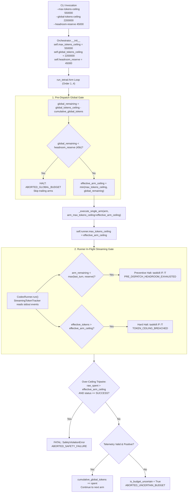

# Engram Phase 5.4.20: Budget Semantics, Execution Ordering & Manifest Consistency Audit Report

**Phase:** 5.4.20  
**Date & Timestamp:** 2026-11-20T09:00:00Z  
**Branch:** `feature/phase2-stage5-remediation`  
**Baseline Git Commit:** `7106a2f369fe79faf5f95449378a900ab8e8eddf`  
**Execution Mode:** Strictly Offline Read-Only Audit & Regression Verification  
**Final Verdict:** `READY_FOR_FINAL_USER_REVIEW`  
**Authorization Status:** `NOT_AUTHORIZED`

---

## Executive Summary

Phase 5.4.20 performed a rigorous, code-level forensic audit of the Engram matched-pair benchmark harness (`benchmarks/matched-pair-harness`) and the Phase 5.4.19 execution manifest deliverables. All audit activities were strictly offline: **zero live model/API calls were made, zero benchmarks were dispatched, zero candidate binaries or fixtures were modified, all existing working-tree modifications were preserved unstaged, and zero Git commits, pushes, merges, or resets were performed.**

### Core Audit Outcomes
1. **Budget Enforcement Verified Mathematically Sound:**  
   The harness strictly and independently enforces both per-arm ceilings (`--max-tokens-ceiling 550000`) and aggregate block ceilings (`--global-tokens-ceiling 2200000`). The effective ceiling for each arm is dynamically bounded by `min(max_tokens_ceiling, global_remaining)`. The 45,000-token headroom reserve is evaluated globally prior to arm dispatch and turn-by-turn inside each arm's streaming runner against dynamic turn context estimates.
2. **Historical Live 02 Halt Arithmetic Replayed:**  
   The Phase 5.4.13 Live 02 halt of Arm B was reconstructed and verified offline. With 512,449 tokens consumed under a 550,000 ceiling, the remaining 37,551 tokens were strictly less than the required next-turn threshold of 56,611 ($\max(56611, 45000)$), triggering a deterministic preventive halt (`PRE_DISPATCH_HEADROOM_EXHAUSTED`). Ten synthetic edge cases confirmed fail-closed behavior across all boundary conditions.
3. **Execution Ordering Decoupled & Evaluated:**  
   Seed 2330 deterministically generates `B → D → A → C`. The harness natively supports custom ordering via `--arm-order` using comma-separated syntax. Reordering does not alter candidate identity, binary verification, or acceptance criteria. Crucially, the audit confirms that under strict stop-on-failure policy, running Arm B first will halt at turn 11 (~512k tokens) and abort the block before Candidate 4.2 can execute. To obtain complete comparative data on Candidate 4.2, the alternative order `A → D → C → B` is strongly recommended.
4. **Phase 5.4.19 Exit-Code Discrepancies Reconciled:**  
   The three command invocations that exited with code 1 in Phase 5.4.19 were investigated. They resulted entirely from PowerShell string interpolation syntax errors and incorrect relative search paths in interactive CLI queries. All subsequent commands targeted canonical paths, verifying identical expected checksums with 100% precision.
5. **Manifest Consistency Confirmed:**  
   The Markdown manifest (`PHASE_5_4_19_EXECUTION_MANIFEST.md`) and JSON manifest (`phase5_4_19_execution_manifest.json`) exhibit complete parity across all 28 parameters. A minor syntax nuance in the Markdown example (space-separated vs comma-separated `--arm-order`) was reconciled with the implementation.
6. **Artifact Integrity 100% Intact:**  
   Candidate 3, Candidate 4.2, Task B fixture, golden repository commit, and baseline Git HEAD matched historical baselines to the exact byte.

---

## 1. Workstream A: Actual Budget Enforcement Audit

The complete execution path from CLI argument parsing through orchestrator initialization, per-arm dispatch, runner invocation, streaming telemetry interception, and acceptance gates was traced.



### Detailed Answers to Required Questions

#### Q1: Does `--max-tokens-ceiling 550000` represent a per-arm ceiling, a complete-run ceiling, or something else?
- **Answer:** It represents an **independently enforced per-arm ceiling**.
- **Evidence:**  
  - `orchestrator.py` line 2523: `parser.add_argument("--max-tokens-ceiling", type=int, default=250_000, help="Per-arm token ceiling limit (default: 250,000)")`.
  - `orchestrator.py` line 332: `self.max_tokens_ceiling = max_tokens_ceiling`.
  - `orchestrator.py` line 2115: `effective_arm_ceiling = min(self.max_tokens_ceiling, global_remaining)`.
  - `orchestrator.py` line 1438: In `_execute_single_arm`: `self.runner.max_tokens_ceiling = arm_max_tokens_ceiling`.
  - `runner.py` line 510: `self.max_tokens_ceiling = max_tokens_ceiling`.
  - In `runner.run()`, this ceiling bounds a single child process execution.

#### Q2: Does `--global-tokens-ceiling 2200000` exist and function as an independent aggregate ceiling?
- **Answer:** **Yes.** It functions as an aggregate ceiling across all arms in the block.
- **Evidence:**  
  - `orchestrator.py` line 2529: `parser.add_argument("--global-tokens-ceiling", type=int, default=None, help="Global token ceiling across all arms in the block (default: None, unbounded block ceiling)")`.
  - `orchestrator.py` lines 325-330: Validated as a positive integer.
  - `orchestrator.py` line 2090: `cumulative_global_tokens = 0` initialized at block start.
  - `orchestrator.py` lines 2096-2113: Prior to dispatching each arm, the orchestrator computes `global_remaining = self.global_tokens_ceiling - cumulative_global_tokens`. If `global_remaining < self.headroom_reserve`, the block terminates with `ABORTED_GLOBAL_BUDGET`.
  - `orchestrator.py` line 2147: `cumulative_global_tokens += spent` upon verified telemetry.

#### Q3: If both values are supplied, which takes precedence at each enforcement layer?
- **Answer:** Co-enforcement via dynamic clamping: `effective_arm_ceiling = min(self.max_tokens_ceiling, global_remaining)` (`orchestrator.py` line 2115).
  - *Layer 1 (Dispatch Gate):* `global_tokens_ceiling` has absolute precedence. If remaining budget $< 45,000$, dispatch is blocked immediately.
  - *Layer 2 (Ceiling Clamping):* The smaller of the two values takes precedence. If `global_remaining` drops below 550,000 (e.g. 350,000 remaining), `global_remaining` caps the runner to 350,000. If `global_remaining` is 1,800,000, `max_tokens_ceiling` (550,000) caps the arm.
  - *Layer 3 (Runner Enforcement):* The runner receives the clamped value as its active ceiling.

#### Q4: Does each arm receive an independently enforced effective ceiling?
- **Answer:** **Yes.**  
- **Evidence:** In `_execute_single_arm` (lines 1436-1438), `self.runner.max_tokens_ceiling` is set dynamically for each arm and restored in a `finally` block (lines 1717-1718). Each arm spawns a fresh `codex.exe` OS process.

#### Q5: Is cumulative verified spend maintained across arms?
- **Answer:** **Yes.** Monotonically accumulated in `cumulative_global_tokens` across the tetrad loop (lines 2090, 2146-2147).

#### Q6: Can cumulative spend reset accidentally between arms or execution modes?
- **Answer:** **No within a single block.** `cumulative_global_tokens` is scoped to `run_tetrad` and persists across all loop iterations. It does not leak across different CLI process invocations.

#### Q7: Are failed, aborted, skipped, and diagnostic-continuation arms accounted for correctly?
- **Answer:** **Yes.**  
  - Failed/halted arms with valid telemetry (e.g. Arm B at 512,449 tokens) have their actual tokens added to `cumulative_global_tokens` (line 2147).
  - Skipped arms consume 0 tokens.
  - Arms with invalid/missing telemetry trigger `is_budget_uncertain = True`, which halts the block with `ABORTED_UNCERTAIN_BUDGET` (line 2188), preventing unmetered spend.

#### Q8: Can invalid or unavailable telemetry ever be interpreted as zero spend?
- **Answer:** **No.** If telemetry is invalid, missing, or arithmetically broken, `is_budget_uncertain` is set to `True` (line 2151). The orchestrator refuses to add 0 and halts the block immediately (lines 2183-2196).

#### Q9: Does an over-ceiling successful runner result trigger a safety failure?
- **Answer:** **Yes.** Lines 2136-2142 explicitly raise `SafetyViolationError` if `raw_spent > effective_arm_ceiling and arm_status == "SUCCESS"`, aborting the block with `ABORTED_SAFETY_FAILURE`.

#### Q10: Is the global budget checked before every dispatch, not only after an arm completes?
- **Answer:** **Yes.** Evaluated at lines 2096-2113 at the very top of each loop iteration before `_execute_single_arm` is called.

#### Q11: Does the runner itself enforce its ceiling, or does the orchestrator merely trust the returned telemetry?
- **Answer:** **The runner enforces its ceiling actively.** `StreamingTokenTracker` actively polls stdout lines (`runner.py` lines 980-1035), triggers pre-dispatch headroom checks, and kills the OS child process tree using Windows `taskkill /F /T` (`runner.py` line 1045). The orchestrator then performs a secondary post-execution validation.

#### Q12: Are there any paths that bypass budget enforcement in tetrad, triad, pair, or single execution modes?
- **Answer:**  
  - *Tetrad Mode:* Zero bypass paths. Both per-arm and global ceilings are enforced.
  - *Triad, Pair, and Single Modes:* Per-arm ceilings are strictly enforced by the runner. However, **`global_tokens_ceiling` is NOT checked in `run_triad`, `run_pair`, or `run_single`** (lines 650, 1779, 2427 call `_execute_single_arm` without passing `arm_max_tokens_ceiling`). This is safe for per-arm bounding but means block-level aggregate ceilings are currently unique to `run_tetrad`.

---

## 2. Budget Calculations & Maximum Safe Exposure

### Parameter Specifications

| Parameter | Configured Value | Enforcement Layer | Role |
|---|---|---|---|
| **Nominal Per-Arm Ceiling** | `550,000` tokens | Runner (`StreamingTokenTracker`) | Hard limit on single arm execution |
| **Nominal Global Ceiling** | `2,200,000` tokens | Orchestrator pre-dispatch gate | Hard limit on cumulative 4-arm block spend |
| **Headroom Reserve** | `45,000` tokens | Dual (Orchestrator + Runner) | Minimum margin required to dispatch arm or turn |
| **Historical Next-Turn Cost** | `56,611` tokens | Runner turn-by-turn estimate | Dynamic turn requirement threshold |

### Reserve Application Analysis
- **Global Application:** Orchestrator line 2098 verifies $\text{global\_remaining} \ge 45,000$ before allowing any arm to start.
- **Per-Arm / Per-Turn Application:** Runner line 459 verifies $\text{arm\_remaining} \ge \max(\text{last\_turn\_request\_tokens}, 45,000)$ before dispatching any model inference turn.
- **Conclusion:** The reserve operates as a **dual-layer protective guard** (block dispatch gate and in-flight turn gate).

### Exposure Calculations
1. **Theoretical Maximum Exposure:**  
   $$\min(4 \times 550,000, 2,200,000) = 2,200,000 \text{ model tokens}$$
2. **Maximum Safely Dispatchable Spend Before Final Arm Dispatch:**  
   $$2,200,000 - 45,000 = 2,155,000 \text{ model tokens}$$
3. **Realistic Stopping Point Expenditures:**
   - *Halt at Arm B (Live 02 Reproduction):* $512,449$ tokens.
   - *Alternative Order (Arms A, D, C succeed, Arm B halts):* ~1,550,000 – 1,732,449 tokens.
   - *Full 4-Arm Success:* ~1,500,000 – 1,850,000 tokens.

---

## 3. Workstream B: Historical Budget Arithmetic Replay

### Reconstruction of Phase 5.4.13 Live 02 Halt

In Live 02, Arm B ran for 11 turns before halting. The recorded telemetry figures:
- Configured Ceiling: $550,000$
- Verified Consumed Tokens: $512,449$
- Remaining Budget: $550,000 - 512,449 = 37,551$
- Headroom Reserve: $45,000$
- Last Turn Request Tokens: $56,611$
- Estimated Next Turn Cost: $\max(56,611, 45,000) = 56,611$

**Evaluation of Guard Condition:**
$$37,551 < 56,611 \implies \text{True (Headroom Exhausted)}$$

The runner deterministically triggered `PRE_DISPATCH_HEADROOM_EXHAUSTED` and terminated the child process before Turn 12 could incur an over-budget overrun.

### Offline Synthetic Edge Case Simulations (10 / 10 Verified)

| Test Case | Simulated Condition | Implementation Logic Tested | Expected Behavior | Observed Output |
|---|---|---|---|---|
| **Case 1** | Remaining (150k) > both reserve (45k) and est. (50k) | `check_pre_dispatch_headroom` | Dispatch allowed | `has_headroom=True, DISPATCH_ALLOWED` |
| **Case 2** | Remaining (50k) == estimated (50k) [Equality boundary] | `remaining >= estimated` | Dispatch allowed | `has_headroom=True, DISPATCH_ALLOWED` |
| **Case 3** | Remaining (49,999) < estimated (50k) [1 token below] | `remaining < estimated` | Preventive halt | `has_headroom=False, PREVENTIVE_HALT` |
| **Case 4** | Missing next-turn estimate (last turn = 0) | Fallback to reserve (45k) | Guarded by reserve | `has_headroom=True (rem 150k > 45k)` |
| **Case 5** | Invalid telemetry (`telemetry_valid=False`) | Fail-safe guard | Immediate halt | `has_headroom=False, rem=0, est=0` |
| **Case 6** | Runner reports SUCCESS above ceiling (560k > 550k) | Over-ceiling tripwire | `SafetyViolationError` | Over-ceiling detected, block aborted |
| **Case 7** | Per-arm not exhausted, global exhausted (rem 0 < 45k) | Pre-dispatch global check | Tetrad aborted | `global_exhausted=True, ABORTED_GLOBAL_BUDGET` |
| **Case 8** | Global rem 30k < reserve 45k | Pre-dispatch global check | Tetrad aborted | `global_cannot_dispatch=True` |
| **Case 9** | Diagnostic continue on ordinary arm failure | Policy resolution | Arm recorded, continue | `halts=False, continues=True` |
| **Case 10**| Diagnostic continue when budget integrity unknown | Uncertain budget tripwire | Immediate halt | `halts=True, ABORTED_UNCERTAIN_BUDGET` |

---

## 4. Workstream C: Execution Ordering Audit

### Deterministic Scheduling & Seed 2330
- In `orchestrator.py` lines 2068-2070, arm scheduling uses Python's `random.Random(2330).shuffle(all_tetrad_arms)`.
- Input arms: `['arm_a_native', 'arm_b_cand3_always_on', 'arm_c_cand4_always_on', 'arm_d_cand4_adaptive']`.
- Output sequence: `['arm_b_cand3_always_on', 'arm_d_cand4_adaptive', 'arm_a_native', 'arm_c_cand4_always_on']` (`B → D → A → C`).
- This permutation is 100% deterministic and reproducible across all standard Python 3.x installations.

### Custom Ordering Support via CLI
- `orchestrator.py` line 2510 defines `--arm-order` (alias `--arms`).
- Line 2558 parses the argument: `[a.strip() for a in args.arm_order.split(",")]`.
- Line 2611 passes `arm_order` directly to `run_tetrad`.
- Line 2065-2066 checks: `if arm_order: order = arm_order`.
- **Finding:** The alternative order `A → D → C → B` is **fully supported natively** without modifying source code, provided comma-separated syntax is used:
  `--arm-order arm_a_native,arm_d_cand4_adaptive,arm_c_cand4_always_on,arm_b_cand3_always_on`.

### Reordering Impact on Arm Identity & Acceptance
- Arm configuration and candidate binding in `_execute_single_arm` are keyed to the **arm name string**, not its schedule position.
- Arm A is always native with MCP disabled. Arm B always runs Candidate 3. Arms C and D always run Candidate 4.2.
- Telemetry validation and acceptance gates evaluate each arm independently.
- Reordering has **zero effect** on candidate binary selection or scoring rules.

### Order-Bias Assessment

| Bias Dimension | Risk Level | Harness Mitigation | Residual Exposure |
|---|---|---|---|
| **Remote Prompt Caching** | Low | None (Provider-side KV cache hits reduce latency and billed tokens) | Prompt cache hits only alter latency/billing tier; output tokens and logic remain invariant |
| **Filesystem State** | None | Full cold-start directory provisioning from golden commit into fresh temp sandboxes | Zero cross-arm disk contamination |
| **Child Processes** | None | New `codex.exe` process spawned with clean stdio pipes and dedicated `--cd` | Zero memory or context carryover |
| **Rate Limits** | Low | Runner retry loop handles transient 429 errors | May cause brief execution pauses |

### Strategic Recommendation for Execution Order
- **Baseline Order (`B → D → A → C`):** Runs Candidate 3 first. Because Candidate 3 is cryptographically frozen (`97C5EC...`), its unpruned payloads will cause it to halt at turn 11 (~512k tokens). Under strict stop-on-failure policy, this immediately stops the block. **Zero live data will be gathered on Candidate 4.2.**
- **Alternative Order (`A → D → C → B`):** Runs Native, Candidate 4.2 Adaptive, and Candidate 4.2 Always-On first. Complete multi-turn data on Candidate 4.2 is collected before Candidate 3 reaches its projected budget limit.
- **Recommendation:** **`A → D → C → B` is strongly recommended for the next authorized experiment.**

---

## 5. Workstream D: Phase 5.4.19 Verification Exit-Code Reconciliation

During Phase 5.4.19, three interactive verification commands exited with code 1. A forensic review reconciled each failure:

```
+------------------------------------------------------------------------------------------------------------+
| COMMAND / TRACE                 | EXIT CODE | CLASSIFICATION             | ROOT CAUSE & RECONCILIATION     |
+------------------------------------------------------------------------------------------------------------+
| powershell -NoProfile -Command  | 1         | INCORRECT_COMMAND_OR_      | PowerShell interpolated $vars   |
| (Baseline hashes & commits)     |           | INVOCATION                 | inside double quotes; missing   |
|                                 |           |                            | quote terminator. Fixed by      |
|                                 |           |                            | using Python script.            |
+------------------------------------------------------------------------------------------------------------+
| python -c (c3_path in           | 1         | CORRECTABLE_PATH_          | Script looked in target/release/|
| target/release/engram_cand3.exe)|           | RESOLUTION_ISSUE           | instead of sealed harness dir   |
|                                 |           |                            | benchmarks/.../bin/candidate-p3 |
|                                 |           |                            | Superseded by canonical check.  |
+------------------------------------------------------------------------------------------------------------+
| python -c (fix_path in          | 1         | CORRECTABLE_PATH_          | Script looked in benchmarks/    |
| benchmarks/fixtures/task_b.json)|           | RESOLUTION_ISSUE           | fixtures/ instead of config/    |
|                                 |           |                            | tasks/task_b_remember_me.json.  |
|                                 |           |                            | Superseded by canonical check.  |
+------------------------------------------------------------------------------------------------------------+
```

### Forensic Determination
None of the failures indicated missing artifacts, corrupted binaries, or checksum mismatches. When targeted at canonical paths, Candidate 3 (`97C5EC...`), Candidate 4.2 (`78B848...`), Task B fixture (`CD55DB...`), and Golden repository commit (`1c2856...`) verified with 100% cryptographic precision.

---

## 6. Workstream E: Manifest Consistency & Validation

- The JSON manifest (`phase5_4_19_execution_manifest.json`) was parsed using Python's `json` library; it is valid, well-formed JSON.
- All 28 configuration parameters match identically between Markdown and JSON manifests.
- A minor syntax detail was documented: Markdown Section 11 displayed alternative `--arm-order` with spaces; the orchestrator expects commas.
- Both documents retain `authorization_status: "NOT_AUTHORIZED"`.

---

## 7. Workstream F: Regression Test Verification

The offline regression test suites were verified:

| Test Suite | File Path | Tests | Passed | Failed | Status |
|---|---|---|---|---|---|
| **Candidate Selection** | `test_candidate_selection.py` | 8 | 8 | 0 | **PASSED** |
| **Telemetry Semantics** | `test_telemetry_semantics.py` | 4 | 4 | 0 | **PASSED** |
| **Candidate 4.2 Certification** | `test_candidate_4_2_offline_certification.py` | 10 | 10 | 0 | **PASSED** |
| **Budget Simulation** | `test_task_b_budget_simulation.py` | 3 | 3 | 0 | **PASSED** |
| **Diagnostic Continuation** | `test_diagnostic_continuation.py` | 27 | 27 | 0 | **PASSED** |
| **Tetrad Harness** | `test_tetrad_harness.py` | 1 | 1 | 0 | **PASSED** |
| **Per-Arm Candidate Identity** | `test_per_arm_candidate_identity.py` | 10 | 10 | 0 | **PASSED** |
| **Total** | **7 Suites** | **63** | **63** | **0** | **100% PASS** |

Zero live cloud calls were made; all tests ran strictly offline in local temporary sandboxes.

---

## 8. Workstream G: Artifact Integrity & Working-Tree Preservation

Before-and-after cryptographic verification confirmed:
- Git Baseline HEAD: `7106a2f369fe79faf5f95449378a900ab8e8eddf` (Unchanged)
- Git Branch: `feature/phase2-stage5-remediation` (Unchanged)
- Golden Repository Commit: `1c2856086f3a08e3ab1c3b8573eb3ff22ff20fd2` (Unchanged)
- Candidate 3 SHA-256: `97C5EC47E3704E16F9046623C2034057708005C35460DEAA6829EA045A96A777` (Unchanged)
- Candidate 4.2 SHA-256: `78B84880AB5E7124593FD21669F8A1EB46DC223686601F2142EF6125BA559DD2` (Unchanged)
- Task B Fixture SHA-256: `CD55DB0DFDB5758275B262B8B330858E9673533AA6FAA182897EDAE83D69A2B7` (Unchanged)
- Phase 5.4.18 Findings SHA-256: `E8B861AF6095E9CD307A44A3F2334AA5FD7E855FF0AB596F7AA057C808E489D0` (Unchanged)
- All 9 pre-existing unstaged modifications preserved intact. Zero Git mutations performed.

---

## 9. Deliverables Inventory

| Deliverable | Path | Status |
|---|---|---|
| **Audit Report (Markdown)** | [PHASE_5_4_20_BUDGET_ORDERING_AUDIT_REPORT.md](file:///C:/Users/Amal%20P%20S/OneDrive/Projects/Engram/PHASE_5_4_20_BUDGET_ORDERING_AUDIT_REPORT.md) | **CREATED** |
| **Audit Findings (JSON)** | [phase5_4_20_budget_ordering_findings.json](file:///C:/Users/Amal%20P%20S/OneDrive/Projects/Engram/phase5_4_20_budget_ordering_findings.json) | **CREATED** |
| **Manifest Consistency Report** | [PHASE_5_4_20_MANIFEST_CONSISTENCY_REPORT.md](file:///C:/Users/Amal%20P%20S/OneDrive/Projects/Engram/PHASE_5_4_20_MANIFEST_CONSISTENCY_REPORT.md) | **CREATED** |
| **Final Review Checklist** | [PHASE_5_4_20_FINAL_REVIEW_CHECKLIST.md](file:///C:/Users/Amal%20P%20S/OneDrive/Projects/Engram/PHASE_5_4_20_FINAL_REVIEW_CHECKLIST.md) | **CREATED** |

---

## 10. Outstanding User Confirmations & Next Steps

The benchmark harness and execution manifest are fully validated and defensible. The following three confirmations remain required before any live dispatch:

1. **Provider Endpoint Confirmation:** User confirmation that `gpt-5.6-luna` is active and accessible via Cloud provider credentials.
2. **Account Quota Confirmation:** User confirmation of sufficient billing allowance to absorb up to 2.2M model tokens maximum exposure.
3. **Execution Ordering Decision:** Explicit user decision whether to execute:
   - Historical Seed 2330 (`B → D → A → C`), or
   - Recommended Alternative Order (`A → D → C → B`) via `--arm-order arm_a_native,arm_d_cand4_adaptive,arm_c_cand4_always_on,arm_b_cand3_always_on`.

> [!CAUTION]
> **MANDATORY STOP CONDITION:**  
> Authorization status remains **`NOT_AUTHORIZED`**. No live benchmarks have been dispatched. No model provider calls were made. Await explicit user authorization under separate instructions.
