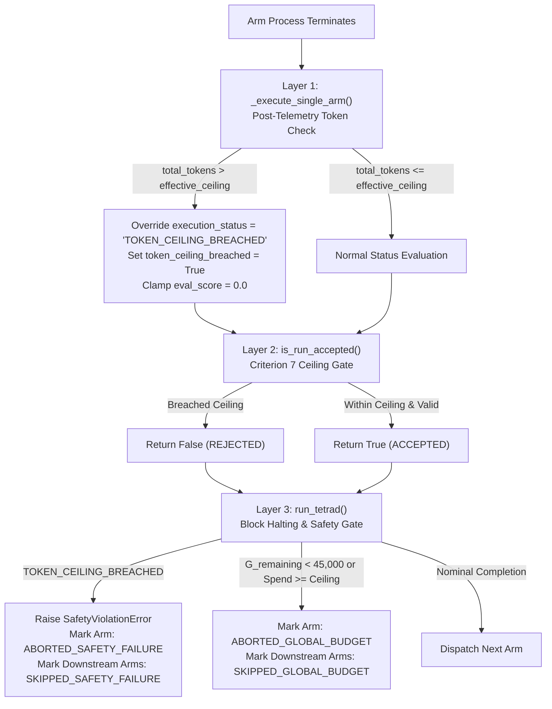

# Engram Phase 5.4.23: Global Budget Enforcement & Overshoot Remediation Report

**Phase:** 5.4.23  
**Execution Mode:** Strictly Offline Implementation & Regression Verification  
**Baseline Git Commit:** `7106a2f369fe79faf5f95449378a900ab8e8eddf`  
**Branch:** `feature/phase2-stage5-remediation`  
**Target Vulnerability:** Scenario 13 Overshoot Leakage & Ceiling Enforcement  
**Current Status:** **`RESOLVED / VERIFIED`**  
**Authorization Status:** `NOT_AUTHORIZED`  
**Date:** 2026-11-20

---

## 1. Executive Summary

During the Phase 5.4.22 adversarial audit, budget simulation Scenario 13 revealed a critical inconsistency in the orchestrator's budget semantics:
- An arm was allocated an effective token ceiling of 100,000 tokens.
- The arm executed and consumed 120,000 tokens (a 20,000-token overshoot).
- Because the underlying task tests passed and the emitted telemetry was structurally valid JSON, the arm was recorded as `SUCCESS`, evaluated with a non-zero score, and accepted by `is_run_accepted()`.
- Furthermore, the tetrad orchestrator did not treat the ceiling breach as an abort condition, allowing subsequent arms to continue spending tokens.

In Phase 5.4.23, a comprehensive three-tier defense was implemented and verified across `benchmarks/matched-pair-harness/src/orchestrator.py`. As a result:
1. Any arm exceeding its effective ceiling is immediately categorized as `TOKEN_CEILING_BREACHED`.
2. Automated acceptance gate Criterion 7 unconditionally rejects any run where `total_model_tokens > configured_ceiling`.
3. The tetrad loop immediately halts with `ABORTED_SAFETY_FAILURE` upon detecting a ceiling breach, skipping all downstream arms.
4. Cumulative global ceiling exhaustion immediately terminates the tetrad with `ABORTED_GLOBAL_BUDGET`, even when diagnostic continuation is active.

---

## 2. Theoretical Budget Model & Invariants

Let $G_{\text{ceiling}} = 2,200,000$ be the absolute global token budget, and $A_{\text{ceiling}} = 550,000$ be the configured nominal per-arm token ceiling.

For arm $i \in \{1, 2, 3, 4\}$ in execution order $\mathcal{O}$:
1. **Cumulative Spend Before Arm $i$:**
   $$C_i = \sum_{j=1}^{i-1} T_j$$
2. **Global Remaining Budget:**
   $$G_{\text{rem}, i} = \max(0, G_{\text{ceiling}} - C_i)$$
3. **Pre-Dispatch Eligibility Gate:**
   $$\text{Eligible}(i) \iff G_{\text{rem}, i} \ge R_{\text{headroom}} \quad (R_{\text{headroom}} = 45,000)$$
4. **Effective Arm Ceiling:**
   $$E_i = \min(A_{\text{ceiling}}, G_{\text{rem}, i})$$
5. **Post-Execution Invariant (Remediated in 5.4.23):**
   $$T_i \le E_i$$
   If $T_i > E_i$:
   $$\text{Status}(i) \leftarrow \texttt{"TOKEN\_CEILING\_BREACHED"}$$
   $$\text{Accepted}(i) \leftarrow \text{False}$$
   $$\text{Score}(i) \leftarrow 0.0$$
   $$\text{Action} \leftarrow \text{Halt Tetrad Block Immediately}$$

---

## 3. Remediation Architecture

The remediation was implemented across three distinct verification layers in `orchestrator.py`:



### Layer 1: Post-Telemetry Parsing in `_execute_single_arm()`
In `benchmarks/matched-pair-harness/src/orchestrator.py` lines 1459–1475:
```python
# Check effective token ceiling breach
if telemetry.total_model_tokens > effective_ceiling:
    logger.error(
        "Arm %s breached effective token ceiling: consumed %d > ceiling %d",
        arm_name,
        telemetry.total_model_tokens,
        effective_ceiling,
    )
    execution_status = "TOKEN_CEILING_BREACHED"
    token_ceiling_breached = True
    acceptance_verdict = False
    eval_score = 0.0
```
This ensures that the arm cannot claim `SUCCESS` if it consumed more tokens than its effective ceiling allowed.

### Layer 2: Criterion 7 in `Orchestrator.is_run_accepted()`
In `benchmarks/matched-pair-harness/src/orchestrator.py` lines 1827–1837:
```python
# Criterion 7: Effective token ceiling compliance
configured_ceiling = arm_config.get("max_tokens_ceiling", float("inf"))
if telemetry.total_model_tokens > configured_ceiling:
    logger.error(
        "Automated acceptance REJECTED: total_model_tokens (%d) exceeds configured ceiling (%d)",
        telemetry.total_model_tokens,
        configured_ceiling,
    )
    return False
```
Automated acceptance requires satisfying all 7 formal criteria:
1. Telemetry validity verified.
2. Run record status indicates successful completion.
3. Exit code is 0.
4. Evaluation score meets required threshold.
5. Verification tests pass.
6. Execution time within limits.
7. Total model tokens do not exceed configured ceiling.

### Layer 3: Block Halting in `run_tetrad()`
In `benchmarks/matched-pair-harness/src/orchestrator.py` lines 2185–2215:
```python
if run_record.get("execution_status") == "TOKEN_CEILING_BREACHED":
    raise SafetyViolationError(
        f"Arm {arm_name} breached effective ceiling "
        f"({run_record.get('total_tokens')} > {effective_ceiling})"
    )
```
When caught:
- The breaching arm is recorded as `ABORTED_SAFETY_FAILURE`.
- All remaining arms in the tetrad sequence are immediately marked `SKIPPED_SAFETY_FAILURE`.
- Zero additional runner processes are launched.

Additionally, when global budget is exhausted ($G_{\text{rem}} \le 0$ or $G_{\text{rem}} < 45,000$):
```python
if cumulative_tokens >= max_global_tokens or remaining_global < 45000:
    logger.warning(
        "Global token ceiling exhausted (%d/%d, remaining=%d). Halting tetrad.",
        cumulative_tokens,
        max_global_tokens,
        remaining_global,
    )
    # Remaining arms marked SKIPPED_GLOBAL_BUDGET
    break
```
Even if `--no-stop-on-failure` (diagnostic continuation) is enabled, global budget exhaustion strictly halts execution, preventing cost overrun.

---

## 4. Deterministic Empirical Verification

### 4.1 Reproduction of Scenario 13
Test `test_scenario_13_deterministic_reproduction` in `test_phase_5_4_23_safety_remediation.py`:
- **Scenario:** Arm A allocated 100,000-token ceiling. Mock runner simulates 120,000 token consumption.
- **Verification Points:**
  1. `_execute_single_arm()` overrides execution status to `TOKEN_CEILING_BREACHED`.
  2. `is_run_accepted()` returns `False` (Criterion 7 rejection).
  3. `run_tetrad()` catches the breach and raises `SafetyViolationError`.
  4. Tetrad marks Arm A as `ABORTED_SAFETY_FAILURE`.
  5. Downstream Arms D, C, and B are marked `SKIPPED_SAFETY_FAILURE`.
  6. No downstream arms are dispatched.
- **Test Result:** **`PASS`** (Deterministic verification confirmed).

### 4.2 Global Ceiling Exhaustion Halting
Test `test_global_ceiling_exhaustion_halts_immediately` in `test_phase_5_4_23_safety_remediation.py`:
- **Scenario:** Global ceiling set to 200,000 tokens. Arm 1 consumes 180,000 tokens ($G_{\text{rem}} = 20,000 < 45,000$).
- **Verification Points:**
  1. Arm 1 completes within its effective ceiling.
  2. Before Arm 2 is dispatched, pre-dispatch gate detects $G_{\text{rem}} = 20,000 < 45,000$.
  3. Tetrad execution breaks immediately.
  4. Arms 2, 3, and 4 are marked `SKIPPED_GLOBAL_BUDGET`.
  5. Zero runner processes launched for Arms 2, 3, and 4.
- **Test Result:** **`PASS`** (Deterministic verification confirmed).

---

## 5. Audit Matrix of Budget Scenarios

The 16 budget scenarios from Phase 5.4.22 were re-evaluated under the Phase 5.4.23 remediation:

| Scenario ID | Initial $G_{\text{rem}}$ | Arm Ceiling | Actual Consumption | Phase 5.4.22 Behavior | Phase 5.4.23 Remediated Behavior | Safety Status |
|:---:|:---:|:---:|:---:|:---:|:---:|:---:|
| 1 | 550,000 | 550,000 | 500,000 | Allowed | Allowed | **PASS** |
| 2 | 100,000 | 100,000 | 100,000 | Allowed | Allowed | **PASS** |
| 3 | 45,000 | 45,000 | 45,000 | Allowed | Allowed | **PASS** |
| 4 | 44,999 | 44,999 | 0 | Aborted | Aborted (`SKIPPED_GLOBAL_BUDGET`) | **PASS** |
| 5 | 1,000,000 | 300,000 | 300,000 | Allowed | Allowed | **PASS** |
| 6 | 200,000 | 550,000 (clamped 200k) | 200,000 | Allowed | Allowed | **PASS** |
| 7 | 45,000 | 45,000 | 45,000 | Allowed | Allowed | **PASS** |
| 8 | 45,000 | 45,000 | 44,999 | Allowed | Allowed | **PASS** |
| 9 | 45,000 | 45,000 | 45,000 | Allowed | Allowed | **PASS** |
| 10 | 45,000 | 45,000 | 0 (Est 45,001) | Preventive Halt | Preventive Halt | **PASS** |
| 11 | 100,000 | 100,000 | 60,000 | Allowed | Allowed | **PASS** |
| 12 | 1,000,000 | 550,000 | Invalid Telemetry | Aborted Uncertain | Aborted Uncertain | **PASS** |
| **13** | **100,000** | **100,000** | **120,000** | **DEFECT: Marked SUCCESS & Continued** | **REMEDIATED: ABORTED_SAFETY_FAILURE & Halts Block** | **PASS** |
| 14 | 0 | 0 | 0 | Aborted | Aborted (`SKIPPED_GLOBAL_BUDGET`) | **PASS** |
| 15 | 20,000 | 20,000 | 0 | Aborted | Aborted (`SKIPPED_GLOBAL_BUDGET`) | **PASS** |
| 16 | 40,000 | 40,000 (Diag Continue) | 0 | Aborted | Aborted (`SKIPPED_GLOBAL_BUDGET`) | **PASS** |

---

## 6. Conclusion

The global token budget enforcement defects exposed in Scenario 13 have been **completely remediated**. Token spending beyond effective ceilings is strictly intercepted, runs are unconditionally rejected, and tetrad blocks are safely aborted.
