# Engram Phase 5.4.23: Offline Regression Evidence Report

**Phase:** 5.4.23  
**Execution Mode:** Strictly Offline Implementation & Regression Verification  
**Baseline Git Commit:** `7106a2f369fe79faf5f95449378a900ab8e8eddf`  
**Branch:** `feature/phase2-stage5-remediation`  
**Regression Suites:** 8 test suites (86 test cases total)  
**Overall Regression Verdict:** **`100% PASS (86/86 PASSED, 0 FAILED)`**  
**Total Execution Time:** 606.54 seconds (~10.1 minutes)  
**Authorization Status:** `NOT_AUTHORIZED`  
**Date:** 2026-11-20

---

## 1. Executive Summary

This document presents the complete empirical evidence of the 8-suite offline regression test executed following the implementation of fail-closed tetrad order validation and global budget overshoot remediation in Phase 5.4.23.

All 8 suites were executed sequentially within the local workspace environment (`C:\Users\Amal P S\OneDrive\Projects\Engram`) with zero external network connectivity, zero live LLM API calls, and zero modifications to candidate binaries or task fixtures.

### Key Metrics:
- **Total Test Suites Executed:** 8
- **Total Test Cases Executed:** 86
- **Passed:** 86
- **Failed:** 0
- **Skipped:** 0
- **Pass Rate:** 100.0%
- **Cumulative Duration:** 606.54s
- **All Exit Codes:** 0

---

## 2. Cryptographic Baseline & Environment State

Prior to test execution, the integrity of the workspace was cryptographically audited:

| Component | Path / Reference | Hash / State | Status |
|---|---|---|:---:|
| **Git Baseline HEAD** | Commit Hash | `7106a2f369fe79faf5f95449378a900ab8e8eddf` | **VERIFIED** |
| **Git Branch** | Active Branch | `feature/phase2-stage5-remediation` | **VERIFIED** |
| **Candidate 3 Binary** | `target/release/engram-candidate-3.exe` | `97C5EC47E3704E16F9046623C2034057708005C35460DEAA6829EA045A96A777` | **MATCHED** |
| **Candidate 4.2 Binary** | `target/release/engram.exe` | `78B84880AB5E7124593FD21669F8A1EB46DC223686601F2142EF6125BA559DD2` | **MATCHED** |
| **Task B Fixture** | `benchmarks/matched-pair-harness/config/tasks/task_b_remember_me.json` | `CD55DB0DFDB5758275B262B8B330858E9673533AA6FAA182897EDAE83D69A2B7` | **MATCHED** |
| **Golden Repository** | Git Commit | `1c2856086f3a08e3ab1c3b8573eb3ff22ff20fd2` | **MATCHED** |
| **Working Tree Modifications** | 9 Pre-Existing Modified Files | Preserved across all test suites | **PRESERVED** |

---

## 3. Comprehensive Suite-by-Suite Regression Results

The full regression execution was orchestrated and recorded to structured JSON log files:

```mermaid
flowchart LR
    S1["1. test_candidate_selection<br>(8/8, 5.81s)"] --> S2["2. test_telemetry_semantics<br>(4/4, 6.29s)"]
    S2 --> S3["3. test_candidate_4_2_offline<br>(10/10, 37.89s)"]
    S3 --> S4["4. test_task_b_budget_simulation<br>(3/3, 3.30s)"]
    S4 --> S5["5. test_diagnostic_continuation<br>(27/27, 204.49s)"]
    S5 --> S6["6. test_tetrad_harness<br>(1/1, 64.38s)"]
    S6 --> S7["7. test_per_arm_candidate_identity<br>(10/10, 265.44s)"]
    S7 --> S8["8. test_phase_5_4_23_safety<br>(23/23, 18.94s)"]
```

### Summary Table

| # | Test Suite | Path | Tests Passed | Failed | Duration | Exit Code | External Services Contacted | Protected Files Modified | Status |
|:---:|---|---|:---:|:---:|:---:|:---:|:---:|:---:|:---:|
| 1 | Candidate Selection | `benchmarks/matched-pair-harness/tests/test_candidate_selection.py` | 8 | 0 | 5.81s | 0 | **False** | **False** | **PASS** |
| 2 | Telemetry Semantics | `benchmarks/matched-pair-harness/tests/test_telemetry_semantics.py` | 4 | 0 | 6.29s | 0 | **False** | **False** | **PASS** |
| 3 | Candidate 4.2 Offline Cert | `benchmarks/matched-pair-harness/tests/test_candidate_4_2_offline_certification.py` | 10 | 0 | 37.89s | 0 | **False** | **False** | **PASS** |
| 4 | Task B Budget Simulation | `benchmarks/matched-pair-harness/tests/test_task_b_budget_simulation.py` | 3 | 0 | 3.30s | 0 | **False** | **False** | **PASS** |
| 5 | Diagnostic Continuation | `benchmarks/matched-pair-harness/tests/test_diagnostic_continuation.py` | 27 | 0 | 204.49s | 0 | **False** | **False** | **PASS** |
| 6 | Tetrad Harness | `benchmarks/matched-pair-harness/tests/test_tetrad_harness.py` | 1 | 0 | 64.38s | 0 | **False** | **False** | **PASS** |
| 7 | Per-Arm Candidate Identity | `benchmarks/matched-pair-harness/tests/test_per_arm_candidate_identity.py` | 10 | 0 | 265.44s | 0 | **False** | **False** | **PASS** |
| 8 | Phase 5.4.23 Safety Remediation | `benchmarks/matched-pair-harness/tests/test_phase_5_4_23_safety_remediation.py` | 23 | 0 | 18.94s | 0 | **False** | **False** | **PASS** |
| **Total** | **8 Test Suites** | **Entire Regression Suite** | **86** | **0** | **606.54s** | **0** | **False** | **False** | **100% PASS** |

---

## 4. Detailed Suite Analysis

### Suite 1: Candidate Selection (`test_candidate_selection.py`)
- **Scope:** Verifies candidate binary resolution, validation of required flags, and rejection of invalid binary paths.
- **Result:** 8 passed in 5.81s.
- **Log:** `scratch/regression_5_4_23/test_candidate_selection.py.log`
- **Verification:** Candidate paths for Baseline Native, Candidate 3, and Candidate 4.2 resolved correctly without regression.

### Suite 2: Telemetry Semantics (`test_telemetry_semantics.py`)
- **Scope:** Verifies schema validation for `run_telemetry.schema.json`, token field consistency, and cost calculation sanity.
- **Result:** 4 passed in 6.29s.
- **Log:** `scratch/regression_5_4_23/test_telemetry_semantics.py.log`
- **Verification:** Telemetry parsing handles all token metrics and validates schema strictly.

### Suite 3: Candidate 4.2 Offline Certification (`test_candidate_4_2_offline_certification.py`)
- **Scope:** Validates Candidate 4.2 CLI interface, MCP tool definitions, semantic retrieval, and UTF-8 boundary resilience.
- **Result:** 10 passed in 37.89s.
- **Log:** `scratch/regression_5_4_23/test_candidate_4_2_offline_certification.py.log`
- **Verification:** Candidate 4.2 binary certified offline without external dependencies.

### Suite 4: Task B Budget Simulation (`test_task_b_budget_simulation.py`)
- **Scope:** Simulates token consumption trajectories for Task B under varying cache hit rates and turns.
- **Result:** 3 passed in 3.30s.
- **Log:** `scratch/regression_5_4_23/test_task_b_budget_simulation.py.log`
- **Verification:** Headroom estimation logic and dynamic ceiling adjustments perform as expected.

### Suite 5: Diagnostic Continuation (`test_diagnostic_continuation.py`)
- **Scope:** Tests failure status preservation, continuation flags (`--no-stop-on-failure`), diagnostic observation isolation, and global reserve bounds under failure.
- **Result:** 27 passed in 204.49s.
- **Log:** `scratch/regression_5_4_23/test_diagnostic_continuation.py.log`
- **Verification:** Preserves failed arm statuses while allowing diagnostic continuation within budget limits.

### Suite 6: Tetrad Harness (`test_tetrad_harness.py`)
- **Scope:** End-to-end mocked tetrad run verifying block orchestration, run record generation, and comparative reporting.
- **Result:** 1 passed in 64.38s.
- **Log:** `scratch/regression_5_4_23/test_tetrad_harness.py.log`
- **Verification:** Complete tetrad execution completes cleanly with all 4 arms evaluated.

### Suite 7: Per-Arm Candidate Identity (`test_per_arm_candidate_identity.py`)
- **Scope:** Rigorously verifies that each tetrad arm executes with its assigned candidate binary, MCP mode, and evaluation rubric without contamination across arms.
- **Result:** 10 passed in 265.44s.
- **Log:** `scratch/regression_5_4_23/test_per_arm_candidate_identity.py.log`
- **Verification:** Arm A (Native), Arm B (Cand 3), Arm C (Cand 4.2 always-on), and Arm D (Cand 4.2 adaptive) are strictly isolated.

### Suite 8: Phase 5.4.23 Safety Remediation (`test_phase_5_4_23_safety_remediation.py`)
- **Scope:** Dedicated verification of fail-closed tetrad order validation (T01–T18), Scenario 13 deterministic reproduction, immediate block halting on global exhaustion, and zero pre-dispatch side effects.
- **Result:** 23 passed in 18.94s.
- **Log:** `scratch/regression_5_4_23/test_phase_5_4_23_safety_remediation.py.log`
- **Verification:** Complete validation of Phase 5.4.23 P0 remediations.

---

## 5. Historical Comparison & Evolution

| Phase | Suites | Tests Passed | Tests Failed | Total Duration | Environment / Mode |
|:---:|:---:|:---:|:---:|:---:|---|
| **Phase 5.4.21** (Historical Baseline) | 7 | 63 | 0 | 396.27s | Offline regression (`task-58182.log`) |
| **Phase 5.4.22** (Audit Rerun) | 7 | 63 | 0 | 1367.05s | Offline rerun audit |
| **Phase 5.4.23** (Current Post-Remediation) | **8** | **86** | **0** | **606.54s** | **Offline regression with safety suite** |

The regression baseline expanded from 63 to 86 tests (+23 tests), with 100% pass rate maintained across all legacy and new test cases.

---

## 6. Regression Isolation & Safety Guarantees

Every test suite was audited during execution for adherence to isolation boundaries:
1. **Network Isolation:** Verified via socket monitoring; zero external HTTP/HTTPS/TCP connections initiated (`external_services_contacted: false`).
2. **Binary Immutability:** Verified SHA-256 hashes of Candidate 3 and Candidate 4.2 binaries pre- and post-test suite run.
3. **Task Definition Immutability:** Verified SHA-256 hash of Task B fixture pre- and post-run.
4. **Git Tree Preservation:** `git status` confirmed zero unintentional changes staged or created.

---

## 7. Conclusion

The Phase 5.4.23 regression execution successfully validates that the new safety features operate with zero regressions against existing benchmark capabilities.

All 8 suites passed unconditionally with exit code 0.
