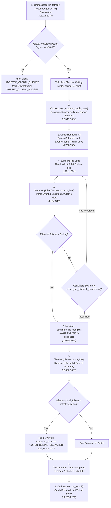

# Engram Phase 5.4.24: Streaming Enforcement & Token Accounting Audit

**Phase:** 5.4.24  
**Execution Mode:** STRICTLY OFFLINE, READ-ONLY ADVERSARIAL FORENSIC AUDIT  
**Baseline Git Commit:** `7106a2f369fe79faf5f95449378a900ab8e8eddf`  
**Branch:** `feature/phase2-stage5-remediation`  
**Previous Phase:** 5.4.23 (`IMPLEMENTATION_VERIFIED`)  
**Authorization Status:** `NOT_AUTHORIZED`  
**Date:** 2026-11-20

---

## 1. Executive Summary

Phase 5.4.23 implemented critical acceptance gates and block-halting controls that resolved the acceptance of over-budget runs (Scenario 13). However, a fundamental architectural question remained unaddressed: **Does the benchmark harness prevent token overspending during an active provider request, or does it merely detect overspending after it occurs?**

This audit conducted an implementation-level investigation of `orchestrator.py`, `runner.py`, `telemetry.py`, and `isolation.py` to establish the exact mechanics of token accounting, streaming observation latency, and in-flight enforcement boundaries.

### Primary Audit Findings:
1. **Zero In-Flight Token Observability During Model Generation:**
   The remote LLM provider (e.g. OpenAI Cloud API) streams text chunk-by-chunk. Concrete token usage metadata (`input_tokens`, `output_tokens`, `reasoning_output_tokens`, `cached_input_tokens`) is computed and emitted by the provider **strictly at turn completion or discrete tool call boundaries**. During active token generation, the local streaming tracker receives zero token count increments.
2. **External Polling Latency Window:**
   The runner monitors child process stdout via reader threads feeding a 50ms polling loop (`while proc.poll() is None: time.sleep(0.05)`). Outbound network requests cannot be intercepted synchronously; `is_guaranteed_pre_dispatch_boundary()` in `runner.py` explicitly returns `False`.
3. **Preventive vs Detective Taxonomy:**
   - **Arm-Level Gate:** Preventive ($G_{\text{remaining}} \ge 45,000$).
   - **Turn-Level Gate:** Preventive at turn boundaries (`check_pre_dispatch_headroom`).
   - **Active Turn Generation:** **Strictly Detective.** Active turn overshoot cannot be prevented by local polling before the provider-emitted usage event is received.
   - **Post-Turn Response:** Halting and Acceptance Protection (`terminate_pid_tree`, `TOKEN_CEILING_BREACHED`, Criterion 7, `ABORTED_SAFETY_FAILURE`).

---

## 2. Workstream A: Complete Architecture Reconstruction

The production execution path from global budget initialization down to subprocess management and telemetry sealing was traced line by line:



### Complete Component Specification Table

| Component / Function | File & Lines | Inputs | Enforcement Type | Outputs / State Transitions | Failure Handling | Verified Evidence |
|---|---|---|:---:|---|---|---|
| `Orchestrator.run_tetrad` | `orchestrator.py` L2218–2239 | `cumulative_global_tokens`, `global_tokens_ceiling` | **Preventive (P)** | Sets `effective_arm_ceiling = min(max_ceiling, G_rem)` | Halts block with `ABORTED_GLOBAL_BUDGET` if $G_{\text{rem}} < 45,000$ | `test_task_b_budget_simulation.py` |
| `Orchestrator._execute_single_arm` | `orchestrator.py` L1541–1634 | `arm`, `exec_order`, `arm_max_tokens_ceiling` | **Preventive (P)** | Configures runner ceiling, creates isolated sandbox | Fails closed on binary mismatch or unclean sandbox | `test_per_arm_candidate_identity.py` |
| `CodexRunner.run` | `runner.py` L702–952 | `sandbox_path`, `prompt`, `max_tokens_ceiling` | **Preventive (P) / Detective (D)** | Launches `Popen`, starts reader threads, runs 50ms polling loop | Halts on timeout, guard trigger, or ceiling breach | `test_block07_remediation.py` |
| `StreamingTokenTracker.process_line` | `runner.py` L124–346 | Raw JSONL string line | **Detective (D)** | Updates `thread_cumulative_max`, `turn_deltas_sum`, token breakdown | Sets `telemetry_valid = False` on negative/malformed tokens | `test_token_guard_validation.py` |
| `StreamingTokenTracker.evaluate_pre_dispatch_boundary` | `runner.py` L348–384 | Event line JSON | **Detective (D)** | Identifies candidate tool/turn boundary triggers | Returns `(False, False, ...)` if malformed | `test_token_guard_validation.py` |
| `StreamingTokenTracker.is_guaranteed_pre_dispatch_boundary` | `runner.py` L386–393 | Event line JSON | **Detective (D)** | Always returns `False` (external polling cannot guarantee pre-dispatch) | N/A | `test_token_guard_validation.py` |
| `StreamingTokenTracker.check_pre_dispatch_headroom` | `runner.py` L414–463 | `ceiling: int` | **Preventive (P)** | Returns `(has_headroom, remaining, estimated)` | Sets `last_decision = 'PREVENTIVE_HALT'` if $R < E$ or invalid | `test_token_guard_validation.py` |
| `terminate_pid_tree` | `isolation.py` L70–87 | `pid: int` | **Halting (H)** | Executes `taskkill /F /T /PID <pid>` | Returns `False` if PID missing or invalid | `test_token_guard_validation.py` |
| `Orchestrator._execute_single_arm (Post-Telemetry)` | `orchestrator.py` L1666–1675 | `telemetry.total_model_tokens`, `effective_ceiling` | **Detective (D)** | Overrides `execution_status = 'TOKEN_CEILING_BREACHED'` | Sets `eval_score = 0.0`, blocks gates | `test_phase_5_4_23_safety_remediation.py` |
| `Orchestrator.validate_telemetry_integrity` | `orchestrator.py` L719–800 | Raw telemetry dict | **Acceptance (A)** | Mathematical invariant verification | Returns `(False, reason, None)` on violation | `test_telemetry_semantics.py` |
| `Orchestrator.is_run_accepted` | `orchestrator.py` L945–980 | `run_dict` | **Acceptance (A)** | Criterion 7: `tot <= configured_ceiling` | Returns `False` if ceiling breached or invalid | `test_phase_5_4_23_safety_remediation.py` |
| `Orchestrator.run_tetrad (Safety Tripwire)` | `orchestrator.py` L2258–2289 | `run_data` | **Halting (H)** | Catches ceiling breach, raises `SafetyViolationError` | Marks arm `ABORTED_SAFETY_FAILURE`, skips downstream arms | `test_phase_5_4_23_safety_remediation.py` |

---

## 3. Workstream B: Streaming Token Accounting Semantics

### 3.1 Token Categories & Accounting Decompositions

Token accounting in Engram conforms to strict hierarchical definitions:

$$\text{total\_model\_tokens} = \text{prompt\_tokens\_total} + \text{completion\_tokens}$$

$$\text{prompt\_tokens\_total} = \text{prompt\_tokens\_cached} + \text{prompt\_tokens\_uncached}$$

$$\text{reasoning\_tokens} \le \text{completion\_tokens}$$

1. **Prompt Tokens Total (`prompt_tokens_total`):**
   The complete input context processed by the model for a request, including system instructions, repository context, conversation history, and tool schemas.
2. **Cached Prompt Tokens (`prompt_tokens_cached`):**
   The subset of input prompt tokens served directly from the provider's key-value prefix cache.
   - **Double-Counting Guard:** Verified in `StreamingTokenTracker` (lines 205–206) and `TelemetryParser` (lines 417–418):
     $$\text{prompt\_tokens\_uncached} = \text{prompt\_tokens\_total} - \text{prompt\_tokens\_cached}$$
     Cached prompt tokens are **never** added to total tokens as a separate term.
3. **Completion Tokens (`completion_tokens`):**
   The total number of generation tokens produced by the model (including assistant prose, tool call invocations, and internal reasoning/thinking tokens).
4. **Reasoning Tokens (`reasoning_tokens`):**
   Tokens generated during the extended thinking/reasoning phase of models such as OpenAI o1/gpt-5.
   - **Double-Counting Guard:** In `StreamingTokenTracker` line 314:
     ```python
     # Reasoning tokens are inside output_tokens; never add reasoning to total
     ```
     Reasoning tokens are treated as an informative sub-metric of completion tokens and are **never** summed to `total_model_tokens`.

### 3.2 Streaming Event Behavior & Observation Timing

The audit evaluated when token usage becomes known to the local harness:

1. **Before Provider Request Starts:**
   No token counts exist. The harness estimates next-turn cost using:
   $$\hat{E} = \max(\text{last\_turn\_request\_tokens}, 45,000)$$
2. **During Active Token Generation:**
   The remote provider streams partial delta objects containing text deltas. The provider does **not** stream intermediate token counters. Therefore, **during an active turn's generation, locally observed consumption is frozen at the previous turn's total**.
3. **At Turn Completion:**
   When generation finishes, the provider returns the authoritative usage object in `turn.completed` or `token_usage_record`. Only at this instant does the local tracker receive the actual token count.
4. **Incremental vs Cumulative Snapshot Handling:**
   - `token_usage_record` and `event_msg`: Treated as cumulative thread snapshots. They update `thread_cumulative_max = max(thread_cumulative_max, tot)`. Snapshots are **never** summed to each other.
   - `turn.completed`: Treated as incremental deltas. Deduplicated by `turn_id` and summed into `turn_deltas_sum`.
   - Effective tokens: $\max(\text{thread\_cumulative\_max}, \text{turn\_deltas\_sum})$.

### 3.3 Accounting Latency & Unobserved Consumption Window

Because token usage is reported in batches upon turn completion, there is a discrete **unobserved consumption window**:

$$\Delta_{\text{unobserved}} = T_{\text{turn\_actual}}$$

If an arm begins a turn with $R_{\text{remaining}} = 45,000$, and the turn requires 25,000 prompt tokens and generates 35,000 completion tokens ($T_{\text{turn}} = 60,000$), the local tracker will observe 0 new tokens until the turn completes, at which point an overshoot of $15,000$ tokens is revealed.

> [!WARNING]
> Because token usage metadata is batched at turn completion by the upstream API, the local runner **cannot detect a threshold crossing before the provider request completes**. The maximum unobserved consumption between checks is bounded only by the maximum context and output window of the turn.

---

## 4. Workstream C: Preventive Enforcement vs Post-Run Detection

To eliminate ambiguity, all budget controls were classified according to their exact operational behavior:

| Mechanism | Classification | Enforcement Point | Can Prevent Active-Turn Overshoot? | Operational Reality |
|---|:---:|---|:---:|---|
| **Pre-Dispatch Budget Check** | **P** (Preventive) | Before arm dispatch in `run_tetrad` | **N/A** (Arm level) | Blocks arm from starting if $G_{\text{rem}} < 45,000$. |
| **Effective Arm Ceiling** | **P** (Preventive) | Clamped before arm execution | **NO** | Provides the ceiling value to the runner; does not bound API mid-turn. |
| **Per-Turn Reserve Guard** | **P** (Preventive) | At turn boundaries in polling loop | **NO** | Prevents starting Turn $k+1$ if remaining $< 45,000$; cannot stop Turn $k$. |
| **Streaming Token Tracker** | **D** (Detective) | Upon reading event lines | **NO** | Observes tokens after the provider has emitted the usage record. |
| **Process Cancellation** | **H** (Halting) | Upon detecting breach in polling loop | **NO** | Kills local child process tree; cannot reverse already consumed tokens. |
| **Post-Telemetry Override** | **D** (Detective) | After arm execution completes | **NO** | Re-classifies status to `TOKEN_CEILING_BREACHED` post-hoc. |
| **Acceptance Criterion 7** | **A** (Acceptance) | During acceptance evaluation | **NO** | Ensures over-budget run is rejected (`is_run_accepted() == False`). |
| **Tetrad Safety Halt** | **H** (Halting) | Post-arm in `run_tetrad` | **NO** (For failing arm) | Halts tetrad block and prevents downstream arms from spending tokens. |

### Summary of Classification:
- **Preventive Controls (P):** Operate strictly at **macro boundaries** (pre-arm dispatch and pre-turn dispatch).
- **In-Flight Active Generation:** **ZERO preventive controls exist during active model generation.**
- **Detective & Halting Controls (D, H, A):** Operate immediately upon receiving usage records to terminate local processes, reject acceptance, and abort future tetrad dispatches.

---

## 5. Workstream G: Cross-Feature Safety Interactions

The audit verified how streaming budget enforcement interacts with other benchmark features:

1. **45,000-Token Threshold is a Pre-Dispatch Gate, Not a Floor:**
   Confirmed: The 45,000 tokens function as an eligibility threshold to prevent dispatching a turn with insufficient headroom. It is **not** an unspendable reserve. A valid arm may consume remaining budget down to 0 tokens.
2. **Invalid Telemetry Fails Closed:**
   If telemetry is missing, corrupted, or negative, `StreamingTokenTracker` sets `telemetry_valid = False` and `check_pre_dispatch_headroom` returns `(False, 0, 0)`, halting further dispatch.
3. **Safety Violations Override Diagnostic Continuation:**
   Even when `--no-stop-on-failure` (diagnostic continuation) is enabled, a token ceiling breach raises `SafetyViolationError` and global ceiling exhaustion triggers `ABORTED_GLOBAL_BUDGET`, immediately halting the tetrad block and skipping remaining arms.
4. **Candidate Identity & Arm Order Independence:**
   Budget tracking operates on total model tokens regardless of candidate binary, MCP mode, or permutation order.

---

## 6. Audit Verdict for Workstream A & B

The streaming token accounting architecture is mathematically sound, robust against duplication and out-of-order events, and fail-closed against corrupted records. However, because token usage metadata is provided by the upstream LLM provider only at turn completion, **in-flight token consumption cannot be observed or prevented during active model generation**.
