# Engram Phase 5.4.25: Offline Regression Evidence Report

**Phase:** 5.4.25  
**Execution Mode:** STRICTLY OFFLINE, READ-ONLY FORENSIC AUDIT  
**Baseline Git Commit:** `7106a2f369fe79faf5f95449378a900ab8e8eddf`  
**Branch:** `feature/phase2-stage5-remediation`  
**Regression Suites:** 8 test suites (86 test cases total)  
**Overall Regression Verdict:** **`100% PASS (86/86 PASSED, 0 FAILED)`**  
**Total Cumulative Duration:** 988.86 seconds (~16.5 minutes)  
**Authorization Status:** `NOT_AUTHORIZED`  
**Date:** 2026-11-20

---

## 1. Executive Summary

This report provides the empirical evidence for the complete 8-suite offline regression test executed during the Phase 5.4.25 forensic audit.

All 8 suites were executed sequentially within `C:\Users\Amal P S\OneDrive\Projects\Engram` under strict offline conditions with zero network or LLM API access, zero candidate binary rebuilds, zero task fixture edits, and full preservation of existing working tree modifications.

### Key Metrics:
- **Total Test Suites Executed:** 8
- **Total Test Cases Executed:** 86
- **Passed:** 86
- **Failed:** 0
- **Skipped:** 0
- **Pass Rate:** 100.0%
- **Cumulative Duration:** 988.86 seconds
- **All Exit Codes:** 0
- **External Network Access:** False
- **Protected Files Modified:** False

---

## 2. Cryptographic Baseline & Environment State

Prior to test execution and immediately following completion, the repository and artifact cryptographic hashes were verified:

| Component | Path / Reference | Verified Cryptographic Hash | Integrity Status |
|---|---|---|:---:|
| **Git Baseline HEAD** | Repository Commit Hash | `7106a2f369fe79faf5f95449378a900ab8e8eddf` | **VERIFIED** |
| **Git Branch** | Active Branch | `feature/phase2-stage5-remediation` | **VERIFIED** |
| **Candidate 3 Binary** | `benchmarks/matched-pair-harness/bin/candidate-phase3/engram.exe` | SHA-256: `97C5EC47E3704E16F9046623C2034057708005C35460DEAA6829EA045A96A777` | **MATCHED** |
| **Candidate 4.2 Binary** | `benchmarks/matched-pair-harness/bin/candidate-phase4.2/engram.exe` | SHA-256: `78B84880AB5E7124593FD21669F8A1EB46DC223686601F2142EF6125BA559DD2` | **MATCHED** |
| **Task B Fixture** | `benchmarks/matched-pair-harness/config/tasks/task_b_remember_me.json` | SHA-256: `CD55DB0DFDB5758275B262B8B330858E9673533AA6FAA182897EDAE83D69A2B7` | **MATCHED** |
| **Golden Repository** | Git Commit | `1c2856086f3a08e3ab1c3b8573eb3ff22ff20fd2` | **MATCHED** |
| **Working Tree Modifications** | 9 Pre-Existing Modified Files | Preserved without modifications | **PRESERVED** |

---

## 3. Comprehensive Suite-by-Suite Regression Results

```mermaid
flowchart LR
    S1["1. test_candidate_selection<br>(8/8, 3.78s)"] --> S2["2. test_telemetry_semantics<br>(4/4, 5.12s)"]
    S2 --> S3["3. test_candidate_4_2_offline<br>(10/10, 36.06s)"]
    S3 --> S4["4. test_task_b_budget_simulation<br>(3/3, 3.63s)"]
    S4 --> S5["5. test_diagnostic_continuation<br>(27/27, 496.31s)"]
    S5 --> S6["6. test_tetrad_harness<br>(1/1, 116.87s)"]
    S6 --> S7["7. test_per_arm_candidate_identity<br>(10/10, 300.70s)"]
    S7 --> S8["8. test_phase_5_4_23_safety<br>(23/23, 26.39s)"]
```

### Summary Table

| # | Test Suite | Path | Tests Passed | Failed | Duration | Exit Code | External Services Contacted | Protected Files Modified | Status |
|:---:|---|---|:---:|:---:|:---:|:---:|:---:|:---:|:---:|
| 1 | Candidate Selection | `benchmarks/matched-pair-harness/tests/test_candidate_selection.py` | 8 | 0 | 3.78s | 0 | **False** | **False** | **PASS** |
| 2 | Telemetry Semantics | `benchmarks/matched-pair-harness/tests/test_telemetry_semantics.py` | 4 | 0 | 5.12s | 0 | **False** | **False** | **PASS** |
| 3 | Candidate 4.2 Offline Cert | `benchmarks/matched-pair-harness/tests/test_candidate_4_2_offline_certification.py` | 10 | 0 | 36.06s | 0 | **False** | **False** | **PASS** |
| 4 | Task B Budget Simulation | `benchmarks/matched-pair-harness/tests/test_task_b_budget_simulation.py` | 3 | 0 | 3.63s | 0 | **False** | **False** | **PASS** |
| 5 | Diagnostic Continuation | `benchmarks/matched-pair-harness/tests/test_diagnostic_continuation.py` | 27 | 0 | 496.31s | 0 | **False** | **False** | **PASS** |
| 6 | Tetrad Harness | `benchmarks/matched-pair-harness/tests/test_tetrad_harness.py` | 1 | 0 | 116.87s | 0 | **False** | **False** | **PASS** |
| 7 | Per-Arm Candidate Identity | `benchmarks/matched-pair-harness/tests/test_per_arm_candidate_identity.py` | 10 | 0 | 300.70s | 0 | **False** | **False** | **PASS** |
| 8 | Phase 5.4.23 Safety Remediation | `benchmarks/matched-pair-harness/tests/test_phase_5_4_23_safety_remediation.py` | 23 | 0 | 26.39s | 0 | **False** | **False** | **PASS** |
| **Total** | **8 Test Suites** | **Comprehensive Regression** | **86** | **0** | **988.86s** | **0** | **False** | **False** | **100% PASS** |

---

## 4. Detailed Suite Analysis

### Suite 1: Candidate Selection (`test_candidate_selection.py`)
- **Scope:** Verifies candidate resolution from CLI flags, binary path verification, and rejection of unknown candidate versions.
- **Outcome:** 8/8 passed in 3.78s (exit code 0).
- **Log:** `scratch/phase_5_4_25/regression_logs/test_candidate_selection.py.log`

### Suite 2: Telemetry Semantics (`test_telemetry_semantics.py`)
- **Scope:** Schema compliance with `run_telemetry.schema.json`, arithmetic invariant checks, negative token rejection, and zero-token anomaly detection.
- **Outcome:** 4/4 passed in 5.12s (exit code 0).
- **Log:** `scratch/phase_5_4_25/regression_logs/test_telemetry_semantics.py.log`

### Suite 3: Candidate 4.2 Offline Certification (`test_candidate_4_2_offline_certification.py`)
- **Scope:** Validates Candidate 4.2 binary responsiveness, MCP tool signatures, UTF-8 boundary safety, and semantic retrieval resilience.
- **Outcome:** 10/10 passed in 36.06s (exit code 0).
- **Log:** `scratch/phase_5_4_25/regression_logs/test_candidate_4_2_offline_certification.py.log`

### Suite 4: Task B Budget Simulation (`test_task_b_budget_simulation.py`)
- **Scope:** Simulates token consumption trajectories under differing cache ratios and turn counts.
- **Outcome:** 3/3 passed in 3.63s (exit code 0).
- **Log:** `scratch/phase_5_4_25/regression_logs/test_task_b_budget_simulation.py.log`

### Suite 5: Diagnostic Continuation (`test_diagnostic_continuation.py`)
- **Scope:** Validates `--no-stop-on-failure`, diagnostic observation preservation, failure status isolation, and global budget limits under continuation.
- **Outcome:** 27/27 passed in 496.31s (exit code 0).
- **Log:** `scratch/phase_5_4_25/regression_logs/test_diagnostic_continuation.py.log`

### Suite 6: Tetrad Harness (`test_tetrad_harness.py`)
- **Scope:** End-to-end mocked tetrad run evaluating block orchestration, run record emission, and comparative metrics generation.
- **Outcome:** 1/1 passed in 116.87s (exit code 0).
- **Log:** `scratch/phase_5_4_25/regression_logs/test_tetrad_harness.py.log`

### Suite 7: Per-Arm Candidate Identity (`test_per_arm_candidate_identity.py`)
- **Scope:** Verifies that Arm A (Native), Arm B (Cand 3), Arm C (Cand 4.2 always-on), and Arm D (Cand 4.2 adaptive) execute strictly with their assigned binary and MCP configuration without cross-talk across arms.
- **Outcome:** 10/10 passed in 300.70s (exit code 0).
- **Log:** `scratch/phase_5_4_25/regression_logs/test_per_arm_candidate_identity.py.log`

### Suite 8: Phase 5.4.23 Safety Remediation (`test_phase_5_4_23_safety_remediation.py`)
- **Scope:** Upfront fail-closed tetrad order validation (T01–T18), Scenario 13 deterministic reproduction, immediate block halting on global budget exhaustion, and zero pre-dispatch side effects.
- **Outcome:** 23/23 passed in 26.39s (exit code 0).
- **Log:** `scratch/phase_5_4_25/regression_logs/test_phase_5_4_23_safety_remediation.py.log`

---

## 5. Historical Regression Benchmark Comparison

| Benchmark Milestone | Suites | Tests Passed | Failed | Duration | Environment / Status |
|:---:|:---:|:---:|:---:|:---:|---|
| **Phase 5.4.21 Baseline** | 7 | 63 | 0 | 396.27s | Offline historical benchmark (`task-58182.log`) |
| **Phase 5.4.22 Audit Rerun** | 7 | 63 | 0 | 1367.05s | Offline forensic rerun |
| **Phase 5.4.23 Post-Remediation** | 8 | 86 | 0 | 606.54s | 8-suite offline regression |
| **Phase 5.4.24 Forensic Audit** | 8 | 86 | 0 | 355.20s | 8-suite offline regression (100% PASS) |
| **Phase 5.4.25 Forensic Audit** | **8** | **86** | **0** | **988.86s** | **8-suite offline regression (100% PASS)** |

The 8-suite regression baseline remains fully stable at 86/86 passing tests with zero flakiness and zero failures across all five consecutive audit phases.

---

## 6. Conclusion

The Phase 5.4.25 offline regression confirms that the benchmark harness remains completely intact, functional, and backward-compatible. All 8 test suites passed unconditionally with 100% pass rate.
