# Engram Phase 5.4.26: Concurrency & Request Lifecycle Forensic Audit

**Phase:** 5.4.26  
**Execution Mode:** STRICTLY OFFLINE, READ-ONLY ADVERSARIAL FORENSIC AUDIT  
**Baseline Git Commit:** `7106a2f369fe79faf5f95449378a900ab8e8eddf`  
**Branch:** `feature/phase2-stage5-remediation`  
**Previous Phase:** 5.4.25  
**Live Benchmark Authorization Status:** `NOT_AUTHORIZED`

---

## 1. Executive Summary

This audit performs an end-to-end tracing of all provider request creation, concurrency control, process cancellation propagation, and telemetry reconciliation paths within the Engram matched-pair benchmark harness.

### Key Lifecycle Findings:
1. **Single-Process Local Invocations:** The orchestrator manages exactly one active child process per arm (`codex.exe`) via `CodexRunner.run()`. Reader threads (`t_stdout`, `t_stderr`) are daemon threads joined synchronously before the arm completes.
2. **Sequential Arm Barrier:** Tetrad arm execution is strictly sequential in a single Python `for` loop. Arm $N+1$ cannot dispatch until Arm $N$ has terminated its local process, joined all threads, parsed and sealed telemetry, torn down its sandbox, and verified golden repository integrity.
3. **Internal Provider Concurrency & Retries:** The harness does not make direct HTTP requests; requests are dispatched internally by `codex.exe`. Any provider-side retries or tool-call dispatches are encapsulated within the Codex session and tracked cumulatively via `StreamingTokenTracker`.
4. **Local vs Remote Cancellation Duality:** Local process cancellation via `taskkill /F /T` terminates the entire PID tree in the Windows kernel and severs network sockets with TCP RST. However, cloud LLM providers meter usage on server GPUs; tokens generated up to or during that in-flight turn cannot be rolled back.
5. **Deterministic Status Resolution:** If an arm is cancelled while over budget or if completion events arrive during termination, the post-telemetry gate deterministically overrides status to `TOKEN_CEILING_BREACHED`, tripping `SafetyViolationError` and aborting downstream dispatches.

---

## 2. Ten-Stage Request Lifecycle Diagram

The complete lifecycle of a benchmark request from creation to next-arm eligibility is modeled below:

```mermaid
flowchart TD
    subgraph S1_Creation["Stage 1: Request Creation"]
        ArmInit["Orchestrator._execute_single_arm()<br>Initializes Arm & Verifies Binary"]
        SandboxProv["create_sandbox()<br>Provisions Clean Git Worktree"]
    end

    subgraph S2_Dispatch["Stage 2: Process Dispatch"]
        BuildCmd["runner.py:build_codex_command()<br>Constructs CLI Arguments"]
        ProcSpawn["subprocess.Popen(codex.exe)<br>Spawns Tracked Child PID"]
        ThreadsSpawn["Spawn Daemon Readers<br>t_stdout, t_stderr"]
    end

    subgraph S3_Provider["Stage 3: Provider Execution"]
        CodexInternal["codex.exe Dispatches Model Request<br>Encapsulates API Calls & Retries"]
        InFlightGen["Remote LLM Inference<br>(Prompt Processing & Output Generation)"]
    end

    subgraph S4_Reporting["Stage 4: Usage Reporting"]
        TurnCompleted["Stdout Emits JSONL Events<br>(token_usage_record, turn.completed)"]
        TrackerMonotonic["StreamingTokenTracker.process_line()<br>Monotonically Accumulates Tokens"]
    end

    subgraph S5_Cancellation["Stage 5: Cancellation Triggers"]
        PollCheck{"50ms Polling Loop<br>Timeout? Breach? Headroom?"}
        TermSignal["Trigger Cancellation<br>stop_reason recorded"]
    end

    subgraph S6_LocalTermination["Stage 6: Local Process Termination"]
        TaskkillTree["isolation.py:terminate_pid_tree()<br>taskkill /F /T /PID"]
        ProcWait["proc.kill() & proc.wait(1.0)<br>Ensures Child Death"]
        ThreadsJoin["t_stdout.join(2.0), t_stderr.join(2.0)<br>Drains OS Pipe Buffers"]
    end

    subgraph S7_Reconciliation["Stage 7: Telemetry Reconciliation"]
        EventsSave["Write All Captured Lines to events.jsonl"]
        TelemParse["TelemetryParser.parse_file()<br>Validates Math Invariants"]
        CeilingCheck{"Total Tokens ><br>Effective Ceiling?"}
        OverrideBreach["Status -> TOKEN_CEILING_BREACHED"]
    end

    subgraph S8_RequestCompletion["Stage 8: Arm Finalization"]
        EvalImpact["Evaluator: Analyze Git Impact & Correctness"]
        SealTelemetry["Validate & Write run_telemetry.json<br>(Immutable Sealed Record)"]
    end

    subgraph S9_Teardown["Stage 9: Cleanup & Teardown"]
        TeardownSb["teardown_sandbox()<br>Deletes Sandbox Worktree"]
        GoldenVerify["verify_dependency_integrity()<br>Asserts Golden Repo Hash"]
    end

    subgraph S10_Eligibility["Stage 10: Next-Arm Eligibility"]
        SafetyGate{"Arm Status ==<br>TOKEN_CEILING_BREACHED?"}
        HaltTetrad["Raise SafetyViolationError<br>Tetrad Status: ABORTED_SAFETY_FAILURE<br>Downstream: SKIPPED"]
        AllowNext["Proceed to Arm N+1 in Loop"]
    end

    ArmInit --> SandboxProv --> BuildCmd --> ProcSpawn --> ThreadsSpawn
    ProcSpawn --> CodexInternal --> InFlightGen --> TurnCompleted --> TrackerMonotonic
    TrackerMonotonic --> PollCheck
    PollCheck -- "Breach / Exhaustion" --> TermSignal --> TaskkillTree --> ProcWait --> ThreadsJoin
    PollCheck -- "Normal Completion" --> ProcWait
    ThreadsJoin --> EventsSave --> TelemParse --> CeilingCheck
    CeilingCheck -- "Breached" --> OverrideBreach --> EvalImpact
    CeilingCheck -- "Within Budget" --> EvalImpact
    EvalImpact --> SealTelemetry --> TeardownSb --> GoldenVerify --> SafetyGate
    SafetyGate -- "Breach Detected" --> HaltTetrad
    SafetyGate -- "No Breach" --> AllowNext
```

---

## 3. Outstanding Provider Request Inventory

The table below examines every request type, subprocess, asynchronous task, and background worker path in the harness:

| Request / Operation Path | Concurrently Outstanding? | Outlive Initiating Function? | Tracked by Orchestrator? | Cancellation Propagated? | Termination Awaited? | Remote Continuation Possible? | Reconciled Post-Arm? |
|---|:---:|:---:|:---:|:---:|:---:|:---:|:---:|
| **`codex.exe` Main Process** | NO (1 per arm) | NO | YES (`proc.pid`) | YES (`taskkill /F /T`) | YES (`proc.wait(1.0)`) | NO (Local process dead) | YES (`events.jsonl`) |
| **`codex.exe` Descendants (git, node)** | YES (within PID tree) | NO | YES (via `/T` tree kill)| YES (`taskkill /F /T`) | YES (`proc.wait()`) | NO (All killed in kernel)| YES (Pipe drained) |
| **Stdout/Stderr Daemon Readers** | YES (2 threads) | NO | YES (`t_stdout`, `t_stderr`)| YES (EOF on pipe close)| YES (`join(2.0)`) | NO (Threads joined) | YES (`stdout_lines`) |
| **Provider API Requests (within Codex)**| UNKNOWN (Internal to CLI)| UNKNOWN | NO (Harness sees stdout only)| VIA TCP RST | NO (Cloud asynchronous) | **YES (Provider-side burst)**| YES (If emitted before kill) |
| **Provider Retries (HTTP 429/500)** | NO (Sequential per thread)| NO | NO (Managed by Codex)| VIA TCP RST | NO | **YES (In-flight retry)**| YES (If emitted before kill) |
| **Tool Execution Requests (MCP)** | NO (Sequential in session)| NO | NO (Internal to Codex)| VIA Process Kill | YES (Local tree kill)| NO (Local tool killed) | YES |
| **Verification Gate (`verification.py`)**| NO (Sequential post-arm)| NO | YES (`proc`) | YES (`terminate_pid_tree`)| YES (`proc.wait()`) | NO (Local test process)| N/A (Runs after arm) |

---

## 4. Concurrency & Race Scenarios (C01–C15) Evaluation

The 15 adversarial concurrency and race scenarios were implemented and executed deterministically in `scratch/phase_5_4_26/run_c01_c15_simulations.py`. All 15 passed unconditionally:

| ID | Title | Preconditions | Classes & Methods Exercised | Event Ordering & Boundary | Budget Before $\to$ After | Process & Task State | Final Arm Status | Further Local/Remote Consumption? | Verdict |
|:---:|---|---|---|---|:---:|:---:|:---:|:---:|:---:|
| **C01** | Budget contention between requests | Rem budget: 40k, Reserve: 45k | `StreamingTokenTracker.check_pre_dispatch_headroom` | Req 1 finishes; Req 2 attempts check | $100\text{k} \to 40\text{k}$ | Inactive | `HALTED` | Local: No; Remote: No | **PASS** |
| **C02** | Two concurrent requests cross ceiling | Ceiling: 100k, Current: 80k | `StreamingTokenTracker.process_line` | Req A (60k) and Req B (55k) arrive | $100\text{k} \to 115\text{k}$ | Breach flagged | `TOKEN_CEILING_BREACHED` | Local: Halted; Remote: In-flight bounded | **PASS** |
| **C03** | Original request & retry overlap | Initial: 40k snapshot | `StreamingTokenTracker.process_line` | Orig (40k) $\to$ Retry (48k) $\to$ Stale (40k) | $40\text{k} \to 48\text{k}$ | Monotonic | `ACTIVE` | Local: No; Remote: No | **PASS** |
| **C04** | Tool call creates another request | Turn 1 tool call | `StreamingTokenTracker.process_line` | Turn 1 (30k) $\to$ Tool $\to$ Turn 2 (25k) | $0 \to 55\text{k}$ | Monotonic | `ACTIVE` | Local: No; Remote: No | **PASS** |
| **C05** | Cancellation during pending request | Process alive (PID 10620) | `isolation.py:terminate_pid_tree`, `proc.poll` | Kill signal issued mid-sleep | N/A | Process dead | `CANCELLED` | Local: 0; Remote: In-flight bounded | **PASS** |
| **C06** | Completion races with cancellation | Kill signal vs 105k usage event | `StreamingTokenTracker`, post-telemetry gate | Usage event processed right as kill occurs | $100\text{k} \to 105\text{k}$ | Process dead | `TOKEN_CEILING_BREACHED` | Local: 0; Remote: 0 | **PASS** |
| **C07** | Late usage callback after arm sealing | `run_telemetry.json` written (50k) | Disk telemetry file inspection | Late callback emits 80k to tracker | $50\text{k} \to 50\text{k}$ (disk) | Arm closed | `SEALED_IMMUTABLE` | Local: 0; Remote: 0 | **PASS** |
| **C08** | Concurrent multi-thread callbacks | 4 threads, 25 events each | `StreamingTokenTracker.process_line` | 100 concurrent delta events processed | $0 \to 10\text{k}$ | All joined | `ACTIVE` | Local: 0; Remote: 0 | **PASS** |
| **C09** | Kill with active child descendant | 2-level process tree (PID 27532) | `isolation.py:terminate_pid_tree` (`taskkill /F /T`) | Parent & child killed in Windows kernel | N/A | All dead | `CANCELLED` | Local: 0; Remote: 0 | **PASS** |
| **C10** | Local process dies during remote call | Remote request outstanding | Architectural model | Process killed; TCP RST sent | N/A | Local dead | `UNKNOWN_REMOTE` | Local: 0; Remote: Bounded by burst | **PASS** |
| **C11** | Safety violation with queued async work| Ceil breach detected | `orchestrator.py:run_tetrad` | Exception raised; remaining arms skipped | N/A | Loop halted | `ABORTED_SAFETY_FAILURE`| Local: 0; Remote: 0 | **PASS** |
| **C12** | Next arm eligibility gates | Arm N exit | `runner.py`, `_execute_single_arm` | Proc wait $\to$ thread join $\to$ teardown $\to$ verify | N/A | Cleaned | `NEXT_ARM_ELIGIBLE` | Local: 0; Remote: 0 | **PASS** |
| **C13** | Continuation enabled during breach | `--no-stop-on-failure` True | `orchestrator.py:run_tetrad` | SafetyViolationError overrides continue | N/A | Loop halted | `ABORTED_SAFETY_FAILURE`| Local: 0; Remote: 0 | **PASS** |
| **C14** | Duplicate cancellation calls | Process already dead | `isolation.py:terminate_pid_tree` | Kill called twice on same PID | N/A | Idempotent | `CANCELLED` | Local: 0; Remote: 0 | **PASS** |
| **C15** | Late telemetry after block completion | Block summary sealed (120k) | Disk record check | Post-block callback simulation | $120\text{k} \to 120\text{k}$ | Block sealed | `ABORTED_SAFETY_FAILURE`| Local: 0; Remote: 0 | **PASS** |

---

## 5. Architectural Findings & Limitations

1. **Local Concurrency Control is Complete:** All local execution (processes, daemon threads, filesystem sandboxes) is strictly governed by synchronous loop barriers, deterministic process death assertions, and pipe buffer draining.
2. **Post-Arm Integrity is Immutable:** Sealed `run_telemetry.json` records and tetrad summaries are isolated on disk; late-arriving in-memory events cannot alter finalized benchmark results.
3. **The Remote Provider Boundary Remains Unobservable:** When `codex.exe` is killed, client-side token counting stops. Cloud API servers do not provide an immediate hardware kill or refund guarantee. Thus, total remote consumption isolation is an architectural impossibility without remote provider cooperation.
