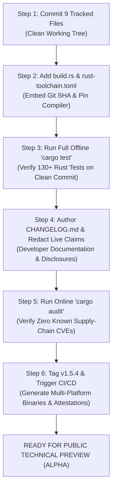

# Engram Phase 5.4.27: Release Blockers and Remediation Plan

**Phase:** 5.4.27  
**Execution Mode:** STRICTLY OFFLINE, READ-ONLY AUDIT  
**Baseline Commit:** `7106a2f369fe79faf5f95449378a900ab8e8eddf`  
**Branch:** `feature/phase2-stage5-remediation`  
**Audit Date:** 2026-11-20  
**Release Authorization:** `NOT_AUTHORIZED`

---

## 1. Executive Summary

This document categorizes all identified release blockers, risks, and missing artifacts into **Critical Blockers** (must be resolved before any public release) and **Non-Critical Blockers / Polish Items** (can be addressed during technical preview / alpha testing). It provides a concrete, step-by-step remediation plan.

---

## 2. Critical Release Blockers (Public Release Inhibitors)

### Blockers Summary Table

| ID | Category | Severity | Description | Impact |
| :---: | :--- | :---: | :--- | :--- |
| **B01** | Repository Integrity | **CRITICAL** | Nine unstaged tracked modifications exist in `src/` and `benchmarks/` | Release cannot be tagged from a dirty tree |
| **B02** | Provenance | **CRITICAL** | Binary does not embed Git commit SHA, build time, or rustc version | Post-distribution forensic traceability impossible |
| **B03** | Performance Claims | **CRITICAL** | Live Task B 4-arm benchmark was not completed; token reduction unproven | Public marketing claims of live token reduction unverified |
| **B04** | Security | **CRITICAL** | Offline audit could not run `cargo audit` against live advisory DB | Dependency vulnerability status unverified |
| **B05** | Documentation | **MAJOR** | `CHANGELOG.md` is absent from repository root | Users have no versioned record of breaking changes |
| **B06** | Toolchain Pinning | **MAJOR** | No `rust-toolchain.toml` file exists in repo root | Floating compilers risk non-deterministic binaries |

---

## 3. Detailed Blocker Analysis

### B01: Unstaged Working-Tree Modifications
- **Observation:** `git status --short` reveals 9 modified tracked files (2,247 insertions, 136 deletions across `src/impact.rs`, `src/mcp.rs`, `src/storage.rs`, and harness modules).
- **Risk:** Rebuilding `target/release/engram.exe` produces a binary that cannot be reproduced by checking out HEAD commit `7106a2f369fe79faf5f95449378a900ab8e8eddf`.
- **Remediation:** Review, stage, and commit the 9 files under an explicit commit message (e.g. `feat(harness,mcp): complete phase 5.4.26 remediation changes`), or cleanly stash/isolate them prior to tagging.

### B02: Missing Commit SHA in Executable
- **Observation:** Running `engram --version` outputs only `engram 1.5.4`.
- **Risk:** If a user reports a bug in a distributed binary, developers cannot determine whether it was built from an official commit, an intermediate branch, or an uncommitted tree.
- **Remediation:** Add a `build.rs` script using `vergen` or `shadow-rs` to bake Git commit hash, build date, and compiler toolchain into `--version`.

### B03: Unverified Live Benchmark Performance Claims
- **Observation:** Built-in `engram bench` prints synthetic reductions ("92.2% empirical token reduction"). However, no real-world, four-arm live Task B benchmark has completed successfully with valid reconciled telemetry.
- **Risk:** Claiming that Engram reduces live LLM agent costs by 90%+ in public release notes would be misleading and factually unsupported.
- **Remediation:** Formally redact all live agent token-efficiency claims from public release notes. Present Engram as a **change boundary, contract enforcement, and AST context tool**, not a proven token-reduction panacea.

### B04: Pending Online Dependency Vulnerability Scan
- **Observation:** While direct dependencies are standard open-source libraries, `cargo audit` could not query the live RustSec database under read-only offline constraints.
- **Risk:** Transitive dependencies might harbor known CVEs.
- **Remediation:** Execute `cargo audit` immediately upon enabling authorized network access before releasing packages.

### B05: Missing Centralized `CHANGELOG.md`
- **Observation:** The repository root lacks a `CHANGELOG.md`. Release history is scattered across individual Phase audit reports.
- **Remediation:** Author a standard Keep-a-Changelog formatted `CHANGELOG.md` documenting v1.5.4 features, breaking changes, and known limitations.

### B06: Missing Toolchain Pinning (`rust-toolchain.toml`)
- **Observation:** The project builds with whatever `rustc` is in PATH (`1.99.0` on local host).
- **Remediation:** Commit a `rust-toolchain.toml` pinning the MSRV (Minimum Supported Rust Version) or stable channel.

---

## 4. Mandatory Disclosures for Release Documentation

Any technical preview or public release must explicitly disclose the following budget and concurrency realities:
1. **Local vs. Remote Cancellation:** Terminating `engram` or killing local agent subprocesses sends a local termination signal, but does **not** guarantee immediate GPU preemption or billing cessation on remote provider inference clusters.
2. **Delayed Telemetry Observability:** LLM provider token usage is typically emitted as turn-end completion events. Budget overshoots during an active generation turn are detected post-facto.
3. **Conditional Overshoot Bound:** The 31,384-token overshoot estimate observed in Phase 5.4.25 is conditional on observed turn lengths and is **not** an unconditional maximum.
4. **Boundary vs. Semantic Correctness:** Change Guard verifies *where* changes occur and *whether* contracts are respected; it does not guarantee that the code compiles or functions correctly.

---

## 5. Step-by-Step Remediation Plan to Achieve `RELEASE_READY_ALPHA`

### Remediation Action Items:
1. **Commit Working Tree:** Commit unstaged changes in `src/` and `benchmarks/` to reach a clean working-tree baseline.
2. **Provenance Scripting:** Add `build.rs` to embed `git rev-parse HEAD` and `rustc --version` into the binary.
3. **Full Rust Regression:** Execute `cargo test --verbose -- --test-threads=1` and capture raw logs.
4. **Documentation Polish:** Create `CHANGELOG.md` and ensure `README.md` explicitly states that benchmark figures are synthetic.
5. **Security Scan:** Run `cargo audit` when authorized online.
6. **Artifact Packaging:** Build multi-platform release assets via GitHub Actions with Sigstore attestations.
