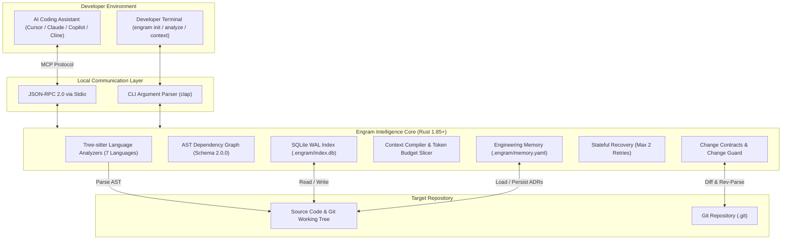
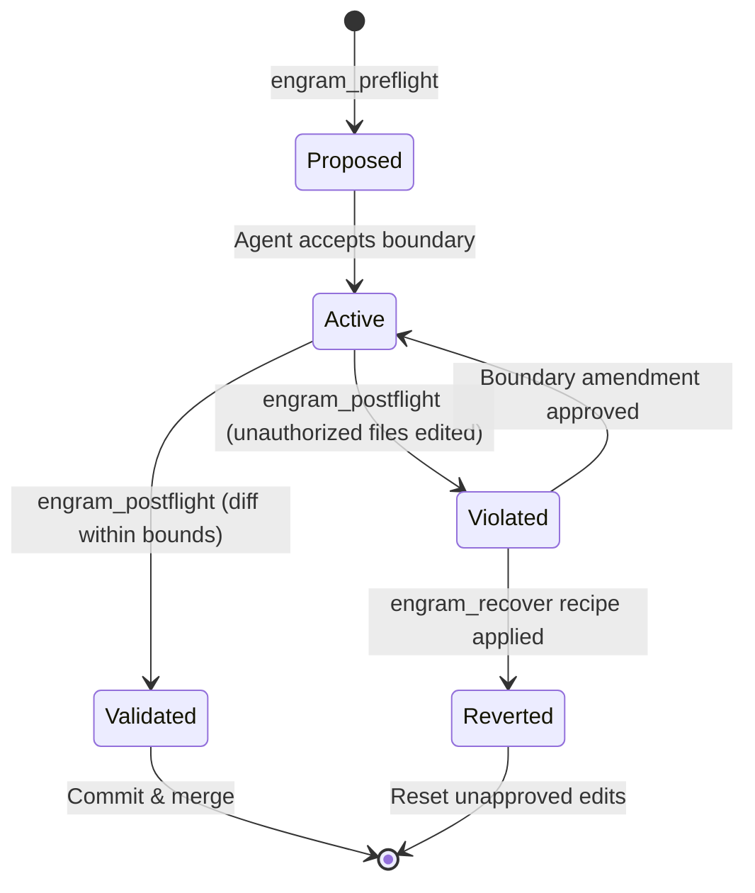

# Engram

[](LICENSE)
[](https://www.rust-lang.org/)
[](https://modelcontextprotocol.io/)
[](https://github.com/code-amalps/Engram/releases/tag/v1.5.5-rc2)
[](docs/TESTING_AND_VALIDATION.md)

**Local engineering memory, AST code intelligence, and change boundary controls for AI coding agents.**

Engram is a standalone, local CLI engine and Model Context Protocol (MCP) server written in Rust. It equips AI coding assistants—including **Cursor, Claude Desktop, VS Code (Copilot / Cline / Roo Code), and Windsurf**—with structural repository intelligence, cross-module dependency graphs, and enforceable change boundaries.

---

## Table of Contents

1. [Product Identity & Value Proposition](#1-product-identity--value-proposition)
2. [Key Architectural Differentiation](#2-key-architectural-differentiation)
3. [Supported Languages & Capabilities](#3-supported-languages--capabilities)
4. [Fast 5-Minute Quickstart](#4-fast-5-minute-quickstart)
5. [Model Context Protocol (MCP) Integration](#5-model-context-protocol-mcp-integration)
6. [Empirical Benchmarks & Token Reduction](#6-empirical-benchmarks--token-reduction)
7. [Change Contracts & Boundary Control](#7-change-contracts--boundary-control)
8. [Engineering Memory (`memory.yaml`)](#8-engineering-memory-memoryyaml)
9. [Security & Privacy Guarantees](#9-security--privacy-guarantees)
10. [Release Information (v1.5.5-rc2 Preview)](#10-release-information-v155-rc2-preview)
11. [Architecture Overview](#11-architecture-overview)
12. [Testing & Verification Evidence](#12-testing--verification-evidence)
13. [Known Limitations](#13-known-limitations)
14. [Contributing Guide](#14-contributing-guide)
15. [License & Attribution](#15-license--attribution)

---

## 1. Product Identity & Value Proposition

AI coding agents are highly effective at writing code, but they suffer from three core operational vulnerabilities:
1. **Repository Discovery Amnesia:** Agents waste thousands of prompt tokens iteratively running naive `find`, `grep`, or directory listings, filling prompt context with entire files when only discrete signatures were needed.
2. **Uncontrolled Blast Radius:** Agents frequently introduce unauthorized changes to tangential files, breaking downstream callers or modifying critical configuration files without realizing the cross-module impact.
3. **Forgotten Architectural Decisions:** Crucial architectural patterns and engineering rules established in prior sessions are forgotten once a chat context window closes.

**Engram eliminates these failure modes** by running a 100% local, high-performance intelligence layer directly in your project repository:
- **AST-Grounded Context:** Parses code into discrete AST symbols and dependency relationships using Tree-sitter.
- **Budgeted Context Compilation:** Assembles minimal sufficient context tailored to the task within a strict token budget.
- **Change Contracts & Change Guard:** Locks agent modifications to declared boundaries and validates working tree diffs before commits.
- **Durable Engineering Memory:** Retains Architectural Decision Records (ADRs) across sessions in human-readable YAML.

---

## 2. Key Architectural Differentiation

Engram runs entirely within your development environment. It has **zero cloud dependencies, zero external telemetry, and zero outbound network calls**.



*For complete technical specifications, see [`docs/architecture.md`](docs/architecture.md).*

---

## 3. Supported Languages & Capabilities

Engram extracts concrete syntax trees and maps directional dependency relationships across 7 primary language families:

| Language Family | Supported Extensions | Extracted AST Constructs | Relationship Extraction Focus |
|---|---|---|---|
| **Rust** | `.rs` | Structs, Enums, Traits, Impl Blocks, Functions, Macros | `use`, trait implementations, caller graphs, type usage |
| **TypeScript** | `.ts`, `.tsx` | Classes, Interfaces, Types, Functions, Arrow Functions, Methods | ES `import`/`export`, inheritance, interface implementations |
| **JavaScript** | `.js`, `.jsx`, `.mjs`, `.cjs` | Classes, Functions, Arrow Functions, Methods, Objects | ES/CJS `import`/`require`, call graphs |
| **Python** | `.py` | Classes, Methods, Functions, Decorators | `import`, `from ... import`, class inheritance |
| **Go** | `.go` | Structs, Interfaces, Functions, Methods, Packages | Package imports, structural interface matching, calls |
| **Java** | `.java` | Classes, Interfaces, Records, Methods, Annotations | Package imports, class extensions, interface implementations |
| **C#** | `.cs` | Classes, Interfaces, Structs, Records, Methods, Properties | Namespace `using`, interface implementations, inheritance |

Engram classifies change impact across 7 deterministic categories (`src/impact.rs`):
- `DIRECT`: The target symbol or enclosing definition.
- `TEST`: Test suites asserting against the target (`TESTS`).
- `IMPLEMENTATION`: Struct ↔ Interface structural implementation (`IMPLEMENTS`).
- `CALLER`: Functions or methods invoking the target.
- `IMPORT_DEPENDENT`: Packages or modules importing the target (`IMPORTS`).
- `CONFIGURATION`: Ecosystem manifests and configuration files.
- `HISTORICAL`: Statistically mined Git co-change coupling.

*See [`docs/supported-languages.md`](docs/supported-languages.md) for detailed extraction rules.*

---

## 4. Fast 5-Minute Quickstart

Get Engram running on your project in three commands:

```bash
# 1. Initialize workspace (.engram/ folder, database, .engramignore)
engram init

# 2. Parse AST symbols and construct dependency graph
engram analyze

# 3. Retrieve budget-allocated context for a task
engram context "How does the storage engine handle SQLite WAL migrations?"
```

### Inspect & Verify Health
```bash
# Inspect symbol impact, blast radius, causal provenance, and active contracts
engram inspect add

# Run environment, Git, database, and parser health checks
engram doctor
```

*For complete step-by-step instructions and exit code definitions, see [`docs/QUICKSTART.md`](docs/QUICKSTART.md).*

---

## 5. Model Context Protocol (MCP) Integration

Engram runs a high-performance Model Context Protocol (MCP) server over local standard input/output (`stdio`), registering **17 purpose-built MCP tools**:

- **Core Context & Task Planning:**
  - `engram_engage`: Consolidated single-shot engagement: binds baseline, compiles context, evaluates constitution, locks contract.
  - `engram_prepare_task`: Single-shot task preparation: context, rules, boundaries, and contract in one atomic round-trip.
  - `engram_get_context`: Compiles focused context with durable memories and co-change alerts.
- **Graph & Code Intelligence:**
  - `engram_inspect_symbol`: Queries blast radius impact, contract authorization, and memory lookup for a target symbol.
  - `engram_why`: Architectural archaeology: explains rationale, governing decisions, and commit history.
  - `engram_get_impact`: Fast 1-hop reverse dependency and blast radius query.
  - `engram_get_cochanges`: Retrieves historical Git co-change coupling signals.
  - `engram_drift`: Analyzes architectural decision drift, boundary erosion, and scoped staleness.
- **Engineering Memory:**
  - `engram_get_memory`: Retrieves durable architectural decisions, policies, and institutional memory.
  - `engram_record_decision`: Proposes an architectural decision (marked `PROVISIONAL` until human ratification).
  - `engram_ratify_decision`: Explicitly ratifies an architectural decision with human authorization.
- **Boundary Guard & Recovery:**
  - `engram_check_constitution`: Evaluates architectural constitution rules and boundary policies against changed files.
  - `engram_preflight`: Pre-flight handshake: compiles context, checks blast radius, locks Change Contract.
  - `engram_postflight`: Post-flight guard check: evaluates mutation against Change Contract and tests.
  - `engram_recover`: Formulates structured, non-destructive recovery recipe for contract violations (max 2 retries).
- **Diagnostics & Ecosystem:**
  - `engram_doctor`: Runs diagnostic health checks on memory storage, index integrity, and append-only chains.
  - `engram_get_ecosystem`: Detects workspace ecosystem, primary language, manifest dependencies, and build tools.

In addition, Engram provides MCP Resources (`engram://memories`, `engram://constitution`, `engram://contract/active`, `engram://ecosystem`) and MCP Prompts (`engram_preflight_handshake`, `engram_postflight_audit`).

### Client Configuration Snippets

#### Claude Desktop (`claude_desktop_config.json`)
```json
{
  "mcpServers": {
    "engram": {
      "command": "engram",
      "args": ["mcp"]
    }
  }
}
```

#### Cursor IDE (`.cursor/mcp.json`)
```json
{
  "mcpServers": {
    "engram": {
      "command": "engram",
      "args": ["mcp"]
    }
  }
}
```

#### VS Code (Cline / Roo Code MCP Settings)
```json
{
  "mcpServers": {
    "engram": {
      "command": "engram",
      "args": ["mcp"],
      "autoApprove": [
        "engram_get_context",
        "engram_inspect_symbol",
        "engram_why",
        "engram_get_impact",
        "engram_get_memory",
        "engram_check_constitution"
      ]
    }
  }
}
```

*For complete tool schemas, parameter types, and Windsurf setup, see [`docs/MCP_INTEGRATION.md`](docs/MCP_INTEGRATION.md).*

---

## 6. Empirical Benchmarks & Token Reduction

> [!IMPORTANT]
> **Empirical Qualification & Accounting Disclosure:**
> The token reduction figures below represent **preliminary local-tokenizer estimates** measured using OpenAI's `cl100k_base` tokenizer (`tiktoken` v0.14.0) across **18 paired experimental runs** on the authoritative Engram repository in Phase 10.3.1.
> 
> - **Accounting Standard:** `ESTIMATED_TOKEN_COUNT`.
> - **Billing Status:** No live LLM provider billing telemetry was accessible; actual billing tokens depend on provider-specific tokenizers and API formatting.
> - **Audit Status:** Findings are preliminary pending independent Phase 10.3.1.1 benchmark audit.

### Phase 10.3.1 Results Matrix (18 Paired Runs across 6 Tasks)

| Task ID | Task Category & Name | Baseline Mean Input Tokens | Engram Mean Input Tokens | Input Token Reduction (%) | Retrieval Precision Baseline -> Engram | Correctness Parity |
|---|---|:---:|:---:|:---:|:---:|:---:|
| **TASK-01** | Feature Discovery: Preflight Verification | 51,772 | 2,692 | **94.80%** | 60.0% -> 100.0% | PASS |
| **TASK-02** | Bug Investigation: Cyclic Dependencies | 68,230 | 2,388 | **96.50%** | 75.0% -> 100.0% | PASS |
| **TASK-03** | Small Feature: Token Budget Estimation | 59,425 | 2,392 | **95.97%** | 75.0% -> 100.0% | PASS |
| **TASK-04** | Cross-Module Change: Rule Violation Propagation | 38,914 | 2,392 | **93.85%** | 75.0% -> 100.0% | PASS |
| **TASK-05** | Refactoring: Incremental Invalidation Cache | 39,122 | 2,042 | **94.78%** | 66.7% -> 100.0% | PASS |
| **TASK-06** | Regression Investigation: Junction Symlink Policy | 31,445 | 2,542 | **91.92%** | 66.7% -> 100.0% | PASS |
| **AGGREGATE** | **Overall 18-Run Summary** | **48,151** | **2,408** | **Median: 94.26% (Mean: 94.04%)** | **63.3% -> 100.0%** | **100% Pass** |

*For complete methodology, paired comparison scripts, and replication commands, see [`docs/benchmarks.md`](docs/benchmarks.md).*

---

## 7. Change Contracts & Boundary Control

Change Contracts enforce architectural discipline during agent coding sessions.



- **Git Baseline Lock:** Locks the active Git commit SHA upon contract creation (`git rev-parse HEAD`).
- **Working Tree Inspection:** Evaluates the current Git diff against declared `planned_files` and `forbidden` patterns.
- **Stateful Automated Recovery:** When a boundary breach occurs, `engram_recover` emits a Git-compatible repair recipe with a strict **maximum of 2 retry attempts** to prevent hallucination loops. Engram never modifies user code directly.

*See [`docs/change-contracts.md`](docs/change-contracts.md) for detailed contract workflows.*

---

## 8. Engineering Memory (`memory.yaml`)

Engram captures and preserves long-term architectural rationale in human-readable YAML (`.engram/memory.yaml`), checked into version control alongside code:

```yaml
schema_version: "1.0.0"
decisions:
  - id: "ADR-001"
    title: "Use SQLite WAL for persistent symbol storage"
    date: "2026-03-15"
    author: "Amal P S"
    status: "Accepted"
    scope:
      - "src/storage.rs"
      - "src/analyzer.rs"
    rationale: "WAL mode allows concurrent read queries from multiple MCP tool calls while background indexing writes without database lock contention."
    superseded_by: null
```

When an agent compiles context via `engram_get_context` or `engram_engage`, Engram automatically includes active ADRs governing the touched files.

---

## 9. Security & Privacy Guarantees

Engram is engineered from the ground up for strict corporate and enterprise privacy:
- **100% Local Execution:** No cloud servers, no outbound network requests, and zero telemetry crates in `Cargo.toml`.
- **Targeted Secret Redaction:** Regex-based filtering automatically replaces sensitive key-value pairs (API keys, passwords, bearer tokens) with `[REDACTED]` prior to SQLite caching.
- **Tiered Ignore Policies:** Automatically respects universal safety exclusions, `engram.yaml`, `.engramignore`, and `.gitignore`, pruning excluded files during traversal before parsing.
- **Symlink & Junction Boundary:** Configured with `follow_links(false)` and canonical boundary containment checks to reject directory traversal loops and symlink escapes.

*See [`docs/SECURITY_AND_LIMITATIONS.md`](docs/SECURITY_AND_LIMITATIONS.md) for full security disclosures.*

---

## 10. Release Information (v1.5.5-rc2 Preview)

The current release is **Engram v1.5.5 RC2 - Public Developer Preview**:

- **Release Tag:** [`v1.5.5-rc2`](https://github.com/code-amalps/Engram/releases/tag/v1.5.5-rc2)
- **Authoritative Commit:** `b5c63d606e8c1bf89e9b89278f36d7eb1b02ea61`
- **Authoritative Tree:** `2ad4e331ec4e8507d784fd8992e78358bee69277`
- **Distribution Archive:** `engram-preview-v1.5.5-rc2-windows-x64.zip` (5,064,678 bytes)
- **Archive SHA-256:** `92B4FE6F7358920F3650782EB43BE70D4A64D7927D25A2C26E412741CAC3751D`
- **Packaged Binary (`bin/engram.exe`):** `BB0AAA66A2F3ADEE3C8F2D5B91C3DA63FF041FEB98CFE08B1DD27B45F858D087`

### Download & Verification
```powershell
# Verify downloaded archive checksum
(Get-FileHash -Algorithm SHA256 .\engram-preview-v1.5.5-rc2-windows-x64.zip).Hash
```

*For complete installation and PATH setup, see [`docs/INSTALLATION.md`](docs/INSTALLATION.md).*

---

## 11. Architecture Overview

Engram's modular architecture separates concerns across discrete Rust subsystems:
- **`analyzer.rs`, `go_parser.rs`, `java_parser.rs`:** Multi-language Tree-sitter AST parsing and cross-symbol reference extraction across 7 language families.
- **`knowledge_graph.rs` & `impact.rs`:** Schema 2.0.0 dependency graph supporting multi-hop blast radius traversal across 7 impact categories.
- **`storage.rs`:** SQLite WAL engine providing persistent statement-cached storage in `.engram/index.db`.
- **`incremental.rs`:** Two-tier invalidation combining `mtime` fast-checks with SHA-256 content hashing.
- **`compiler.rs` & `budget.rs`:** Lexical BM25 ranking, graph expansion, and token budget priority slicing.
- **`contract.rs` & `hook.rs`:** Working tree Git diff inspection, pre-commit hooks, and boundary enforcement.
- **`recovery.rs`:** Bounded 2-attempt recovery engine generating structured repair recipes.
- **`mcp.rs`:** Stdio JSON-RPC 2.0 protocol handler dispatching all 17 MCP tools.

*See [`docs/architecture.md`](docs/architecture.md) for full subsystem documentation.*

---

## 12. Testing & Verification Evidence

Engram maintains rigorous verification standards:
- **800+ Discrete Tests:** Codebase declares 800 test functions (41 unit tests across 11 `src/` modules and 759 integration tests across 73 `tests/` suite files).
- **Historical Full Quality Gate:** Phase 10.1 verification confirmed 73 test suites with 816 passing tests (0 failures, 0 ignored).
- **10-Step Fresh-Environment Acceptance Protocol:** Verified in Phase 10.2.2.6 on a clean test machine with the packaged binary (`BB0AAA...`).
- **Historical Checksum Registry:** Authoritative records for all historical release archives from v1.1.0 through v1.5.5-rc2.

*See [`docs/TESTING_AND_VALIDATION.md`](docs/TESTING_AND_VALIDATION.md) for complete verification records.*

---

## 13. Known Limitations

Documented limitations for the `v1.5.5-rc2` Developer Preview:
1. **403 Compiler Warnings:** Harmless unused warnings in auxiliary Tree-sitter grammar modules during release compilation.
2. **82 Non-Code Files:** Non-code files (markdown, json, yaml, shell scripts) are not currently indexed into the AST graph.
3. **Windows x64 Primary Distribution:** Pre-compiled binaries are provided for Windows x64; other platforms require compiling from source via `cargo build --release`.
4. **Single-Writer SQLite Locking:** Initial whole-repository indexing requires an exclusive write lock.

*See [`docs/SECURITY_AND_LIMITATIONS.md`](docs/SECURITY_AND_LIMITATIONS.md) for detailed limitations and workarounds.*

---

## 14. Contributing Guide

We welcome contributions! To build and test Engram locally:

```bash
# Clone the repository
git clone https://github.com/code-amalps/Engram.git
cd Engram

# Compile in debug mode
cargo build

# Run formatting, clippy, and tests
cargo fmt --check
cargo clippy
cargo test
```

*See [`docs/contributing.md`](docs/contributing.md) for code style, Tree-sitter analyzer integration, and pull request guidelines.*

---

## 15. License & Attribution

Engram is free software licensed under the **[GNU Affero General Public License v3.0 or later (AGPL-3.0-or-later)](LICENSE)**.

All 114 third-party dependencies utilize permissive open-source licenses (MIT, Apache-2.0, BSD, Unicode-3.0, Zlib). Full license texts and copyright notices are documented in **[`THIRD_PARTY_NOTICES.md`](THIRD_PARTY_NOTICES.md)**.

### Corresponding Source Availability (AGPL Section 6(d))
In accordance with AGPL-3.0 Section 6(d), machine-readable Corresponding Source is publicly available at:
- **Release Tag:** [`https://github.com/code-amalps/Engram/tree/v1.5.5-rc2`](https://github.com/code-amalps/Engram/tree/v1.5.5-rc2)
- **Authoritative Commit:** [`https://github.com/code-amalps/Engram/tree/b5c63d606e8c1bf89e9b89278f36d7eb1b02ea61`](https://github.com/code-amalps/Engram/tree/b5c63d606e8c1bf89e9b89278f36d7eb1b02ea61)
- **Source Code Archive:** [`https://github.com/code-amalps/Engram/archive/refs/tags/v1.5.5-rc2.zip`](https://github.com/code-amalps/Engram/archive/refs/tags/v1.5.5-rc2.zip)
