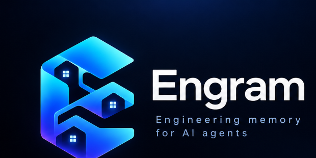

<p align="center">
  
</p>

<p align="center">
  <strong>Persistent engineering memory and change intelligence for AI coding agents.</strong>
</p>

<p align="center">
  <a href="LICENSE"></a>
  <a href="https://www.rust-lang.org/"></a>
  <a href="https://modelcontextprotocol.io/"></a>
  
</p>

> 💡 **The Story Behind the Name:**  
> **Engram** carries a profound double meaning. In cognitive neuroscience, an *engram* is the physical trace of memory stored in brain circuits. In Malayalam, ***Ente Gramam*** (എന്റെ ഗ്രാമം) translates to *"My Village"*—a place where every home, resident, and pathway is intimately known, protected, and remembered. Engram treats your codebase like a cherished village: mapping every home (module), road (dependency), and boundary so AI coding agents never lose their way or break things.

Engram is a blazingly fast, standalone tool written in **Rust** that acts as an **external brain and safety guard** for AI coding assistants (like Cursor, Claude, Windsurf, and Copilot). 

Instead of letting an AI agent burn thousands of tokens rediscovering your repository on every prompt—or accidentally modifying unrelated files—Engram understands your codebase globally, gives the agent the exact minimal context it needs, and verifies that its edits stayed inside safe boundaries.

---

## 🧸 Explain Like I'm 5 (What is Engram?)

Imagine hiring a super-smart robot assistant to fix a toy in your bedroom:

1. **Without Engram:** Every single day, the robot wakes up with **amnesia**. It searches every drawer, closet, and toy box just to find a screwdriver (burning time and money). Then, while fixing the toy, it accidentally disassembles your television set because nobody told it where to stop.
2. **With Engram:** Engram is the house blueprint and memory journal. When you ask the robot to fix a toy, Engram says:  
   *"The toy is on the shelf. Here are the 2 screws you need to touch. Do not touch the television."*  
   And after the robot finishes, Engram checks its work and records what was fixed so the robot remembers tomorrow!

---

## ⚡ Key Highlights

* 🏎️ **Blazingly Fast:** Re-analyzes a 140+ file codebase in **< 15 milliseconds** using composite content-addressed caching.
* 🪶 **Featherweight:** Runs quietly in the background using **< 20 MB of RAM** with zero garbage collection pauses.
* 📦 **Single Static Binary:** Self-contained executable (`engram.exe` on Windows or `engram` on Mac/Linux) with **zero external dependencies**—no Node.js, Python, or .NET runtime needed.
* 📜 **Elastic Change Contracts:** Pre-edit boundaries (`EXPECTED`, `EXPANSION`, `UNEXPECTED`, `BOUNDARY_VIOLATION`, `MISSING`) anchored to Git commits with canonical symbol matching.
* ⚡ **Git Co-Change Mining:** Discovers files that statistically co-change in commits with noise filtering and conditional probability signals.
* 🧠 **Durable Engineering Memory:** Stores human/team architectural decisions with full rationale (**WHY**) in `.engram/memory.yaml` with memory poisoning protection.
* 🌳 **Go Dependency Intelligence & Structural Interfaces (v0.6.0):** Full `go.mod` directive parsing (`module`, `require`, `replace`, `exclude`, `toolchain`), explicit origin classification (`LOCAL`, `VENDORED`, `REPLACED_LOCAL`, `REPLACED_EXTERNAL`, `EXTERNAL`, `UNRESOLVED`), two-stage structural interface satisfaction (method candidate lookup + full parameter/result signature verification), and cross-file graph context grounding.
* 🌲 **Polyglot Tree-Sitter AST & Multi-Language Support:** Native AST extractors for **Rust, Go, TypeScript, JavaScript, Python, and C#**. Features receiver pointer normalization (`*OrderService.ExportCSV` == `OrderService.ExportCSV`) and test conventions (`*_test.go`). Dogfoods on its own repository!

---

## 🔄 The Engram Loop

```text
       TASK ("Add CSV export")
                 │
                 ▼
       ┌───────────────────┐
       │  Task Grounding   │  <- BM25 lexical tokenization & symbol resolution
       └─────────┬─────────┘
                 │
                 ▼
       ┌───────────────────┐
       │  Change Contract  │  <- Pre-edit boundary (Allowed files & symbols)
       └─────────┬─────────┘
                 │
                 ▼
       ┌───────────────────┐
       │ Context Compiler  │  <- Delivers minimal sufficient context under token budget
       └─────────┬─────────┘
                 │
                 ▼
       ┌───────────────────┐
       │   AI Agent Edits  │  <- Cursor / Claude writes code
       └─────────┬─────────┘
                 │
                 ▼
       ┌───────────────────┐
       │   Change Guard    │  <- Validates Git diff against contract (Catch scope drift!)
       └─────────┬─────────┘
                 │
                 ▼
       ┌───────────────────┐
       │  Memory Promotion │  <- Stores accepted decisions into durable memory
       └───────────────────┘
```

---

## 🚀 Quickstart: Install in Seconds

### Option A: 1-Click Install (Recommended)

No compiler, Rust, or Node.js required. Downloads the self-contained standalone binary, verifies SHA256 integrity, and configures `PATH`:

**Windows (PowerShell):**
```powershell
iwr -useb https://raw.githubusercontent.com/code-amalps/Engram/main/install.ps1 | iex
```

**macOS & Linux (Bash / Sh):**
```bash
curl -fsSL https://raw.githubusercontent.com/code-amalps/Engram/main/install.sh | sh
```

---

### Option B: Pre-Compiled Release Binaries

Download standalone archives directly from [GitHub Releases](https://github.com/code-amalps/Engram/releases/latest):

| Platform | Architecture | Target Triple | Format |
| :--- | :--- | :--- | :--- |
| **Windows** | 64-bit Intel / AMD | `x86_64-pc-windows-msvc` | `.zip` |
| **Linux** | 64-bit (musl static) | `x86_64-unknown-linux-musl` | `.tar.gz` |
| **macOS** | Apple Silicon (M1/M2/M3/M4) | `aarch64-apple-darwin` | `.tar.gz` |
| **macOS** | Intel | `x86_64-apple-darwin` | `.tar.gz` |

> 🔒 Every release includes a cryptographically verified `SHA256SUMS` manifest.

---

### Option C: Build from Source (Requires Rust)

```bash
git clone https://github.com/code-amalps/Engram.git
cd Engram
cargo build --release
```

The compiled standalone binary will be at:
* **Windows:** `target/release/engram.exe`
* **macOS / Linux:** `target/release/engram`

---

## 📖 3-Minute Tutorial: Using Engram

Navigate to any repository you want to analyze:

```bash
cd /path/to/your/project
```

### 1. Initialize Engram
```bash
engram init
```
*Creates `.engram/constitution.yaml` (for team architectural rules), `.engram/config.yaml`, and `.engramignore`.*

### 2. Analyze the Repository
```bash
engram .
```
*Parses all source files using Tree-sitter, extracts symbols and imports, and stores them in a local SQLite database in under a second!*

```json
{
  "revision": "1c2856086f3a08e3ab1c3b8573eb3ff22ff20fd2",
  "indexed_files": 141,
  "changed_files": 141,
  "symbols": 224,
  "removed_files": 0
}
```

*Run `engram .` a second time, and it will return in 10ms with `"changed_files": 0` thanks to cache invalidation!*

### 3. Compile Context for a Task
```bash
engram context "settings effect dark theme" --token-budget 800
```
*Engram calculates BM25 relevance, locates the exact files and symbol signatures, and slices the context to fit within your token budget.*

### 4. Ground a Task & Generate a Change Contract
```bash
# Analyze the task to get a task_id:
engram analyze-task "toggle dark theme in settings"
```
*(Copy the `task_id` from the output, e.g. `task_0df9d0952aa64bdf`)*

```bash
# Create the Change Contract:
engram contract task_0df9d0952aa64bdf
```
*This defines the expected files and symbols allowed to be modified.*

### 5. Validate Edits (The Change Guard)
While the AI agent is working, run:
```bash
engram validate task_0df9d0952aa64bdf
```

* If the agent edited allowed files $\to$ **`warnings: []`, `valid: true`**.
* If the agent edited an unexpected file outside the contract $\to$ **`warnings: [{"code": "SCOPE_EXPANSION"}]`**!

### 6. Record Decisions & Promote Memory
Once satisfied with the change:
```bash
engram decision task_0df9d0952aa64bdf accepted "Clean implementation"
engram update-memory task_0df9d0952aa64bdf
```
*The decision and rationale are permanently promoted to local engineering memory.*

---

---

## ⚡ 1-Click Verified Agent Setup (MCP)

No more manually editing JSON files! Engram automatically configures MCP integrations while safely preserving all third-party servers:

```bash
# List supported integrations
engram setup --list

# Auto-configure Cursor (.cursor/mcp.json)
engram setup cursor

# Auto-configure Claude Desktop
engram setup claude

# Auto-configure Windsurf
engram setup windsurf

# Check configuration & live MCP health
engram setup cursor --status
```

---

## 📦 Package Ecosystem & Reverse Dependency Intelligence

```bash
# Inspect declared vs resolved versions and runnable scripts:
engram ecosystem

# Reverse dependency query: "Who will break if I change this file/symbol?"
engram impact projects/src/app/settings.actions.ts

# Context compilation with full provenance reasons:
engram context "settings effect" --explain
```

---

## 🏛️ Project Constitution & Team Rules

Define architectural constraints in `.engram/constitution.yaml`:

```yaml
schema_version: 1
architecture:
  pattern: modular-clean
rules:
  - id: RULE-001
    name: "No direct fetch in components"
    type: PATTERN
    severity: WARNING
    target_files: "**/*.component.ts"
    pattern: "fetch\\("
    description: "Use dedicated ApiService or state effects instead of direct window.fetch."
  - id: RULE-002
    name: "Domain boundary isolation"
    type: DEPENDENCY
    severity: ERROR
    source: "src/domain/**"
    forbidden: "src/infrastructure/**"
```

* **Advisory Checks:** Run `engram validate <task_id>` to check working tree changes against active rules.
* **Auditable Overrides:** Record an explicit override with rationale:
  ```bash
  engram decision <task_id> OVERRIDE "Migration exception approved by team lead" --rule-id RULE-001
  ```
  Overrides are permanently preserved in Engineering Memory.

---

## 💻 CLI Commands Reference

| Command | Description | Example |
| :--- | :--- | :--- |
| `engram init` | Initializes `.engram/` config & constitution | `engram init` |
| `engram .` or `engram analyze` | Analyzes repository AST & updates SQLite WAL | `engram .` |
| `engram setup <client>` | 1-Click MCP setup (Cursor, Claude, Windsurf) | `engram setup cursor` |
| `engram ecosystem` | Discovers frameworks, lockfile versions & scripts | `engram ecosystem` |
| `engram context "<task>"` | Compiles context under token budget (`--explain`) | `engram context "add login" --explain` |
| `engram contract create "<task>"` | Creates elastic Change Contract (auto-grounds scope) | `engram contract create "export csv"` |
| `engram contract check` | Validates working-tree, staged, or PR changes against contract | `engram contract check --staged` |
| `engram contract ratify <id>` | Ratifies expanded contract boundary with human authorization | `engram contract ratify ctr_123` |
| `engram contract reconcile <id>` | Reconciles human interventions & expands scope | `engram contract reconcile ctr_123 "approved"` |
| `engram contract install-hook` | Installs Change Guard pre-commit hook (`--dry-run`) | `engram contract install-hook` |
| `engram history cochanges <file>` | Inspects statistical Git co-change patterns | `engram history cochanges src/orders.rs` |
| `engram history mine` | Mines and caches Git co-changes from commit log | `engram history mine --window 200` |
| `engram memory list` | Lists durable engineering memories (`memory.yaml`) | `engram memory list` |
| `engram memory record` | Records architectural decisions with rationale (**WHY**) | `engram memory record "Title" "Stmt" "Reason"` |
| `engram memory promote <id>` | Promotes accepted candidates to durable memory | `engram memory promote cand_123` |
| `engram impact <id_or_file>` | Compares live diff or queries reverse dependencies | `engram impact OrderService` |
| `engram validate <task_id>` | Advisory checks for scope expansion & rules | `engram validate task_abc123` |
| `engram bench` | Runs scientific benchmark suite (`--verbose`, `--json`) | `engram bench --verbose` |
| `engram mcp` | Starts background JSON-RPC 2.0 MCP server | `engram mcp` |

---

## 🛡️ Change Guard: Pre-Commit Hooks & CI/CD Enforcement

Engram prevents unintended changes from silently crossing the boundaries of an approved Change Contract. The Change Contract remains the single source of truth; local Git hooks and CI are enforcement surfaces.

### 1. Local Pre-Commit Hook Integration

Install the pre-commit hook into `.git/hooks/pre-commit` (never installed silently):

```bash
# Preview what would be installed without modifying disk
engram contract install-hook --dry-run

# Safely install or chain with existing pre-commit hooks (Husky, Lefthook)
engram contract install-hook

# Uninstall cleanly
engram contract uninstall-hook
```

When you run `git commit`, Change Guard automatically runs:
```bash
engram contract check --staged
```
* If changes stay within allowed boundaries $\to$ **Commit proceeds instantly**.
* If changes breach an explicit forbidden boundary $\to$ **Commit is halted with diagnostics**.

### 2. GitHub Actions CI Enforcement

Add `.github/workflows/engram-guard.yml` to validate pull requests:

```yaml
name: Engram Change Guard
on: [pull_request]

jobs:
  change-guard:
    runs-on: ubuntu-latest
    steps:
      - uses: actions/checkout@v4
        with:
          fetch-depth: 0
      - run: |
          curl -fsSL https://raw.githubusercontent.com/code-amalps/Engram/main/install.sh | sh
          engram contract check --base ${{ github.event.pull_request.base.sha }} --check-provenance
```

### 3. Stable Numeric Exit Codes

Change Guard never forces shell scripts or CI runners to parse human prose:

| Exit Code | Constant | Meaning |
| :---: | :--- | :--- |
| **`0`** | `PASS` | All changes match expected boundaries. |
| **`1`** | `CONTRACT_VIOLATION` | Breached a forbidden boundary or strict unexpected change. |
| **`2`** | `CONTRACT_NOT_FOUND` | No active Change Contract found in repository. |
| **`3`** | `CONTRACT_INVALID` | Corrupt contract schema or unparseable JSON. |
| **`4`** | `BASELINE_UNAVAILABLE` | Baseline commit missing from local Git history (shallow clone). |
| **`5`** | `INTERNAL_ERROR` | System I/O error or Git subprocess exception. |

### 4. Constitution Absolute Precedence & Trust Model

* **Constitution Precedence:** Rules in `.engram/constitution.yaml` take absolute precedence over Change Contracts. If Constitution Rule `RULE-AUTH-LOCK` forbids `src/auth/**`, even if an agent contract declared it as `EXPECTED`, editing it produces a `BOUNDARY_VIOLATION` (Exit Code 1).
* **PR Provenance & Ratification:** If a contract boundary is expanded after the baseline commit, CI flags `CONTRACT_MODIFIED_IN_PR` until humanly ratified (`engram contract ratify <id>`).

---

## 📊 Empirical Benchmarks & Token ROI (`engram bench`)

Engram includes a built-in, scientific benchmark engine that evaluates repository intelligence across five languages (**TypeScript, Python, C#, Rust, Go**). All measurements strictly separate **empirically measured context payloads** from **estimated baseline discovery models**:

```bash
# Run benchmark with summary output
engram bench

# Run with per-task breakdown
engram bench --verbose

# Output machine-readable JSON for CI/CD tracking
engram bench --json
```

### Verified Empirical Results (Corpus 2026.10-corp-1)

| Benchmark Dimension | Measured Result | Baseline / Target | Empirical Improvement |
| :--- | :---: | :---: | :---: |
| **Discovery Context Tokens** | **210 tokens** | 4,500 tokens (est. scan) | **-95.3% token reduction** |
| **Discovery Tool Calls** | **1 tool call** | 12 calls (est. discovery) | **-91.7% tool call reduction** |
| **Grounding File Recall** | **95.2%** | Target $\ge$ 90% | **Achieved** |
| **Composite Grounding F1** | **0.813** | Target $\ge$ 0.800 | **Achieved** (Precision: 61.4%) |
| **Change Contract Accuracy** | **100.0% (28/28)** | Synthetic mutation suite | **100% boundary classification** |
| **Memory Compounding Lift** | **100.0% recall** | Control: 0.0% recall | **CONFIRMED ✓** (Zero side-effects) |

> 🔬 **Benchmark Rigor & Reproducibility:**  
> * **Separation of Concerns:** Measured Engram context (`measured_context_tokens`) is recorded from actual graph compiler output, not simulated.
> * **Multi-Entity Evaluation:** Ground truth models files, symbols, modules, tests, and dependencies separately across 7 tasks in 5 languages.
> * **Controlled A/B Memory Lift:** Evaluates Task 2 once in a blank fixture (0% memory recall) and once after recording Task 1's decision (100% recall of team rationale).
> * **Zero Side-Effects:** Runs entirely in isolated temporary sandboxes with automatic cleanup.

---

## 🔒 Security & Privacy

* **100% Local:** Engram runs entirely on your local machine. No code, tokens, or project files are ever sent to external cloud servers.
* **Secret Redaction:** Deterministic regex pattern matching redacts API keys (`sk-...`, `ghp_...`), JWTs, database connection strings, and passwords before any file excerpt enters the index.
* **Smart Ignores:** `.engramignore` excludes vendored folders (`node_modules`), build output (`dist/`, `target/`), and sensitive `.env*` files by default.

---

## 🧪 Testing

Engram includes a comprehensive automated test suite covering Tree-sitter parsers, token budgeting, SQLite WAL bi-temporal storage, graph traversal, Change Contracts, Git co-change mining, durable memory lifecycle, scientific benchmarks, and MCP stdio protocols:

```bash
cargo test
```

All **68 tests** run and pass:
```text
running 17 tests (Unit Tests)
test go_parser::tests::test_parse_full_go_mod_directives ... ok
test go_parser::tests::test_dependency_origin_classification ... ok
test go_parser::tests::test_two_stage_interface_matching ... ok
test tests::test_language_detection ... ok
test tests::test_evidence_decay_and_precedence ... ok
test tests::test_analysis_key_composition ... ok
test tests::test_matches_pattern ... ok
test tests::test_tokenization_and_estimation ... ok
test tests::test_tree_sitter_typescript_extraction ... ok
test tests::test_tree_sitter_csharp_extraction ... ok
test tests::test_tree_sitter_rust_extraction ... ok
test tests::test_tree_sitter_python_extraction ... ok
test tests::test_tree_sitter_go_extraction ... ok
test tests::test_secret_redaction ... ok

running 6 tests (Scientific Benchmark Engine)
test test_discovery_measured_vs_estimated_separation ... ok
test test_synthetic_mutation_accuracy ... ok
test test_memory_compounding_ab_control ... ok
test test_grounding_multi_entity_recall_precision ... ok
test test_benchmark_zero_side_effects ... ok
test test_benchmark_determinism ... ok

running 14 tests (Change Guard & Enforcement Invariants)
test test_check_no_active_contract ... ok
test test_check_corrupt_contract_schema ... ok
test test_check_expected_expansion_passes ... ok
test test_check_all_expected_passes ... ok
test test_check_boundary_violation_always_fails ... ok
test test_check_missing_expected_changes ... ok
test test_check_unexpected_advisory_vs_strict ... ok
test test_check_shallow_clone_missing_baseline ... ok
test test_constitution_precedence_over_contract ... ok
test test_hook_uninstall_cleans_up ... ok
test test_hook_installation_and_idempotency ... ok
test test_ci_pr_base_comparison ... ok
test test_human_reconciliation_v1_to_v2 ... ok
test test_contract_modified_in_pr_requires_ratification ... ok

running 8 tests (Go Dependency Intelligence & Structural Interfaces)
test test_full_go_mod_parsing_and_resolution ... ok
test test_vendored_dependency_precedence ... ok
test test_replaced_local_and_external_resolution ... ok
test test_unresolved_dependency_evidence_integrity ... ok
test test_external_not_confused_with_local_subpath ... ok
test test_two_stage_interface_satisfaction_match ... ok
test test_two_stage_interface_satisfaction_signature_mismatch ... ok
test test_interface_implementation_graph_grounding ... ok

running 8 tests (Go Language Extraction & Acceptance Gate)
test test_go_mod_module_resolution ... ok
test test_go_struct_and_interface_extraction ... ok
test test_go_receiver_pointer_value_normalization ... ok
test test_go_test_convention_linking ... ok
test test_go_contract_symbol_matching_acceptance_gate ... ok
test test_go_constitution_precedence_over_contract ... ok
test test_go_change_guard_contract_enforcement ... ok
test test_go_extracted_import_grounding_context_selection ... ok

running 1 test (Lifecycle Integration)
test test_end_to_end_lifecycle ... ok

running 1 test (MCP Protocol Handshake)
test test_mcp_protocol_handshake_and_tools ... ok

running 6 tests (Phase 2 Intelligence)
test test_setup_targets_list ... ok
test test_setup_dry_run_does_not_modify_disk ... ok
test test_package_json_and_lockfile_intelligence ... ok
test test_setup_safe_merge_preserves_unrelated_servers ... ok
test test_constitution_rules_and_overrides ... ok
test test_graph_traversal_and_reverse_dependencies ... ok

running 7 tests (Phase 3 Flywheel & Dogfooding)
test test_git_cochange_noise_filters_and_signal_formatting ... ok
test test_cache_deletion_and_durable_memory_survival ... ok
test test_rust_tree_sitter_ast_extraction ... ok
test test_memory_poisoning_protection_and_promotion_lifecycle ... ok
test test_change_contract_elastic_boundaries ... ok
test test_contract_reconciliation_human_intervention ... ok
test test_north_star_e2e_flywheel ... ok
```

---

## 📜 Copyright & License

Copyright (C) 2026 **Amal P S**.

This software is licensed under the **[GNU Affero General Public License v3.0 (AGPL-3.0-or-later)](LICENSE)**.

### Freedom for Developers & Open Source
* **100% Free & Open Source:** Developers, hobbyists, students, and open-source contributors are completely free to inspect, download, use, modify, and build upon Engram without paying any fee.
* **Network & Copyleft Protection:** Any modified versions hosted as a network service or redistributed must remain free and open-source under the AGPLv3.
* **Attribution Required:** Under Sections 5(d) and 7 of the AGPLv3, all author attributions and copyright notices for **Amal P S** must remain intact in all copies, distributions, and interactive interfaces.

### Commercial & Enterprise Licensing
If your organization wishes to use, embed, or distribute Engram under proprietary terms without being bound by the copyleft provisions of the AGPLv3, a separate commercial license is required.

For enterprise inquiries, custom deployments, or commercial licensing:
* **Author:** Amal P S
* **GitHub:** [https://github.com/code-amalps](https://github.com/code-amalps)
