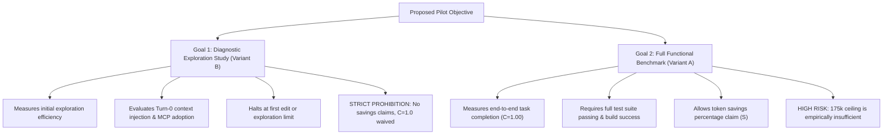

# Engram Amendment 05 — Candidate Readiness Review (Offline Forensic Audit)

**Document Identifier:** `ENGRAM_DRAFT05_CANDIDATE_READINESS_REVIEW`  
**Governing Context:** Candidate Readiness & Experimental Feasibility Review  
**Operational Status:** Strictly Offline — Zero Model/API Inference Credits Consumed  
**Parent Directory:** `amendments/draft-05/`  
**Target Repository:** `C:\Users\Amal P S\OneDrive\Projects\Engram`  
**Verified Git HEAD:** `c70845b4d5913457f1b176fb0370b80dd792711f` (`feature/async-precommit-guard`)  
*Note on Historical Citations:* As proven in [`snapshot-integrity-closure-audit.md`](file:///C:/Users/Amal%20P%20S/OneDrive/Projects/Engram/amendments/draft-05/snapshot-integrity-closure-audit.md), the string `c70845b410522197609f98485cb487f5d08409e5` appearing in prior Pass 3–5 documents is a documentation transcription error. Historical artifacts remain unedited and preserved bit-for-bit.

---

## 1. Executive Summary & Review Scope

This offline review evaluates the feasibility, safety, and integration readiness of Engram candidate binaries and harness protocols prior to authorizing any future live experimental block under proposed Amendment 05.

### Core Review Findings:
1. **Ceiling Feasibility Conflict:** Task B (`task_b_remember_me`) historically required **145,999 to 151,470 tokens** of exploration before an agent authored its first edit. Under a 175,000-token ceiling:
   - A conservative reserve (30,000–40,000 tokens) stops **100% of historical sequences before the first edit** (agent halted with 0 files edited).
   - The decided 15,000 reserve (stop trigger 160,000) permits the edit turn to dispatch, but because late turns cost 26,000–35,000 tokens, it leads to an in-flight ceiling breach (**`OVERRUN_CENSORED`**), which is ineligible to support a token savings claim under Owner Decision 2.
2. **Objective Mismatch:** A diagnostic run measuring exploration reduction cannot establish functional completion ($C = 1.00$) or end-to-end token savings ($S$). Conversely, requiring full Task B completion under a 175,000 ceiling guarantees early termination.
3. **Guard Safety Status:** The historical runner (`runner.py` at `HEAD`) executed `proc.communicate()` synchronously without streaming token tracking. The `StreamingTokenTracker` poller exists only as uncommitted remediation code, operates externally at 50 ms intervals, and cannot guarantee a zero-leakage hard cap against rapid outbound child requests.
4. **Integration Readiness:** Engram MCP tools have **never executed successfully** in any historical live run (Block 06 baseline omitted MCP; Block 07 rejected the call locally due to `approval_policy: never`; Block 08 agent chose shell commands). Candidate MCP invocation within Codex CLI remains unproven in live execution.
5. **Subscription Billing Exposure:** Authentication mode is `auth_mode: "chatgpt"`. Quota tier, reset cycles, rate limits, and the critical absence of auto-purchase remain `UNVERIFIED, owner to fill in`.

---

## 2. Verified Repository & Baseline State (`OBSERVED`)

- **Repository Working Tree:** Verified at Git HEAD `c70845b4d5913457f1b176fb0370b80dd792711f`. Exactly 13 modified files from prior remediation blocks remain intact.
- **Candidate Phase 1 Binary:** `benchmarks/matched-pair-harness/bin/candidate-phase1/engram.exe` — SHA-256 `F56347EF2F0BFD4854176A3EC3C86D8D20B4C0E5954F04E4464998F623D85BEE` (Preserved bit-for-bit).
- **Frozen Binaries:** v1.5.1 (`474A1A7A...`) and v1.5.4 (`CF807EAC...`) verified intact.
- **Protocol Baseline:** Amendment 04 (`03C4B278...`) verified intact.
- **Golden Repository:** `C:\Users\Amal P S\OneDrive\Projects\Test\angular-ngrx-material-starter` verified at commit `1c2856086f3a08e3ab1c3b8573eb3ff22ff20fd2` (18 modified user files, 29 `.engram/` metadata files verified bit-for-bit).
- **Historical Benchmark Reports:** Block 06 (`11CBEC6F...`), Block 07 (`325EF0EC...`), and Block 08 (`706A3C81...`) verified bit-for-bit.

---

## 3. Experiment Feasibility Analysis

### 3.1 Historical Task B Progression to First Edit (`OBSERVED`)
Across all historical live runs of Task B, the progression of tokens before code modification was metered as follows ([`task-b-feasibility.md#L35-L85`](file:///C:/Users/Amal%20P%20S/OneDrive/Projects/Engram/amendments/draft-05/task-b-feasibility.md#L35-L85)):
- **Block 06 Baseline Arm 1:** Turns 1–6 consumed **145,999 tokens** purely in exploration (`Get-ChildItem`, `Get-Content`, `rg`). The first edit was dispatched at Turn 7 ($\Delta = 34,867$), bringing cumulative tokens to **180,866 tokens**.
- **Block 07 Candidate Arm 3:** Consumed **270,506 tokens** across 11 turns with **zero code edits** authored. Turn 7 ended at **151,280 tokens** before entering a compiler hang loop.
- **Block 08 Candidate Arm 3:** Turns 1–8 consumed **151,470 tokens** in exploration (`Get-Content`, `rg`, subprocess polling). The first edit was dispatched at Turn 9 ($\Delta = 26,118$), bringing cumulative tokens to **177,588 tokens**.

### 3.2 Retrospective Headroom Reserve Simulation (`RECONSTRUCTED`)
As audited in [`reserve-simulation.md#L41-L96`](file:///C:/Users/Amal%20P%20S/OneDrive/Projects/Engram/amendments/draft-05/reserve-simulation.md#L41-L96), simulating candidate headroom reserves under a **175,000-token ceiling** yields the following behavior:

| Historical Run Sequence | Pre-Edit Tokens ($T_{\text{cum}}$) | Turn Attempting First Edit | First-Edit Turn Cost ($\Delta$) | 30k Reserve (Stop Trigger 145k) | 35k Reserve (Stop Trigger 140k) | 40k Reserve (Stop Trigger 135k) | 15k Reserve (Decided Stop Trigger 160k) |
| :--- | :---: | :---: | :---: | :---: | :---: | :---: | :---: |
| **B06 Baseline Arm 1** | 145,999 (Turn 6) | Turn 7 | 34,867 | **HALTED before Turn 7** (Rem: 29,001 < 30k) | **HALTED before Turn 7** (Rem: 29,001 < 35k) | **HALTED before Turn 7** (Rem: 29,001 < 40k) | **DISPATCHED $\rightarrow$ OVERRUN** ($180,866 > 175\text{k}$) |
| **B07 Candidate Arm 3** | 151,280 (Turn 7) | `NONE` | 29,625 | **HALTED before Turn 8** (Rem: 23,720 < 30k) | **HALTED before Turn 8** (Rem: 23,720 < 35k) | **HALTED before Turn 8** (Rem: 23,720 < 40k) | **DISPATCHED $\rightarrow$ OVERRUN** ($180,905 > 175\text{k}$) |
| **B08 Candidate Arm 3** | 151,470 (Turn 8) | Turn 9 | 26,118 | **HALTED before Turn 9** (Rem: 23,530 < 30k) | **HALTED before Turn 9** (Rem: 23,530 < 35k) | **HALTED before Turn 9** (Rem: 23,530 < 40k) | **DISPATCHED $\rightarrow$ OVERRUN** ($177,588 > 175\text{k}$) |

#### Empirical Implication:
1. **Conservative Reserves (30k–40k):** In 100% of historical cases, the guard halts execution at 145,999 to 151,470 tokens. Because the first edit occurred at 177,588 to 180,866 tokens, **the agent is stopped before authoring a single code edit**.
2. **Decided Reserve (15k, Trigger 160k):** The guard allows Turn 7 (B06) or Turn 9 (B08) to dispatch because $146\text{k} < 160\text{k}$ and $151.5\text{k} < 160\text{k}$. However, because turn cost is 26k–35k, the turn blows past 175,000 tokens into an overrun, triggering `OVERRUN_CENSORED` and invalidating savings claims.

### 3.3 Retrospective Simulation vs. Prospective Guarantee (`INTERPRETATION`)
- **Retrospective Replay:** Simulates deterministic guard equations against static, pre-recorded historical turn histories.
- **Prospective Stochasticity:** Future live model runs are non-deterministic. A future run may dispatch different tools, explore different files, or generate smaller or larger turns. 
- **Methodological Rule:** A retrospective simulation on $N = 3$ runs provides **directional risk evidence**, not a mathematical guarantee of future behavior.
- **Completion Rate Clarification:** One must **NOT** claim a "measured 0% completion rate under the 175,000-token protocol." No controlled trial has ever executed under a 175,000-token ceiling (B06 and B07 ran under 250,000; B08 ran under 350,000). What is empirically verified is that 0 of 3 historical runs completed Task B within 175,000 tokens.

---

## 4. Definition of Experiment Objectives: Diagnostic vs. Functional

Two mutually exclusive experimental goals must be clearly separated:



### 4.1 Comparison of Goals

| Evaluation Dimension | Diagnostic Exploration Pilot (Variant B) | Full Functional Task B Benchmark (Variant A) | Supporting Evidence |
| :--- | :--- | :--- | :--- |
| **Primary Metric** | Tokens consumed and tool calls dispatched before first edit | End-to-end functional completion rate ($C=1.00$) and net token savings ($S$) | [`amendment-05-draft-v2.md#L77-L92`](file:///C:/Users/Amal%20P%20S/OneDrive/Projects/Engram/amendments/draft-05/amendment-05-draft-v2.md#L77-L92) vs. [`amendment-05.md#L20-L23`](file:///C:/Users/Amal%20P%20S/OneDrive/Projects/Engram/amendments/draft-05/amendment-05.md#L20-L23) |
| **Stopping Boundary** | First code edit or exploration headroom exhaustion | Full unit test passing, production build, or ceiling breach | [`first-edit-rule-audit.md#L60-L78`](file:///C:/Users/Amal%20P%20S/OneDrive/Projects/Engram/amendments/draft-05/first-edit-rule-audit.md#L60-L78) |
| **Expected Token Range** | 100,000 – 150,000 tokens per arm | 250,000 – 350,000+ tokens per arm | Historical runs consumed 253k–365k. |
| **Overrun Risk** | Low to Moderate (if stopped before late-stage turn inflation) | High (late-stage turns exceed 30k tokens) | [`turn-size-audit.md#L98-L106`](file:///C:/Users/Amal%20P%20S/OneDrive/Projects/Engram/amendments/draft-05/turn-size-audit.md#L98-L106) |
| **Eligibility for Savings Claims ($S$)** | **STRICTLY FORBIDDEN ($S$ Suppressed)** | **Eligible ONLY if $C_{\text{treat}} = 1.00 \land C_{\text{ctrl}} = 1.00$** | Mandatory protocol invariant across Amendments 02, 04, and 05. |

### 4.2 Why First-Edit Results Cannot Establish Functional Completion or Token Savings
Reaching a "first edit" establishes only that an agent modified code after exploring. It **cannot** prove:
1. **Functional Correctness:** In B06, Turn 7 modified 6 files, but subsequent typechecks and build verifications were never executed. The code may be completely broken.
2. **Post-Edit Cost Dynamics:** In B08, the first edit occurred at Turn 9 (177,588 tokens), but subsequent compiler verification, test runs, and debugging consumed an additional **187,588 tokens** before halting at 365,176 tokens. Over 51% of total tokens were consumed *after* the first edit.
3. **Net Efficiency:** An agent might achieve a compact first edit via MCP context injection, but fail in downstream integration; or conversely, an agent might explore broadly and author a perfect, one-shot fix. Token savings ($S$) is defined mathematically across the entire completed lifecycle:
   $$S = 1.0 - \frac{T_{\text{treatment}}}{T_{\text{control}}} \quad \text{strictly subject to } C_{\text{treat}} = 1.00 \land C_{\text{ctrl}} = 1.00$$
   A first-edit diagnostic is an observational telemetry study, not an acceptance benchmark.

---

## 5. Guard Safety & Concurrency Boundaries

### 5.1 Historical Reality vs. Remediation Implementation (`OBSERVED`)
Inspection of the codebase confirms two distinct states ([`guard-evidence-audit.md#L15-L35`](file:///C:/Users/Amal%20P%20S/OneDrive/Projects/Engram/amendments/draft-05/guard-evidence-audit.md#L15-L35)):
1. **Commit HEAD State (`c70845b4d591...`):**
   The historical runner invoked `subprocess.Popen` followed immediately by `proc.communicate(timeout=...)` ([`runner.py#L171-L183`](file:///C:/Users/Amal%20P%20S/OneDrive/Projects/Engram/benchmarks/matched-pair-harness/src/runner.py#L171-L183)). It performed **zero live streaming token tracking** and had no capability to intercept in-flight turns.
2. **Working-Tree Remediation State:**
   The `StreamingTokenTracker` and dynamic rollout-tailing loop (`runner.py#L199-L218`) represent **uncommitted remediation code authored offline after Block 07**. It has never executed in a live inference benchmark.

### 5.2 Best-Effort External Poller vs. Deterministic Pre-Dispatch Gate (`INTERPRETATION`)
The harness runner operates as an external supervisor polling a child process:
- **Asynchronous Polling Lag:** The runner discovers newly appended rollout records via a 50 ms polling loop (`time.sleep(0.05)`).
- **Internal Dispatch Race:** Codex CLI receives tool returns from the OS and dispatches the subsequent HTTP request to OpenAI internally. The network request initiation timestamp is not emitted to stdout.
- **In-Flight Irrevocability:** If Codex CLI dispatches an HTTP request across a tool completion in $< 50\text{ms}$ before the runner's polling loop reads the previous turn's token record, the request is in flight across the internet. Calling `terminate_pid_tree(proc.pid)` halts the local process, but OpenAI completes the inference server-side.
- **Verdict on "Hard Ceiling":** **The harness poller is a best-effort external monitor, NOT a deterministic pre-dispatch gate.** A mathematically guaranteed hard ceiling cannot be claimed unless pre-request interception hooks are compiled directly into the Codex CLI binary.

### 5.3 Minimum Offline Verification Required Before Live Execution
Before trusting the remediation guard in a live trial, the following offline validations must occur:
1. **Automated Unit Testing of `StreamingTokenTracker`:** Validate with synthetic rollout streams simulating out-of-order writes, delayed flushes, zero-token turns, and missing usage objects.
2. **Process Termination Latency Benchmarking:** Benchmark the exact millisecond latency of `terminate_pid_tree()` on Windows under heavy CPU load.
3. **Simulated Rapid-Turn Race Testing:** Mock a child process emitting rapid tool outputs to prove that the guard stops execution before subsequent dispatches under artificial delays.

---

## 6. Engram Integration & MCP Tool Invocations

### 6.1 Four-Stage Taxonomy of MCP Tool Invocations
To prevent conflating agent intent with server execution, all MCP tool events must be categorized across four distinct states:

```
[ Attempted ] ──> [ Locally Approved ] ──> [ Server-Executed ] ──> [ Successful ]
     │                    │                         │                      │
Model outputs        Codex client validates     JSON-RPC request       Valid context
tool call in         approval policy & mode     sent via stdio to      returned without
completion text      without error              Engram binary          error to model
```

### 6.2 Forensic Audit of Historical Invocations (`OBSERVED`)
Inspection of rollouts across Blocks 06, 07, and 08 ([`exploration-attribution-audit.md#L55-L89`](file:///C:/Users/Amal%20P%20S/OneDrive/Projects/Engram/amendments/draft-05/exploration-attribution-audit.md#L55-L89)):
- **Block 06 Baseline Arm 1:** Zero Engram calls (MCP disabled by design).
- **Block 07 Candidate Arm 3 (Turn 2):**  
  - State: **`ATTEMPTED`**, but **`REJECTED LOCALLY`**.
  - Detail: Model emitted `tools.mcp__engram__engram_inspect_symbol`. Codex CLI evaluated its runtime policy (`approval_policy: "never"`, no per-tool override). Codex aborted the call locally with `"MCP tool call requires approval, but approval policy is never"` ([`v154_arm3/events.jsonl#L7`](file:///C:/Users/Amal%20P%20S/OneDrive/Projects/Engram/benchmarks/matched-pair-harness/reports/runs/task_b_remember_me_block_07/v154_arm3/events.jsonl#L7)). The call **never reached the Engram binary process**.
- **Block 08 Candidate Arm 3:** Zero Engram calls. The model never attempted an MCP invocation, defaulting entirely to shell commands (`Get-Content`, `rg`).
- **Conclusion:** **The candidate binary has NEVER successfully executed an MCP tool call within a live Codex CLI benchmark run.**

### 6.3 Minimum Integration Checks Needed Prior to Live Execution
To verify that the candidate binary can actually be invoked by Codex CLI without live inference:
1. **Offline CLI Argument Verification:** Verify via a dry-run test that `runner.py` generates the exact configuration flags required by Codex:
   `-c mcp_servers.engram.default_tools_approval_mode="approve"` and per-tool approvals ([`runner.py#L338-L346`](file:///C:/Users/Amal%20P%20S/OneDrive/Projects/Engram/benchmarks/matched-pair-harness/src/runner.py#L338-L346)).
2. **Headless Stdio Protocol Smoke Test:** Execute an offline script spawning `engram.exe mcp` over stdio, sending standard JSON-RPC `initialize`, `tools/list`, and `tools/call` for `engram_inspect_symbol`, verifying schema compliance and return status code 0.
3. **Mock Client Handshake Test:** Run a local mock test confirming that the target Codex CLI binary accepts the candidate MCP configuration flags without syntax rejection or approval warnings.

---

## 7. Billing, Authentication, and Account Exposure

### 7.1 Authentication Reality (`OBSERVED`)
- Inspection of `~/.codex/auth.json` confirms:
  `"auth_mode": "chatgpt"`
- This confirms that Codex CLI authenticates via a **ChatGPT subscription OAuth token**, not an OpenAI Platform API key.

### 7.2 What `auth_mode: "chatgpt"` Does NOT Prove (`UNKNOWN`)
Subscription authentication does **not** provide local visibility into:
1. **Subscription Tier:** Whether the account is Plus, Pro, Team, or Enterprise.
2. **Active Quota Ceiling:** The total tokens or requests allowed in the current rolling window.
3. **Remaining Usage:** How much capacity has already been consumed by other interactive tasks.
4. **Saturation Behavior:** Whether limit exhaustion results in HTTP 429 throttling, queued delays, or fallback to slower models.
5. **Auto-Purchase / Overage Risk:** Whether the owner's billing settings permit automated add-on purchases or account balance drawdowns.

### 7.3 Mandatory Owner Pre-Flight Verification Checklist
Under no circumstances may live inference be initiated until the project owner directly inspects account settings and completes the checklist in [`billing-checklist-v2.md#L33-L65`](file:///C:/Users/Amal%20P%20S/OneDrive/Projects/Engram/amendments/draft-05/billing-checklist-v2.md#L33-L65):
- [ ] Confirm active subscription plan tier.
- [ ] Record pre-run subscription window utilization percentage.
- [ ] **Verify that auto-purchase / automatic balance reload is strictly OFF.**
- [ ] Sign and certify the pre-flight billing checklist.

---

## 8. Comparative Decision Matrix

| Dimension | Variant A: Full Task B Functional Run | Variant B: Exploration / First-Edit Diagnostic | Option 3: Defer Live Tests Until Hardened |
| :--- | :--- | :--- | :--- |
| **Primary Purpose** | Attempt end-to-end task completion ($C=1.00$) and test comparative token efficiency ($S$) on Task B. | Observe exploratory context accumulation, Turn-0 injection impact, and MCP adoption up to first edit. | Validate guard mechanics, MCP approval plumbing, and test harness offline before spending quota. |
| **Evidence Gained** | Definitive functional completion outcome on Task B under proposed ceiling. | Direct telemetry on prompt growth, tool selection, and candidate MCP invocation mechanics. | Cryptographic verification of guard reliability, zero-regression test results, and elimination of execution risks. |
| **Known Limitations** | Empirically infeasible under 175k ceiling (historical exploration consumes 146k–151k; edits occur at >177k). Near 100% risk of premature halt or `OVERRUN_CENSORED`. | Cannot claim functional completion ($C=1.00$ waived). **Strictly forbidden from making token savings claims ($S$)**. Headroom guard halts before first edit under safe reserves. | Yields no live model inference telemetry or agent behavioral data. |
| **Exposure / Quota Risk** | High: Up to 350,000 model tokens across two arms (or 175,000 on stop-on-failure). | Moderate: Capped at 145k–175k tokens on candidate arm; Arm 2 skipped under stop-on-failure. | **Zero:** 0 tokens, 0 inference credits, $0.00 exposure. |
| **Required Prerequisites** | Ratified Amendment 05; validated pre-dispatch guard; signed billing checklist; higher token ceiling (250k–350k). | New harness event-interception code for `file_change`; validated MCP approval flags; signed billing checklist. | None. Can be executed immediately using local offline test scripts and mock fixtures. |

---

## 9. Evidence Attribution & Knowledge Boundaries

- **`OBSERVED`:**
  - Real Git HEAD is `c70845b4d5913457f1b176fb0370b80dd792711f` ([`snapshot-integrity-closure-audit.md#L28-L45`](file:///C:/Users/Amal%20P%20S/OneDrive/Projects/Engram/amendments/draft-05/snapshot-integrity-closure-audit.md#L28-L45)).
  - B06, B07, and B08 consumed 253k, 270.5k, and 365k tokens, respectively ([`turn-size-audit.md#L14-L19`](file:///C:/Users/Amal%20P%20S/OneDrive/Projects/Engram/amendments/draft-05/turn-size-audit.md#L14-L19)).
  - Candidate MCP tool call in B07 was rejected locally due to client approval policy ([`exploration-attribution-audit.md#L71`](file:///C:/Users/Amal%20P%20S/OneDrive/Projects/Engram/amendments/draft-05/exploration-attribution-audit.md#L71)).
  - `runner.py` at `HEAD` contains no streaming token tracking ([`guard-evidence-audit.md#L27-L34`](file:///C:/Users/Amal%20P%20S/OneDrive/Projects/Engram/amendments/draft-05/guard-evidence-audit.md#L27-L34)).
- **`RECONSTRUCTED`:**
  - Headroom reserves of 30k–40k stop historical runs before Turn 7 (B06) and Turn 9 (B08), prior to any code edit ([`reserve-simulation.md#L41-L96`](file:///C:/Users/Amal%20P%20S/OneDrive/Projects/Engram/amendments/draft-05/reserve-simulation.md#L41-L96)).
  - Late turn increments grow monotonically from ~13k to ~37k tokens due to autoregressive prompt history re-ingestion ([`turn-size-audit.md#L127-L136`](file:///C:/Users/Amal%20P%20S/OneDrive/Projects/Engram/amendments/draft-05/turn-size-audit.md#L127-L136)).
- **`UNKNOWN`:**
  - Exact outbound network dispatch timestamps within the child Codex process ([`guard-evidence-audit.md#L151-L154`](file:///C:/Users/Amal%20P%20S/OneDrive/Projects/Engram/amendments/draft-05/guard-evidence-audit.md#L151-L154)).
  - Exact active ChatGPT subscription quota capacity and reset window ([`billing-checklist-v2.md#L33-L46`](file:///C:/Users/Amal%20P%20S/OneDrive/Projects/Engram/amendments/draft-05/billing-checklist-v2.md#L33-L46)).
  - Behavioral response of future agent runs to Turn-0 prompt variations.
