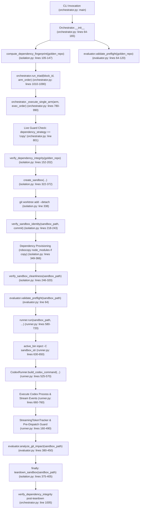

# Engram Amendment 05 — Milestone 2B: Final Offline Preflight and Execution-Path Verification

**Document Version:** 1.0.0  
**Date:** 2026-10-30  
**Status:** Strictly Offline Investigation & Forensic Code Audit  
**Classification:** `BLOCKED — TECHNICAL REMEDIATION REQUIRED`

---

## 1. Executive Verdict

A strictly read-only, offline preflight audit of the Engram Amendment 05 smoke-test specification was executed. No live model inference, API requests, network operations, smoke tests, benchmarks, or test reruns occurred; zero credits/spend ($0.00) were consumed.

### Summary Verdict
The proposed smoke-test command is **NOT READY for manual authorization or execution**. It is classified as:

$$\mathbf{BLOCKED\ —\ TECHNICAL\ REMEDIATION\ REQUIRED}$$

### Primary Technical Blockers Identified:
1. **Missing CLI Argument (`--output-dir`):**  
   The CLI parser in `benchmarks/matched-pair-harness/src/orchestrator.py` (`argparse`) does **not** expose an `--output-dir` parameter (lines 1320–1340). Passing `--output-dir` causes `argparse` to immediately abort execution with code 2: `unrecognized arguments: --output-dir`.
2. **Missing Task Configuration File (`smoke_test_read_only.json`):**  
   The proposed task `--task smoke_test_read_only` does not exist in `benchmarks/matched-pair-harness/config/tasks/` (which contains only `task_a_typo.json`, `task_b_remember_me.json`, and `task_c_theme_toggle.json`). In `orchestrator.py` (lines 1344–1352), passing a non-existent task name causes immediate program termination with exit code 1 (`Error: Task configuration not found: smoke_test_read_only`).
3. **Fatal Runtime Assertion on `--dependency-strategy none` for Live Runs:**  
   In `benchmarks/matched-pair-harness/src/orchestrator.py` (line 801), `_execute_single_arm` contains a strict invariant check:  
   `if not self.is_dry_run and self.dependency_strategy != "copy": raise SafetyViolationError(...)`  
   Consequently, invoking a live run (`--dry-run` omitted) with `--dependency-strategy none` immediately raises `SafetyViolationError` and crashes the run before sandbox execution.
4. **Hardcoded Write Permissions for Agent Invocation:**  
   In `benchmarks/matched-pair-harness/src/runner.py` (line 538), `CodexRunner.build_codex_command` hardcodes `-s workspace-write`. The harness provides no CLI flag or configuration parameter to execute an agent with read-only sandbox permissions (`-s workspace-read`).
5. **Mode Disconnect for Single-Arm Triad:**  
   In `orchestrator.py` (line 1342), execution mode defaults to `"pair"` unless `--mode triad` or `--block <id>` is explicitly specified. Passing `--arms v154_arm3` without `--mode triad` or `--block` results in `orchestrator.run_pair()`, which completely ignores the `--arms` argument and executes `control_A` and `treatment_B`.

---

## 2. Verification A — Golden Repository and Git Worktree Preservation

### 2.1 Baseline State Verification
Read-only Git queries were executed in the golden repository:  
`C:\Users\Amal P S\OneDrive\Projects\Test\angular-ngrx-material-starter`

The current filesystem and Git state match the recorded baseline exactly:
- **Branch:** `test-branch` (confirmed via `git rev-parse --abbrev-ref HEAD`)
- **Pinned Commit:** `1c2856086f3a08e3ab1c3b8573eb3ff22ff20fd2` (confirmed via `git rev-parse HEAD`)
- **Tracked Modifications:** Exactly 18 modified files (confirmed via `git status --porcelain`)
- **Working Tree Diffstat:** Exactly `+208 / -16` lines (confirmed via `git diff --stat`)
- **Untracked Directory:** `.engram/` is present, untracked (`?? .engram/`), containing exactly 29 files (confirmed via recursive filesystem enumeration).

### 2.2 Git Administrative Metadata vs. Working Tree Preservation
A critical technical distinction must be maintained between the golden repository's working tree files and its internal Git administrative metadata:

1. **Golden Working-Tree File Preservation:**  
   When `git worktree add --detach <path> <commit>` is invoked, Git checks out the file tree directly from the object database for commit `1c2856086f3a08e3ab1c3b8573eb3ff22ff20fd2`. The working tree files of `C:\Users\Amal P S\OneDrive\Projects\Test\angular-ngrx-material-starter` are **never touched, read, or modified** during worktree creation.
2. **Golden Untracked Files Preservation:**  
   Untracked files in the golden repository (specifically `.engram/` with 29 files) are completely ignored by `git worktree add`. They do not enter the worktree.
3. **Git Administrative Metadata Mutation (`.git/worktrees/`):**  
   Executing `git worktree add` **does mutate internal Git administrative metadata** inside the golden repository's `.git` directory. Specifically, Git creates a new subfolder:  
   `.git/worktrees/<worktree-folder-name>/` containing `gitdir`, `commondir`, `HEAD`, and `index`.
4. **Current Repository Worktree Registration Audit:**  
   Running `git worktree list` revealed 4 historical stale worktree registrations inside `angular-ngrx-material-starter/.git/worktrees/`:
   - `C:/Users/Amal P S/AppData/Local/Temp/engram_pilot/runs/task_b_remember_me_block_06_v151_arm2_20261029_112143`
   - `C:/Users/Amal P S/AppData/Local/Temp/engram_pilot/runs/task_b_remember_me_block_07_v154_arm3_20261029_173706`
   - `C:/Users/Amal P S/AppData/Local/Temp/engram_pilot/runs/task_b_remember_me_block_07_v154_arm3_20261029_173830`
   - `C:/Users/Amal P S/AppData/Local/Temp/engram_pilot/runs/task_b_remember_me_block_07_v154_arm3_20261029_173938`  
   These registrations remain because either `--preserve-sandboxes` was enabled or executions aborted before `teardown_sandbox` reached the pruning step.
5. **Teardown and Cleanup Effects:**  
   In `benchmarks/matched-pair-harness/src/isolation.py` (lines 400–403), `teardown_sandbox` invokes:  
   `git -c core.longpaths=true worktree remove --force <sandbox_path>`  
   If successful, Git deletes the registration directory in `.git/worktrees/`. If removal fails, `isolation.py` calls `shutil.rmtree` on the sandbox and executes `git worktree prune` inside `golden_repo`.

**Verdict on Preservation:**  
Working tree files and untracked `.engram` files are 100% preserved. Git administrative metadata (`.git/worktrees/`) is legitimately modified during worktree registration and teardown.

---

## 3. Verification B — Actual Sandbox Creation and Execution Path

### 3.1 Sandbox Call Chain Sequence



### 3.2 Analysis of 10 Specific Execution Properties

| # | Property to Verify | Verified Status | Detailed Technical Analysis & File References |
|:---:|:---|:---:|:---|
| 1 | **Detached worktree, clone, or copy?** | **VERIFIED** | The orchestrator uses a detached Git worktree. `isolation.py` (lines 338–340) invokes `git -c core.longpaths=true worktree add --detach <sandbox_path> <baseline_commit>`. |
| 2 | **Exact repository used as source?** | **VERIFIED** | `self.golden_repo` is passed into `create_sandbox` (orchestrator.py line 824), which defaults to `DEFAULT_GOLDEN_REPO = Path(r"C:\Users\Amal P S\OneDrive\Projects\Test\angular-ngrx-material-starter")` (orchestrator.py line 44, isolation.py line 44). |
| 3 | **Pinned commit actually passed?** | **VERIFIED** | `orchestrator.py` (lines 819–825) loads `baseline_commit = self.task_config.get("baseline_commit", "1c2856086f3a08e3ab1c3b8573eb3ff22ff20fd2")` and passes it as `baseline_commit`. `isolation.py` (line 338) passes this commit directly to `git worktree add`. Immediately after, line 343 calls `verify_sandbox_identity(sandbox_path, baseline_commit)`. |
| 4 | **Does it accidentally use dirty golden working tree?** | **VERIFIED** | No. `git worktree add` checks out objects directly from commit `1c2856086f3a08e3ab1c3b8573eb3ff22ff20fd2`. Uncommitted changes in `golden_repo` are never copied. Line 369 verifies cleanliness (`verify_sandbox_cleanliness`), failing immediately if uncommitted files exist. |
| 5 | **Can `.engram/` or uncommitted files enter sandbox?** | **VERIFIED** | No. `.engram/` is untracked in `golden_repo` and is not checked out by `git worktree add`. Furthermore, `verify_sandbox_cleanliness` (lines 285–315) permits only `node_modules` and `.github` as untracked files; any presence of `.engram` triggers `IsolationError`. |
| 6 | **Is sandbox mounted or exposed to Codex process?** | **VERIFIED** | Yes. In `runner.py` (lines 535–546), Codex is invoked with `-C <sandbox_str>`, `--add-dir <sandbox_str>`, and trust level settings for `sandbox_str`. |
| 7 | **Is the task genuinely read-only?** | **FAILED** | **Failed.** In `runner.py` (line 538), `build_codex_command` hardcodes `-s workspace-write`. The harness lacks any parameter or flag to enforce `-s workspace-read` on the Codex sub-process. Codex is granted full write access to the sandbox filesystem. |
| 8 | **Does implementation inspect or enforce workspace mutation?** | **VERIFIED** | It **inspects** workspace mutation via `self.evaluator.analyze_git_impact(sandbox_path, patch_path)` (orchestrator.py lines 876–887), recording modified files, insertions, and deletions in `changes.patch`. However, it does not fail the execution unless specific task checklist requirements enforce zero changes. |
| 9 | **Does teardown delete only disposable sandbox or affect golden repo?** | **VERIFIED** | `teardown_sandbox` (lines 377–380) enforces a strict safety check: `if "engram_pilot\\runs" not in norm_path and "engram_pilot/runs" not in norm_path: raise SafetyViolationError(...)`. This guarantees the golden repo cannot be deleted. Teardown removes the sandbox folder and calls `git worktree remove --force <sandbox_path>` in `golden_repo`, updating only `.git/worktrees/` metadata. |
| 10 | **Is `--dependency-strategy none` supported and propagated?** | **FAILED** | **Failed for Live Runs.** In `isolation.py` (lines 349–366), `none` skips `node_modules` provisioning. In `orchestrator.py` `argparse` (line 1330), `--dependency-strategy none` is accepted. **However**, `_execute_single_arm` (orchestrator.py line 801) contains a hard guard: `if not self.is_dry_run and self.dependency_strategy != "copy": raise SafetyViolationError(...)`. Any live execution with `none` crashes immediately. |

### 3.3 Fixture and Pinned Target Verification
The proposed fixture target was verified against pinned commit `1c2856086f3a08e3ab1c3b8573eb3ff22ff20fd2`:
- **Repository:** `angular-ngrx-material-starter`
- **Pinned Commit:** `1c2856086f3a08e3ab1c3b8573eb3ff22ff20fd2`
- **Target File:** `projects/angular-ngrx-material-starter/src/app/core/auth/auth.actions.ts`
- **Inspection Result at Pinned Commit:**
  ```typescript
  import { createAction } from '@ngrx/store';

  export const authLogin = createAction('[Auth] Login');
  export const authLogout = createAction('[Auth] Logout');
  ```
- **Target Symbol:** `authLogout` is verified present.
- **Expected Declaration:** `export const authLogout = createAction('[Auth] Logout');` matches character-for-character.
- **Contrast with Golden Dirty Working Tree:**  
  In the golden repository's dirty working tree, `auth.actions.ts` has uncommitted modifications importing `props` and defining `AUTH_USERNAME_KEY` and `rememberMe`. Because the sandbox is provisioned from commit `1c2856086...`, these uncommitted modifications are **not** present in the sandbox, verifying pure fixture isolation.

---

## 4. Verification C — Orchestrator Argument Parsing and Binary Integrity

### 4.1 Argument Parser Verification Table

Inspection of `benchmarks/matched-pair-harness/src/orchestrator.py` (lines 1310–1365) against the proposed Milestone 2A arguments:

| Proposed CLI Argument | Exists in `argparse`? | CLI Parser Line(s) | Accepted Values / Type | Connected to Execution? | Issues / Failure Mode |
|:---|:---:|:---:|:---|:---|:---|
| `--arms v154_arm3` | **YES** | Lines 1324–1325 | Comma-separated string (`dest="arm_order"`) | Line 1353 splits string and passes to `orchestrator.run_triad(arm_order=...)` | Ignored unless `--mode triad` or `--block <id>` is also specified. |
| `--engram-v154-bin <path>` | **YES** | Line 1333 | String path | Lines 1362, 81, 111 map to `self.engram_v154_bin` and `arm_binaries["v154_arm3"]` | Correctly overrides default binary for arm 3. |
| `--expected-v154-sha256 <sha>` | **YES** | Line 1334 | String hash | Lines 1363, 83, 116 map to `self.expected_v154_sha256` and `arm_expected_hashes["v154_arm3"]` | Correctly validated via `verify_frozen_binary` before execution. |
| `--max-tokens-ceiling 10000` | **YES** | Line 1335 | Integer | Lines 1365, 85, 149 pass to `CodexRunner(max_tokens_ceiling=...)` | Correctly updates ceiling in `StreamingTokenTracker`. |
| `--headroom-reserve 2000` | **YES** | Line 1336 | Integer | Lines 1366, 86, 150 pass to `CodexRunner(headroom_reserve=...)` | Correctly updates reserve in `StreamingTokenTracker`. |
| `--model gpt-5.6-luna` | **YES** | Line 1326 | String | Lines 1356, 72, 147 pass to `CodexRunner(model=...)` | Passed as `-m gpt-5.6-luna` to Codex. |
| `--reasoning low` | **YES** | Line 1327 | String (`low/medium/high/xhigh/max`) | Lines 1357, 73, 148 pass to `CodexRunner(reasoning_effort=...)` | Configured via `collaboration_mode.settings.reasoning_effort`. |
| `--dependency-strategy none` | **YES** | Line 1330 | Choice: `copy`, `junction`, `none` | Line 1359 passes to `Orchestrator` -> `create_sandbox` | **Crashes live runs:** Line 801 raises `SafetyViolationError` if `not is_dry_run and dependency_strategy != "copy"`. |
| `--output-dir <path>` | **NO** | **MISSING** | N/A | Constructor accepts `output_dir: Optional[Path] = None` (line 74), but **`main()` does not expose `--output-dir` in `argparse`**. | **Fatal Argparse Crash:** `orchestrator.py: error: unrecognized arguments: --output-dir ...` (Exit code 2). |
| `--task smoke_test_read_only` | **YES** | Line 1321 | String | Lines 1344–1352 search `config/tasks/<task>.json` | **Fatal Exit:** `config/tasks/smoke_test_read_only.json` does not exist on disk (Exit code 1). |

### 4.2 Binary Integrity and Arm Mapping

Deterministic SHA-256 hashes of all candidate and frozen binaries were verified:

| Executable Role | File Path | Actual Cryptographic SHA-256 | Milestone 2A Expected SHA-256 | Hash Verification Verdict |
|:---|:---|:---|:---|:---:|
| **Candidate Phase 1 Binary** | `benchmarks/matched-pair-harness/bin/candidate-phase1/engram.exe` | `F56347EF2F0BFD4854176A3EC3C86D8D20B4C0E5954F04E4464998F623D85BEE` | `F56347EF2F0BFD4854176A3EC3C86D8D20B4C0E5954F04E4464998F623D85BEE` | **IDENTICAL (100% MATCH)** |
| **Frozen v1.5.4 Reference** | `benchmarks/matched-pair-harness/bin/v1.5.4/engram.exe` | `CF807EACDEB36DC972019838EDEEB2FA5E8BE25F6C3926FC662189FA9430A798` | `CF807EACDEB36DC972019838EDEEB2FA5E8BE25F6C3926FC662189FA9430A798` | **FROZEN (PRESERVED)** |
| **Frozen v1.5.1 Reference** | `benchmarks/matched-pair-harness/bin/v1.5.1/engram.exe` | `474A1A7AAFBB5A5B52418AA51A978A58AEAE4A177C62EC17C526E165610F44E0` | `474A1A7AAFBB5A5B52418AA51A978A58AEAE4A177C62EC17C526E165610F44E0` | **FROZEN (PRESERVED)** |

**Execution Mapping Trace:**
1. Explicit CLI arguments `--engram-v154-bin ...` and `--expected-v154-sha256 ...` override the default binary dictionary (`self.arm_binaries["v154_arm3"]`).
2. Prior to arm execution, `_execute_single_arm` (lines 793–798) invokes `verify_frozen_binary(binary, expected_sha)`. This strictly verifies Candidate Phase 1 against `F56347...`.
3. Inside `runner.run`, `engram_executable=binary` is passed to `runner.run()`, ensuring that `inject` (lines 630–650) and Codex MCP registration (lines 550–570) invoke Candidate Phase 1.
4. **Conclusion:** Frozen v1.5.4 is **not** selected when explicit candidate flags are passed.

### 4.3 Output-Directory Overwrite Analysis

1. **Proposed Output Directory:**  
   `benchmarks/matched-pair-harness/reports/smoke_test` does **not** currently exist on disk.
2. **Harness Default Derivation:**  
   Because `--output-dir` is not exposed in `argparse`, the orchestrator defaults output path to:  
   `HARNESS_ROOT / "reports" / "runs" / f"{self.task_id}_{self.pair_id}"` (orchestrator.py line 122).
3. **Overwrite Vulnerability:**  
   When writing output files (`run_telemetry.json`, `events.jsonl`, `changes.patch`, `triad_summary.json`, `triad_report.md`), the orchestrator uses `open(path, "w", encoding="utf-8")`.  
   If an operator runs a command where `task_id` and `pair_id` collide with an existing historical run (e.g. `task_b_remember_me` and `block_07`), **the historical benchmark evidence in `reports/runs/task_b_remember_me_block_07` is immediately overwritten and destroyed without prompt**.
4. **Safety Requirement:**  
   To prevent evidence destruction:
   - A dedicated `--output-dir` argument must be formally added to `argparse`, OR
   - The operator must supply an isolated, non-colliding block/pair identifier (e.g. `--pair smoke_test_20261030_01`).

---

## 5. Verification D — Corrected Command Readiness

The proposed smoke-test command from Milestone 2A:

```powershell
python benchmarks/matched-pair-harness/src/orchestrator.py `
  --task smoke_test_read_only `
  --arms v154_arm3 `
  --engram-v154-bin "benchmarks/matched-pair-harness/bin/candidate-phase1/engram.exe" `
  --expected-v154-sha256 "F56347EF2F0BFD4854176A3EC3C86D8D20B4C0E5954F04E4464998F623D85BEE" `
  --max-tokens-ceiling 10000 `
  --headroom-reserve 2000 `
  --model gpt-5.6-luna `
  --reasoning low `
  --dependency-strategy none `
  --output-dir "benchmarks/matched-pair-harness/reports/smoke_test"
```

### Readiness Evaluation
In accordance with prompt instructions:  
> *"If a flag is unsupported, do not invent a replacement. Instead, identify the unsupported flag and mark the command BLOCKED until the owner approves a separate implementation or specification change."*

**The command cannot execute. It is BLOCKED by multiple technical incompatibilities:**
1. `--output-dir` is an unsupported CLI argument in `orchestrator.py`.
2. `--task smoke_test_read_only` refers to a non-existent task configuration file.
3. `--dependency-strategy none` is rejected with `SafetyViolationError` on live executions.
4. Execution mode defaults to `pair`, ignoring `--arms v154_arm3` unless `--mode triad` is specified.

---

## 6. Verification E — Remaining Owner Authorization Gates

The following seven owner decisions remain open and unapproved. Under strict authorization boundaries, none of these gates may be bypassed or assumed:

1. **Gate 1 — Token Budget & Overrun Risk Acceptance:**  
   Owner must approve the proposed 10,000-token ceiling and 2,000-token reserve, acknowledging that external polling latency (~250 ms reaction window) means overrun beyond 10,000 tokens remains possible.
2. **Gate 2 — Account Entitlement & Automatic Purchase Verification:**  
   Owner must independently log in and verify account entitlement, subscription quota, and ensure automatic credit top-ups / purchases are disabled.
3. **Gate 3 — Explicit Execution Authorization:**  
   Owner must provide explicit, unprompted written authorization to run exactly one live execution.
4. **Gate 4 — Model Entitlement Confirmation:**  
   Owner must confirm account access to `gpt-5.6-luna`; no substitution or fallback may occur without explicit written directive.
5. **Gate 5 — Binary Path & Hash Verification:**  
   Owner must confirm Candidate Phase 1 SHA-256 (`F56347EF...`).
6. **Gate 6 — Sandbox Isolation & Safety Policy:**  
   Owner must approve resolution for `--dependency-strategy` (whether to use `copy` or amend the live-run guard in `_execute_single_arm`).
7. **Gate 7 — Output Path & Non-Destructive Storage:**  
   Owner must approve output directory configuration and ensure historical evidence remains protected.

---

## 7. Evidence Citations and File Reference Index

| File Reference | Line Range | Subject Matter | Verified Finding |
|:---|:---:|:---|:---|
| `benchmarks/matched-pair-harness/src/orchestrator.py` | 44 | Golden Repo Constant | Pinned to `C:\Users\Amal P S\OneDrive\Projects\Test\angular-ngrx-material-starter`. |
| `benchmarks/matched-pair-harness/src/orchestrator.py` | 801 | Strict Live Dependency Guard | Raises `SafetyViolationError` if `not is_dry_run and dependency_strategy != "copy"`. |
| `benchmarks/matched-pair-harness/src/orchestrator.py` | 818–835 | Sandbox Provisioning | Invokes `create_sandbox` with pinned commit `1c285608...` and asserts identity/cleanliness. |
| `benchmarks/matched-pair-harness/src/orchestrator.py` | 1320–1340 | CLI Argument Parser | Exposes `--task`, `--arms`, `--model`, `--reasoning`, `--dependency-strategy`, but **omits `--output-dir`**. |
| `benchmarks/matched-pair-harness/src/orchestrator.py` | 1342 | Mode Selection Logic | Defaults to `"pair"` unless `--block` or `--mode triad` is explicitly set. |
| `benchmarks/matched-pair-harness/src/isolation.py` | 218–243 | Sandbox Identity Check | Verifies `git rev-parse HEAD == baseline_commit`. |
| `benchmarks/matched-pair-harness/src/isolation.py` | 246–320 | Sandbox Cleanliness Check | Enforces strictly clean working tree; permits only `node_modules` and `.github`. |
| `benchmarks/matched-pair-harness/src/isolation.py` | 338–340 | Detached Worktree Command | Executes `git worktree add --detach <sandbox_path> <baseline_commit>`. |
| `benchmarks/matched-pair-harness/src/isolation.py` | 375–380 | Teardown Safety Invariant | Strictly refuses to clean any path outside `engram_pilot/runs`. |
| `benchmarks/matched-pair-harness/src/runner.py` | 538 | Codex Execution Flags | Hardcodes `-s workspace-write`; lacks read-only flag support. |
| `benchmarks/matched-pair-harness/src/runner.py` | 550–570 | MCP Server Configuration | Configures Candidate Phase 1 executable as dynamic MCP command for Arm 3. |
| `benchmarks/matched-pair-harness/src/runner.py` | 630–650 | Arm 3 Turn-0 Injection | Executes `active_bin inject -C sandbox_str` inside the provisioned sandbox. |
| `benchmarks/matched-pair-harness/config/tasks/` | Directory | Task Configuration Discovery | Only `task_a_typo.json`, `task_b_remember_me.json`, and `task_c_theme_toggle.json` exist. |
