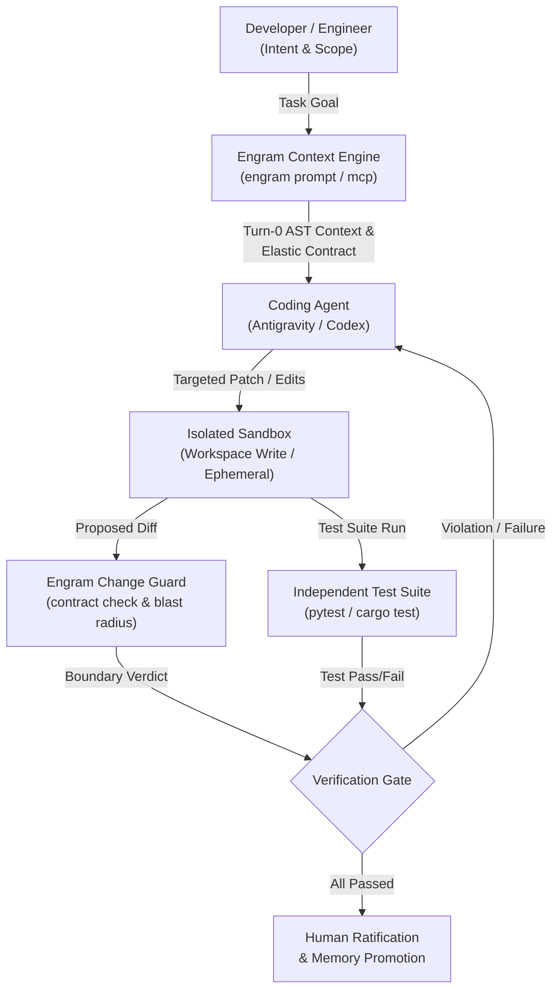

# Engram Amendment 05 — Milestone 2D: Track C Self-Hosting Development Architecture

**Document Version:** 1.0.0  
**Date:** 2026-10-30  
**Status:** Architectural Specification  
**Focus:** Closed-Loop Engram-Assisted Engineering Workflow

---

## 1. Executive Vision

The objective of self-hosting is to establish a rigorous, disciplined engineering loop where Engram actively assists developers and coding agents in building, refactoring, and verifying Engram itself.

In this workflow, Engram serves as the repository's **institutional memory, contextual lens, and architectural guardrail**, while the coding agent acts as the **implementer**, and external automated test suites serve as the **impartial verification authority**.

---

## 2. Separation of Responsibilities

To prevent dangerous circular dependencies and hallucinated self-approvals, responsibilities must remain strictly partitioned:

| Entity | Primary Responsibilities | Strictly Prohibited Actions |
|:---|:---|:---|
| **Engram** | • AST symbol indexing & reverse dependency graphs. • Minimum sufficient context compilation. • Blast radius impact prediction. • Change Contract boundary definition. • Durable engineering memory query & persistence. | • Autonomously editing its own source files. • Self-authorizing boundary violations without human sign-off. • Serving as the sole test validator. |
| **Coding Agent** *(Antigravity / Codex)* | • Translating objectives into correct code edits. • Writing comprehensive unit & regression tests. • Adhering to Turn-0 AST context & constraints. • Refactoring within established module boundaries. | • Bypassing Change Contract boundaries. • Installing unauthorized ecosystem packages. • Suppressing failing test suites. |
| **Independent Verification** *(pytest / cargo test / CI)* | • Executing full offline regression suites. • Validating compilation, types, and lints. • Measuring test coverage and runtime performance. • Cryptographic binary & evidence hash sealing. | • Relying on agent self-reported success. • Relaxing gate thresholds without explicit owner approval. |
| **Human Engineer / Owner** | • Setting architectural intent and authorizing tasks. • Reviewing proposed Change Contracts. • Ratifying legitimate contract expansions (`engram contract ratify`). • Approving durable memory promotions. | • Abdicating governance oversight to autonomous loops. |

---

## 3. The 9-Stage Self-Hosting Development Loop

1. **Stage 1: Intent & Task Formulation**  
   The engineer defines the engineering change (e.g., adding an execution mode, refactoring an AST parser, or updating token tracking).
2. **Stage 2: Offline Self-Analysis & Indexing**  
   `engram analyze --incremental` refreshes the SQLite WAL database in `%LOCALAPPDATA%\Engram\cache\`, capturing the latest AST symbols and import dependencies across both Rust (`src/`) and Python (`benchmarks/`).
3. **Stage 3: Turn-0 Context & Contract Lock**  
   `engram prepare` (or `engram prompt`) evaluates the task objective, queries the dependency graph, extracts the minimum sufficient AST symbol outlines, and generates an elastic Change Contract locking:
   - Expected modules (e.g. `orchestrator`, `runner`).
   - Expected target files.
   - Forbidden boundaries (e.g. frozen benchmarks, golden repository).
   - Ecosystem package constraints from `Cargo.toml`.
4. **Stage 4: Coding Agent Reception & Implementation**  
   The coding agent receives the Turn-0 package. Grounded by exact line numbers and symbol names, the agent navigates directly to the target functions without wasting tokens on iterative filesystem exploration.
5. **Stage 5: Local Sandbox Execution**  
   The agent applies its edits inside an isolated worktree or ephemeral sandbox, preserving the pristine host repository.
6. **Stage 6: Pre-Commit Change Guard Evaluation**  
   Before any commit, `engram contract check --strict` analyzes the working-tree diff against the active contract. If the agent touched forbidden files or expanded outside the allowed module boundary, the check fails closed (exit code 4).
7. **Stage 7: Independent Test Verification**  
   The external test harness executes:
   - For Rust: `cargo test --offline`
   - For Python: `pytest benchmarks/matched-pair-harness/tests`
   Both suites must return exit code 0.
8. **Stage 8: Human Ratification & Review**  
   If an unexpected file was legitimately required (e.g., an unanticipated schema modification), the human engineer inspects the diff and runs `engram contract ratify <contract_id> --reason "<explanation>"`.
9. **Stage 9: Engineering Memory Promotion**  
   Once accepted, `engram update-memory` records the newly validated architectural pattern into `.engram/memory.yaml`, ensuring future agent sessions inherit the institutional learning.

---

## 4. Architectural Risks & Safeguards

| Risk Identified | Root Cause | Implemented / Proposed Safeguard |
|:---|:---|:---|
| **Self-Approval Circularity** | Tool validating its own changes without external ground truth. | Mandatory external test runner (`cargo test`, `pytest`) independent of Engram binary. |
| **Stale Cache Drift** | Files modified on disk while SQLite WAL index remains cached. | Incremental mtime check (`analyzer::ensure_fresh`) automatically refreshes derived symbols before any query. |
| **Git Coupling in Disposable Sandboxes** | `contract check` fails if workspace lacks `.git` directory. | Implement a fallback diff provider in `contract.rs` that can compare against an explicit baseline directory template if Git history is absent. |
| **Cross-Language Semantic Collisions** | Ambiguous query terms matching both Rust and Python modules. | Add explicit `--subpath` or `--language` filters to `context` and `prompt` CLI commands. |
| **Configuration File Blindspot** | JSON schemas and task configs omitted from symbol index. | Introduce a lightweight JSON/YAML key-path AST extractor in `analyzer.rs`. |

---

## 5. Recommended Future Implementation Roadmap

- **Phase 1 (Harness Integration):** Author an Engram skill / hook that automatically executes `engram prompt` inside coding agent environments, reducing Turn-0 exploration tokens.
- **Phase 2 (Non-Git Fallback):** Extend `contract.rs` and `validate.rs` to support file-to-file directory diffs when `.git` is omitted in isolated test sandboxes.
- **Phase 3 (Structured Schema Indexing):** Enable AST indexing for JSON task configurations (`config/tasks/*.json`) and JSON schemas (`schemas/*.schema.json`).
- **Phase 4 (Continuous CI Change Guard):** Deploy `engram guard` into CI pull-request validation pipelines to enforce architectural contracts on every merge.
