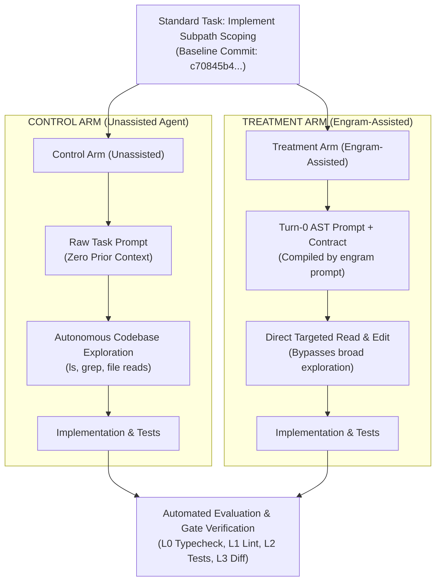

# Engram Amendment 05 — Milestone 3: Controlled Token-Efficiency Experiment Design

**Document Version:** 1.0.0  
**Date:** 2026-10-30  
**Status:** Offline Experimental Design (Zero Live Execution Permitted)  
**Experiment Objective:** Scientific Verification of Engram Token-Efficiency Hypothesis

> [!CAUTION]
> **NO LIVE BENCHMARKS AUTHORIZED:**  
> This protocol specifies the design of a future controlled experiment. No model inference calls, API tokens, or benchmark trials were executed in Milestone 3. Execution requires explicit owner authorization across all governance gates.

---

## 1. Objective & Hypothesis

### 1.1 The Token-Efficiency Hypothesis
Providing an AI coding agent with an AST-grounded, line-numbered Turn-0 engineering context package compiled by Engram will significantly reduce total input token expenditure, exploratory tool calls, and time-to-first-correct-edit compared to an unassisted agent exploring the codebase from scratch, while maintaining identical or superior functional correctness.

### 1.2 Core Research Questions
1. Does Engram reduce overall task token expenditure when accounting for Engram's Turn-0 context overhead?
2. Does Turn-0 AST grounding reduce exploratory directory listing and search tool calls?
3. Does the presence of Engram Change Contract boundaries prevent unintended file mutations?

---

## 2. Experimental Arm Definitions

The experiment evaluates a matched-pair trial comparing two arms on the identical task:

### Arm A: Control Arm (Standard Agent Exploration)
- **Input Prompt:** Raw task description and acceptance criteria only.
- **Instruction Context:** Standard workspace instructions; zero pre-compiled AST context; no Change Contract.
- **Agent Behavior:** The agent must autonomously discover relevant files and symbols using environment tools (`list_directory`, `search_files`, `read_file`).

### Arm B: Treatment Arm (Engram-Assisted)
- **Input Prompt:** Identical task description augmented with the Turn-0 structured context package produced by `engram prompt` (~1,200 tokens).
- **Instruction Context:** Contains exact AST symbol outlines, line numbers, ecosystem package constraints, and an active elastic Change Contract.
- **Agent Behavior:** The agent is guided directly to target files and bounded by contract restrictions.

---

## 3. Strict Experimental Invariants

To ensure scientific validity and eliminate confounding variables, both arms must execute under identical conditions:

| Parameter | Specification & Invariant Binding |
|:---|:---|
| **Repository Baseline** | Pinned Git commit `c70845b4d5913457f1b176fb0370b80dd792711f` on clean isolated worktrees. |
| **Model Specification** | `gpt-5.6-luna` (strictly identical model snapshot; zero fallback or substitution). |
| **Reasoning Effort** | `low` (fixed for both arms). |
| **Token Expenditure Ceiling** | `25,000 tokens` per arm. |
| **Pre-Dispatch Headroom Reserve**| `3,000 tokens` (nominal stop threshold: 22,000 tokens). |
| **Execution Sandbox Isolation** | Ephemeral Git worktree created per arm; deleted after evaluation unless `--preserve-sandboxes` is set. |
| **Counterbalanced Order** | Matched pairs execute in randomized order (Trial 1: AB; Trial 2: BA) to control for provider-side caching advantages. |

---

## 4. Telemetry Collection & Metric Definitions

The matched-pair harness captures streaming telemetry directly via `StreamingTokenTracker` and `TelemetryParser`:

### 4.1 Quantitative Metrics
1. **Total Input Tokens ($T_{\text{in}}$):** Sum of all prompt tokens sent across all agent turns.
2. **Cached Input Tokens ($T_{\text{cache}}$):** Tokens served from the provider prefix cache.
3. **Output Tokens ($T_{\text{out}}$):** Tokens generated by the model (excluding hidden reasoning).
4. **Reasoning Tokens ($T_{\text{reason}}$):** Tokens expended on internal model reasoning.
5. **Total Model Tokens ($T_{\text{tot}}$):** $T_{\text{in}} + T_{\text{out}} + T_{\text{reason}}$.
6. **Exploration Turn Count ($N_{\text{explore}}$):** Number of tool calls prior to the first file modification.
7. **Total Agent Turns ($N_{\text{turns}}$):** Total interactive model round-trips.
8. **Elapsed Wall-Clock Time ($t_{\text{elapsed}}$):** End-to-end task duration in seconds.

### 4.2 Distinguishing Context Size Reduction from True Token Efficiency

> [!IMPORTANT]
> **Scientific Integrity Requirement:**  
> A claim of "token savings" must never be made based solely on the size of the initial prompt. Total token expenditure must be evaluated across the entire task:
> 
> $$\text{Net Savings} = T_{\text{tot, Control}} - \left( T_{\text{tot, Treatment}} + T_{\text{Engram Context}} \right)$$

1. **Context-Size Reduction:** An input metric measuring how much smaller the initial prompt context is compared to full-file dumps.
2. **Net Token Savings:** The actual dollar-relevant reduction in total tokens billed across all turns.
3. **Suppression Condition:** If the treatment arm fails functional acceptance (any automated gate fails), **all token savings claims are strictly suppressed**. A broken or non-compiling solution that used fewer tokens is classified as `FAILED (INELIGIBLE FOR SAVINGS)`.

---

## 5. Automated Gate Evaluation & Correctness Scoring

Each arm's output is evaluated deterministically in its isolated sandbox:

- **Gate L0 (Compilation):** `cargo check --offline` returns 0 errors.
- **Gate L1 (Format/Clippy):** `cargo clippy --offline` reports 0 warnings.
- **Gate L2 (Automated Unit Tests):** Targeted tests pass 100%.
- **Gate L3 (Boundary Diff Check):** `git diff` verifies zero mutations to forbidden files.

$$\text{Correctness Score} = \begin{cases} 1.0 & \text{if all gates L0--L3 pass} \\ 0.0 & \text{if any gate fails} \end{cases}$$

$$\text{Quality-Adjusted Cost} = \begin{cases} T_{\text{tot}} & \text{if Score} = 1.0 \\ T_{\text{tot}} \times 10.0 & \text{if Score} = 0.0 \end{cases}$$

---

## 6. Owner Authorization & Preflight Checklist

Before any live trial can be executed under this protocol, the owner must complete and sign off on all governance gates:

- [ ] **Gate 1:** Owner formal approval of 25,000-token per-arm ceiling and 3,000-token reserve.
- [ ] **Gate 2:** Owner verification of platform dashboard billing, tier, and auto-reload disablement.
- [ ] **Gate 3:** Explicit written owner authorization for a single paired benchmark trial.
- [ ] **Gate 4:** Owner confirmation of `gpt-5.6-luna` entitlement on the target account.
- [ ] **Gate 5:** Cryptographic SHA-256 verification of Candidate Phase 1 binary.
- [ ] **Gate 6:** Ephemeral worktree isolation and dependency verification.
- [ ] **Gate 7:** Collision-safe output directory configuration.
