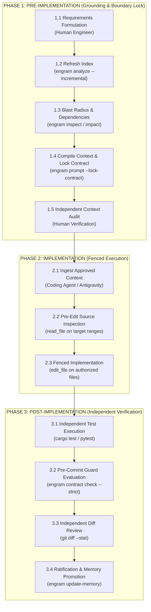

# Engram Amendment 05 — Milestone 3: Reusable Self-Hosting Development Workflow

**Document Version:** 1.0.0  
**Date:** 2026-10-30  
**Status:** Approved Operational Protocol  
**Scope:** Standard Operating Procedure for Engram-Assisted Engineering

---

## 1. Executive Purpose

This document establishes the official **Standard Operating Procedure (SOP)** for conducting engineering work on the Engram codebase using Engram as an offline intelligence and governance assistant.

The workflow guarantees that every engineering task is grounded in repository evidence, bound by explicit change contracts, implemented within strict architectural fences, and validated through independent automated test suites.

---

## 2. The Three-Phase Self-Hosting Lifecycle



---

## 3. Phase 1: Pre-Implementation Protocol (Grounding & Boundary Lock)

### 3.1 Task Formulation & Scoping
- The human engineer writes a clear task objective with explicit acceptance criteria (`REQ-1`, `REQ-2`, etc.).
- Identify target architectural domains (e.g., CLI parsing, compiler SQL queries, prompt formatting).

### 3.2 Refresh Repository WAL Storage
Before executing any retrieval command, refresh the local derived symbols database:
```powershell
engram analyze -C . --incremental --json
```
- **Invariant:** Must report `Exit Code: 0`. WAL database in `%LOCALAPPDATA%\Engram\cache\` is refreshed incrementally.

### 3.3 Query Blast Radius & Reverse Dependencies
Inspect the target symbol to predict the downstream impact:
```powershell
engram inspect -C . "<TargetSymbol>" --depth 2 --json
```
- **Verification:** Inspect the returned `impact_cone` to identify all 1-hop and 2-hop dependent files and test suites.

### 3.4 Compile Context & Lock Change Contract
Generate the Turn-0 structured prompt and lock the elastic Change Contract:
```powershell
engram prompt -C . --token-budget 1200 --stdout --no-clipboard --lock-contract "<TaskDescription>"
```
- **Output Artifacts:**
  - Active Change Contract in `.engram/contracts/<contract_id>.json` specifying `expected_files`, `expected_modules`, and `forbidden_boundaries`.
  - Structured Turn-0 prompt containing AST symbols, line numbers, and ecosystem package guardrails.

### 3.5 Independent Human Audit of Generated Context
- Compare the generated context against the ground-truth source files.
- Verify whether the retrieval engine missed critical implementation files due to BM25 test crowding (as audited in Milestone 3 Track D).
- If necessary, manually append target file paths or adjust subpath scoping before handing off to the coding agent.

---

## 4. Phase 2: Implementation Protocol (Fenced Agent Execution)

### 4.1 Ingestion of Approved Context Package
- The coding agent (e.g. Antigravity, Codex, or human pair programmer) receives the audited Turn-0 context package.
- The agent is forbidden from launching broad exploratory tool sweeps (`find`, recursive directory listings, wide regex greps).

### 4.2 Mandatory Pre-Edit Inspection
- The agent must use targeted file reading (`read_file`) on the specific line ranges identified in the AST context before modifying code.
- Confirms syntax, types, and existing comments in the active working tree.

### 4.3 Fenced Implementation Edits
- All code modifications (`edit_file`, `write_file`) must strictly remain within the `expected_files` and `expected_modules` defined in the active Change Contract.
- **Rule of Expansion:** If the agent discovers that an unauthorized file must be modified, it **must stop immediately**, explain the architectural rationale, and request human ratification before modifying the file.

---

## 5. Phase 3: Post-Implementation Protocol (Independent Verification)

### 5.1 Independent Automated Test Suite Execution
Execute the offline test suite directly via compiler toolchains (completely independent of Engram):
- For Rust:
  ```powershell
  cargo test --offline
  ```
- For Python Matched-Pair Harness:
  ```powershell
  pytest benchmarks/matched-pair-harness/tests -q
  ```
- **Invariant:** Exactly 100% pass rate (Exit Code: 0). Zero failures, zero errors, zero regressions.

### 5.2 Pre-Commit Change Guard Evaluation
Evaluate working-tree mutations against the active contract:
```powershell
engram contract check -C . --strict
```
- **Verification:** Ensures:
  - 0 forbidden files modified.
  - 0 unauthorized module expansions.
  - All declared targets satisfied.

### 5.3 Independent Diff Review
Perform manual and automated Git diff inspections:
```powershell
git diff --stat
git diff
```
- Confirm that no unintended whitespace changes, temporary debug logs, or unrelated edits were introduced.

### 5.4 Ratification & Durable Memory Promotion
If new architectural rules, decisions, or invariants were established during the implementation:
```powershell
engram update-memory -C . --task "<TaskId>" --title "<DecisionTitle>"
```
- Promotes the newly validated knowledge into `.engram/memory.yaml`, ensuring subsequent agent sessions inherit the institutional learning.

---

## 6. Separation of Governance: Offline Specification vs. Live Execution

| Workflow Stage | Authorization Status in Milestone 3 | Future Requirements |
|:---|:---:|:---|
| **Phase 1: Pre-Implementation** | **FULLY AUTHORIZED & DEMONSTRATED** | Operates strictly offline. Zero credit spend. |
| **Phase 2: Implementation** | **OFFLINE SPECIFICATION ONLY** | Requires isolated workspace; coding agent tool permissions. |
| **Phase 3: Post-Implementation** | **OFFLINE SPECIFICATION ONLY** | Requires local toolchain (`cargo`, `pytest`); human review. |
| **Live Model Inference** | **STRICTLY PROHIBITED** | Requires explicit written owner authorization across governance gates. |
