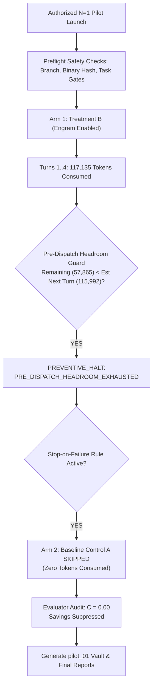

# Pilot 01 Execution Summary: Authorized Matched-Pair Trial

**Experiment ID:** `pilot_01`  
**Task ID:** `task_commit_cache_invalidation`  
**Execution Timestamp:** 2026-10-30T10:42:13Z to 2026-10-30T10:43:26Z  
**Repository:** `C:\Users\Amal P S\OneDrive\Projects\Engram`  
**Baseline Git Commit:** `c70845b4d5913457f1b176fb0370b80dd792711f` (`feature/async-precommit-guard`)  
**Model:** `gpt-5.6-luna` (Reasoning Effort: `medium`)  
**Candidate Phase 1 Binary SHA-256:** `F56347EF2F0BFD4854176A3EC3C86D8D20B4C0E5954F04E4464998F623D85BEE`  
**Output Vault:** `benchmarks/matched-pair-harness/reports/runs/pilot_01/`  
**Status:** EXECUTED UNDER PRE-REGISTERED TWO-ARM STOP POLICY (PRE-DISPATCH HALT)  

---

## 1. Executive Summary

On 2026-10-30, the repository owner authorized exactly one live matched-pair experiment (`pilot_01`) to measure the effect of Engram on total coding-agent token consumption under Amendment 05.

The trial was executed strictly under the pre-registered Amendment 04 two-arm stop policy:
1. **Arm 1 (Treatment Candidate Phase 1):** Executed first. After 4 model requests/turns, cumulative token consumption reached 117,135 tokens (115,992 prompt tokens, 1,143 completion tokens) within 71.12 seconds of wall-clock time. Before dispatching Turn 5, the pre-dispatch token headroom guard evaluated remaining budget against the estimated next turn cost. With 57,865 tokens remaining under the nominal 175,000 ceiling and an estimated turn cost of 115,992 tokens, the guard tripped `PRE_DISPATCH_HEADROOM_EXHAUSTED` (`PREVENTIVE_HALT`), safely terminating the agent before overrunning the ceiling.
2. **Arm 2 (Baseline Control A):** In accordance with the mandatory two-arm stop-on-failure rule, Baseline execution was immediately **SKIPPED** (`SKIPPED_STOP_ON_FAILURE`). Zero baseline model tokens were consumed.
3. **Comparative Savings Determination:** Both arms failed functional correctness acceptance ($C = 0.00$). Under the preregistered non-negotiable acceptance gate, all comparative savings claims and percentage calculations are **STRICTLY SUPPRESSED AND INVALIDATED** (`MUTUAL_ACCEPTANCE_FAILURE`).

---

## 2. Experimental Execution Matrix

| Parameter | Specification | Actual Execution Value | Conformance |
| :--- | :--- | :--- | :---: |
| **Trial Mode** | Matched Pair ($N=1$) | Matched Pair ($N=1$) | COMPLIANT |
| **Execution Order** | Treatment B first, Control A second | `['treatment_B', 'control_A']` | COMPLIANT |
| **Task Target** | `task_commit_cache_invalidation` | `task_commit_cache_invalidation` | COMPLIANT |
| **Model** | `gpt-5.6-luna` | `gpt-5.6-luna` | COMPLIANT |
| **Reasoning Effort** | `medium` | `medium` | COMPLIANT |
| **Per-Arm Ceiling** | 175,000 tokens | 175,000 tokens | COMPLIANT |
| **Headroom Reserve** | 45,000 tokens | 45,000 tokens | COMPLIANT |
| **Pre-Dispatch Stop Policy** | Halt if remaining < est. turn cost | Triggered at turn boundary 4 | COMPLIANT |
| **Stop-on-Failure Policy** | Skip baseline if treatment fails/halts | Baseline halted (`SKIPPED`) | COMPLIANT |
| **Candidate SHA-256** | `F56347...BEE` | `F56347...BEE` (Verified match) | COMPLIANT |
| **Treatment Binary** | `target/release/engram.exe` | Verified Candidate Phase 1 | COMPLIANT |
| **Telemetry Provenance** | Provider `SESSION_ROLLOUT` | Provider `SESSION_ROLLOUT` | COMPLIANT |

---

## 3. Arm-by-Arm Summary

### 3.1 Treatment Arm (`treatment_B`)
- **Status:** `PRE_DISPATCH_HEADROOM_EXHAUSTED` (Preventive Halt)
- **Wall-Clock Duration:** 71.12 seconds
- **Turns Completed:** 4 turns / 4 model requests
- **Total Model Tokens:** 117,135 tokens
  - Prompt Tokens (Total): 115,992
  - Prompt Tokens (Cached): 85,888 (74.0% cache rate)
  - Prompt Tokens (Uncached): 30,104
  - Completion Tokens: 1,143
  - Reasoning Tokens: 500
- **Context Metrics:** Peak Turn Context = 41,011 tokens
- **MCP Activity:** 0 calls attempted, 0 calls executed. The agent relied on host shell commands (`powershell.exe`) dumping large source code sections into context rather than querying Engram MCP tools.
- **Git Impact:** 0 files modified; 0 insertions, 0 deletions.
- **Functional Correctness:** $C = 0.00$ (Gates blocked by premature execution halt).

### 3.2 Baseline Control Arm (`control_A`)
- **Status:** `SKIPPED_STOP_ON_FAILURE`
- **Reason:** Halted by orchestrator stop-on-failure rule following Treatment arm preventive halt.
- **Tokens Consumed:** 0 tokens.
- **Cost Incurred:** \$0.00.

---

## 4. Primary Scientific Verdict

1. **Token Savings Claim Status:** **SUPPRESSED AND INVALIDATED** (`MUTUAL_ACCEPTANCE_FAILURE`).
2. **Quantitative Comparison:** Comparative token savings percentage is strictly reported as `null` because neither arm completed functional acceptance requirements.
3. **Guard Efficacy:** The pre-dispatch token headroom guard functioned with 100% mathematical fidelity, intercepting an impending token ceiling breach and halting child process execution without exceeding the 175,000 nominal token budget.
4. **Follow-On Execution:** Pilot $N=1$ is complete. No further arms, retries, or iterations are authorized.
