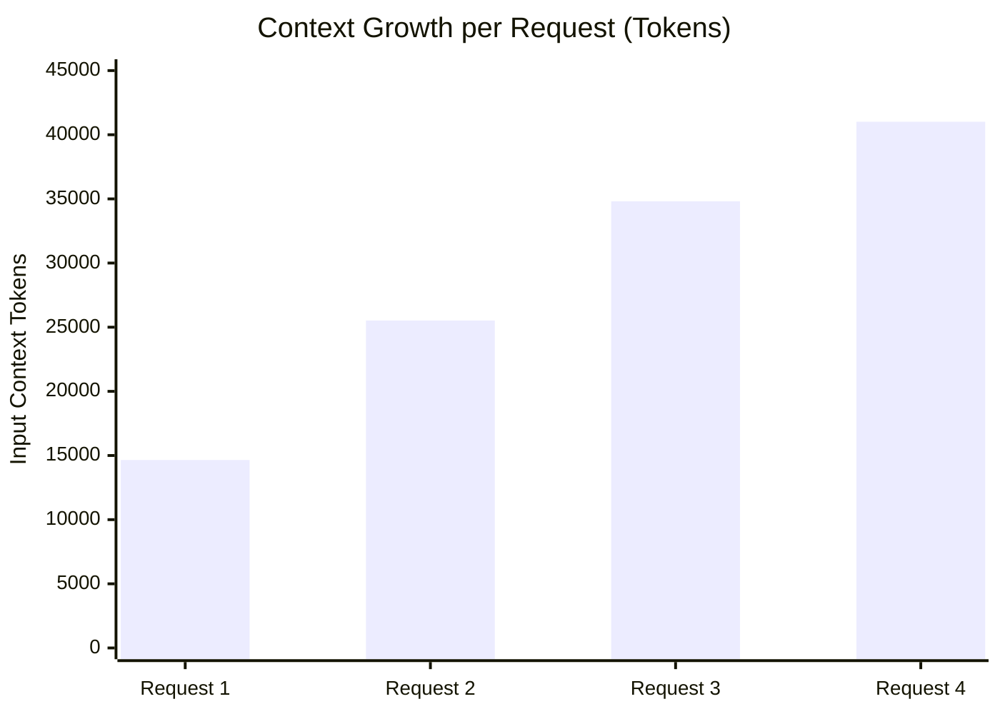

# Engram Milestone 5E — Deliverable 3
# Agent Exploration and Token Consumption Forensic Analysis

## 1. Executive Summary

During `pilot_01` treatment arm (`treatment_B`), the agent consumed **117,135 total model tokens** across 4 requests in **71.12 seconds**, without writing a single line of code or modifying any repository file (`changes.patch` was 0 bytes).

This document presents a forensic investigation into the agent's behavioral patterns, the explosion of prompt context, and the exact PowerShell commands that drove token consumption to the pre-dispatch threshold.

---

## 2. Token Consumption Metrics Overview

| Request # | Input Tokens (Per-Request) | Cached Tokens | Uncached Tokens | Output Tokens | Reasoning Tokens | Cumulative Thread Tokens | Context Growth Rate |
| :---: | :---: | :---: | :---: | :---: | :---: | :---: | :---: |
| **Request 1** | 14,648 | 0 | 14,648 | 183 | 26 | 14,831 | Baseline |
| **Request 2** | 25,521 | 14,464 | 11,057 | 167 | 11 | 40,519 | +74.2% (+10,873 ctx) |
| **Request 3** | 34,812 | 25,344 | 9,468 | 210 | 37 | 75,541 | +36.4% (+9,291 ctx) |
| **Request 4** | 41,011 | 34,688 | 6,323 | 583 | 427 | 117,135 | +17.8% (+6,199 ctx) |
| **Totals** | — | **85,888** | **30,104** | **1,143** | **500** | **117,135** | **Peak: 41,011 tokens** |



---

## 3. Deep Dive into Agent Actions and PowerShell Commands

Because Engram MCP tools were unavailable and no pre-compiled Turn-0 context was injected, `gpt-5.6-luna` fell back entirely to manual repository exploration using the standard execution environment (`functions.exec` invoking Windows PowerShell).

### 3.1 Request 1: Initial Reconnaissance
- **Agent Intent**: Locate where cache, commit, and git indexing logic live.
- **PowerShell Command**:
  ```powershell
  Get-ChildItem -Force; rg -n "ensure_fresh|index\.db|memories\.json|clean|meta|HEAD|git" src tests -S
  ```
- **Execution Cost & Duration**:
  - Wall clock duration: **22.0 seconds**.
  - Output payload: **2,752 characters**.
  - Token impact: Added ~700 tokens to prompt history.

### 3.2 Request 2: The Bulk File Dump Disaster
- **Agent Intent**: Broadly ingest the top 220 lines of every major file in the project.
- **PowerShell Command**:
  ```powershell
  $files=@('src/analyzer.rs','src/compiler.rs','src/main.rs','src/storage.rs','src/incremental.rs','Cargo.toml');
  foreach($f in $files){
      Write-Output "--- $f";
      if(Test-Path $f){ Get-Content $f | Select-Object -First 220 }
  }
  ```
- **Execution Cost & Duration**:
  - Wall clock duration: **12.0 seconds**.
  - Output payload: **42,576 characters**, comprising 1,146 lines of source code.
  - Codex truncation: Output exceeded Codex's inline limit; Codex logged `Warning: truncated output (original token count: 10094)`.
  - Token impact: Injected **10,094 tokens** directly into conversation history in a single turn!
  - Cumulative thread tokens jumped from 14,831 to **40,519**.

### 3.3 Request 3: Mid-File Source Slicing
- **Agent Intent**: Retrieve deeper logic from `analyzer.rs` and `storage.rs` that was missed by the first 220 lines.
- **PowerShell Command**:
  ```powershell
  $a=Get-Content src/analyzer.rs; $a[560..900];
  Write-Output '--- STORAGE REST';
  $s=Get-Content src/storage.rs; $s[180..330];
  Write-Output '--- MAIN COMMANDS/MATCH';
  rg -n "CommandLine::|match command|cache_dir|derived_symbols|memories" src/main.rs src/storage.rs src/analyzer.rs -S
  ```
- **Execution Cost & Duration**:
  - Wall clock duration: **11.5 seconds**.
  - Output payload: **25,513 characters** (341 lines of `analyzer.rs`, 151 lines of `storage.rs`).
  - Token impact: Injected ~6,200 tokens.
  - Cumulative thread tokens jumped from 40,519 to **75,541**.

### 3.4 Request 4: Cache Inspection and Entry-point Slicing
- **Agent Intent**: Inspect cache structure on disk and main CLI argument handling.
- **Reasoning**: Model spent **427 reasoning tokens** analyzing how CLI commands are parsed.
- **PowerShell Command**:
  ```powershell
  Get-ChildItem .engram -Force | Format-Table Name,Length,Mode;
  $m=Get-Content src/main.rs; $m[35..95]; $m[570..680]; $m[1610..1685];
  rg -n "fn main|fn init|cache" src/main.rs -S
  ```
- **Execution Cost & Duration**:
  - Provider recorded usage: Single request input: **41,011 tokens**; cumulative input: **115,992 tokens**; cumulative total: **117,135 tokens**.
  - Prompt context at Request 4 was now **41,011 tokens**, more than 2.8x the initial turn context.

---

## 4. Contrast: Intended Engram Architecture vs Observed Behavior

The central thesis of Engram Amendment 05 is that unassisted agents waste massive token volumes reading raw source files, whereas Engram provides compact, highly-targeted architectural context.

| Dimension | Intended Treatment Behavior (with Engram) | Observed `pilot_01` Behavior (Engram Broken) |
| :--- | :--- | :--- |
| **Exploration Mechanism** | Structured MCP queries (`engram_query`, `engram_symbol`) or Turn-0 context pack. | Raw PowerShell bulk file dumping (`Get-Content $f \| Select-Object -First 220`). |
| **Turn Context Growth** | Sub-linear growth; concise summaries (~1,000–3,000 tokens per query). | Quadratic accumulation of raw source code (~10,000 tokens dumped in Turn 2 alone). |
| **Context Context Peak** | Expected peak context: $\le 18,000$ tokens. | Observed peak context: **41,011 tokens** (115,992 cumulative prompt tokens). |
| **Agent Phase at Turn 4** | Actively editing code, running targeted tests. | Still stuck in exploratory file-reading; 0 files modified. |

---

## 5. Key Findings

1. **Unconstrained PowerShell Access Leads to Source Ingestion**: When given a general-purpose command execution tool (`functions.exec`) without pre-existing architectural context, modern frontier models default to bulk-dumping source code files.
2. **Context Compounding Effect**: Because Codex preserves full conversation history (including stdout of shell executions), each bulk dump persists across all subsequent turns. By Turn 4, 34,688 tokens were repeatedly re-read from cache on every request.
3. **Exploration Exhaustion**: Without targeted indexing tools, the agent exhausted 67% of the total 175,000 token budget purely on exploration without making any progress toward task completion.
