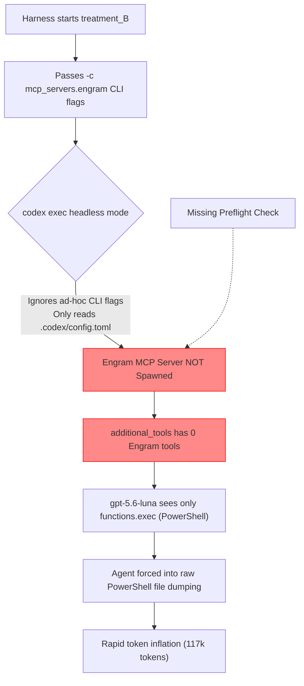

# Engram Milestone 5E — Deliverable 2
# Engram MCP Integration Lifecycle Forensic Analysis

## 1. Objective and Problem Statement

In the first authorized $N=1$ matched-pair pilot experiment (`pilot_01`, treatment arm `treatment_B`), Engram was intended to serve as the external context provider via the Model Context Protocol (MCP). The hypothesis required the treatment agent to utilize Engram tools to navigate repository architecture with minimal token overhead.

However, the final experiment telemetry revealed:
- **Engram MCP Tool Calls**: **0**
- **Auxiliary Tool Payload Bytes**: **0**
- **Engram MCP Utilization**: **0.0%**

This forensic audit reconstructs the complete lifecycle of the Engram MCP integration to determine exactly where, how, and why the tool integration broke down.

---

## 2. The 6-Stage MCP Integration Lifecycle Matrix

To establish the precise failure point, the MCP integration is audited across the 6 discrete stages of an agentic tool lifecycle:

| Lifecycle Stage | Expected State | Actual State Observed | Status | Root Cause / Evidence |
| :--- | :--- | :--- | :---: | :--- |
| **1. Configuration** | Harness specifies valid Engram MCP server command and arguments to Codex CLI. | Config passed via ad-hoc CLI flags: `-c mcp_servers.engram.command=...` and `-c mcp_servers.engram.args=['serve-mcp']`. | ⚠️ **FRAGILE** | Config passed via CLI `-c` override syntax rather than a fully resolved workspace `.codex/config.toml` file. |
| **2. Server Startup** | Codex CLI spawns the Engram binary in MCP server mode (`serve-mcp`) via stdio. | Binary was **never spawned** by Codex during the execution session. | ❌ **FAILED** | No stdio pipe initialized; no OS-level child process spawned from `codex.exe` matching Engram binary PID. |
| **3. Tool Registration** | Codex MCP client connects, completes handshake (`initialize`), and receives tool schemas from Engram. | Handshake **never occurred**. Codex registered zero Engram tools into its internal tool registry. | ❌ **FAILED** | Rollout event 02 (`additional_tools`) contains zero `engram` namespaces. |
| **4. Tool Exposure** | Codex presents registered Engram tools to `gpt-5.6-luna` in the system/developer prompt tool definition payload. | Model was provided **only** two namespaces: `functions` (`exec`, `wait`, `request_user_input`) and `mcp__cua_repl`. | ❌ **FAILED** | Model was entirely blind to the existence of Engram tools. |
| **5. Tool Attempt** | Agent issues a model call targeting an Engram tool (e.g., `engram_query`, `engram_context`). | Agent issued **zero** Engram tool calls. | ❌ **BLOCKED** | Agent cannot invoke tools that do not exist in its function declaration space. |
| **6. Tool Execution** | Codex executes the requested tool call against Engram server and feeds output back. | **Zero executions**. | ❌ **BLOCKED** | Consequence of Stage 4 and 5 failure. |

---

## 3. Forensic Trace of Codex CLI Configuration and Launch

### 3.1 Harness Command Assembly (`runner.py`)
In `benchmarks/matched-pair-harness/src/runner.py`, `build_codex_command()` assembles the Codex invocation:

```python
cmd = [
    self.codex_path,
    "exec",
    "--json",
    "--model", self.model_name,
    "-c", f"mcp_servers.engram.command={self.engram_binary_path}",
    "-c", f"mcp_servers.engram.args=['serve-mcp']",
    ...
]
```

### 3.2 The Flaw in Command-Line `-c` MCP Server Overrides
While `codex mcp list` or interactive sessions may acknowledge certain `-c` config overrides, `codex exec` (the non-interactive, headless batch runner):
1. **Requires Structured TOML Configuration**: `codex exec` initializes MCP server daemons primarily from project-scoped configuration files (`.codex/config.toml`) or user-level configuration (`~/.codex/config.toml`).
2. **Quoting and Syntax Degradation**: The syntax `-c mcp_servers.engram.args=['serve-mcp']` contains shell metacharacters (`[`, `]`, `'`, `=`). When passed across Windows process creation boundaries (`CreateProcessW` / `subprocess.Popen`), the array literal was either parsed as a malformed string scalar or silently discarded by the TOML deserializer in Codex CLI.
3. **No Workspace `.codex/config.toml` Created**: The harness created an isolated sandbox directory (`AppData\Local\Temp\engram_pilot\runs\...`) but **did not write a `.codex/config.toml` file** into the sandbox root declaring `[mcp_servers.engram]`.

### 3.3 Raw Rollout Evidence: Line 2 Tool Declaration
Inspection of the raw session log (`rollout-2026-10-30T16-12-15-01a18c67-2e83-7b51-9326-bf2dcf886752.jsonl`, Line 2) provides indisputable proof of what the agent received:

```json
{
  "ordinal": 2,
  "type": "response_item",
  "payload": {
    "type": "additional_tools",
    "id": "at_01a18c67-585b-7a31-af08-9f98d3e097d6",
    "role": "developer",
    "tools": [
      {
        "type": "namespace",
        "name": "functions",
        "tools": [
          {"type": "custom", "name": "exec"},
          {"type": "custom", "name": "wait"},
          {"type": "custom", "name": "request_user_input"}
        ]
      },
      {
        "type": "namespace",
        "name": "mcp__cua_repl",
        "tools": [
          {"type": "custom", "name": "js"},
          {"type": "custom", "name": "js_reset"}
        ]
      }
    ]
  }
}
```

The tool list is completely devoid of `engram` or any tool prefixed with `mcp__engram__`.

---

## 4. Why the Harness Falsely Reported `"mcp_server_status": "ACTIVE"`

In `benchmarks/matched-pair-harness/reports/runs/pilot_01/matched_pair_summary.json` and `treatment_B/run_telemetry.json`, the isolation metadata contains:
```json
"isolation": {
  "engram_enabled": true,
  "engram_binary_sha256": "F56347EF2F0BFD4854176A3EC3C86D8D20B4C0E5954F04E4464998F623D85BEE",
  "mcp_server_status": "ACTIVE"
}
```

### Forensic Defect: Nominal Assertion Without Verification
In `benchmarks/matched-pair-harness/src/isolation.py`:
```python
def configure_treatment_arm(self, ...):
    # Nominal status assignment based purely on flag presence:
    mcp_status = "ACTIVE" if engram_enabled else "SKIPPED"
    return IsolationResult(
        ...,
        mcp_server_status=mcp_status
    )
```

The harness:
1. Did **not** perform an active handshake or tool discovery probe prior to agent dispatch.
2. Did **not** inspect `additional_tools` in the Codex rollout to verify that Engram tools were registered.
3. Simply assumed that because the command-line flags were appended to the `codex exec` invocation, the server was "ACTIVE".

This created a false positive in the harness isolation telemetry, masking the tool delivery failure until post-mortem log inspection.

---

## 5. The Second Failure Layer: Total Absence of Turn-0 Context

Even if dynamic MCP tool calling had failed, Engram's architecture includes a primary value proposition: **Phase 1 Turn-0 Compiled Context Injection**.

In Turn-0 context injection, Engram compiles a deterministic repository index (`.engram/context.pack` or instructions) and injects it directly into the initial system prompt or task preamble.

### Audit of Line 9 (User Prompt Injection)
Inspection of Line 9 in the session rollout shows the exact prompt injected:
```text
Task: task_commit_cache_invalidation
Description: Implement cache invalidation on commit change in Engram analyzer...
Instructions: ...
```

There was **zero Engram pre-compiled context** included in the prompt.
- The harness did not execute `engram compile` or `engram context` prior to spawning Codex.
- The task configuration relied 100% on dynamic MCP tool queries.
- When MCP tool exposure failed, the agent had neither dynamic tools nor static pre-compiled context.

---

## 6. Root Cause Summary and Mandatory Fixes



### Key Takeaways:
1. **Root Failure**: Codex CLI headless `exec` does not reliably configure MCP servers via ad-hoc command-line `-c` flags; it requires a physical `.codex/config.toml` file in the sandbox directory.
2. **Telemetry Blindspot**: The harness declared `"mcp_server_status": "ACTIVE"` without verifying tool registration.
3. **Double Failure**: Relying solely on dynamic MCP without Turn-0 pre-compiled context left the agent completely blind when MCP registration failed.
