# Engram Milestone 5E — Deliverable 6
# Task and Tool Suitability Forensic Review

## 1. Executive Summary

This review analyzes the architectural alignment between the selected benchmark task (`task_commit_cache_invalidation`) and Engram's tool capabilities.

The evaluation concludes that:
1. **Task Relevance**: The task (implementing commit-based cache invalidation in Engram's Rust codebase) is an **ideal showcase** for Engram's indexing and symbol-graph architecture.
2. **Dynamic MCP vs Static Context Gap**: Relying exclusively on dynamic MCP queries without Turn-0 static context created a single point of failure.
3. **Instruction Deficiency**: The task prompt lacked any agent guidance instructing the model to prioritize domain-specific Engram tools over raw shell execution (`powershell.exe`).

---

## 2. Task Requirements Analysis

The task specification (`config/tasks/task_commit_cache_invalidation.json`) defines four strict functional requirements:

| Requirement ID | Contract | Target Files | Engram Context Relevance |
| :---: | :--- | :--- | :--- |
| **REQ-1** | Incorporate Git HEAD commit hash and dirty status into the cache validation key. | `src/analyzer.rs`, `src/storage.rs` | **HIGH**: Engram's symbol graph can immediately isolate the cache key struct and its hashing function. |
| **REQ-2** | Detect commit hash divergence and trigger cache invalidation. | `src/analyzer.rs`, `src/storage.rs` | **HIGH**: Requires tracing call paths from `Storage::load_cache()` through analyzer initialization. |
| **REQ-3** | Provide CLI flag or automatic invalidation logic on commit mismatch. | `src/main.rs`, `src/compiler.rs` | **MEDIUM**: Involves CLI argument parsing in `main.rs` and compiler pipeline wiring. |
| **REQ-4** | Deliver automated integration test verifying invalidation behavior. | `tests/commit_cache_invalidation_test.rs` | **MEDIUM**: Requires understanding test harness patterns and mock git repo helpers. |

---

## 3. What Engram MCP Could Have Delivered vs What Happened

```mermaid
flowchart TD
    subgraph What_Happened ["What Happened in pilot_01 (No Engram)"]
        A1["Agent starts blind"] --> B1["Runs rg across whole repo (Req 1)"]
        B1 --> C1["Dumps 6 source files x 220 lines (Req 2)"]
        C1 --> D1["Dumps 500 lines of analyzer & storage (Req 3)"]
        D1 --> E1["Inspects .engram & main.rs (Req 4)"]
        E1 --> F1["Consumes 117k tokens; edits 0 files; HALTS"]
    end

    subgraph What_Engram_Enables ["What Engram MCP / Turn-0 Enables"]
        A2["Agent receives Turn-0 context pack"] --> B2["Directly knows cache struct lives in storage.rs:180"]
        B2 --> C2["Issues targeted MCP query: engram_query('cache_key')"]
        C2 --> D2["Receives exact 40-line signature & call graph"]
        D2 --> E2["Modifies storage.rs & analyzer.rs in Turn 2"]
        E2 --> F2["Runs cargo test; completes task in <35k tokens"]
    end

    style F1 fill:#f88,stroke:#f00
    style F2 fill:#8f8,stroke:#0a0
```

1. **In `pilot_01`**: Because Engram MCP was missing, the agent acted as a conventional unassisted agent, dumping 1,146 lines of source code in Request 2 and another 500 lines in Request 3. By Request 4, context was 41,011 tokens and cumulative tokens reached 117,135.
2. **With Working Engram**: A single query (`engram_query("cache invalidation")`) or Turn-0 context pack would have replaced all four massive PowerShell dumps with a 1,500-token summary of the relevant cache structs, keeping total turn context under 15,000 tokens.

---

## 4. Prompt Engineering and Agent Instruction Deficiencies

Even if Codex had registered the Engram MCP server, the task execution was vulnerable to prompt-level agent habits:

### 4.1 Absence of Tool Prioritization Guidance
Frontier coding models (such as `gpt-5.6-luna`) are heavily fine-tuned on general-purpose bash/PowerShell tools. When presented with both `functions.exec` and novel MCP tools:
- Without explicit system instructions, agents frequently ignore custom MCP tools and default to standard shell commands (`rg`, `cat`, `Get-Content`).
- The prompt in `pilot_01` contained zero instructions directing the agent to use Engram tools.

### 4.2 Missing Pre-Compiled Turn-0 Context Pack
Engram's primary design strength is **Phase 1 Static Compilation**.
- Instead of forcing the model to discover tools dynamically via trial-and-error MCP handshakes, Engram can compile an architectural context block prior to agent launch.
- In `pilot_01`, no Turn-0 context was injected into the prompt preamble. The experiment was configured as a "naked MCP" run, exposing the entire protocol to Codex CLI MCP initialization bugs.

---

## 5. Strategic Recommendations for Future Tasks

1. **Dual-Channel Context Delivery (Hybrid Strategy)**:
   - **Primary**: Turn-0 pre-compiled context injected directly into the initial task prompt. This guarantees 100% availability regardless of Codex MCP client behavior.
   - **Secondary**: Dynamic MCP tools available for deep-dive exploratory queries when the static context is insufficient.
2. **Explicit Prompt Directives**:
   - Add a standardized system prompt block informing the agent:
     > *"Engram repository context tools are available. You MUST query Engram tools for repository navigation before falling back to manual shell file reading. Avoid dumping large source files."*
3. **Task Scope Calibration**:
   - `task_commit_cache_invalidation` remains the optimal task for testing Engram token efficiency. Its requirements directly reward architectural comprehension and penalize blind repository dumps.
