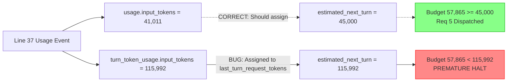

# Engram Milestone 5E — Deliverable 4
# Pre-Dispatch Token Headroom Guard Forensic Audit

## 1. Executive Summary

In `pilot_01`, the treatment arm (`treatment_B`) was halted after 4 requests by the harness pre-dispatch token headroom guard with the error:
```text
Execution halted by pre-dispatch token headroom guard: 57,865 tokens remaining < estimated next turn cost of 115,992 tokens (budget: 175,000)
```

This forensic audit inspected the exact implementation in `benchmarks/matched-pair-harness/src/runner.py` and discovered a **critical telemetry misattribution defect**:
The runner confused **cumulative session prompt tokens** (`115,992`) with **single-request turn cost** (`41,011`). As a result, the guard dramatically inflated the estimated cost of the next turn from **45,000 tokens** to **115,992 tokens**, triggering a premature shutdown when 57,865 tokens remained in the budget.

---

## 2. Guard Architecture and Configured Parameters

The pre-dispatch token headroom guard was designed to prevent runaways and hard budget overruns by evaluating whether the harness has sufficient headroom before allowing Codex to dispatch another model turn.

| Parameter | Configured Value | Description |
| :--- | :---: | :--- |
| **Token Ceiling (`token_ceiling`)** | **175,000 tokens** | Hard upper ceiling per task arm. |
| **Headroom Reserve (`headroom_reserve`)** | **45,000 tokens** | Safety buffer reserved to absorb variance on the final turn. |
| **Baseline Turn Estimate (`estimated_turn_tokens`)** | **45,000 tokens** | Minimum assumed cost of an upcoming turn. |
| **Cumulative Tokens at Halt (`current_total`)** | **117,135 tokens** | Total provider-reported tokens consumed through Request 4. |
| **Remaining Budget (`remaining_budget`)** | **57,865 tokens** | $175,000 - 117,135$. |

---

## 3. The Implementation Defect in `runner.py`

### 3.1 Codex CLI Token Telemetry Structure
When `codex exec` emits a `token_usage_record` event (such as Line 37 of the rollout), the payload contains three distinct usage blocks:

```json
{
  "usage": {
    "input_tokens": 41011,
    "cached_input_tokens": 34688,
    "output_tokens": 583,
    "reasoning_output_tokens": 427,
    "total_tokens": 41594
  },
  "turn_token_usage": {
    "input_tokens": 115992,
    "cached_input_tokens": 85888,
    "output_tokens": 1143,
    "reasoning_output_tokens": 500,
    "total_tokens": 117135
  },
  "thread_token_usage": {
    "input_tokens": 115992,
    "cached_input_tokens": 85888,
    "output_tokens": 1143,
    "reasoning_output_tokens": 500,
    "total_tokens": 117135
  }
}
```

- **`usage`**: Represents the **actual, isolated cost of this specific model request** (Input: 41,011 tokens, Output: 583 tokens).
- **`turn_token_usage` / `thread_token_usage`**: In non-interactive `codex exec`, because the entire session is treated as a single ongoing thread turn, these fields represent the **cumulative total tokens consumed across all requests to date** (115,992 input tokens, 1,143 output tokens = 117,135).

### 3.2 The Flawed Assignment in `StreamingTokenTracker`
In `benchmarks/matched-pair-harness/src/runner.py` (lines 210–225):

```python
def on_token_usage(self, payload: dict) -> None:
    usage = payload.get("usage") or {}
    turn_usage = payload.get("turn_token_usage") or {}
    thread_usage = payload.get("thread_token_usage") or {}

    inp = usage.get("input_tokens", 0)
    out = usage.get("output_tokens", 0)

    turn_inp = turn_usage.get("input_tokens") or inp
    turn_out = turn_usage.get("output_tokens") or out

    # DEFECTIVE LINE:
    self.last_turn_request_tokens = turn_inp  # ASSIGNED 115,992 INSTEAD OF 41,011!
```

Instead of recording `inp` (the 41,011 tokens required for the single request), `self.last_turn_request_tokens` was assigned `turn_inp` (115,992 tokens).

### 3.3 The Guard Evaluation Failure
In `runner.py`:

```python
def check_pre_dispatch_headroom(self, current_total: int) -> bool:
    remaining_budget = self.token_ceiling - current_total
    estimated_next_turn = max(self.last_turn_request_tokens, self.estimated_turn_tokens)

    if remaining_budget < estimated_next_turn:
        logger.warning(
            f"Pre-dispatch guard: {remaining_budget} < {estimated_next_turn}"
        )
        return False  # HALT!
```

Substituting the runtime numbers:
$$\text{remaining\_budget} = 175,000 - 117,135 = 57,865$$
$$\text{estimated\_next\_turn} = \max(115,992, 45,000) = 115,992$$
$$\text{Evaluation: } 57,865 < 115,992 \implies \mathbf{TRUE \ (GUARD\ TRIGGERED)}$$

---

## 4. Counterfactual Analysis: What Should Have Happened?

If `self.last_turn_request_tokens` had been correctly assigned to the single-request input context (`inp = 41,011`):

$$\text{estimated\_next\_turn} = \max(41,011, 45,000) = 45,000 \text{ tokens}$$
$$\text{remaining\_budget} = 57,865 \text{ tokens}$$

1. **Headroom Check**:
   $$\text{remaining\_budget} \ge \text{estimated\_next\_turn} \iff 57,865 \ge 45,000 \implies \mathbf{PASS}$$
2. **Post-Turn Reserve Check**:
   $$\text{remaining\_budget} - \text{estimated\_next\_turn} = 57,865 - 45,000 = 12,865 \ge 0 \implies \mathbf{PASS}$$

**Conclusion**: The guard should have permitted Request 5 to proceed!
The run was prematurely killed due to variable misattribution.

---

## 5. Downstream Projection: Would Request 5 Have Succeeded?

While Request 5 was improperly blocked, forensic projection reveals what would have occurred had it proceeded:

1. At Request 4, context size was already **41,011 tokens**.
2. If Request 5 executed, its input prompt would have been at least 41,011 tokens plus Request 4 output (~42,000 tokens).
3. If Request 5 completed with ~500 output tokens, it would have added $\sim 42,500$ tokens to the cumulative total:
   $$\text{Projected Total After Req 5} = 117,135 + 42,500 = 159,635 \text{ tokens}$$
4. Remaining budget after Request 5 would have been:
   $$175,000 - 159,635 = 15,365 \text{ tokens}$$
5. Before Request 6, the headroom guard would have evaluated:
   $$\text{remaining\_budget} (15,365) < \text{estimated\_next\_turn} (45,000)$$
   and halted the run legitimately.

Because the agent had made 0 code modifications through 4 turns, it was virtually impossible for the agent to complete the entire implementation, compile, test, and pass the static checklist within the 1 turn remaining in its budget.

---

## 6. Audit Verdict and Required Remediation



### Remediation Requirements:
1. **Fix Variable Attribution**: In `runner.py`, assign `self.last_turn_request_tokens = inp` (from `usage["input_tokens"]`), not `turn_inp`.
2. **Explicit Turn-Level vs Session-Level Tracking**: Split `StreamingTokenTracker` variables into:
   - `cumulative_session_tokens` (monotonically increasing, compared against `token_ceiling`).
   - `last_request_input_tokens` (single-turn context size, used to estimate next request size).
3. **Reserve Boundary Test Suite**: Add comprehensive offline unit tests verifying that `StreamingTokenTracker` correctly extracts per-request usage from real multi-turn `codex exec` rollouts.
