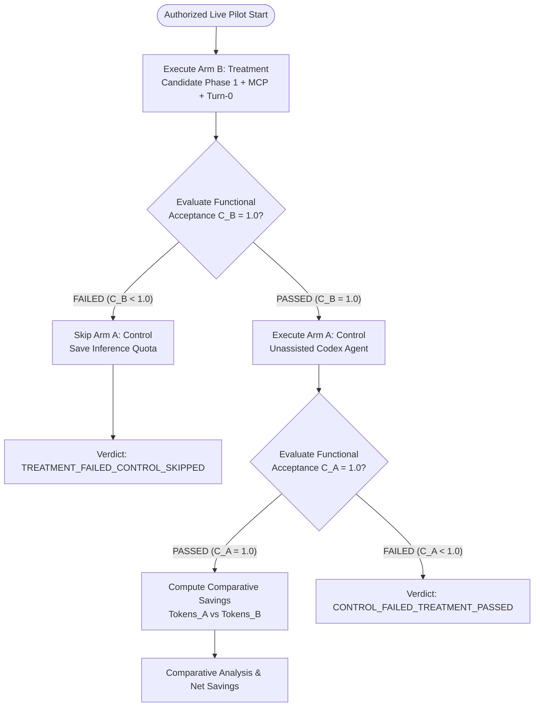

# Engram Milestone 5G — Matched-Pair Live Pilot Protocol
## Experimental Specification for Token-Efficiency Measurement

**Date:** 2026-11-04  
**Milestone:** 5G — Live Pilot Readiness Package  
**Status:** DRAFT / PENDING EXPLICIT OWNER AUTHORIZATION  
**Target Repository:** `C:\Users\Amal P S\OneDrive\Projects\Engram`  
**Git Branch:** `feature/async-precommit-guard`  
**Git HEAD:** `c70845b4d5913457f1b176fb0370b80dd792711f`  

---

## 1. Experimental Objective & Hypothesis

The primary objective of the Engram Matched-Pair Live Pilot is to measure whether the Engram Knowledge Engine achieves **statistically valid and operationally significant net token reduction** during an autonomous coding task executed by an advanced LLM agent (OpenAI Codex / `gpt-5-codex` / `gpt-5.6-luna`).

### Primary Hypothesis
$$\text{Tokens}(\text{treatment\_B}) < \text{Tokens}(\text{control\_A}) \quad \text{given} \quad C_B = 1.0 \land C_A = 1.0$$
Providing the agent with pre-indexed, high-relevance semantic code excerpts at Turn-0 and on-demand via the Model Context Protocol (MCP) will replace costly iterative file reading (`cat`, `Get-Content`, search loops), thereby reducing total provider-reported model tokens consumed to achieve 100% functional acceptance ($C = 1.0$).

### Core Token Replacement Principle
Every token Engram emits into agent context must offset more than one token of full-file inspection or exploratory rework. If Engram emits pointers or excerpts for files that the agent subsequently reads in full via shell commands, the net token replacement value for those files is zero.

---

## 2. Experimental Task Specification

### 2.1 Task Selection: `task_commit_cache_invalidation`
- **Task Identifier:** `task_commit_cache_invalidation`
- **Task Configuration:** `benchmarks/matched-pair-harness/config/tasks/task_commit_cache_invalidation.json`
- **Repository Type:** `cargo` (Rust)
- **Source/Golden Repository:** `C:\Users\Amal P S\OneDrive\Projects\Engram` (resolved via `orchestrator.py` `HARNESS_ROOT.parent.parent`)
- **Baseline Commit:** `c70845b4d5913457f1b176fb0370b80dd792711f`
- **Allowed Target Files:**
  - `src/compiler.rs`
  - `src/analyzer.rs`
  - `src/main.rs`
  - `tests/commit_cache_invalidation_test.rs`
- **Strictly Forbidden Patterns:**
  - `Cargo.toml`, `Cargo.lock` (manifest mutation triggers immediate gate failure)
  - `src/mcp.rs`, `src/guard.rs`, `src/ci_guard.rs`, `src/hook.rs`
  - `.engram/memories.json`

### 2.2 Task Functional Contract & Requirements
The agent is tasked with adding an automated Git commit-bound AST cache invalidation mechanism and safe cache purge CLI subcommand to the Engram Rust codebase:
1. **REQ-1 (SQLite Metadata Persistence, weight 0.25):**  
   Record active Git commit HEAD in the SQLite `.engram/index.db` `meta` table column/key `git_commit_head`.
2. **REQ-2 (Commit Drift Detection & Invalidation, weight 0.25):**  
   In `ensure_fresh()`, compare current repository HEAD against the cached commit hash; trigger invalidation of stale file records upon detecting commit drift. Write integration tests in `tests/commit_cache_invalidation_test.rs` verifying that drift triggers re-indexing.
3. **REQ-3 (`clean --cache` Subcommand, weight 0.25):**  
   Implement the `engram clean --cache` CLI subcommand in `src/main.rs` to purge the SQLite cache database while strictly preserving `.engram/memories.json`.
4. **REQ-4 (Boundary Adherence & Gate Quality, weight 0.25):**  
   Zero modifications to `Cargo.toml`, `Cargo.lock`, or unauthorized files. Ensure all changes compile and pass offline checks:
   - `cargo check --offline`
   - `cargo test --offline --lib compiler::tests && cargo test --offline --test commit_cache_invalidation_test`

### 2.3 Semantic Retrieval Contract Reality
- **Scope of Retrieval in Task:** The task requires cross-module structural discovery across SQLite storage, staleness checks, CLI parsing, and test scaffolding. This structure is intended to benefit from Engram's semantic MCP tools (`search_symbols`, `read_context`, `get_architecture`).
- **Evaluator Limitation:** The evaluator (`evaluator.py`) verifies the *functional output* (SQLite schema, AST/regex patterns, unit tests, and compilation). It does **not** directly assess whether the agent discovered these symbols via Engram MCP or native shell searches. Net replacement value is therefore verified through empirical telemetry analysis (`TokenReplacementAccounting` tracking subsequent `cat`/`type` reads in `session_events.jsonl`).

---

## 3. Matched-Pair Experimental Design

The experiment follows a strict two-arm sequential matched-pair methodology:

### 3.1 Arm B: Treatment Arm (`treatment_B`)
- **Execution Order:** 1 (Runs first).
- **Candidate Binary:** Engram Candidate Phase 1.
  - **Filesystem Path:** `benchmarks/matched-pair-harness/bin/candidate-phase1/engram.exe`  
    *(Identical build at `target/release/engram.exe`).*
  - **Verified SHA-256:** `F56347EF2F0BFD4854176A3EC3C86D8D20B4C0E5954F04E4464998F623D85BEE`.
- **MCP Integration:** Automated MCP server registration via sandbox `.codex/config.toml`:
  - Command: `engram serve --stdio`
  - Auto-approval: Enabled for `read_context`, `search_symbols`, `get_architecture`.
- **Knowledge Engine Optimizations:**
  - Bounded line ranges: `L{start}..L{end}`.
  - Completeness signaling: `[COMPLETE_BLOCK]` vs `[INCOMPLETE_EXCERPT]`.
  - Confidence & uncertainty signaling for un-indexed boundaries.
- **Turn-0 Injection:** High-relevance entry point context injected into workspace instructions (`.github/copilot-instructions.md`) and task prompt prefix.

### 3.2 Arm A: Control Arm (`control_A`)
- **Execution Order:** 2 (Conditional upon Treatment success).
- **Binary:** None (Unassisted baseline).
- **Tooling:** Native Codex tools only (standard bash/cmd/PowerShell file exploration, `grep`, `cat`, directory listing).
- **Turn-0 Injection:** Disabled. Standard raw task prompt only.
- **MCP Servers:** None.

### 3.3 Conditional Execution & Cost Protection
To safeguard model quota and prevent wasteful token spend, the orchestrator enforces strict conditional execution:
- If Treatment (`treatment_B`) fails functional acceptance ($C_B < 1.0$), halts on timeout, crashes, or trips the pre-dispatch token guard, the Control arm (`control_A`) is **NOT executed**.
- The control arm status is serialized as `score: null`, `passed_all_requirements: null`, and the comparative verdict is recorded as `TREATMENT_FAILED_CONTROL_SKIPPED`.

---

## 4. Frozen Binary Manifest

All binaries utilized in benchmarking are frozen and verified via SHA-256 hashes:

| Binary Identity | Filesystem Location | SHA-256 Checksum | Role |
| :--- | :--- | :--- | :--- |
| **Candidate Phase 1** | `benchmarks/matched-pair-harness/bin/candidate-phase1/engram.exe` | `F56347EF2F0BFD4854176A3EC3C86D8D20B4C0E5954F04E4464998F623D85BEE` | Active Treatment Arm |
| **v1.5.1 Baseline** | `benchmarks/matched-pair-harness/bin/v1.5.1/engram.exe` | `474A1A7AAFBB5A5B52418AA51A978A58AEAE4A177C62EC17C526E165610F44E0` | Historical Reference |
| **v1.5.4 Baseline** | `benchmarks/matched-pair-harness/bin/v1.5.4/engram.exe` | `CF807EACDEB36DC972019838EDEEB2FA5E8BE25F6C3926FC662189FA9430A798` | Historical Reference |

No binary may be rebuilt, replaced, or modified without a new formal amendment and re-certification.

---

## 5. Agent & Runtime Environment Configuration

- **Agent CLI:** OpenAI Codex CLI (`codex exec`).
- **Model:** `gpt-5-codex` (Runtime alias `gpt-5.6-luna`; offline status: `NOT VERIFIABLE`).
- **Sandbox Root:** Isolated Git worktree provisioned under `AppData\Local\Temp\engram_pilot\runs\<task_id>_<pair_id>_<arm>_<timestamp>\`.
- **Baseline Git Identity:** Provisioned from `golden_repo` commit `c70845b4d5913457f1b176fb0370b80dd792711f` via `git worktree add --detach`.
- **Sandbox Whitelist:** Isolation asserts clean worktree state, allowing only `target/`, `.engram/`, `.github/`, and `.codex/`.
- **Execution Limits:**
  - Wall-clock timeout: 600 seconds (10 minutes) per arm.
  - Maximum turns: 25 turns per arm.
  - Hard token ceiling: 175,000 provider-reported tokens per arm (`--max-tokens-ceiling 175000`).
  - Headroom reserve: 15,000 tokens (`--headroom-reserve 15000`).
  - Pre-dispatch guard threshold: 160,000 tokens (derived from $175\text{k} - 15\text{k}$).

---

## 6. Telemetry & Evidence Preservation

For each executed arm, the orchestrator produces and archives the following evidentiary artifacts in `benchmarks/matched-pair-harness/results/<pilot_run_id>/`:
1. `run_telemetry.json`: Comprehensive structured telemetry conforming to `run_telemetry.schema.json`.
2. `orchestrator_log.txt`: Timestamped execution log tracing subprocess invocation, guard checks, and status changes.
3. `session_events.jsonl`: Real-time streaming events captured from Codex stdout/stderr.
4. `raw_events.jsonl`: Unfiltered event records for forensic analysis.
5. `evaluator_results.json`: Output of the functional verification evaluator.
6. `matched_pair_summary.json`: Pair-level comparison, efficiency ratio, and formal verdict conforming to `matched_pair_summary.schema.json`.
7. `SHA256SUMS`: Cryptographic manifest over all generated artifacts.
