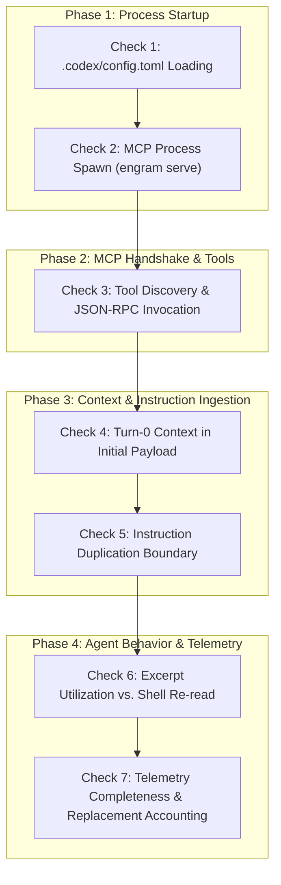

# Engram Milestone 5G — Runtime Observation Plan
## Live Experimental Verification, Boundary Inspection, and Telemetry Validation

**Date:** 2026-11-04  
**Milestone:** 5G — Live Pilot Readiness Package  
**Status:** DRAFT / PENDING EXPLICIT OWNER AUTHORIZATION  
**Target Repository:** `C:\Users\Amal P S\OneDrive\Projects\Engram`  
**Git Branch:** `feature/async-precommit-guard`  
**Git HEAD:** `c70845b4d5913457f1b176fb0370b80dd792711f`  

---

## 1. Offline Verification vs. Live Runtime Observability

A critical lesson from Milestone 5E and the independent audits of Milestones 5F and 5G is that **offline structural verification is not equivalent to live runtime exposure**.

- **Offline Proofs (Already Achieved):**
  - We have verified that `isolation.py` generates `.codex/config.toml` with correct TOML syntax.
  - We have verified that unit and integration tests for `StreamingTokenTracker`, evaluator requirements, and replacement parsers pass offline.
  - We have verified that the candidate binary compiles and executes CLI commands locally.
- **Live Runtime Observability (Must Be Inspected During Live Run):**
  - Whether the proprietary OpenAI Codex CLI actually reads `.codex/config.toml` from the sandbox root directory.
  - Whether Codex spawns `engram serve --stdio` over stdio pipes without security blocks or permission denials.
  - Whether the agent model chooses to call Engram MCP tools rather than falling back on native shell searches.
  - Whether `.github/copilot-instructions.md` is ingested natively by Codex alongside the prompt, causing duplicate token expenditure.
  - Whether the model identifier `gpt-5-codex` (alias `gpt-5.6-luna`) is accepted without endpoint errors.

This document defines the 7 mandatory observational checkpoints to be verified during any future authorized live pilot execution.

---

## 2. The 7 Live Runtime Observation Checkpoints

### Checkpoint 1: `.codex/config.toml` Loading and Recognition
- **Observation Target:** Verify that Codex CLI recognizes and parses the sandbox-local configuration without schema warnings or path errors.
- **Observational Evidence:**
  - Inspect `raw_events.jsonl` and stderr logs for messages matching `Loaded config from .codex/config.toml` or any `unrecognized field` warnings.
  - Verify that the sandbox environment does not override configuration paths.

### Checkpoint 2: Engram MCP Subprocess Spawn
- **Observation Target:** Confirm that Codex CLI successfully spawns `engram.exe serve --stdio` (Candidate Phase 1, SHA-256 `F56347EF...`) as a managed child process.
- **Observational Evidence:**
  - In `session_events.jsonl` or system process tree: confirm process creation of `engram.exe`.
  - Confirm stdin/stdout pipe connection established without immediate process exit code $\ne 0$.

### Checkpoint 3: MCP Tool Discovery & JSON-RPC Invocations
- **Observation Target:** Verify that Codex registers the three Engram tools (`read_context`, `search_symbols`, `get_architecture`) and presents them in the model's tool schema.
- **Observational Evidence:**
  - Event stream `session_events.jsonl` must contain tool discovery payloads and agent tool calls of type `mcp_tool_call` or `custom_tool_call` with server name `engram`.
  - Check responses for bounded excerpt syntax: `L{start}..L{end}` and `[COMPLETE_BLOCK]` indicators.

### Checkpoint 4: Turn-0 Context Injection into Initial Request
- **Observation Target:** Verify that initial architectural entry points and guidance are present in the first request sent to the model API.
- **Observational Evidence:**
  - Inspect Turn 1 `input_tokens` count in `run_telemetry.json`.
  - Inspect the recorded initial prompt in `orchestrator_log.txt` to confirm that the `TaskContextCompiler` output was prepended to the user task description.

### Checkpoint 5: Instruction Duplication Boundary Inspection
- **Observation Target:** Determine whether writing instructions to `.github/copilot-instructions.md` and prepending them to the task prompt leads to double-counting or inflated Turn-0 token usage.
- **Observational Evidence:**
  - Compare Turn 1 prompt byte size against reported Turn 1 `input_tokens`.
  - Check whether Codex automatically ingested `.github/copilot-instructions.md` as an implicit system prompt. If Turn 1 context shows duplicate text blocks, record the exact token inflation overhead.

### Checkpoint 6: Excerpt Utilization vs. Shell Re-Read Behavior
- **Observation Target:** Monitor agent tool usage to observe whether the agent relies on the returned code excerpts or reverts to full-file shell reading.
- **Observational Evidence:**
  - Telemetry parser logs in `run_telemetry.json`: `TokenReplacementAccounting`.
  - Match file targets of any `cat`, `type`, `Get-Content`, `head`, or `tail` commands against the canonical paths returned by Engram (`src/compiler.rs`, `src/analyzer.rs`, etc.).
  - Confirm that `re_read_files` is zero or properly accounted for in net savings.

### Checkpoint 7: Telemetry Completeness and Schema Conformity
- **Observation Target:** Verify that every turn logs full provider token metrics and that the final run telemetry conforms strictly to JSON Schema.
- **Observational Evidence:**
  - Validate `run_telemetry.json` against `schemas/run_telemetry.schema.json`.
  - Verify that `cached_input_tokens`, `reasoning_tokens`, and `tokens_per_successful_task` are properly populated and non-negative.

---

## 3. Real-Time Intervention Protocols

During a live authorized run, the orchestrator and human operator must adhere to the following real-time rules:

1. **No Manual Inference Injections:** No manual hints, prompts, or tool calls may be injected into the agent session.
2. **Subprocess Hung State:** If the agent process emits no stdout/stderr events for 180 seconds, the orchestrator logs a warning. If no event occurs for 300 seconds, the run is terminated under the `TIMEOUT` condition.
3. **Loop Detection:** If an agent issues the identical tool call 3 times consecutively with identical arguments, the orchestrator records a `LOOP_DETECTED` warning in telemetry.

---

## 4. Post-Run Forensic Procedure

Immediately upon termination of each arm:
1. Verify sandbox working directory integrity (`git status`, `git diff`).
2. Run functional evaluator `evaluator.py` against the sandbox and record output in `evaluator_results.json`.
3. Verify golden repository dependency tree post-run integrity via `verify_dependency_integrity()`.
4. Generate and verify `SHA256SUMS` over all output files in the run vault.
5. Record comparative analysis in `matched_pair_summary.json`.
