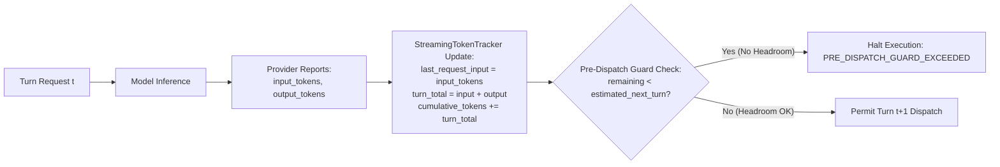
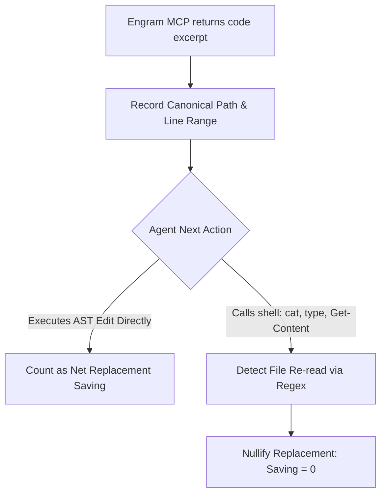

# Engram Milestone 5G — Token Accounting & Stop Conditions
## Rigorous Token Measurement, Guard Verification, and Empirical Replacement

**Date:** 2026-11-04  
**Milestone:** 5G — Live Pilot Readiness Package  
**Status:** DRAFT / PENDING EXPLICIT OWNER AUTHORIZATION  
**Target Repository:** `C:\Users\Amal P S\OneDrive\Projects\Engram`  
**Git Branch:** `feature/async-precommit-guard`  
**Git HEAD:** `c70845b4d5913457f1b176fb0370b80dd792711f`  

---

## 1. Provider-Reported Token Taxonomy

All primary efficiency claims and stop conditions in the Engram Matched-Pair Harness rely exclusively on **authoritative provider-reported token usage** extracted from the OpenAI Codex execution stream. Heuristic or byte-derived approximations are segregated as secondary diagnostic telemetry.

### 1.1 The Authoritative Provider Token Tuple
For every turn $t \in [1, N]$, the model provider reports the following usage fields:

| Field Name | Type | Description & Accounting Relationship |
| :--- | :--- | :--- |
| `input_tokens` | Integer | Total tokens ingested by the model for this request (system prompt, conversation history, injected context, tool schemas, and user turns). |
| `cached_input_tokens` | Integer | **Subset of `input_tokens`** that matched provider-side prefix caches. *Crucial:* Cached tokens are already included inside `input_tokens` and must **not** be added a second time. |
| `output_tokens` | Integer | Total tokens emitted by the model in the response (agent thought, tool calls, text explanations). |
| `reasoning_tokens` | Integer | **Subset of `output_tokens`** dedicated to internal model chain-of-thought/reasoning (for reasoning models such as `gpt-5-codex`). Must **not** be double-counted. |
| `total_tokens` | Integer | Authoritative sum for the single turn: `total_tokens = input_tokens + output_tokens`. |

### 1.2 Byte-Derived Estimates vs. Provider Tokens
- Byte-derived estimates ($\text{tokens} \approx \text{bytes} / 4$) are strictly heuristic approximations used solely for static budget caps during context packaging.
- **Mandate:** Byte estimates must **never** be substituted for or conflated with provider-reported token counts in experimental reports, efficiency ratios, or stop-condition evaluations.

---

## 2. Per-Request vs. Cumulative Accounting Architecture

### 2.1 The Milestone 5E Accounting Defect
During the initial post-mortem of `pilot_01`, a critical accounting variable misattribution was discovered in `StreamingTokenTracker`:
- The tracker conflated the single-request input payload (~41,000 tokens) with the cumulative running thread input (~115,000 tokens).
- When evaluating the pre-dispatch guard before Turn 3, the tracker computed:
  $$\text{estimated\_next} = \text{cumulative\_tokens} (117,135) + \text{cumulative\_input} (115,000) = 232,135$$
- Because $232,135 > 160,000$, the guard tripped prematurely, incorrectly reporting that a single turn would require 115,000 tokens when the true marginal turn cost was only ~41,000 tokens.

### 2.2 The Remediated Milestone 5F Accounting Model
In Milestone 5F, `StreamingTokenTracker` in `benchmarks/matched-pair-harness/src/runner.py` was refactored with strict mathematical invariants:

1. **`last_request_input`**: Represents the actual context window size of the most recent turn. For `task_commit_cache_invalidation`, this hovers between 35,000 and 42,000 tokens.
2. **`cumulative_tokens`**: The strict sum of all tokens consumed across turns $\sum_{i=1}^t (I_i + O_i)$.
3. **Dynamic Next-Turn Estimate**:
   $$\text{estimated\_next\_turn} = \max(\text{last\_turn\_request\_tokens}, \text{conservative\_reserve})$$
4. **Remaining Budget Check**:
   $$\text{remaining} = \text{max\_tokens\_ceiling} - \text{cumulative\_tokens}$$
   $$\text{has\_headroom} = (\text{remaining} \ge \text{estimated\_next\_turn})$$

---

## 3. Ceilings, Thresholds, and Guard Mechanics

### 3.1 Parameter Configuration & CLI Alignment

| Parameter | Value | CLI Option & Default | Definition & Operational Role |
| :--- | :---: | :--- | :--- |
| **Hard Ceiling** | 175,000 tokens | `--max-tokens-ceiling 175000` *(Harness default: 250,000)* | Absolute cumulative provider token limit per arm. |
| **Headroom Reserve** | 15,000 tokens | `--headroom-reserve 15000` *(Harness default: 45,000)* | Minimum token buffer required to dispatch the first turn. |
| **Dynamic Reserve** | $\max(I_{\text{last}}, 15000)$ | Calculated dynamically by `runner.py` | Estimated token cost of the subsequent turn request. |
| **Derived Pre-Dispatch Threshold** | 160,000 tokens | Implicit: $\text{ceiling} - \text{reserve}$ ($175\text{k} - 15\text{k} = 160\text{k}$) | Earliest watermark at which a dispatch could be halted. |
| **Wall-Clock Timeout** | 600 seconds | Hardcoded runner execution limit | Maximum elapsed subprocess execution time. |
| **Maximum Turns** | 25 turns | Hardcoded agent loop cutoff | Maximum allowed agent interactions. |

> [!IMPORTANT]
> **Orchestrator CLI Flag Alignment:**  
> The orchestrator (`orchestrator.py` line 1623) sets a default `--headroom-reserve` of `45,000` (which was sized for Task B). To achieve the documented 15,000 reserve and derived 160,000 threshold for `task_commit_cache_invalidation`, the CLI invocation **must explicitly pass** `--headroom-reserve 15000` alongside `--max-tokens-ceiling 175000`. If omitted, the default 45,000 reserve would cause dispatches to halt at $175,000 - 45,000 = 130,000$ tokens.

### 3.2 The Physical Reality of the Client-Side Guard
It is critical to distinguish a client-side pre-dispatch guard from a provider-side token throttle:
- **Inter-turn Operation:** The guard evaluates usage strictly **between turns** before a new request payload is transmitted.
- **In-flight Limitlessness:** Once an HTTP/WebSocket request is dispatched to OpenAI Codex, the client has **no physical mechanism to cap or truncate** generation tokens in real-time. If an in-flight request consumes 35,000 output/reasoning tokens, the client cannot abort generation mid-stream; it only records the usage upon message completion.
- **Risk Characterization:** If cumulative usage stands at 145,000 tokens and a request is dispatched, an unexpectedly verbose model turn consuming 35,000 tokens will push total usage to 180,000 upon return. The pre-dispatch guard prevents subsequent turns, but cannot enforce a hard ceiling mid-turn. The dynamic reserve buffer ($\max(I_{\text{last}}, \text{reserve})$) exists precisely to minimize the likelihood of dispatching when an in-flight breach could occur.

---

## 4. Empirical Token Replacement Accounting

A core flaw of naive context augmentation is that providing code excerpts may not actually stop an agent from reading files. If an agent receives an Engram excerpt but still issues `cat src/compiler.rs`, Engram's context overhead is purely additive.

### 4.1 Measurement Framework (`TokenReplacementAccounting`)
Implemented in `telemetry.py` and validated under `run_telemetry.schema.json`:

1. **Observed Excerpts:**
   - Every MCP response is parsed for canonical file paths, line ranges (`L{start}..L{end}`), and completeness markers (`[COMPLETE_BLOCK]` vs `[INCOMPLETE_EXCERPT]`).
   - Byte length is tracked alongside an estimated replacement figure ($B / 4$).
2. **Subsequent Shell Read Detection:**
   - The telemetry parser monitors all tool execution commands in `session_events.jsonl`.
   - Regular expressions monitor file-reading commands:
     - POSIX: `cat`, `head`, `tail`, `more`, `less`, `awk`, `sed`
     - Windows/PowerShell: `type`, `Get-Content`, `gc`, `more`
   - Target paths are normalized canonically (resolving relative paths against repository root).
3. **Invalidation & Zero-Saving Rule:**
   - If an agent issues a shell read targeting a file for which Engram previously provided a code excerpt, that file is flagged as `re_read_after_engram: true`.
   - The effective net token replacement for that file is set to **zero**.

### 4.2 Primary Comparative Metric: Tokens Per Successful Task
The definitive metric for Engram value is:
$$\text{Tokens per Successful Task} = \frac{\text{Total Provider Tokens Consumed}}{\text{Functional Acceptance Score } C}$$
- Where $C = 1.0$ (complete pass).
- If $C < 1.0$, the metric is undefined / failure.
- A candidate binary that achieves $C = 1.0$ with 65,000 tokens outperforms a baseline that achieves $C = 1.0$ with 110,000 tokens by:
  $$\text{Savings} = 1 - \frac{65,000}{110,000} = 40.9\%$$

---

## 5. Formal Stop Conditions Matrix

| Trigger Event | Detection Point | Action Taken | Result Classification |
| :--- | :--- | :--- | :--- |
| **Cumulative Usage $\ge$ 175,000** | Post-turn provider accounting | Immediate abort | `HARD_CEILING_BREACH` |
| **Estimated Next Turn $>$ Remaining Budget** | Pre-turn dispatch check | Suppress next request, abort | `PRE_DISPATCH_GUARD_EXCEEDED` |
| **Elapsed Time $\ge$ 600s** | Polling timer / subprocess wait | Terminate subprocess tree | `TIMEOUT` |
| **Turns $\ge$ 25** | Turn loop counter | Terminate arm | `MAX_TURNS_EXCEEDED` |
| **Subprocess Crash / Error** | Exit code $\ne 0$ or stderr unhandled | Clean sandbox, record error | `EXECUTION_CRASH` |
| **Treatment Arm Acceptance $C_B < 1.0$** | Post-arm evaluator execution | Suppress Control Arm execution | `TREATMENT_FAILED_CONTROL_SKIPPED` |
| **Normal Completion** | Agent terminates with exit code 0 | Proceed to evaluation | `EVALUATION_PENDING` |
