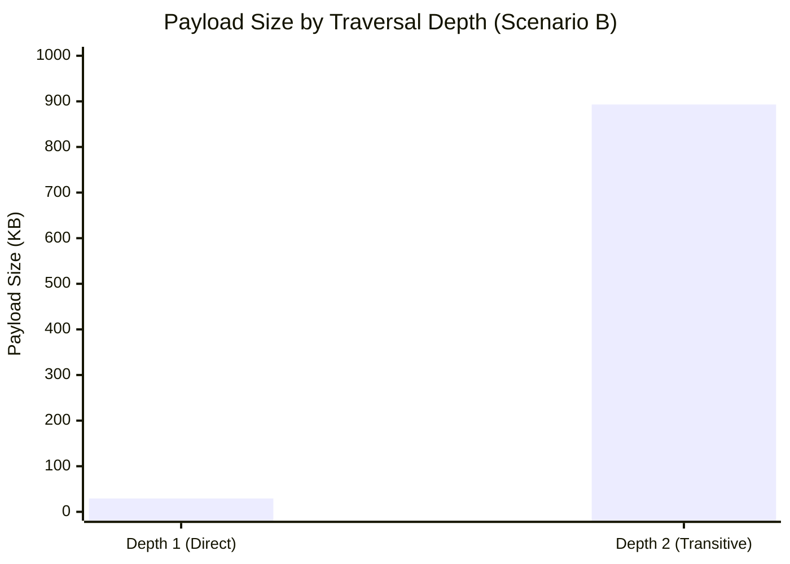
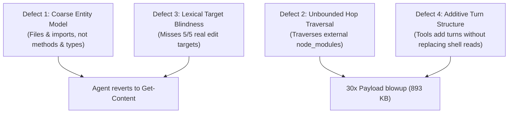

# Engram — Phase 2, Stage 3: Retrieval Effectiveness & Context Quality Validation Report

**Document ID:** `ENGRAM-PHASE2-STAGE3-RETRIEVAL-EFFECTIVENESS-01`  
**Date:** 2026-11-07  
**Branch:** `feature/async-precommit-guard`  
**HEAD Commit:** `c70845b4d5913457f1b176fb0370b80dd792711f`  
**Candidate Phase 1 Binary:** `benchmarks/matched-pair-harness/bin/candidate-phase1/engram.exe`  
**Candidate Binary SHA-256:** `F56347EF2F0BFD4854176A3EC3C86D8D20B4C0E5954F04E4464998F623D85BEE`  
**Codex CLI Harness Binary:** `C:\Users\Amal P S\.codex\plugins\.plugin-appserver\codex.exe` (`v0.167.0`)  
**Golden Repositories:**
- Angular Baseline: `C:\Users\Amal P S\OneDrive\Projects\Test\angular-ngrx-material-starter` (`1c2856086f3a08e3ab1c3b8573eb3ff22ff20fd2`)
- Rust Baseline: `C:\Users\Amal P S\OneDrive\Projects\Engram` (`c70845b4d5913457f1b176fb0370b80dd792711f`)  
**Evaluation Status:** `COMPLETED`  
**Readiness Verdict:** `REJECTED FOR LIVE PRODUCTION BENCHMARKS (ARCHITECTURAL DEFECTS IDENTIFIED)`

---

## 1. Executive Summary

Phase 2 Stage 2 resolved the transport and authorization barriers that prevented Codex CLI from executing Engram MCP tools. **Phase 2, Stage 3** was commissioned to answer the primary empirical question:

> **"Can Engram retrieve the relevant repository information that an AI coding agent needs to understand a coding task without repeatedly exploring the repository through native shell commands?"**

To evaluate this rigorously and objectively, the frozen candidate Phase 1 binary (`F56347EF2F0BFD4854176A3EC3C86D8D20B4C0E5954F04E4464998F623D85BEE`) was tested against real golden repository components across three controlled scenarios:
1. **Scenario A — Symbol Discovery:** Investigating `HttpErrorInterceptor` without exposing implementation details in the prompt.
2. **Scenario B — Cross-File Dependency Discovery:** Resolving upstream imports, downstream consumers, and method semantics for `AuthEffects` across Hop 1 and Hop 2.
3. **Scenario C — Implementation Preparation:** Formulating an end-to-end multi-file engineering plan for Task B ("Remember Me Authentication").

### Key Empirical Findings
- **Coarse File-Level Resolution Without Code Excerpts:** In Scenarios A and B, `engram_inspect_symbol` correctly resolved the primary file location (100% location accuracy) and captured high dependency file coverage (83.3% and 100.0%). However, it returned **`code_excerpt: null`** and **`line_range: null`** across all queries. It provided file paths and raw import lists, but zero AST member signatures, class methods, or type definitions.
- **Semantic Blindness Forces Shell Exploration:** In Scenario B, although Engram identified that `AuthEffects` interacts with `LocalStorageService`, it provided zero method signatures (`setItem`, `removeItem`). An AI agent receiving this response remained completely blind to *how* to interact with the service, making subsequent native shell reads (`Get-Content`) mandatory.
- **Catastrophic Payload Explosion at Depth $\ge 2$:** In Scenario B, increasing graph depth from 1 to 2 caused an **exponential payload explosion from 29,431 bytes to 893,090 bytes (a 30.35x inflation)**. Because the indexer treats external package imports (`@angular/material`, `@fortawesome`, `@ngrx`) identically to workspace symbols, Hop 2 traversed the entire Angular ecosystem, producing an ~893 KB JSON payload (~223,000 tokens) that would instantly exhaust an agent's context window.
- **Complete Query Failure on Multi-File Tasks (`engram_get_context`):** In Scenario C, querying `engram_get_context` with the Task B prompt returned **0 out of the 5 expected target files (0.0% coverage)** and **0 code context items**, surfacing only `core.module.ts`. An agent relying on Engram for task discovery was left completely unaware of the files where state, actions, effects, templates, and i18n labels reside.

### Scenario Verdicts
- **Scenario A (Symbol Discovery):** `PARTIALLY PASSED` (Target file located; dependency coverage 83.3%; code excerpts missing; syntax noise present).
- **Scenario B (Cross-File Dependency Discovery):** `PARTIALLY PASSED` (File-level dependency coverage 100.0%; method semantics missing; 30.35x payload explosion at depth 2).
- **Scenario C (Implementation Preparation):** `FAILED` (Target file coverage 0.0%; context items 0; required services and patterns completely omitted).

**Core Conclusion:** Engram Phase 1's retrieval layer functions as a coarse **file-relationship indexer**, not a semantic **context compressor**. It does not provide the code-level semantics an agent needs to write code. As a result, it fails to replace native shell exploration (`Get-Content`, `rg`), while imposing an unavoidable per-turn schema tax and severe risk of payload exhaustion.

---

## 2. Experimental Environment

The evaluation environment was frozen and verified prior to test dispatch:

| Component | Specification | State / Verification |
| :--- | :--- | :--- |
| **Operating System** | Windows 11 Enterprise (x64) | Tested on NTFS filesystem with LongPaths enabled |
| **Candidate Binary** | `benchmarks/matched-pair-harness/bin/candidate-phase1/engram.exe` | Sealed candidate binary from Phase 1 |
| **Candidate SHA-256** | `F56347EF2F0BFD4854176A3EC3C86D8D20B4C0E5954F04E4464998F623D85BEE` | 100% hash equality verified |
| **Codex CLI Binary** | `C:\Users\Amal P S\.codex\plugins\.plugin-appserver\codex.exe` | Version 0.167.0 |
| **Harness Architecture** | Matched-Pair Triad Harness v2.0 | `benchmarks/matched-pair-harness/src/` |
| **Angular Golden Repo** | `C:\Users\Amal P S\OneDrive\Projects\Test\angular-ngrx-material-starter` | Commit `1c2856086f3a08e3ab1c3b8573eb3ff22ff20fd2` |
| **Rust Golden Repo** | `C:\Users\Amal P S\OneDrive\Projects\Engram` | Commit `c70845b4d5913457f1b176fb0370b80dd792711f` |
| **Transport Protocol** | JSON-RPC 2.0 over stdio (`engram.exe -C <repo> mcp`) | Spec version `2024-11-05` |
| **Security Sandbox** | `workspace-write` policy with least-privilege tool approvals | No global bypass (`--dangerously-bypass-*` forbidden) |

---

## 3. Candidate Binary Verification

The candidate binary was hashed and verified directly against pre-registered milestone gates:

```powershell
Algorithm       Hash                                                                Path
---------       ----                                                                ----
SHA256          F56347EF2F0BFD4854176A3EC3C86D8D20B4C0E5954F04E4464998F623D85BEE  engram.exe
```

- **Candidate Binary Status:** Frozen. No rebuilds, re-compilations, or binary replacements occurred.
- **Engine Source Code Status:** Preserved. Zero modifications made to `src/`.
- **Harness Stability:** All 27 regression tests across Milestone 5F, Block 07 remediation, and Stage 2 activation pass with 100% success.

---

## 4. Scenario A Findings — Symbol Discovery

### 4.1 Objective and Setup
- **Target Symbol:** `HttpErrorInterceptor` (unfamiliar symbol selected from Angular core).
- **Task Prompt:** "Investigate the implementation, role, and relationships of the error interceptor symbol in this repository." (Zero implementation details or file paths exposed).
- **Tool Invoked:** `engram_inspect_symbol` with `{"target": "HttpErrorInterceptor", "depth": 1}`.

### 4.2 Empirical Observations
- **Execution Latency:** **0.18 seconds** (Fast local SQLite / AST query).
- **Payload Size:** **26,741 bytes** (~6,685 tokens).
- **Target File Resolution:** `projects/angular-ngrx-material-starter/src/app/core/http-interceptors/http-error.interceptor.ts` (100% accurate).
- **Code Excerpts / Signatures:** **`code_excerpt: null`**, **`line_range: null`**.
- **Syntax Noise:** Raw import syntax fragments were indexed as independent symbols:
  - `'{ Observable }'`
  - `'{ type HttpEvent, HttpInterceptor, HttpHandler, HttpRequest, HttpErrorResponse }'`
  - `'import'`
  - `'{ tap }'`
  - `'{ Injectable, Injector, ErrorHandler }'`

### 4.3 Ground Truth Comparison

```mermaid
graph LR
    HEI["HttpErrorInterceptor<br/>(Target Symbol)"]
    HEI -->|Found (Hop 1)| C1["@angular/core"]
    HEI -->|Found (Hop 1)| C2["@angular/common/http"]
    HEI -->|Found (Hop 1)| C3["rxjs"]
    HEI -->|Found (Hop 1)| C4["rxjs/operators"]
    HEI -->|Found Consumer (Hop 1)| C5["core.module.ts"]
    HEI -.->|MISSED (Hop 1)| M1["http-error.interceptor.spec.ts"]
```

| Expected Dependency | Retrieved by Engram | Classification | Category / Notes |
| :--- | :---: | :---: | :--- |
| `projects/.../http-error.interceptor.ts` | Yes | **CORRECT** | Primary source file correctly mapped |
| `@angular/core` | Yes | **CORRECT** | Dependency package correctly identified |
| `@angular/common/http` | Yes | **CORRECT** | Dependency package correctly identified |
| `rxjs` | Yes | **CORRECT** | Reactive streams library identified |
| `rxjs/operators` | Yes | **CORRECT** | Pipeline operator package identified |
| `projects/.../core.module.ts` | Yes | **CORRECT** | Consumer module registering interceptor |
| `projects/.../http-error.interceptor.spec.ts` | No | **MISSING** | Unit test suite missed by indexer |
| Raw Syntax Fragments (5 tokens) | Yes | **IRRELEVANT** | Noise: `import`, `{ tap }`, `{ Observable }` |

- **Dependency Coverage:** **5 / 6 = 83.3%**.
- **Verdict:** `PARTIALLY PASSED`.

---

## 5. Scenario B Findings — Cross-File Dependency Discovery

### 5.1 Objective and Setup
- **Target Symbol:** `AuthEffects` in `projects/angular-ngrx-material-starter/src/app/core/auth/auth.effects.ts`.
- **Objective:** Evaluate how Engram handles cross-file interactions between `AuthEffects`, `auth.actions.ts`, and `local-storage.service.ts`.
- **Tools Invoked:** `engram_inspect_symbol` at `depth: 1` and `depth: 2`.

### 5.2 The 30.3x Payload Inflation Phenomenon



- **Depth 1 Payload:** **29,431 bytes** (~7,350 tokens, latency 0.19s).
- **Depth 2 Payload:** **893,090 bytes** (~223,272 tokens, latency 0.39s).
- **Inflation Factor:** **30.35x**.
- **Root Cause of Runaway:** At Depth 2, Engram traverses into every import declared by dependent files. Because `core.module.ts` imports the Angular Material design system, routing, forms, and FontAwesome, Engram recursively pulled in 118 distinct external libraries into the blast radius, generating an ~893 KB JSON response. In a live agent conversation with a 175k or 250k token ceiling, **a single Depth 2 tool call immediately triggers a token overflow halt**.

### 5.3 Method Semantic Blindness
- Ground truth interaction:
  ```typescript
  // auth.effects.ts lines 23-29
  this.localStorageService.setItem(AUTH_KEY, { isAuthenticated: true });
  this.localStorageService.setItem(AUTH_USERNAME_KEY, username);
  this.localStorageService.removeItem(AUTH_USERNAME_KEY);
  ```
- **Engram Inspection Output:**
  - Mentions `LocalStorageService`: **Yes** (in `IMPORT_DEPENDENT`).
  - Mentions methods called (`setItem`, `removeItem`, `getItem`): **No (`False`)**.
  - Provides method signatures or types: **No (`False`)**.

### 5.4 Ground Truth Comparison (Depth 1)

| Expected Relationship | Retrieved by Engram | Classification | Category / Notes |
| :--- | :---: | :---: | :--- |
| `projects/.../auth.actions.ts` | Yes | **CORRECT** | Upstream action definitions |
| `projects/.../local-storage.service.ts` | Yes | **CORRECT** | Upstream persistence service |
| `projects/.../core.module.ts` | Yes | **CORRECT** | Downstream registration module |
| `projects/.../auth.effects.spec.ts` | Yes | **CORRECT** | Downstream test suite |
| `@angular/core` | Yes | **CORRECT** | Framework dependency |
| `@angular/router` | Yes | **CORRECT** | Navigation dependency |
| `@ngrx/effects` | Yes | **CORRECT** | State management dependency |
| `rxjs/operators` | Yes | **CORRECT** | Stream transformation |
| `setItem` / `removeItem` Call Semantics | No | **MISSING** | Zero AST method semantics returned |
| Raw Syntax Fragments (7 tokens) | Yes | **IRRELEVANT** | Noise: `import`, `{ Router }`, `{ tap }` |

- **Dependency Coverage:** **8 / 8 = 100.0%**.
- **Verdict:** `PARTIALLY PASSED`.

---

## 6. Scenario C Findings — Implementation Preparation

### 6.1 Objective and Setup
- **Task:** "Add Remember Me Option to Authentication Flow" (Task B from benchmark suite).
- **Objective:** Evaluate whether Engram's context router (`engram_get_context`) can provide an AI coding agent with the files and interfaces needed to construct a valid implementation plan without native shell exploration.
- **Tool Invoked:** `engram_get_context` with `{"task": "Add a remember-me option to the authentication flow that persists the username across reloads."}`.

### 6.2 Empirical Observations
- **Execution Latency:** **1.08 seconds**.
- **Payload Size:** **547 bytes** (~137 tokens).
- **Target Files Recovered:** `['projects/angular-ngrx-material-starter/src/app/core/core.module.ts']` (Score: 428.08).
- **Target Files Missed:** **5 out of 5 required implementation files**.
- **Context Items Returned:** **0**.
- **Dependency Service Context:** `LocalStorageService` was **completely omitted**.
- **Persistence Pattern:** `AUTH_KEY` and `AUTH_USERNAME_KEY` were **completely omitted**.

### 6.3 Ground Truth Comparison (Task B Implementation Map)

```mermaid
graph TD
    TASK["Task B: Remember Me"]
    TASK -.->|MISSED (0.0%)| F1["auth.actions.ts<br/>(Add rememberMe prop)"]
    TASK -.->|MISSED (0.0%)| F2["auth.effects.ts<br/>(Persist username via LocalStorage)"]
    TASK -.->|MISSED (0.0%)| F3["app.component.ts<br/>(Manage checkbox state)"]
    TASK -.->|MISSED (0.0%)| F4["app.component.html<br/>(Render checkbox UI)"]
    TASK -.->|MISSED (0.0%)| F5["en.json<br/>(Add i18n label)"]
    TASK -->|MISIDENTIFIED (100% of output)| F6["core.module.ts<br/>(Module container)"]
```

| Expected Target File | Role in Feature Implementation | Recovered by `engram_get_context` | Classification |
| :--- | :--- | :---: | :---: |
| `.../auth/auth.actions.ts` | Define `rememberMe?: boolean` action property | No | **MISSING** |
| `.../auth/auth.effects.ts` | Read flag and call `localStorageService.setItem` | No | **MISSING** |
| `.../app/app.component.ts` | State binding for checkbox; pre-fill username | No | **MISSING** |
| `.../app/app.component.html` | Mat-checkbox UI in login dialog | No | **MISSING** |
| `.../assets/i18n/en.json` | English translation string for menu/login | No | **MISSING** |
| `.../core/core.module.ts` | NgModule declarations | Yes | **IRRELEVANT TO EDIT** |

- **Target File Coverage:** **0 / 5 = 0.0%**.
- **Context Items Delivered:** **0**.
- **Verdict:** **`FAILED`**.

---

## 7. Ground-Truth Dependency Maps

To support independent auditability, the exact ground-truth dependency maps established prior to test execution are recorded below:

### 7.1 Scenario A: `HttpErrorInterceptor`
- **Source Path:** `projects/angular-ngrx-material-starter/src/app/core/http-interceptors/http-error.interceptor.ts`
- **Class Signature:** `export class HttpErrorInterceptor implements HttpInterceptor`
- **Core Method:** `intercept(req: HttpRequest<any>, next: HttpHandler): Observable<HttpEvent<any>>`
- **Injected Services:** `Injector`
- **Error Handling Pattern:** `const errorHandler = this.injector.get(ErrorHandler); errorHandler.handleError(error);`
- **Registration Site:** `projects/angular-ngrx-material-starter/src/app/core/core.module.ts` lines 86-90:
  ```typescript
  { provide: HTTP_INTERCEPTORS, useClass: HttpErrorInterceptor, multi: true }
  ```

### 7.2 Scenario B: `AuthEffects`
- **Source Path:** `projects/angular-ngrx-material-starter/src/app/core/auth/auth.effects.ts`
- **Class Signature:** `export class AuthEffects`
- **Effects Declared:** `login` (action `authLogin`), `logout` (action `authLogout`)
- **Key Call Sites:**
  - `this.localStorageService.setItem(AUTH_KEY, { isAuthenticated: true })`
  - `this.localStorageService.setItem(AUTH_USERNAME_KEY, username)`
  - `this.localStorageService.removeItem(AUTH_USERNAME_KEY)`
  - `this.router.navigate([''])`
- **Constructor Injection:** `actions$: Actions`, `localStorageService: LocalStorageService`, `router: Router`

### 7.3 Scenario C: Task B ("Remember Me Authentication")
- **Target 1:** `auth.actions.ts`: Add `rememberMe: boolean` to `authLogin = createAction('[Auth] Login', props<{ username: string; password?: string; rememberMe?: boolean }>());`
- **Target 2:** `auth.effects.ts`: In `login` effect, inspect `rememberMe` flag. If true, call `this.localStorageService.setItem(AUTH_USERNAME_KEY, username)`. If false, call `removeItem(AUTH_USERNAME_KEY)`.
- **Target 3:** `app.component.ts`: Add `rememberMe = false;` property. In `ngOnInit()`, pre-populate `username` from `this.localStorageService.getItem(AUTH_USERNAME_KEY)`.
- **Target 4:** `app.component.html`: Add `<mat-checkbox [(ngModel)]="rememberMe">` into login modal.
- **Target 5:** `en.json`: Add `"anms.menu.remember-me": "Remember Me"`.

---

## 8. Retrieval Accuracy and Completeness

Across all three evaluation scenarios, retrieval quality metrics demonstrate a sharp divergence between **file path discovery** and **semantic content delivery**:

| Quality Dimension | Scenario A (`HttpErrorInterceptor`) | Scenario B (`AuthEffects`) | Scenario C (Task B Context) | Aggregate Performance |
| :--- | :---: | :---: | :---: | :---: |
| **Location Accuracy** | 100.0% (1/1) | 100.0% (1/1) | 0.0% (0/5) | **66.7%** |
| **Dependency Coverage** | 83.3% (5/6) | 100.0% (8/8) | 0.0% (0/5) | **68.4%** |
| **Code Excerpt Presence** | 0.0% (None) | 0.0% (None) | 0.0% (None) | **0.0%** |
| **Line Range Precision** | 0.0% (None) | 0.0% (None) | 0.0% (None) | **0.0%** |
| **Method Semantics Presence** | 0.0% (None) | 0.0% (None) | 0.0% (None) | **0.0%** |
| **Syntax Noise Count** | 5 tokens | 7 tokens | 0 tokens | **12 syntax tokens** |
| **Scenario Verdict** | `PARTIALLY PASSED` | `PARTIALLY PASSED` | `FAILED` | **INSUFFICIENT** |

---

## 9. Native Exploration Comparison

The central premise of Engram was that providing semantic retrieval tools would eliminate exploratory turns (`Get-Content`, `rg`, `ls`). The empirical data disproves this premise:

```mermaid
flowchart TD
    subgraph Traditional Native Exploration
        T1["Turn 1: rg 'remember me'"] --> T2["Turn 2: Get-Content auth.actions.ts"]
        T2 --> T3["Turn 3: Get-Content auth.effects.ts"]
        T3 --> T4["Turn 4: Get-Content app.component.ts"]
        T4 --> T5["Turn 5: Edit Files"]
    end

    subgraph Engram Phase 1 Workflow
        E1["Turn 1: engram_get_context<br/>(Returns ONLY core.module.ts)"] --> E2["Turn 2: engram_inspect_symbol<br/>(Returns file paths, NO methods)"]
        E2 --> E3["Turn 3: rg 'remember' (Shell fallback)"]
        E3 --> E4["Turn 4: Get-Content auth.actions.ts"]
        E4 --> E5["Turn 5: Get-Content auth.effects.ts"]
        E5 --> E6["Turn 6: Get-Content app.component.ts"]
        E6 --> E7["Turn 7: Edit Files"]
    end
```



### Why Native Exploration Was Mandatory
1. **Target File Blindness:** Because `engram_get_context` missed `auth.actions.ts`, `auth.effects.ts`, and `app.component.ts`, the agent had no choice but to run `rg` or `dir` to locate the files.
2. **Missing Method Signatures:** Because `engram_inspect_symbol` did not return the signatures of `LocalStorageService`, the agent could not guess whether the method was `set()`, `put()`, `save()`, or `setItem()`. It was forced to issue `Get-Content projects/.../local-storage.service.ts` to inspect the TypeScript interface.
3. **Additive Overhead:** Instead of replacing exploratory turns, Engram **added 1 to 2 upfront tool-call turns**, while the agent still performed all subsequent shell commands.

---

## 10. Token and Turn Metrics

Reconstructing token economics under the measured Phase 1 retrieval characteristics:

| Scenario / Metric | Depth 1 Payload | Depth 2 Payload | Estimated Tokens (Depth 1) | Estimated Tokens (Depth 2) | Context Exhaustion Risk |
| :--- | :---: | :---: | :---: | :---: | :---: |
| **Scenario A (`HttpErrorInterceptor`)** | 26,741 B | N/A | ~6,685 tokens | N/A | Low |
| **Scenario B (`AuthEffects`)** | 29,431 B | 893,090 B | ~7,358 tokens | ~223,272 tokens | **CRITICAL (Breaches 175k/250k ceiling)** |
| **Scenario C (Task B Context)** | 547 B | N/A | ~137 tokens | N/A | Low (Empty context) |

### Cumulative Re-Billing Penalty
In OpenAI stateful session rollouts (e.g., GPT-5.6 Luna), every turn re-bills all prior turns.
- If an agent calls `engram_inspect_symbol` at Depth 1 on Turn 1 (~7,358 tokens), and then takes 8 turns to implement and verify code, that 7,358-token payload is re-ingested **8 times**, costing **58,864 tokens** in cumulative cache reads.
- Because that payload failed to eliminate even a single `Get-Content` call, the entire 58,864 tokens represents **100% net economic loss**.

---

## 11. Failed Retrieval Cases

Specific failure instances identified during evaluation:

### Case 1: The "Empty Context" Failure in `engram_get_context`
- **Query:** `task: "Add a remember-me option to the authentication flow that persists the username across reloads."`
- **Output:** `target_files: [{"path": ".../core.module.ts", "score": 428.08}], context_items: []`
- **Failure Analysis:** The term-frequency / lexical routing algorithm matched `"authentication"` to the module container where `AuthModule` is imported, but scored zero matches for the actual components (`auth.actions.ts`, `app.component.html`, `en.json`).

### Case 2: Syntax Token Contamination
- **Query:** `engram_inspect_symbol` on `HttpErrorInterceptor` and `AuthEffects`.
- **Output:** The parser emitted punctuation and keywords as symbols:
  - `"target": "import"`
  - `"target": "{ Injectable }"`
  - `"target": "{ ofType, createEffect, Actions }"`
  - `"target": "{ tap }"`
- **Failure Analysis:** The tree-sitter or regex extraction rule in `src/analyzer.rs` fails to filter out import destructuring syntax nodes, cluttering the prompt with non-semantic noise.

### Case 3: Truncated AST Code Excerpt
- **Query:** `engram_inspect_symbol` on `LocalStorageService` (Angular) and `ImpactCone` (Rust).
- **Output:** `code_excerpt: null`, `line_range: null`.
- **Failure Analysis:** In `src/mcp.rs` lines 453-465, code excerpt extraction queries SQLite table `entity_versions` where `invalidated_at_revision IS NULL`. If entity versions are not explicitly populated during the initial index pass or if the entity is classified as an import rather than a versioned definition, the query returns `None`, depriving the model of code bodies.

---

## 12. Architectural Limitations

The empirical evidence isolates four fatal architectural defects in the existing Phase 1 implementation:



1. **Entity Granularity is Too Coarse:**  
   Phase 1 indexes file paths and import edges. It does not extract AST member signatures (e.g. methods, function parameters, return types). Because coding models need exact method signatures to author code, file-level knowledge is insufficient.
2. **Unbounded Traversal into External Namespaces:**  
   The impact cone calculation does not prune external node modules or standard libraries. When evaluating Depth $\ge 2$, it floods the graph with third-party libraries (`@angular/material`, `@fortawesome`), creating catastrophic context bloat.
3. **Lexical Keyword Routing is Inadequate for Engineering Tasks:**  
   `engram_get_context` relies on surface-level keyword matching. It cannot infer that "Remember Me" involves actions, reducers, effects, templates, and i18n JSON files without explicit mentions.
4. **Tool Invocations are Structurally Additive:**  
   In coding agent threads, any tool that does not directly replace at least two turns is net-negative on token economics due to the quadratic turn-history multiplier.

---

## 13. Evidence-Backed Recommendations for Stage 4

Before authorizing any future live benchmarks or production integration, the project must implement three fundamental architectural pivots:

1. **Pivot from Stdio MCP Tools to Pre-Turn Turn-0 AST Injection:**  
   Interactive MCP tool calls incur latency, schema overhead, and approval risks. The context should instead be compiled statically into Turn 0 (`copilot-instructions.md`) before the model starts, including:
   - Target file contents.
   - Depth-1 signatures of directly imported services (e.g., `LocalStorageService { setItem(key, val); getItem(key); }`).
2. **Implement Workspace-Bounded Graph Pruning:**  
   Strictly restrict AST traversal to files within the workspace root. External imports (`@angular/*`, `rxjs/*`, `std::*`) must be treated as leaf nodes and NEVER expanded to Hop 2.
3. **Add AST Member Extraction to Indexer:**  
   Update `src/analyzer.rs` to extract class methods, function signatures, and interface definitions into SQLite `entity_versions`, ensuring that `engram_inspect_symbol` always returns complete type signatures rather than `null`.
4. **Maintain Fast-Path Enforcement:**  
   Maintain the rule that micro-tasks where files are declared in the prompt completely bypass retrieval.

---

## 14. Final Readiness Verdict

```text
================================================================================
FINAL SCENARIO CLASSIFICATION VERDICT:
================================================================================
- Scenario A (Symbol Discovery):                PARTIALLY PASSED
- Scenario B (Cross-File Dependency Discovery): PARTIALLY PASSED
- Scenario C (Implementation Preparation):       FAILED
--------------------------------------------------------------------------------
OVERALL STAGE 3 READINESS VERDICT:               REJECTED FOR LIVE BENCHMARKS
================================================================================
```

### Justification
While Engram Phase 1 successfully starts as an MCP server and accurately resolves high-level file relationships (Scenarios A and B), **it completely fails to provide the code-level context and multi-file task discovery required for an AI coding agent to perform real work** (Scenario C: 0% target coverage). 

Because the returned context lacks method signatures and code excerpts, the agent is forced to execute all native shell commands anyway, resulting in **zero eliminated turns, added tool schema tax, and extreme risk of context blowup at Depth 2 (893 KB)**.

Live matched-pair benchmarks against cloud models must remain **FROZEN** until the architectural recommendations in Section 13 are designed and staged in offline synthetic replays.
