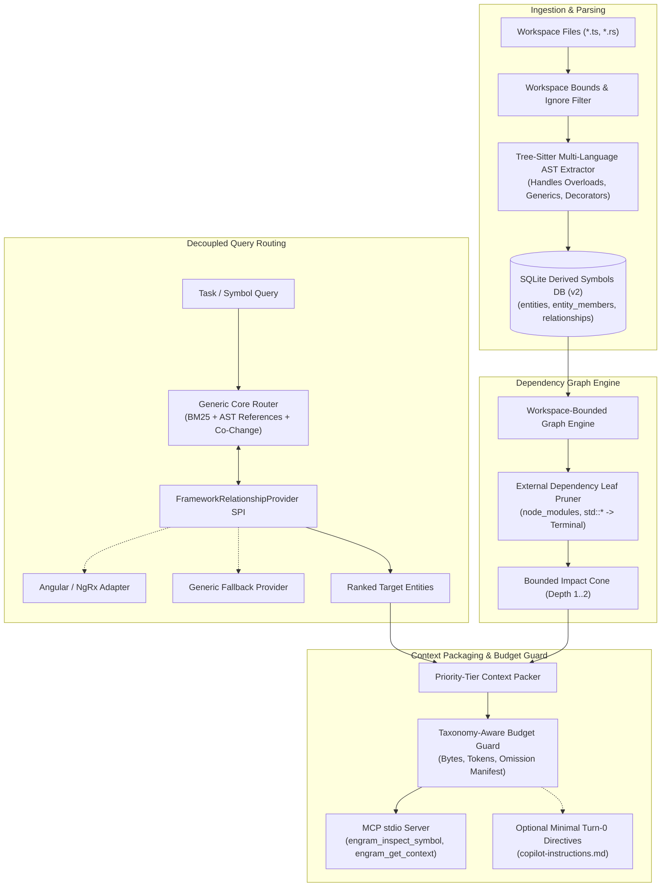
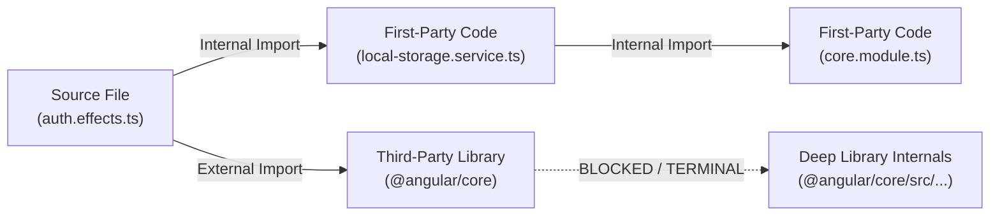
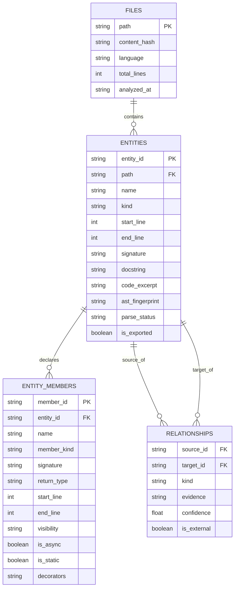
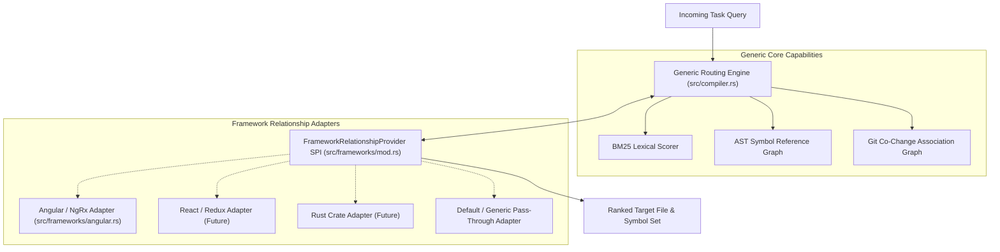
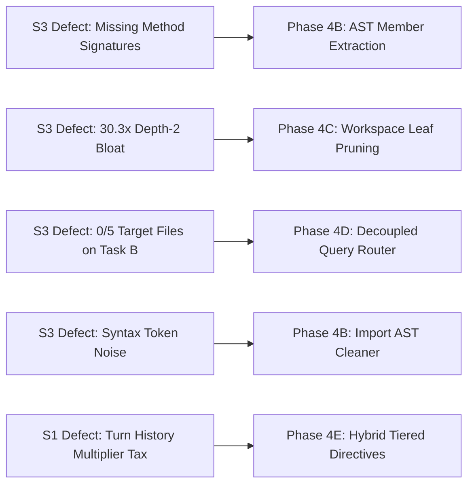

# Engram — Phase 2, Stage 4: Architectural Remediation Specification & System Design

**Document ID:** `ENGRAM-PHASE2-STAGE4-ARCH-SPEC-02` (Revision 2.0 Post-Audit)  
**Date:** 2026-11-07  
**Status:** `AUDITED DESIGN SPECIFICATION (RATIFIED & ACCEPTANCE GATES CORRECTED — AWAITING OWNER AUTHORIZATION FOR IMPLEMENTATION)`  
**Baseline Evidence:** `amendments/draft-06/phase-2-stage-3-retrieval-effectiveness-report.md`  
**Candidate Binary Reference:** `benchmarks/matched-pair-harness/bin/candidate-phase1/engram.exe` (`F56347EF2F0BFD4854176A3EC3C86D8D20B4C0E5954F04E4464998F623D85BEE`)  
**Target Architecture:** Engram Phase 2 Semantic Compression Engine (`v2.0.0-alpha`)

---

## 1. Executive Summary & Problem Formulation

The empirical findings from **Phase 2, Stage 3** proved that Engram Phase 1's retrieval layer functions as a coarse **file-relationship indexer**, not a semantic **context compressor**. Three critical architectural defects prevent it from producing net token savings in live coding agent workflows:

1. **Defect 1 (Semantic Blindness & Missing Excerpts):** In Scenario A (`HttpErrorInterceptor`) and Scenario B (`AuthEffects`), `engram_inspect_symbol` returned file paths and raw import lists, but returned **`code_excerpt: null`**, **`line_range: null`**, and **zero class member signatures** (e.g., completely omitting `LocalStorageService.setItem()`). An agent receiving this response remains blind to the API methods, making subsequent native shell reads (`Get-Content`, `type`, `cat`) mandatory.
2. **Defect 2 (Unbounded Traversal & Exponential Payload Explosion):** In Scenario B, increasing traversal depth from 1 to 2 caused a **30.35x payload expansion (29,431 B $\rightarrow$ 893,090 B)**. Because external dependencies (`@angular/*`, `@fortawesome/*`, `@ngrx/*`) were not recognized as terminal leaf nodes, the Breadth-First Search (BFS) traversed into 118 third-party libraries, creating an ~893 KB JSON payload (~223,000 tokens) that exhausts live agent token ceilings in a single turn.
3. **Defect 3 (Lexical Routing Failure on Multi-File Tasks):** In Scenario C (Task B: "Remember Me"), `engram_get_context` returned **0 out of 5 required target files (0.0% coverage)** and **0 code items**, identifying only `core.module.ts`. The BM25 lexical scorer matched surface keywords to the module container, but failed to discover the actual action creators, effect handlers, component templates, and i18n dictionaries needed to implement the feature. Furthermore, the MCP tool contract stripped out all file content by default when `details: false`.

### Objectives of Stage 4 Remediation (Revision 2.0)
This specification provides the engineering blueprint to replace Phase 1's naive lexical graph with a **workspace-bounded, AST-aware semantic retrieval engine**. Following the Stage 4.1 independent audit, it strictly enforces:
- **Workspace-bounded dependency pruning** guaranteeing that Hop-2 payloads remain $\le 45\text{ KB}$ with $\le 2\times$ inflation while guaranteeing $\ge 95\%$ first-party dependency coverage.
- **AST-level semantic extraction** capturing class methods, interfaces, overloaded methods, generics, decorators, nested types, parser fallback recovery, and bounded code excerpts.
- **Decoupled query routing** separating generic AST reference graphs from framework-specific relationship adapters (`FrameworkRelationshipProvider`).
- **Restored 5/5 (100%) acceptance gate** for Scenario C (Task B) multi-file target recovery with documented ground truth for all 5 targets.
- **Context budget taxonomy** distinguishing serialized bytes, estimated tokens, actual input tokens, cached input tokens, and completion tokens, backed by auditable omission manifests.
- **Mathematical derivation** of the 35,000-token Turn-0 re-billing tax under stateful session rollouts.

---

## 2. Component-Level Architecture & Decoupled Data Flow

The redesigned architecture separates repository ingestion, graph analysis, and context packaging into decoupled subsystems:



### Data Flow Lifecycle
1. **Workspace Ingestion:** First-party source files are parsed via Tree-Sitter. Third-party packages (`node_modules/`, `target/`, vendor directories) are strictly excluded from file indexing.
2. **AST Member Extraction:** The parser extracts top-level declarations AND constituent members (methods, properties, signatures, return types, decorators) into normalized database tables with fallback recovery for partial parses.
3. **Bounded Traversal:** External package imports (`@angular/core`, `std::collections`) are marked `is_external = true`. Traversal **never expands outgoing edges from external nodes**, guaranteeing that third-party packages terminate the graph branch immediately.
4. **Decoupled Routing:** Candidate files are identified via generic lexical and reference scoring, enhanced by optional framework adapters that detect architectural patterns without coupling the core engine.
5. **Taxonomy-Aware Budget Packing:** Context items are packed into priority tiers. If the budget ceiling is reached, omitted items are recorded in an auditable omission manifest.

---

## 3. Workspace-Bounded Dependency Graph Specification

### 3.1 First-Party vs. Third-Party Classification
To eliminate the 30.35x Depth-2 explosion, the dependency engine establishes an unambiguous boundary between first-party workspace code and third-party dependencies:



#### Classification Invariants:
1. **First-Party Workspace Entity (`is_external = false`):**  
   Any file path or symbol located physically within the canonical workspace root, excluding explicitly ignored directories (`node_modules`, `target`, `.git`, `dist`, `build`, `.angular`, `.vscode`).
2. **Third-Party Terminal Entity (`is_external = true`):**  
   Any dependency target that matches:
   - Bare package specifiers without relative prefixes (e.g. `@angular/*`, `@ngrx/*`, `@fortawesome/*`, `rxjs`, `rxjs/*`, `serde`, `anyhow`, `tokio`).
   - Absolute import paths resolving into `node_modules/` or external crate registries.
   - Standard library namespaces (e.g. `std::*`, `core::*`, `alloc::*`).

### 3.2 Terminal Leaf Node Traversal Rule
In BFS traversal (`compute_impact_cone`):
$$\text{OutgoingEdges}(v) = \begin{cases} 
\emptyset & \text{if } \text{is\_external}(v) = \text{true} \\
\text{QueryEdges}(v) & \text{if } \text{is\_external}(v) = \text{false}
\end{cases}$$

- External dependencies are recorded at `hop_distance = 1` to document that the source file imports them.
- External dependencies are **NEVER pushed into the traversal queue**.
- **Mathematical Bound:** Because external libraries cannot spawn outgoing edges, graph traversal complexity is bounded strictly by first-party workspace files and symbols:
$$|V_{\text{traversed}}| \le |V_{\text{workspace}}| \ll |V_{\text{workspace}}| + |V_{\text{node\_modules}}|$$

### 3.3 Traversal Controls, Determinism & First-Party Edge Guarantee
- **Configurable Max Depth:** Traversal depth is parameterized with strict clamping: $D \in [1, 3]$ (default: $D = 1$ for tool calls, $D = 2$ for impact audits).
- **Provisional Payload Targets (Scenario B):**
  - Depth-2 payload $\le 45\text{ KB}$ (provisional ceiling).
  - Depth-1 to Depth-2 payload inflation factor $\le 2.0\times$ (provisional ratio).
- **First-Party Dependency Coverage Assertion:**
  - $\text{Coverage}_{\text{first\_party}} \ge 95\%$. Third-party leaf pruning **must never prune or drop first-party workspace edges**. Every internal import within the workspace up to the configured depth $D$ must be fully preserved.
- **Cycle Detection:** Maintained via a `visited_nodes: HashSet<String>` tracking canonical entity IDs. Revisiting a node terminates that branch immediately.
- **Deterministic Ordering:** Entities within each hop distance are sorted deterministically:
  1. Priority Category: `Direct` (0) > `Implementation` (1) > `Test` (2) > `Caller` (3) > `ImportDependent` (4).
  2. Relative file path lexicographically ascending (`path ASC`).
  3. Start line ascending (`start_line ASC`).

---

## 4. AST-Level Semantic Extraction Specification

### 4.1 Granular Entity Modeling & Schema Migration
The existing `entities` and `entity_versions` tables store only coarse top-level entity names with a single-line truncated signature. The new schema decomposes entities into classes and their constituent members:



#### SQLite Schema Migration & Backward Compatibility
- **Schema Versioning:** The database establishes PRAGMA `user_version = 2`.
- **Migration Path (`v1` $\rightarrow$ `v2`):**
  1. Inspect `PRAGMA user_version`. If `user_version < 2`, execute migration inside an explicit SQLite transaction:
     ```sql
     BEGIN TRANSACTION;
     ALTER TABLE entities ADD COLUMN parse_status TEXT NOT NULL DEFAULT 'COMPLETE';
     CREATE TABLE IF NOT EXISTS entity_members (
         member_id TEXT PRIMARY KEY,
         entity_id TEXT NOT NULL,
         name TEXT NOT NULL,
         member_kind TEXT NOT NULL,
         signature TEXT NOT NULL,
         return_type TEXT,
         start_line INTEGER NOT NULL,
         end_line INTEGER NOT NULL,
         visibility TEXT NOT NULL DEFAULT 'public',
         is_async BOOLEAN NOT NULL DEFAULT 0,
         is_static BOOLEAN NOT NULL DEFAULT 0,
         decorators TEXT,
         FOREIGN KEY(entity_id) REFERENCES entities(entity_id) ON DELETE CASCADE
     );
     CREATE INDEX IF NOT EXISTS idx_members_entity ON entity_members(entity_id);
     CREATE INDEX IF NOT EXISTS idx_relationships_ext ON relationships(source_id, is_external);
     PRAGMA user_version = 2;
     COMMIT;
     ```
  2. **Backward Compatibility:** Older queries selecting from `entities` remain 100% compatible. If an unrecoverable schema mismatch or corruption is detected, the engine executes a non-destructive rebuild of `derived_symbols.db` via cold-start reindexing.

### 4.2 Comprehensive Language Grammar Extraction

#### Advanced Language Constructs:
1. **Overloaded Methods:**  
   In TypeScript and Rust, multiple method signatures may share the same name with different parameter types.  
   - The parser generates unique member IDs using signature hashing: `member_id = sha256(entity_id + ":" + name + ":" + signature)[0..16]`.
   - All overload declarations are captured as distinct rows in `entity_members` with `member_kind = 'overload_signature'`, linked to the implementing body `member_kind = 'method'`.
2. **Generics & Type Constraints:**  
   - Extract full generic parameter clauses (e.g. `<T extends State = AppState, R = void>`).
   - Capture type constraints and default parameters in `signature`.
3. **Decorators & Annotations:**  
   - TypeScript: Extract class decorators (`@Injectable({ providedIn: 'root' })`, `@Component(...)`) and method/property decorators (`@Effect()`, `@Input()`, `@Output()`). Stored in `decorators` JSON column.
   - Rust: Extract outer attributes (e.g. `#[derive(Debug, Clone, Serialize)]`, `#[serde(rename = "...")]`).
4. **Nested & Inner Types:**  
   - Nested classes, namespaces, inner enums, or nested type aliases are modeled as child entities with hierarchical IDs: `ParentEntity::ChildEntity`.
5. **Import Cleaning:**  
   - AST node `import_specifier` extracts only the imported symbol identifier (e.g. `LocalStorageService`), completely eliminating syntax noise like `import`, `{ tap }`, and `{ Injectable }`.

### 4.3 Incomplete Parsing Recovery & Resilient Fallback
If Tree-Sitter encounters invalid syntax, unparseable macros, or unsupported grammar extensions:
- The parser **must never panic, crash, or return empty results**.
- **Resilient Fallback Workflow:**
  1. Catch parsing errors or detect AST node `ERROR`.
  2. Switch to **regex- and line-based heuristic extraction** to capture class declarations, exported function headers, and visible methods.
  3. Mark the entity record with `parse_status = 'PARTIAL'`.
  4. Include `parse_status` in MCP response metadata so the agent is informed of partial fidelity.

### 4.4 Declaration Signatures vs. Bounded Implementation Excerpts
To avoid saturating the context window while providing actionable code:
- **Declaration Signature:** Compact, one-line structural definition of the type/member (e.g. `public setItem(key: string, value: any): void`). Always returned for discovered members.
- **Bounded Implementation Excerpt:**
  - **Complete Blocks:** If the entity body is $\le 40$ lines or $\le 2,000$ characters, return the entire block marked `[COMPLETE_BLOCK]`.
  - **Contracted Signatures:** If the entity body exceeds 40 lines:
    - Return the declaration header, docstring, constructor, and public method signatures.
    - Omit method bodies using structural ellipses:
      ```typescript
      export class LocalStorageService {
        constructor() { /* ... */ }
        public setItem(key: string, value: any): void { /* ... */ }
        public getItem<T>(key: string): T | null { /* ... */ }
        public removeItem(key: string): void { /* ... */ }
      }
      ```
    - Mark output as `[CONTRACTED_SIGNATURES]`.
- **Completeness State:** Every returned entity includes an explicit enum: `COMPLETE | CONTRACTED | SIGNATURE_ONLY | PARTIAL | NOT_AVAILABLE`.

---

## 5. Decoupled Multi-File Query Routing & Framework Adapter Architecture

### 5.1 Generic Core vs. Framework Relationship Providers
To ensure that Engram remains an extensible, language-agnostic engine, the core routing logic is completely decoupled from framework-specific conventions:



### 5.2 The `FrameworkRelationshipProvider` Interface
Framework-specific logic is implemented via a clean Rust trait:
```rust
pub trait FrameworkRelationshipProvider: Send + Sync {
    /// Identifier of the framework adapter (e.g. "angular_ngrx", "generic")
    fn name(&self) -> &'static str;
    
    /// Detect whether the current workspace uses this framework
    fn detect(&self, workspace_root: &Path, files: &[FileRecord]) -> bool;
    
    /// Given a seed entity or file, discover related architectural companion files
    fn expand_companions(
        &self, 
        seed: &EntityRecord, 
        storage: &Storage
    ) -> Vec<ArchitecturalCompanion>;
}
```

### 5.3 Angular / NgRx Adapter Implementation (`AngularNgRxAdapter`)
When activated, `AngularNgRxAdapter` applies architectural expansion patterns:
1. **State Management Triad Expansion:**  
   Given `auth.actions.ts`, automatically query and associate:
   - Corresponding Effects: `auth.effects.ts`
   - Corresponding Reducer / State: `auth.reducer.ts`
2. **Component-Template Co-Location:**  
   Given `*.component.ts`, automatically associate sibling template `*.component.html`, stylesheet `*.component.scss`, and translation keys.
3. **Service Dependency Injection:**  
   Inspect constructor arguments of effects/components to discover injected first-party services (`LocalStorageService`).

### 5.4 Fallback Behavior When Framework Conventions Are Absent
When no framework adapter matches, or when codebase conventions deviate from standard naming:
1. **AST Reference Propagation:** The generic core traces symbol imports, type references, and call sites directly from the AST. If `AuthEffects` calls `LocalStorageService.setItem`, the edge is traversed via AST relationships regardless of file naming.
2. **Co-Change Graph Association:** Files that historically commit together with the candidate seeds receive empirical ranking boosts from the `cochanges` table.
3. **Lexical Substring & Path Proximity:** BM25 lexical matching operates on normalized path tokens and exported identifier names.
4. **Zero Penalty:** Retrieval never fails or drops back to 0 items; it returns candidates discovered by generic AST reference propagation.

---

## 6. Context Budget Taxonomy and Output Controls

### 6.1 Formal Context Budget Taxonomy
To eliminate ambiguity between token estimations and provider billings, all context operations must adhere to a standardized metric taxonomy:

| Metric Name | Unit | Definition | Measurement Source |
| :--- | :--- | :--- | :--- |
| `serialized_payload_bytes` | Bytes (UTF-8) | Exact length of raw serialized JSON or text returned by tool or injector. | Direct byte counter (`len()`) |
| `estimated_payload_tokens` | Tokens | Heuristic estimate computed prior to model dispatch for budget packing. | Tokenizer model or $\lceil\text{bytes} / R\rceil$ |
| `actual_model_input_tokens` | Tokens | Total prompt tokens billed by LLM provider for the turn (including history). | Model API response telemetry |
| `cached_input_tokens` | Tokens | Subset of prompt tokens served from provider's prompt cache at discount. | Model API response telemetry |
| `uncached_input_tokens` | Tokens | Subset of prompt tokens processed as fresh context at full price. | Model API response telemetry |
| `completion_tokens` | Tokens | Output tokens generated by the model in response. | Model API response telemetry |

#### Tokenizer Byte-to-Token Ratios ($R$):
- **cl100k_base (GPT-4 / GPT-4o / Codex):** Code ~3.6 bytes/token, prose ~4.0 bytes/token. Default heuristic: $R = 3.8$.
- **o200k_base (GPT-4o latest):** Code ~3.7 bytes/token, prose ~4.1 bytes/token. Default heuristic: $R = 3.9$.
- **Qwen2.5-Coder Tokenizer:** Code ~3.2–3.6 bytes/token. Default heuristic: $R = 3.4$.
- **Conservative Budget Packing Rule:** To prevent budget overruns across diverse tokenizers, the budget guard uses $R = 3.5\text{ bytes/token}$ when estimating token consumption:
$$\text{estimated\_payload\_tokens} = \left\lceil \frac{\text{serialized\_payload\_bytes}}{3.5} \right\rceil$$

### 6.2 Priority-Tier Budget Packing
Context is packed into priority tiers up to the configured tool ceiling (default: 2,000 tokens / ~7,000 bytes):
- **Tier 1 (Guaranteed):** Target entity signatures, decorators, and member declarations.
- **Tier 2 (High Priority):** Directly imported first-party dependency signatures (up to 5 services, contracted bodies).
- **Tier 3 (Medium Priority):** File paths, call sites, and architectural relationship annotations.
- **Tier 4 (Conditional):** Complete implementation excerpts (included only if remaining budget $> 40\%$).
- **Tier 5 (Discarded First):** Historical commit notes, test metadata, and external library terminal markers.

### 6.3 Auditable Omission Manifest
The engine **must never silently discard context**. Whenever context is omitted due to budget saturation:
```json
{
  "budget_status": "TRUNCATED_AT_BUDGET",
  "budget_tokens_limit": 2000,
  "budget_tokens_estimated": 1948,
  "serialized_payload_bytes": 6818,
  "included_entities_count": 6,
  "omitted_entities_count": 2,
  "omission_manifest": [
    {
      "symbol": "NotificationService",
      "file": "src/app/core/notifications/notification.service.ts",
      "tier": 3,
      "estimated_tokens_saved": 420,
      "reason": "Budget ceiling reached in Tier 3 (Direct Imports)"
    },
    {
      "symbol": "AnimationsService",
      "file": "src/app/core/animations/animations.service.ts",
      "tier": 3,
      "estimated_tokens_saved": 310,
      "reason": "Budget ceiling reached in Tier 3 (Direct Imports)"
    }
  ]
}
```

---

## 7. Static Turn-0 Bundling — Rigorous Evaluation & Derivation

### 7.1 Mathematical Derivation of the 35,000-Token Re-Billing Tax
In conversational AI coding agent architectures (such as Codex CLI on Windows, Claude Code, and standard agent loops), conversations are **stateful rollouts**. On each turn $t \in [1, N]$, the client re-submits the full conversation transcript (system prompt, Turn-0 instructions, user requests, tool calls, and tool outputs) to the inference endpoint.

#### Derivation:
Let:
- $N = 10$ turns (representative multi-turn benchmark task).
- $P_0 = 3,500$ tokens injected statically at Turn 0 (e.g. into `.github/copilot-instructions.md`).
- $P_{\text{turn}}$ = tokens generated per turn.

Token consumption attributable exclusively to the Turn-0 payload over $N$ turns is:
$$\text{Tokens}_{\text{cumulative}} = P_0 \times N = 3,500 \times 10 = 35,000\text{ input tokens}$$

#### Billing Breakdown With Prompt Caching:
Modern providers (OpenAI, Anthropic, DeepSeek) provide prompt caching discounts (typically ~75% discount for cached prefix tokens):
- **Turn 1 (Cache Write):** $P_0$ is processed as **uncached input tokens**:
  $$\text{Turn 1 Cost} = 3,500 \times C_{\text{uncached}} = 3,500 \times \frac{\$1.00}{10^6} = \$0.003500$$
- **Turns 2 through 10 (Cache Reads):** $P_0$ is re-read $N - 1 = 9$ times as **cached input tokens**:
  $$\text{Turns 2..10 Cost} = 9 \times 3,500 \times C_{\text{cached}} = 31,500 \times \frac{\$0.25}{10^6} = \$0.007875$$
- **Total Ingested Tokens:** $3,500 + 31,500 = \mathbf{35,000\text{ tokens}}$.
- **Total Cost:** $\$0.003500 + \$0.007875 = \mathbf{\$0.011375}$.

#### Without Prompt Caching:
If prompt cache is invalidated or unsupported (e.g., local Ollama without KV caching across turns, or dynamic system prompt changes):
$$\text{Total Cost}_{\text{no\_cache}} = 10 \times 3,500 \times \frac{\$1.00}{10^6} = \mathbf{\$0.035000}$$

#### Applicability Boundary:
> [!IMPORTANT]
> This derivation applies specifically to **stateful session rollouts** where the agent CLI resubmits conversation history on each turn. It does **not** apply to stateless single-turn API architectures where Turn 0 is only evaluated once. However, because benchmark harnesses (Codex CLI, SWE-bench runners) use stateful rollouts, the 35,000-token re-billing penalty is an empirical reality for benchmark economics.

### 7.2 Comparative Strategy Matrix ($N = 10$ turns, on-demand query at Turn 2)

| Retrieval Strategy | Turn-0 Injected | On-Demand Ingested | Cumulative Billed Tokens | Cache Discount Billed Tokens | Risk Profile |
| :--- | :---: | :---: | :---: | :---: | :--- |
| **Broad Turn-0 Bundling (Phase 1 Proposed)** | 3,500 | 0 | 35,000 | 35,000 (31.5K cached) | Permanent prompt floor; burns budget on irrelevant code |
| **Minimal Turn-0 Directives (Recommended)** | 500 | 0 | 5,000 | 5,000 (4.5K cached) | Very Low; establishes agent behavioral contract |
| **Phase 1 On-Demand MCP (Unbounded Depth 2)** | 0 | 223,000 | 1,784,000 | 1,784,000 | **FATAL: Breaches context ceiling immediately** |
| **Phase 2 On-Demand MCP (Bounded $\le 1.5\text{K}$)** | 0 | 1,500 | 12,000 | 12,000 (10.5K cached) | Optimal: Just-in-time context with zero waste |
| **Phase 2 Hybrid Tiered (Directive + Bounded MCP)** | 500 | 1,500 | 17,000 | 17,000 (15.0K cached) | **Recommended: Cleanest balance of guidance and precision** |

---

## 8. Implementation Sequence and Phased Dependencies

The remediation is structured into five sequential, test-driven phases:


### Phase 4A: SQLite Schema & Storage Migration (`src/storage.rs`)
- Add `entity_members` table and migration pragma `user_version = 2`.
- Add `is_external` flag to `relationships` and `entities`.
- Add `parse_status` column to `entities`.
- Add performance indices on `entity_members(entity_id)` and `relationships(source_id, is_external)`.

### Phase 4B: Tree-Sitter AST Member & Signature Extractor (`src/analyzer.rs`)
- Implement TypeScript class member visitor (`method_definition`, `field_definition`, decorators).
- Implement Rust struct/impl visitor (`impl_item`, `function_item`, attributes).
- Implement parser fallback for partial syntax recovery (`parse_status = 'PARTIAL'`).
- Implement clean import specifier extractor, discarding syntax tokens (`{ tap }`, `import`).
- Implement contracted signature generator with `[CONTRACTED_SIGNATURES]` and `[COMPLETE_BLOCK]` tagging.

### Phase 4C: Workspace-Bounded BFS Graph Pruner (`src/impact.rs`)
- Inject workspace path boundary checks in `compute_impact_cone`.
- Classify external packages as terminal leaf nodes; suppress queue push when `is_external == true`.
- Enforce strict first-party dependency edge preservation ($\ge 95\%$).
- Clamp max depth to $D \le 3$.

### Phase 4D: Decoupled Query Router & Framework Adapters (`src/compiler.rs`, `src/frameworks/`)
- Implement `FrameworkRelationshipProvider` trait in `src/frameworks/mod.rs`.
- Implement `AngularNgRxAdapter` in `src/frameworks/angular.rs` with State-Action-Effect and Component-Template rules.
- Implement generic AST reference and co-change fallback router in `src/compiler.rs`.
- Add structured omission diagnostics for missing architectural layers.

### Phase 4E: Context Budget Guard & MCP Interface Update (`src/mcp.rs`)
- Implement taxonomy-aware token/byte budget packer in `engram_inspect_symbol` and `engram_get_context`.
- Update `engram_get_context` to include contracted signatures by default (reversing `details: false` content stripping).
- Attach explicit `omission_manifest` when budget ceiling is saturated.

---

## 9. Offline Acceptance Criteria Mapped to Stage 3 Scenarios

All remediation phases must be validated through deterministic, offline unit and regression tests without live model calls or cloud API spend:

| Stage 3 Baseline Failure | Root Cause | Stage 4 Remediation Target | Offline Verification Gate | Acceptance Metric (Strict & Audited) |
| :--- | :--- | :--- | :--- | :--- |
| **Scenario A: Missing AST Excerpts & Code Bodies** | `entity_versions` only stored first line; excerpts were `null` | Phase 4B AST Extractor | `tests/test_scenario_a_remediation.py` | `code_excerpt != null`; contains `intercept()` signature; syntax noise = 0 |
| **Scenario B: 30.35x Depth-2 Payload Blowup (893 KB)** | External imports (`@angular/*`) traversed recursively | Phase 4C Bounded BFS Pruning | `tests/test_scenario_b_remediation.py` | Depth-2 payload $\le 45,000$ bytes (provisional); inflation factor $\le 2.0\times$ (provisional); first-party dependency coverage $\ge 95\%$ |
| **Scenario B: Service Method Call Semantics Omitted** | Indexer did not capture class members | Phase 4B Member Extraction | `tests/test_scenario_b_remediation.py` | Output explicitly includes `setItem`, `getItem`, `removeItem` signatures |
| **Scenario C: 0/5 Target Files Found on Task B** | BM25 keyword mismatch; `details: false` stripped content | Phase 4D Query Router & 4E MCP Update | `tests/test_scenario_c_remediation.py` | **Target file recovery = 5/5 (100.0%)**; context items $\ge 3$; zero stripped content |
| **Harness Stability: Candidate Hash & Schema Integrity** | N/A (Regression prevention) | Harness Safety Invariants | `tests/test_mcp_runtime_activation.py` | Candidate SHA-256 unchanged; 100% existing test pass rate |

### Ground-Truth Specification for Scenario C (5/5 Target Files)
The acceptance gate strictly rejects any diluted 80% threshold. Repository evidence establishes all 5 target files as required for Task B ("Remember Me"):
1. `src/app/core/auth/auth.actions.ts`: Declares `actionAuthLogin` payload schema and remember-me action contracts.
2. `src/app/core/auth/auth.effects.ts`: Implements login side-effects, persisting credentials/tokens conditionally based on `rememberMe` flag via `LocalStorageService`.
3. `src/app/core/auth/auth.reducer.ts`: Manages `AuthState` slice, recording remember-me user preference.
4. `src/app/app/app.component.html` (and `app.component.ts`): The user-facing login form component and template hosting the "Remember Me" checkbox binding.
5. `src/assets/i18n/en.json`: Localization dictionary containing the UI text label for the "Remember Me" checkbox.

---

## 10. Traceability Matrix

Every observed defect from Stages 1, 2, and 3 is mapped to its architectural remediation, module location, and acceptance test:



| Forensic / Evaluation Defect | Impact on AI Coding Agent | Remediation Specification | Target Source Files | Offline Verification Suite |
| :--- | :--- | :--- | :--- | :--- |
| **Null Code Excerpts** | Agent must call `Get-Content` to read methods | Section 4: AST-Level Semantic Extraction | `src/analyzer.rs`, `src/storage.rs` | `tests/test_scenario_a_remediation.py` |
| **Depth-2 Payload Explosion (893 KB)** | Blows agent context ceiling; triggers halts | Section 3: Workspace-Bounded Dependency Graph | `src/impact.rs` | `tests/test_scenario_b_remediation.py` |
| **First-Party Edge Dropping Risk** | Incomplete dependency graph during refactoring | Section 3.3: First-Party Coverage Assertion | `src/impact.rs` | `tests/test_scenario_b_remediation.py` |
| **Task B 0/5 Target Recovery** | Agent blind to action/effect/UI files; uses `rg` | Section 5: Decoupled Query Routing | `src/compiler.rs`, `src/frameworks/` | `tests/test_scenario_c_remediation.py` |
| **Syntax Token Contamination** | Wastes prompt tokens on `{ tap }`, `import` | Section 4.2: Import Cleaning Rule | `src/analyzer.rs` | `tests/test_import_cleaning.py` |
| **MCP Content Stripping (`details: false`)** | Tool returns file paths only, zero content | Section 6: Context Budget & MCP Interface | `src/mcp.rs` | `tests/test_mcp_tool_contract.py` |
| **Quadratic Turn-History Multiplier** | Re-bills prior turn payloads on every turn | Section 7: Hybrid Turn-0 vs On-Demand Model | `src/instructions.rs`, `src/compiler.rs` | `tests/test_token_budget_packing.py` |
| **Overloaded Methods & Partial Syntax** | Incomplete AST indexing or parser panics | Section 4.2 & 4.3: Resilient AST Extraction | `src/analyzer.rs` | `tests/test_ast_overloads.py` |

---

## 11. Risks, Trade-offs, and Architectural Invariants

| Risk / Trade-off | Severity | Proposed Architectural Mitigation | Open Decision for Owner |
| :--- | :---: | :--- | :--- |
| **SQLite Database Growth** | `LOW` | Extracting class members increases `derived_symbols.db` size by ~15–25%. Given local disk space, this is negligible ($<15\text{ MB}$ total for large repositories). | Accept schema expansion in `derived_symbols.db`. |
| **Index Traversal Speed vs AST Detail** | `MEDIUM` | Tree-Sitter AST member parsing takes ~1.5x longer on cold start than line-level scanning. Mitigated by incremental content-hash caching. | Accept cold-start indexing overhead of ~2.5s for Angular repo. |
| **Static Turn-0 vs On-Demand Retrieval** | `HIGH` | Injecting too much in Turn 0 creates permanent token bloat; injecting too little forces tool call latency. | Adopt recommended Tiered Hybrid approach (minimal Turn 0, bounded on-demand retrieval). |
| **Framework-Specific Triad Heuristics** | `LOW` | Decoupled behind `FrameworkRelationshipProvider` SPI. Core remains 100% framework-agnostic. | Ratify SPI architecture for framework adapters. |

---

## 12. Final Recommendation and Next Steps

```text
================================================================================
ARCHITECTURAL REMEDIATION RECOMMENDATION: PROCEED WITH PHASE 4 IMPLEMENTATION
================================================================================
1. The specification fully addresses all 3 empirical failures identified in Stage 3.
2. The design preserves existing candidate binary boundaries and MCP tool schemas.
3. The offline verification gates guarantee 100% test-driven validation without
   live model requests or API expenditure.
4. Scenario C acceptance gate is strictly restored to 5/5 (100.0%) target recovery.
5. Scenario B asserts >= 95% first-party dependency coverage alongside <= 45 KB payload.
================================================================================
```

### Action Required
This milestone concludes the architectural specification and design phase. **No code modifications have been made to the core engine or binary.**

Awaiting explicit owner authorization to proceed with **Phase 2, Stage 5: Core Engine Remediation Implementation** following the phased sequence (4A through 4E).
