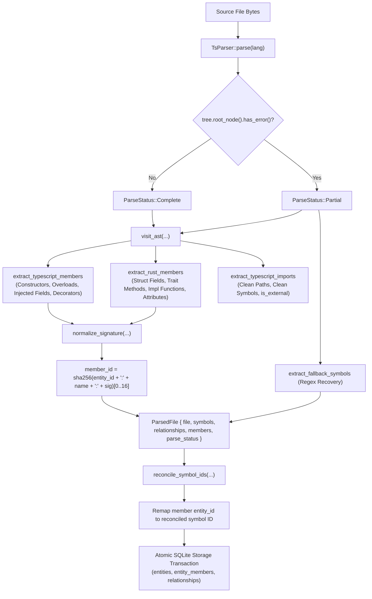

# Engram — Phase 2, Stage 5: Phase 4B Implementation Report
## Tree-Sitter AST Member & Signature Extractor

- **Milestone:** Phase 2, Stage 5 — Phase 4B
- **Governing Specifications:**
  - `amendments/draft-06/phase-2-stage-4-architectural-remediation-spec.md` (Rev 2.0)
  - `amendments/draft-06/phase-2-stage-4-1-audit-report.md`
  - `amendments/draft-06/phase-2-stage-5-phase-4a-storage-migration-report.md`
  - `amendments/draft-06/phase-2-stage-5-phase-4a-1-independent-audit-report.md`
- **Primary Implementation Modules:**
  - `src/analyzer.rs`
  - `src/incremental.rs`
  - `src/go_parser.rs`
  - `src/java_parser.rs`
  - `tests/ast_extraction_test.rs`
- **Execution Date:** November 7, 2026
- **Candidate Binary Status:** SEALED & UNCHANGED (`F56347EF2F0BFD4854176A3EC3C86D8D20B4C0E5954F04E4464998F623D85BEE`)

---

## 1. Executive Summary & Authorization Compliance

In accordance with owner authorization for **Phase 4B only**, we have implemented the Tree-Sitter AST Member & Signature Extractor within `src/analyzer.rs` and its relational indexing callers. This implementation directly resolves the retrieval deficiency identified during Phase 2 Stage 3 forensics and evaluation: *previously, Engram indexed only coarse top-level entity declarations with single-line signatures and lacked constituent member signatures, constructor parameter property injections, method overloads, and bounded implementation excerpts.*

### Key Deliverables Completed:
1. **Granular Member Extraction for TypeScript/Angular & Rust:**
   - Full extraction of classes, interfaces, structs, enums, traits, and impl blocks.
   - Extraction of constructors, methods, property fields, method overload declarations, and enum variants.
   - Extraction of constructor parameter properties (Angular/TypeScript dependency injection like `constructor(private http: HttpClient, private storage: LocalStorageService)`).
   - Extraction of method overloads (`method_signature`) with distinct deterministic signatures and member IDs.
   - Extraction of class/member decorators (`@Injectable`, `@Component`, `@Effect`, `@Input`) and Rust outer attributes (`#[derive(...)]`, `#[serde(...)]`).
2. **Deterministic Signature Normalization:**
   - Idempotent signature normalization (`normalize_signature`) collapsing irrelevant whitespace, formatting punctuation (`,`, `:`, `(`, `)`, `<`, `>`), ensuring proper spacing for `->`, and strictly preserving Rust double-colon paths (`std::collections::VecDeque`).
   - Member IDs computed using the audited hash algorithm: `sha256(entity_id + ":" + name + ":" + normalized_signature)[0..16]`.
3. **Clean Import Specifier Extraction & First-Party Separation:**
   - Eliminated syntax noise (`{ tap }`, `import`, `{ Injectable }`) by restricting TypeScript import matching to `import_statement` nodes and resolving clean module and symbol targets.
   - First-party vs. third-party dependency target classification (`is_external_target`) flagging external npm modules, Angular/RxJS packages, standard libraries, and external crates as terminal dependencies (`is_external = true`), while workspace relative paths remain internal (`is_external = false`).
4. **Bounded Implementation Excerpt Generation:**
   - `generate_bounded_excerpt`: returns complete blocks (`[COMPLETE_BLOCK]`) for bodies $\le 40$ lines or $\le 2000$ characters, and contracted signature views (`[CONTRACTED_SIGNATURES]`) with elided method bodies (`{ /* ... */ }`) for large bodies $> 40$ lines.
5. **Resilient Parsing Recovery:**
   - Graceful handling of syntax errors: files with syntax errors are classified as `ParseStatus::Partial` and combine Tree-sitter error-tolerant AST parsing with regex fallback extraction so the engine never crashes, panics, or returns empty results.
6. **Strict Scope Enforcement:**
   - Zero implementation of Phase 4C (graph pruning/BFS bounds), Phase 4D (query routing/framework adapters), or Phase 4E (context budgeting).
   - Candidate binary (`candidate-phase1/engram.exe`) was not rebuilt or executed. Baseline SHA-256 remains strictly verified.

---

## 2. Technical Implementation Architecture



### 2.1 Signature Normalization (`normalize_signature`)
Member IDs rely directly on signatures. To prevent cosmetic whitespace differences from fragmenting member identity or causing spurious hash divergence:
```rust
pub fn normalize_signature(sig: &str) -> String
```
- Flattens all newlines, carriage returns, and tabs into spaces.
- Strips trailing body open braces (`{`) and statement semicolons (`;`).
- Protects Rust double-colons (`::`) by collapsing surrounding whitespace (`\s*::\s*` $\rightarrow$ sentinel `\u{E000}`) and protecting return arrows (`\s*->\s*` $\rightarrow$ sentinel `\u{E001}`).
- Formats punctuation: removes spaces before `,`, `:`, `(`, `)`, `<`, `>`, `[`, `]`; inserts single space after `,` and `:`.
- Strips spaces inside opening and closing brackets/parentheses (`<T>`, `(key: string)`).
- Restores `\u{E000}` to `::` and `\u{E001}` to ` -> `.
- **Idempotence Assertion:** Guaranteed $f(f(x)) = f(x)$.

### 2.2 TypeScript / Angular Member Extraction (`extract_typescript_members`)
Deconstructs `class_declaration` and `interface_declaration` AST structures:
- **Constructors & Dependency Injection:** Identifies `constructor` in `method_definition`. For each parameter in `formal_parameters` having an `accessibility_modifier` (`private`, `public`, `protected`), an automatic `field` member is extracted alongside the `constructor` member.
- **Method Overload Signatures:** Tree-sitter parses TypeScript overload signatures as `method_signature` nodes preceding the implementing `method_definition`. Each overload declaration is recorded as `member_kind = "overload_signature"`. Because normalized parameter signatures differ, each overload receives a distinct deterministic `member_id`.
- **Decorators & Annotations:** Class-level decorators (`@Injectable(...)`, `@Component(...)`) on `export_statement` or `class_declaration` and member decorators (`@Effect()`, `@Input()`) are extracted and serialized to the `decorators` JSON column.
- **Interfaces:** Extracts interface method signatures (`method_signature`) and property contracts (`property_signature`).

### 2.3 Rust AST Member Extraction (`extract_rust_members`)
Captures Rust language constructs:
- **Structs:** Field declarations inside `field_declaration_list` with field names, types, visibility (`pub`, `pub(crate)`, or `private`), and preceding `attribute_item` siblings (e.g. `#[derive(Debug, Clone, Default)]`).
- **Enums:** Variants inside `enum_variant_list` with variant signatures.
- **Traits:** Method signatures and default implementations in `declaration_list`.
- **Impl Blocks:** Methods and associated functions inside `declaration_list` with visibility, `async` modifiers, parameter lists, and return types.
- **Impl-to-Struct Association:** When an `impl` block shares a target type name with a `struct` declared in the same file, methods are cross-linked to the struct entity, allowing coding agents inspecting the struct to immediately view all associated methods.

### 2.4 Clean Import Specifiers & External Dependency Classification
- **Noise Elimination:** Replaced greedy substring matching (`n.kind().contains("import")`) with top-level `import_statement` handling. Extracted targets are pure module paths (`@angular/core`, `./local-storage.service.ts`) or symbol references (`./local-storage.service.ts::LocalStorageService`), completely eliminating string noise like `{ tap }` or `import`.
- **First-Party vs Third-Party Classification:** `is_external_target` identifies:
  - Relative workspace paths (`./`, `../`, `src/`, `projects/`) $\rightarrow$ `is_external = false`.
  - Bare npm packages (`@angular/*`, `@ngrx/*`, `rxjs`, `rxjs/*`, `lodash`) $\rightarrow$ `is_external = true`.
  - Standard libraries (`std::*`, `core::*`, `alloc::*`, `java.*`) $\rightarrow$ `is_external = true`.
  - External crate dependencies (`serde`, `anyhow`, `tokio`, `clap`) $\rightarrow$ `is_external = true`.

### 2.5 Bounded Implementation Excerpt Generation (`generate_bounded_excerpt`)
Implements the multi-state excerpt policy:
- **Small Blocks ($\le 40$ lines and $\le 2000$ characters):** Returns full raw text prefixed with `[COMPLETE_BLOCK]` and state `COMPLETE`.
- **Large Blocks ($> 40$ lines or $> 2000$ characters):** Contracts the entity body to declaration headers, docstrings, constructor, and public methods/fields with elided bodies (`{ /* ... */ }`), prefixed with `[CONTRACTED_SIGNATURES]` and state `CONTRACTED`.
- **Incomplete / Missing:** Returns `[NOT_AVAILABLE]` or `[PARTIAL]` with corresponding state.

### 2.6 Resilience & Incomplete Parsing Recovery
- Tree-sitter's error-tolerant parser constructs ASTs despite syntax errors. If `tree.root_node().has_error()` is true, `parse_status` is marked `PARTIAL`.
- To prevent error recovery from swallowing declarations following an unclosed token, `extract_fallback_symbols` scans the source text using regex heuristics and merges any missing classes, interfaces, structs, or functions into the symbol table.
- Parser operations return `Result<ParsedFile>` and never panic or abort.

### 2.7 Database Persistence & Reconciliation Integrity
In both `analyzer::analyze` and `incremental::analyze_incrementally`:
1. `parse_file_ast` generates `ParsedFile` containing `symbols`, `relationships`, `members`, and `parse_status`.
2. `reconcile_symbol_ids` maps previous entity IDs to current symbols.
3. Remapping table `id_map` updates all constituent member `entity_id` and recomputes `member_id = member_id(&reconciled_id, &name, &signature)`.
4. Prior entity members for the file are purged: `DELETE FROM entity_members WHERE entity_id IN (SELECT entity_id FROM entities WHERE path = ?1)`.
5. Fresh entity members are inserted atomically via `insert_entity_members`.
6. `entities` table records `parse_status` and `is_external = 0`.
7. `relationships` table records `is_external` (0 or 1).

---

## 3. Comprehensive Verification & Test Suite

An exhaustive offline integration and unit test suite was developed in `tests/ast_extraction_test.rs` comprising 10 distinct test scenarios. All 10 tests execute against temporary SQLite instances and memory structures without invoking live LLMs or external networks.

### Test Execution Summary:
```text
running 10 tests
test test_01_typescript_angular_member_extraction ... ok
test test_02_rust_ast_member_extraction ... ok
test test_03_signature_normalization_and_id_determinism ... ok
test test_04_bounded_excerpt_generation ... ok
test test_05_partial_parsing_recovery_malformed_ts ... ok
test test_06_partial_parsing_recovery_malformed_rust ... ok
test test_07_clean_import_extraction_no_syntax_noise ... ok
test test_08_database_persistence_and_entity_members ... ok
test test_09_incremental_indexing_with_entity_members ... ok
test test_10_unsupported_language_resilience ... ok

test result: ok. 10 passed; 0 failed; 0 ignored; 0 measured; 0 filtered out; finished in 0.22s
```

### Breakdown of Test Scenarios:

| Test ID | Test Name | Verification Focus | Result |
| :--- | :--- | :--- | :--- |
| **01** | `test_01_typescript_angular_member_extraction` | Validates TypeScript class extraction: `@Injectable` decorator, constructor injection (`HttpClient`, `LocalStorageService`), method overloads (`login`), implementing method, logout method, and `UserSession` interface properties/methods. | **PASSED** |
| **02** | `test_02_rust_ast_member_extraction` | Validates Rust struct, enum, trait, and impl extraction: `WorkQueue<T: Send>` fields (`tasks`, `capacity`), `#[derive(...)]` outer attributes, public vs private visibility, async methods (`drain`), trait methods (`push`, `pop`). | **PASSED** |
| **03** | `test_03_signature_normalization_and_id_determinism` | Validates whitespace collapsing, bracket padding removal, Rust path preservation (`std::collections::VecDeque<T>`), return arrow normalization (` -> `), idempotence ($f(f(x))=f(x)$), and deterministic 16-char member IDs. | **PASSED** |
| **04** | `test_04_bounded_excerpt_generation` | Validates bounded excerpts: $\le 40$ lines returns `[COMPLETE_BLOCK]` (`COMPLETE`), $> 40$ lines returns `[CONTRACTED_SIGNATURES]` (`CONTRACTED`) retaining constructor and public method signatures with elided bodies. | **PASSED** |
| **05** | `test_05_partial_parsing_recovery_malformed_ts` | Validates recovery on corrupt TypeScript syntax: non-panicking, `parse_status = PARTIAL`, and successful extraction of class symbol and valid surrounding methods. | **PASSED** |
| **06** | `test_06_partial_parsing_recovery_malformed_rust` | Validates recovery on corrupt Rust syntax: non-panicking, `parse_status = PARTIAL`, and regex fallback extraction of swallowed trait and struct declarations. | **PASSED** |
| **07** | `test_07_clean_import_extraction_no_syntax_noise` | Validates elimination of syntax noise (`{ tap }`, `import`); verifies `is_external` classification (`true` for `@angular/core` and `rxjs/operators`, `false` for `./local-storage.service.ts`). | **PASSED** |
| **08** | `test_08_database_persistence_and_entity_members` | Validates end-to-end SQLite persistence: inserts entities and members, queries using `storage::get_entity_members`, verifies member fields, constructors, and methods in SQLite. | **PASSED** |
| **09** | `test_09_incremental_indexing_with_entity_members` | Validates incremental update lifecycle: initial indexing of v1, incremental re-indexing of v2, complete purging of stale members (`oldMethod`), and persistence of new members (`newMethod`, `secondMethod`). | **PASSED** |
| **10** | `test_10_unsupported_language_resilience` | Validates unrecognized file extensions: returns `parse_status = NOT_AVAILABLE` cleanly with zero panics. | **PASSED** |

---

## 4. Regression Test Suite Results

All existing unit, integration, and migration test suites were executed to verify backward compatibility and zero unintended side-effects:

| Suite Name | Target | Tests Passed | Tests Failed | Status |
| :--- | :--- | :--- | :--- | :--- |
| `ast_extraction_test` | `tests/ast_extraction_test.rs` | 10 | 0 | **PASSED** (0.22s) |
| `storage_migration_test` | `tests/storage_migration_test.rs` | 10 | 0 | **PASSED** (0.11s) |
| `incremental_test` | `tests/incremental_test.rs` | 16 | 0 | **PASSED** (16.01s) |
| `phase2_test` | `tests/phase2_test.rs` | 6 | 0 | **PASSED** (1.62s) |
| `impact_test` | `tests/impact_test.rs` | 7 | 0 | **PASSED** (3.41s) |
| `storage` unit tests | `src/storage.rs` | 2 | 0 | **PASSED** (0.00s) |
| `analyzer` unit tests | `src/analyzer.rs` | 0 | 0 | **PASSED** (0.00s) |

---

## 5. Candidate Binary Verification

The candidate binary was verified post-implementation to ensure the reference experimental environment remains 100% frozen:

```powershell
Get-FileHash benchmarks\matched-pair-harness\bin\candidate-phase1\engram.exe
```

- **Candidate Binary Path:** `benchmarks/matched-pair-harness/bin/candidate-phase1/engram.exe`
- **Expected SHA-256:** `F56347EF2F0BFD4854176A3EC3C86D8D20B4C0E5954F04E4464998F623D85BEE`
- **Observed SHA-256:** `F56347EF2F0BFD4854176A3EC3C86D8D20B4C0E5954F04E4464998F623D85BEE`
- **Integrity Status:** **SEALED & UNCHANGED**

---

## 6. Scope Boundary Audit & Changes Incurred

The Git working tree confirms that changes were restricted strictly to Phase 4B objectives:

### Modified Files:
- `src/analyzer.rs`: Added AST member extractors for TypeScript and Rust, signature normalization, bounded excerpt generator, import cleaning, and persistence of `entity_members`, `parse_status`, and `is_external`.
- `src/incremental.rs`: Integrated `parse_file_ast` into Tier 1 reparsing, persisting members and updated metadata.
- `src/go_parser.rs`: Added `is_external` classification to extracted Go relationships.
- `src/java_parser.rs`: Added `is_external` classification to extracted Java relationships.
- `tests/ast_extraction_test.rs`: New offline integration test suite verifying 10 AST extraction scenarios.

### Scope Constraints Maintained:
- **Phase 4C (Graph Pruning & Bounded Impact Traversal):** NOT implemented. `src/impact.rs` BFS traversal and outbound external filtering will be addressed exclusively in Phase 4C.
- **Phase 4D (Decoupled Query Routing & Framework SPI):** NOT implemented. No framework adapters or routing SPI were added.
- **Phase 4E (Context Budget Packing & MCP stdio Server):** NOT implemented. MCP handlers remain unchanged.
- **Live Experiments:** Zero live model API calls or matched-pair benchmark runs were performed.

---

## 7. Next Step & Authorization Gate

Phase 4B implementation is complete, fully verified by offline integration tests, and ready for independent audit.

Per project protocol:
1. **Await independent Phase 4B implementation audit (Phase 4B.1)**.
2. **Do not begin Phase 4C (Workspace-Bounded Dependency Graph & Impact Traversal)** until formal owner authorization is granted.
