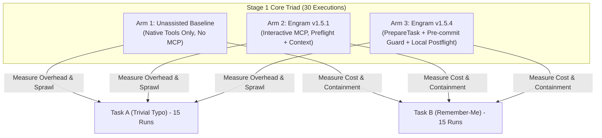

# Amendment 02: Stage 1 Core Triad Benchmark Protocol

**Document Version:** 2.0.0  
**Status:** DRAFT PILOT SPECIFICATION (PRE-EXECUTION REVIEW)  
**Parent Specification:** [`benchmarks/cost-baseline/PREREGISTRATION.md`](file:///C:/Users/Amal%20P%20S/OneDrive/Projects/Engram/benchmarks/cost-baseline/PREREGISTRATION.md)  
**Roadmap Reference:** [`docs/competitive_differentiation_roadmap.md`](file:///C:/Users/Amal%20P%20S/OneDrive/Projects/Engram/docs/competitive_differentiation_roadmap.md) Section 6  
**Target Golden Repository:** `angular-ngrx-material-starter` (Commit `1c2856086f3a08e3ab1c3b8573eb3ff22ff20fd2`)  
**Execution Scope:** 30 Total Executions (3 Arms × 2 Tasks × 5 Matched Blocks)

---

## 1. Executive Summary & Purpose

This amendment formally operationalizes the **Stage 1 Core Triad** benchmark protocol defined in Section 6 of the authoritative differentiation roadmap. It extends the original two-arm pilot (`cost-baseline/PREREGISTRATION.md`) to a three-arm matched-block design to evaluate the progressive efficiency impact of:
1. Native baseline agent exploration (Arm 1).
2. First-generation interactive MCP tooling (Arm 2: Engram v1.5.1).
3. Modern efficiency-first consolidated tooling with Turn-0 context injection, pre-commit Change Contract gating, and deterministic local postflight (Arm 3: Engram v1.5.4).

---

## 2. Experimental Arm Definitions

### Arm 1: Unassisted Baseline (Control A)
- **Agent:** GitHub Copilot in VS Code / Headless Agent Runner.
- **Model:** `Claude 3.5 Sonnet` / `GPT-5.6` (strictly identical across all arms).
- **Engram Status:** **DISABLED**.
- **PATH Isolation:** Child process `PATH` is sanitized to strip any directory containing `engram`.
- **MCP Server:** None (`mcp_servers` configuration omitted).
- **Available Tools:** Native agent tools only (`read_file`, `replace_string_in_file`, `run_in_terminal`, `grep_search`, `find_files`).
- **Context Injection:** None.
- **Postflight / Gating:** None (agent self-terminates when it believes task is done).

### Arm 2: Engram v1.5.1 Workflow (Legacy Treatment B)
- **Agent:** GitHub Copilot in VS Code / Headless Agent Runner.
- **Model:** Identical to Arm 1.
- **Engram Binary:** `benchmarks/matched-pair-harness/bin/v1.5.1/engram.exe`  
  *SHA-256:* `474a1a7aafbb5a5b52418aa51a978a58aeae4a177c62ec17c526e165610f44e0`
- **MCP Response Mode:** Compact by default (`details: false`, payload size $\sim 700\text{--}900$ bytes).
- **Available Tools:** Native agent tools + interactive Engram MCP tools (`engram_get_context`, `engram_preflight`, `engram_postflight`).
- **Context Injection:** None (requires agent to proactively call MCP tools in conversational turns).
- **Workflow:** 2–3 sequential round-trips (`get_context` $\rightarrow$ `preflight` $\rightarrow$ edit $\rightarrow$ `postflight`).

### Arm 3: Engram v1.5.4 Efficiency-First Workflow (Optimized Treatment C)
- **Agent:** GitHub Copilot in VS Code / Headless Agent Runner.
- **Model:** Identical to Arm 1 and Arm 2.
- **Engram Binary:** `benchmarks/matched-pair-harness/bin/v1.5.4/engram.exe`  
  *SHA-256:* `cf807eacdeb36dc972019838edeeb2fa5e8be25f6c3926fc662189fa9430a798`
- **MCP Response Mode:** Compact by default (`details: false`).
- **Available Tools:** Native agent tools + consolidated `engram_prepare_task`, deterministic `engram_postflight`, and `engram guard` CLI.
- **Context Policy & Optimization:**
  - **Single-Shot Handshake:** `engram_prepare_task` executes atomic context compilation, preflight boundary check, and Change Contract locking in a single turn.
  - **Adaptive Small-Task Bypass:** On trivial single-line changes (Task A), auto-returns `BYPASS_TRIVIAL`, eliminating Change Contract locking overhead.
  - **Asynchronous Guard & Local Postflight:** Pre-commit hook enforces contract boundaries and constitution rules locally with 0 LLM tokens.

---

## 3. Tasks & Acceptance Standards

| Task Identifier | Category | Allowed Files | Automated Acceptance Script | Target Casing / Feature Requirement |
|---|---|---|---|---|
| **Task A** | Trivial Single-File Configuration | `projects/angular-ngrx-material-starter/src/environments/environment.ts` | `scripts/verify_task_a.ps1` | `appName: 'Angular NgRx Material Starter'`; exactly 1 file modified; TypeScript builds pass |
| **Task B** | Multi-File Architectural Feature | Auth core modules, `app.component`, `en.json` | `scripts/verify_task_b.ps1` | Remember-me toggle persisted in local storage; zero password/JWT persistence; unit tests pass; 0 forbidden file edits |

---

## 4. Run Matrix & Counterbalanced Randomization Schedule

To eliminate order-of-execution bias, server-side prompt cache contamination, and time-of-day drift, the 5 repetitions of each task are assigned via a **Balanced Latin-Square Order**:

| Block ID | Task ID | Execution Order (Arms) | Seed | Sandbox Prefix |
|:---:|:---:|:---:|:---:|:---:|
| **Block 01** | `task_a` | Arm 1 (Baseline) $\rightarrow$ Arm 2 (v1.5.1) $\rightarrow$ Arm 3 (v1.5.4) | `2026102801` | `triad_task_a_b01` |
| **Block 02** | `task_a` | Arm 2 (v1.5.1) $\rightarrow$ Arm 3 (v1.5.4) $\rightarrow$ Arm 1 (Baseline) | `2026102802` | `triad_task_a_b02` |
| **Block 03** | `task_a` | Arm 3 (v1.5.4) $\rightarrow$ Arm 1 (Baseline) $\rightarrow$ Arm 2 (v1.5.1) | `2026102803` | `triad_task_a_b03` |
| **Block 04** | `task_a` | Arm 1 (Baseline) $\rightarrow$ Arm 3 (v1.5.4) $\rightarrow$ Arm 2 (v1.5.1) | `2026102804` | `triad_task_a_b04` |
| **Block 05** | `task_a` | Arm 2 (v1.5.1) $\rightarrow$ Arm 1 (Baseline) $\rightarrow$ Arm 3 (v1.5.4) | `2026102805` | `triad_task_a_b05` |
| **Block 06** | `task_b` | Arm 1 (Baseline) $\rightarrow$ Arm 2 (v1.5.1) $\rightarrow$ Arm 3 (v1.5.4) | `2026102806` | `triad_task_b_b06` |
| **Block 07** | `task_b` | Arm 2 (v1.5.1) $\rightarrow$ Arm 3 (v1.5.4) $\rightarrow$ Arm 1 (Baseline) | `2026102807` | `triad_task_b_b07` |
| **Block 08** | `task_b` | Arm 3 (v1.5.4) $\rightarrow$ Arm 1 (Baseline) $\rightarrow$ Arm 2 (v1.5.1) | `2026102808` | `triad_task_b_b08` |
| **Block 09** | `task_b` | Arm 1 (Baseline) $\rightarrow$ Arm 3 (v1.5.4) $\rightarrow$ Arm 2 (v1.5.1) | `2026102809` | `triad_task_b_b09` |
| **Block 10** | `task_b` | Arm 2 (v1.5.1) $\rightarrow$ Arm 1 (Baseline) $\rightarrow$ Arm 3 (v1.5.4) | `2026102810` | `triad_task_b_b10` |

**Total Executions:** 10 blocks $\times$ 3 arms = **30 individual runs**.

---

## 5. Metrics Taxonomy & Authoritative Measurement Sources

| Metric Name | Authoritative Source | Unit | Category | Scientific Handling |
|---|---|:---:|:---:|---|
| **Quality-Adjusted Cost ($QAC$)** | Calculated ($\text{Total Tokens} / C$) | Tokens | **Primary** | Predeclared primary evaluation metric. |
| **Total Model Tokens** | Provider Rollout JSONL (`.codex/sessions`) | Tokens | **Measured** | Authoritative sum of input and completion tokens. |
| **Prompt Tokens (Total / Cached)** | Provider Rollout JSONL | Tokens | **Measured** | Cached input tracked with inference flags (`prompt_tokens_cached_inferred`). |
| **Completion & Reasoning Tokens** | Provider Rollout JSONL | Tokens | **Measured** | Generation and reasoning tokens. Never double-counted. |
| **Conversational Turns ($T$)** | Event Stream / Transcript | Turns | **Measured** | Agent-environment interactive round-trips. |
| **Tool Invocations** | Event Stream (`events.jsonl`) | Calls | **Measured** | Breakdown: Engram calls vs file edits vs terminal test runs. |
| **MCP Payload Bytes** | Event Stream (`events.jsonl`) | Bytes | **Measured** | Exact JSON-RPC request and response payload bytes. |
| **Blast Radius (Files Changed)** | `git status --short` in sandbox | Files | **Measured** | Count of files modified/added in disposable worktree. |
| **Correctness Score ($C$)** | Automated acceptance evaluation | $[0.0, 1.0]$ | **Measured** | Full acceptance requires $C = 1.0$ and exit code 0 on all gates. |
| **Elapsed Wall-Clock Time** | System High-Resolution Clock | Seconds | **Measured** | Total time from initialization to completion. |

---

## 6. Statistical Analysis Plan

1. **Predeclared Primary Outcome:**  
   $$\Delta QAC_{\text{Arm3 vs Arm1}} = QAC_{\text{Arm1}} - QAC_{\text{Arm3}}$$  
   $$\Delta QAC_{\text{Arm3 vs Arm2}} = QAC_{\text{Arm2}} - QAC_{\text{Arm3}}$$
2. **Acceptance Invariant:**  
   If an arm achieves $C < 1.0$, its token savings claims are strictly **INVALIDATED** (`INVALIDATED_BY_ACCEPTANCE_FAILURE`). Token savings are only reported between mutually accepted runs ($C = 1.0$).
3. **Hypothesis Testing:**  
   - Non-parametric **Friedman Test** across the 3 arms within matched blocks.
   - Post-hoc **Wilcoxon Signed-Rank Tests** for pairwise comparisons with Bonferroni-Holm family-wise error control ($\alpha = 0.05$).
4. **Estimation & Confidence Intervals:**  
   Report median, mean, standard deviation, and 95% Confidence Intervals via non-parametric bootstrapping ($B = 10,000$ iterations).
5. **Small-Task Overhead Limit:**  
   For Task A, Arm 3 must demonstrate $\le 15\%$ wall-clock overhead and $\le 1$ additional turn relative to Arm 1 (enforced by adaptive small-task bypass).

---

## 7. Quality Gates (Rejecting Harmful Token Cuts)

1. **Zero Context Starvation:** Context filtering must never omit files required for compilation or test resolution.
2. **Zero Test Elimination:** Optimizations that bypass unit tests or suppress linter errors fail acceptance immediately.
3. **Zero Security & Safety Bypasses:** Constitution rules and forbidden directories remain 100% active.
4. **No Stale Invalidation:** Invalidation rules remain authoritative (`SHA-256` content hash beats `mtime`).
5. **Traceability:** Every tool invocation and telemetry event produces an append-only audit trail in the run vault.
