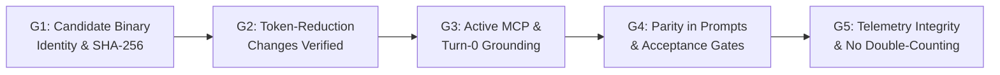

# Amendment 04: Stage 1 Task B Benchmark Protocol Revision

**Document Identifier:** `AMENDMENT_04_STAGE1_TOKEN_EFFICIENCY_PROTOCOL_REVISION`  
**Document Version:** `4.1.0-RATIFIED` (Formally Adopted Specification)  
**Ratification Date:** October 29, 2026  
**Status:** **RATIFIED — FORMALLY ADOPTED BY USER**  
**Parent Specification:** [`benchmarks/cost-baseline/PREREGISTRATION.md`](file:///C:/Users/Amal%20P%20S/OneDrive/Projects/Engram/benchmarks/cost-baseline/PREREGISTRATION.md) (SHA-256: `db3ab2956a4da40aad8f1f376aa72a50bebc96f3e1ecc3120f405f0a294ea8bb`)  
**Preceding Protocol Amendments:**  
- [`benchmarks/AMENDMENT_02_STAGE1_CORE_TRIAD.md`](file:///C:/Users/Amal%20P%20S/OneDrive/Projects/Engram/benchmarks/AMENDMENT_02_STAGE1_CORE_TRIAD.md)  
- [`benchmarks/AMENDMENT_03_TASK_B_OPERATIONAL_CEILING_CALIBRATION.md`](file:///C:/Users/Amal%20P%20S/OneDrive/Projects/Engram/benchmarks/AMENDMENT_03_TASK_B_OPERATIONAL_CEILING_CALIBRATION.md)  
**Target Golden Repository:** `angular-ngrx-material-starter` (Commit `1c2856086f3a08e3ab1c3b8573eb3ff22ff20fd2`)  
**Target Task:** `task_b_remember_me` (Multi-file Remember Me feature)  
**Effective Scope:** Prospective Execution of Stage 1 Block 07 (Primary Matched Pair Evaluation)

---

> [!IMPORTANT]
> **GOVERNANCE STATUS: RATIFIED PROTOCOL SPECIFICATION**  
> This specification was formally approved and ratified on October 29, 2026. It establishes the authoritative governance, arm scheduling, stopping rules, and candidate verification requirements for prospective execution of Stage 1 Block 07. Execution of a live benchmark block continues to require separate explicit authorization.

---

## 1. Executive Summary & Research Objective

The primary scientific research question of the Engram project is:
> **Does optimized Engram consume fewer total model tokens than the unassisted baseline while completing the same Task B successfully?**

### 1.1 Empirical Context & Rationale
Prior Task B benchmark runs revealed the following operational realities:
1. **Block 06 Baseline (`baseline_arm1`):** Consumed **253,748 tokens** across 9 turns before being terminated by the default 250,000 ceiling. It demonstrated direct feature progress (+45 / -7 lines) but failed functional acceptance ($C = 0.00$) because it was halted before running typechecks.
2. **Block 08 Candidate (`v154_arm3`):** Consumed **365,176 tokens** across 16 turns under Amendment 03 (350,000 ceiling). Telemetry revealed that its MCP server was not exposed due to a Windows TOML path escaping defect (`\U`), and a background interactive `npx tsc` polling loop burned 108,723 tokens in 28 seconds.
3. **Legacy Arm 2 (`v151_arm2`):** Has **zero empirical observations on Task B**. It registers 16 unoptimized MCP tool schemas (1,702 `o200k_base` tokens per request) without Turn-0 context injection.
4. **Phase 1 Token Optimizations:** The lean 4-tool MCP surface (389 tokens), compact Turn-0 directive (53 tokens), and symbol lookup guidance have passed offline unit and integration tests (177/177 Python tests, 57/57 Rust tests). However, their end-to-end token efficiency on a live coding agent remains **an empirical hypothesis to be evaluated**.

### 1.2 Ratified Protocol: Alternative B (Primary Pair Prioritization)
Block 07 is restructured to **prioritize candidate Engram (`v154_arm3`) directly against the unassisted baseline (`baseline_arm1`)**, deferring legacy Engram v1.5.1 (`v151_arm2`).  
- **Operational Ceiling:** Retained at the established default of **`250,000` tokens per arm**.
- **Maximum Planned Block Exposure:** Capped at **`500,000` tokens** ($2 \times 250,000$), saving 250,000 tokens of authorized exposure compared to the 3-arm triad.

---

## 2. Explicit Preflight Verification Gates (Mandatory Prior to Launch)

Before any prospective execution of Block 07 under this amendment, the harness must verify and pass five deterministic preflight gates:



### Gate G1: Exact Candidate Executable Identity & Cryptographic Hash
- The runner must explicitly verify the path and `SHA-256` hash of the candidate executable immediately before launch.
- The approved candidate executable for Phase 1 testing is:
  `benchmarks/matched-pair-harness/bin/candidate-phase1/engram.exe`
- The frozen reference binaries (`bin/v1.5.1/engram.exe` and `bin/v1.5.4/engram.exe`) remain unmodified bit-for-bit to preserve historical reproducibility.

### Gate G2: Verification of Token-Reduction Changes in the Candidate
The candidate configuration must be verified offline prior to launch:
1. **Lean MCP Surface:** Default tool schema payload must measure $\le 400$ `o200k_base` tokens (measured: 389 tokens across 4 core tools: `engram_prepare_task`, `engram_postflight`, `engram_inspect_symbol`, `engram_validate_modification`).
2. **Compact Turn-0 Directive:** Generated directive must measure $\le 60$ tokens (measured: 53 tokens: `- Directives: Contract locked. Use engram_inspect_symbol for symbol lookups; call engram_postflight.`).
3. **Semantic Guidance Alignment:** Confirmation that contradictory directives have been removed, directing the agent to use targeted symbol lookups instead of whole-file dumps.
4. **Distinction of Measurements:** Component-level schema/directive token counts are distinct from, and do not constitute proof of, end-to-end task token reductions.

### Gate G3: Verification that MCP Tools and Prompt Behavior Are Actually Active
1. **Windows TOML Path Escaping:** The Codex CLI command line must use forward slashes (`C:/Users/...`) for all `-c mcp_servers.engram...` arguments, eliminating the `\U` invalid Unicode escape error that prevented tool registration in Blocks 01–05 and Block 08.
2. **Turn-0 File Injection:** Verification that `.github/copilot-instructions.md` is populated in the sandbox with valid Change Contract metadata and AST excerpts.
3. **Execution Routing:** Verification that Task B fails open to `ENGRAM_MODE` (non-bypass), ensuring MCP tools are active on multi-file architectural tasks.

### Gate G4: Input and Gate Parity Between Arms
1. **Task Instructions:** Both `v154_arm3` and `baseline_arm1` must receive the exact identical task prompt from [`task_b_remember_me.json`](file:///C:/Users/Amal%20P%20S/OneDrive/Projects/Engram/benchmarks/matched-pair-harness/config/tasks/task_b_remember_me.json).
2. **Acceptance Script:** Both arms must be evaluated against the exact identical checklist requirements (`REQ-1` through `REQ-4`) and security invariants (zero password/JWT persistence in localStorage).
3. **Quality Gates:** Both arms must pass the identical compiler and build commands:
   - `L0_typecheck`: `npx tsc -p projects/angular-ngrx-material-starter/tsconfig.app.json --noEmit`
   - `L2_unit_tests`: `npx tsc -p projects/angular-ngrx-material-starter/tsconfig.spec.json --noEmit`
   - `L3_production_build`: `npm run build`
4. **Baseline Isolation:** Control `baseline_arm1` is unassisted: zero Turn-0 injection, zero MCP tools registered, and system `PATH` sanitized of all Engram references.

### Gate G5: Telemetry Integrity & Non-Double-Counting Token Accounting
1. **Authoritative Provenance:** Metrics must be extracted directly from provider rollout session logs (`.codex/sessions/**/*.jsonl`) and verified against `events.jsonl`.
2. **Mathematical Invariant:** Total model tokens must be calculated strictly as:
   $$\text{Total Model Tokens} = \text{input\_tokens} + \text{output\_tokens}$$
3. **No Double-Counting:** Cached prompt tokens (`prompt_tokens_cached`) and reasoning tokens (`reasoning_tokens`) are recorded strictly as sub-metrics. Under no circumstances may cached prompt tokens or static tool schema sizes be added to `total_model_tokens`.
4. **Integrity Suppression:** If telemetry is missing, unwritten, or mathematically inconsistent, comparative savings claims are strictly suppressed.

---

## 3. Protocol Architecture: Alternative B (Primary Pair Prioritization)

### 3.1 Structural Alteration of Preregistered Design
> [!IMPORTANT]
> **Explicit Methodological Declaration:**  
> Prioritizing `v154_arm3` versus `baseline_arm1` and deferring `v151_arm2` **alters the preregistered three-arm Latin-square design** established in Amendment 02.  
> - **Cross-Block Pooling Invariant:** The resulting two-arm observation **CANNOT be pooled** into cross-block non-parametric Friedman ANOVA tests as if it were an unchanged three-arm block.  
> - **Analytical Categorization:** Block 07 will be analyzed strictly as an independent **two-arm matched pair**. This change is adopted deliberately to protect model quota and ensure that quota is expended exclusively on the primary product hypothesis.

### 3.2 Execution Schedule & Stopping Rules
1. **Execution Order:**
   $$\text{Order 1: } \texttt{v154\_arm3} \longrightarrow \text{Order 2: } \texttt{baseline\_arm1}$$
2. **Stopping Rules (Ratified):**  
   - **Immediate Halt on Execution Failure:** If candidate `v154_arm3` (Order 1) breaches its token ceiling (250,000 tokens), times out (600s), crashes (non-zero exit code), or produces invalid telemetry (`telemetry_valid == False`):
     - The arm is formally recorded as `FAILED` (`TOKEN_CEILING_BREACHED`, `TIMEOUT`, or `FAILED`).
     - **Execution halts immediately.** Baseline `baseline_arm1` is marked `SKIPPED_STOP_ON_FAILURE`.
   - **Diagnostic Continuation on Functional Failure:** If candidate `v154_arm3` completes execution within the 250,000 ceiling with valid telemetry, but fails functional acceptance ($C < 1.00$):
     - Execution **continues to Order 2 (`baseline_arm1`) for diagnostic and forensic purposes**.
3. **Comparative Savings Claim Invariant:**  
   - In **all cases** where either arm fails functional acceptance ($C < 1.00$) or produces invalid telemetry, all comparative token savings claims are strictly **suppressed (`savings_claim_eligible: False`, `savings_pct: null`)**.
   - **Diagnostic execution does NOT qualify as a valid matched-pair savings result.** A defective patch cannot claim efficiency savings under any circumstance.

---

## 4. Harness Implementation & CLI Command Reconciliation

### 4.1 Schema & Argument Reconciliation
1. **Schema Integrity:**  
   [`triad_summary.schema.json`](file:///C:/Users/Amal%20P%20S/OneDrive/Projects/Engram/benchmarks/matched-pair-harness/schemas/triad_summary.schema.json) strictly requires all three arms in `"runs"` and `"acceptance"`.
2. **Isolated Harness Implementation:**  
   In [`orchestrator.py`](file:///C:/Users/Amal%20P%20S/OneDrive/Projects/Engram/benchmarks/matched-pair-harness/src/orchestrator.py), when a subset of arms is executed in triad mode, any omitted arm (`v151_arm2`) is populated post-execution with a structured skipped record:
   - `execution_status: "DEFERRED_AMENDMENT_04"`, Order = 3
   - `telemetry_valid: False`, `correctness.score: 0.0`
   - `triad_summary.schema.json` is 100% satisfied without schema loosening.
   - `compute_comparative_analysis` automatically marks comparisons with deferred arms as `INVALIDATED_BY_ACCEPTANCE_FAILURE`.
   - CLI parser accepts `--arms` as a supported alias for `--arm-order`.

### 4.2 Verified Execution Command (Dry-Run and Prospective Live)

The verified command for running Block 07 under Alternative B:

```powershell
python benchmarks/matched-pair-harness/src/orchestrator.py `
  --block block_07 `
  --arms v154_arm3,baseline_arm1 `
  --engram-v154-bin benchmarks/matched-pair-harness/bin/candidate-phase1/engram.exe `
  --max-tokens-ceiling 250000 `
  --model gpt-5.6-luna `
  --reasoning medium
```

- **Effective Ceiling:** Exactly **250,000 tokens per arm**.
- **Maximum Planned Block Exposure:** Exactly **500,000 tokens** across both arms.
- **Execution Sequence:** `v154_arm3` (Order 1) $\rightarrow$ `baseline_arm1` (Order 2).
- **Legacy Arm Status:** `v151_arm2` formally marked `DEFERRED_AMENDMENT_04`.

---

## 5. Budget & Quota Summary

- **Per-Arm Token Ceiling:** **`250,000` model tokens**.
- **Per-Arm Timeout:** **`600` seconds (10 minutes)**.
- **Arm Count:** Exactly **2 arms** (`v154_arm3` and `baseline_arm1`).
- **Maximum Authorized Block Exposure:** **`500,000` model tokens**.
- **Direct Financial Cash Cost:** **$0.00 USD** (Covered under ChatGPT subscription token).

---

## 6. Ratification & Governance Certification

**RATIFICATION AUDIT TRAIL:**
- **Ratification Date:** October 29, 2026
- **Approving Authority:** USER (Explicit Direction)
- **Draft History Preserved:** [`benchmarks/AMENDMENT_04_STAGE1_TOKEN_EFFICIENCY_PROTOCOL_REVISION_DRAFT.md`](file:///C:/Users/Amal%20P%20S/OneDrive/Projects/Engram/benchmarks/AMENDMENT_04_STAGE1_TOKEN_EFFICIENCY_PROTOCOL_REVISION_DRAFT.md)
- **Live Execution Status:** PENDING SEPARATE EXPLICIT AUTHORIZATION. Zero live benchmark runs, model invocations, or quota consumption authorized under this ratification.
- **Golden Repository Baseline:** Commit `1c2856086f3a08e3ab1c3b8573eb3ff22ff20fd2` preserved bit-for-bit.
- **Frozen Binary Baseline:** `bin/v1.5.1/engram.exe` and `bin/v1.5.4/engram.exe` preserved bit-for-bit.
