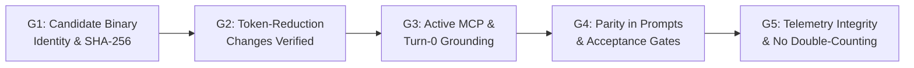

# Amendment 04: Stage 1 Task B Benchmark Protocol Revision

**Document Identifier:** `AMENDMENT_04_STAGE1_TOKEN_EFFICIENCY_PROTOCOL_REVISION_DRAFT`  
**Document Version:** `4.1.0-DRAFT` (Preserved Pre-Ratification Draft History)  
**Date:** October 29, 2026  
**Status:** **SUPERSEDED BY RATIFICATION (OCTOBER 29, 2026)**  
**Ratified Version:** [`benchmarks/AMENDMENT_04_STAGE1_TOKEN_EFFICIENCY_PROTOCOL_REVISION.md`](file:///C:/Users/Amal%20P%20S/OneDrive/Projects/Engram/benchmarks/AMENDMENT_04_STAGE1_TOKEN_EFFICIENCY_PROTOCOL_REVISION.md)  
**Parent Specification:** [`benchmarks/cost-baseline/PREREGISTRATION.md`](file:///C:/Users/Amal%20P%20S/OneDrive/Projects/Engram/benchmarks/cost-baseline/PREREGISTRATION.md) (SHA-256: `db3ab2956a4da40aad8f1f376aa72a50bebc96f3e1ecc3120f405f0a294ea8bb`)  

---

> [!NOTE]
> **GOVERNANCE NOTICE: DRAFT HISTORY PRESERVED**  
> This draft has been formally approved, ratified, and reconciled into [`AMENDMENT_04_STAGE1_TOKEN_EFFICIENCY_PROTOCOL_REVISION.md`](file:///C:/Users/Amal%20P%20S/OneDrive/Projects/Engram/benchmarks/AMENDMENT_04_STAGE1_TOKEN_EFFICIENCY_PROTOCOL_REVISION.md) on October 29, 2026. This file is retained in its pre-ratification state for audit trail and provenance preservation.

---

## 1. Executive Summary & Research Objective

The primary scientific research question of the Engram project is:
> **Does optimized Engram v1.5.4 consume fewer total model tokens than the unassisted baseline while completing the same Task B successfully?**

### 1.1 Empirical Context & Rationale
Prior Task B benchmark runs revealed the following operational realities:
1. **Block 06 Baseline (`baseline_arm1`):** Consumed **253,748 tokens** across 9 turns before being terminated by the default 250,000 ceiling. It demonstrated direct feature progress (+45 / -7 lines) but failed functional acceptance ($C = 0.00$) because it was halted before running typechecks.
2. **Block 08 Candidate (`v154_arm3`):** Consumed **365,176 tokens** across 16 turns under Amendment 03 (350,000 ceiling). Telemetry revealed that its MCP server was not exposed due to a Windows TOML path escaping defect (`\U`), and a background interactive `npx tsc` polling loop burned 108,723 tokens in 28 seconds.
3. **Legacy Arm 2 (`v151_arm2`):** Has **zero empirical observations on Task B**. It registers 16 unoptimized MCP tool schemas (1,702 `o200k_base` tokens per request) without Turn-0 context injection.
4. **Phase 1 Token Optimizations:** The lean 4-tool MCP surface (389 tokens), compact Turn-0 directive (53 tokens), and symbol lookup guidance have passed offline unit and integration tests (168/168 Python tests, 57/57 Rust tests). However, their end-to-end token efficiency on a live coding agent remains **unproven**.

### 1.2 Proposed Direction: Alternative B (Primary Pair Prioritization)
Under the proposed direction, Block 07 is restructured to **prioritize candidate Engram v1.5.4 (`v154_arm3`) directly against the unassisted baseline (`baseline_arm1`)**, deferring legacy Engram v1.5.1 (`v151_arm2`).  
- **Operational Ceiling:** Retained at the established default of **`250,000` tokens per arm**.
- **Maximum Permitted Token Exposure:** Capped at **`500,000` tokens** ($2 \times 250,000$), saving 250,000 tokens of authorized exposure compared to the 3-arm triad.

---

## 2. Explicit Preflight Verification Gates (Mandatory Prior to Launch)

Before any prospective execution of Block 07 under this amendment, the harness must verify and pass five deterministic preflight gates:



### Gate G1: Exact Candidate Executable Identity & Cryptographic Hash
- The runner must explicitly verify the path and `SHA-256` hash of the candidate executable immediately before launch.
- If testing the frozen baseline release candidate, the executable is `benchmarks/matched-pair-harness/bin/v1.5.4/engram.exe` with expected hash:
  `cf807eacdeb36dc972019838edeeb2fa5e8be25f6c3926fc662189fa9430a798`
- If testing an updated candidate incorporating Phase 1 Rust changes, that binary must be built into a sealed candidate path (e.g. `bin/v1.5.5/engram.exe`), hashed, and recorded in the execution manifest under separate approval.

### Gate G2: Verification of Token-Reduction Changes in the Candidate
The candidate configuration must be verified to contain the Phase 1 efficiency optimizations:
1. **Lean MCP Surface:** Default tool schema payload must measure $\le 400$ `o200k_base` tokens (measured: 389 tokens across 4 core tools: `engram_prepare_task`, `engram_postflight`, `engram_inspect_symbol`, `engram_validate_modification`).
2. **Compact Turn-0 Directive:** Generated directive must measure $\le 60$ tokens (measured: 53 tokens: `- Directives: Contract locked. Use engram_inspect_symbol for symbol lookups; call engram_postflight.`).
3. **Semantic Guidance Alignment:** Confirmation that contradictory directives (`DO NOT CALL engram_get_context`) have been removed, directing the agent to use targeted symbol lookups instead of whole-file dumps.
4. **Architectural Preflight Flag:** Gate G2 must verify whether the candidate binary being executed was compiled from the modified Rust source tree (`src/instructions.rs`, `src/mcp.rs`) or is the frozen 28-10-2026 binary.

### Gate G3: Verification that MCP Tools and Prompt Behavior Are Actually Active
1. **Windows TOML Path Escaping:** The Codex CLI command line must use forward slashes (`C:/Users/...`) for all `-c mcp_servers.engram...` arguments, eliminating the `\U` invalid Unicode escape error that prevented tool registration in Blocks 01–05 and Block 08.
2. **Turn-0 File Injection:** Verification that `.github/copilot-instructions.md` is populated in the sandbox with valid Change Contract metadata and AST excerpts.
3. **Execution Routing:** Verification that Task B fails open to `ENGRAM_MODE` (non-bypass), ensuring MCP tools are active on multi-file architectural tasks.

### Gate G4: Input and Gate Parity Between Arms
1. **Task Instructions:** Both `v154_arm3` and `baseline_arm1` must receive the exact identical task prompt from [`task_b_remember_me.json`](file:///C:/Users/Amal%20P%20S/OneDrive/Projects/Engram/benchmarks/matched-pair-harness/config/tasks/task_b_remember_me.json).
2. **Acceptance Script:** Both arms must be evaluated against the exact identical checklist requirements (`REQ-1` through `REQ-4`) and security invariants (zero password/JWT persistence in localStorage).
3. **Quality Gates:** Both arms must pass the identical compiler and build commands:
   - `L0_typecheck`: `npx tsc -p projects/angular-ngrx-material-starter/tsconfig.app.json --noEmit`
   - `L2_unit_tests`: `npx tsc -p projects/angular-ngrx-material-starter/tsconfig.spec.json --noEmit`
   - `L3_production_build`: `npm run build`

### Gate G5: Telemetry Integrity & Non-Double-Counting Token Accounting
1. **Authoritative Provenance:** Metrics must be extracted directly from provider rollout session logs (`.codex/sessions/**/*.jsonl`) and verified against `events.jsonl`.
2. **Mathematical Invariant:** Total model tokens must be calculated strictly as:
   $$\text{Total Model Tokens} = \text{input\_tokens} + \text{output\_tokens}$$
3. **No Double-Counting:** Cached prompt tokens (`prompt_tokens_cached`) and reasoning tokens (`reasoning_tokens`) are recorded strictly as sub-metrics. Under no circumstances may cached prompt tokens or static tool schema sizes be added to `total_model_tokens`.
4. **Integrity Suppression:** If telemetry is missing, unwritten, or mathematically inconsistent, comparative savings claims are strictly suppressed.

---

## 3. Protocol Architecture: Alternative B (Primary Pair Prioritization)

### 3.1 Structural Alteration of Preregistered Design
> [!IMPORTANT]
> **Explicit Methodological Declaration:**  
> Prioritizing `v154_arm3` versus `baseline_arm1` and deferring `v151_arm2` **alters the preregistered three-arm Latin-square design** established in Amendment 02.  
> - **Cross-Block Pooling Invariant:** The resulting two-arm observation **CANNOT be pooled** into cross-block non-parametric Friedman ANOVA tests as if it were an unchanged three-arm block.  
> - **Analytical Categorization:** Block 07 will be analyzed strictly as an independent **two-arm matched pair**. This change is adopted deliberately to protect model quota and ensure that quota is expended exclusively on the primary product hypothesis.

### 3.2 Execution Schedule & Stopping Rules
1. **Execution Order:**
   $$\text{Order 1: } \texttt{v154\_arm3} \longrightarrow \text{Order 2: } \texttt{baseline\_arm1}$$
2. **Realistic Expectations & Uncertainty:**  
   **Successful completion of both arms CANNOT be guaranteed.** Prior evidence shows that unassisted exploration of Task B accumulates ~250k prompt tokens across 9 turns. Whether optimized v1.5.4 can complete Task B within 250,000 tokens is an empirical hypothesis to be tested, not an established fact.
3. **Stop-on-Failure Logic:**  
   - If candidate `v154_arm3` (Order 1) breaches the 250,000 ceiling, times out (600s), crashes, produces invalid telemetry, or fails functional acceptance ($C < 1.00$):
     - The arm is formally recorded as `FAILED` (`TOKEN_CEILING_BREACHED`, `TIMEOUT`, or `ACCEPTANCE_FAILURE`).
     - **Execution halts immediately.** Control `baseline_arm1` is marked `SKIPPED_STOP_ON_FAILURE`.
     - *Rationale:* A comparative savings claim ($S$) strictly requires mutual functional acceptance ($C_{\text{treat}} = 1.00 \land C_{\text{ctrl}} = 1.00$). If the candidate fails, running the baseline would burn 250,000 tokens of quota with zero possibility of establishing savings.
   - If candidate `v154_arm3` succeeds ($C = 1.00$), execution proceeds to Order 2 (`baseline_arm1`).
4. **Comparative Savings Invariant:**  
   - If either arm breaches the ceiling, times out, crashes, has invalid telemetry, or achieves $C < 1.00$, all comparative token savings claims are strictly **suppressed (`null`)**.
   - An arm-level failure is recorded transparently as a failure. **A failed arm's outcome can NEVER be converted into a successful comparative result or manufactured savings claim.**

---

## 4. Harness Implementation Gap & CLI Command Reconciliation

### 4.1 Orchestrator Argument Parser & Mode Audit
An inspection of [`benchmarks/matched-pair-harness/src/orchestrator.py`](file:///C:/Users/Amal%20P%20S/OneDrive/Projects/Engram/benchmarks/matched-pair-harness/src/orchestrator.py) and [`schemas/triad_summary.schema.json`](file:///C:/Users/Amal%20P%20S/OneDrive/Projects/Engram/benchmarks/matched-pair-harness/schemas/triad_summary.schema.json) revealed an important technical gap:

1. **Schema & Argument Reconciliation:**
   - In `orchestrator.py`: Passing `--block block_07` forces `mode = "triad"`.
   - In `triad_summary.schema.json`: Lines 33, 43, and 52 strictly require all three arms (`baseline_arm1`, `v151_arm2`, `v154_arm3`) in `"runs"` and `"acceptance"`.
   - Passing `--arms v154_arm3,baseline_arm1` to `run_triad()` executes only the specified 2 arms.
   - **Completed Harness Implementation (Isolated Minimal Diff):**
     `orchestrator.py` was extended so that when a subset of arms is executed in triad mode, any omitted arm (such as `v151_arm2` under Alternative B) is populated post-execution with a structured skipped record (`DEFERRED_AMENDMENT_04`, Order = 3).
     - **Schema Invariant Preserved:** `triad_summary.schema.json` is 100% satisfied without schema weakening or modification.
     - **Validation Invariant Preserved:** `compute_comparative_analysis` automatically marks comparisons with deferred arms as `INVALIDATED_BY_ACCEPTANCE_FAILURE`.
     - **CLI Support Added:** `--arms` added as a direct alias for `--arm-order`.
     - **Offline Test Suite:** Authored [`test_amendment_04_two_arm.py`](file:///C:/Users/Amal%20P%20S/OneDrive/Projects/Engram/benchmarks/matched-pair-harness/tests/test_amendment_04_two_arm.py) (9/9 passed; 177/177 full regression passed).

### 4.2 Verified Execution Command (Dry-Run and Prospective Live)

The verified command for running Block 07 under Alternative B:

```powershell
python benchmarks/matched-pair-harness/src/orchestrator.py --block block_07 --arms v154_arm3,baseline_arm1 --max-tokens-ceiling 250000 --model gpt-5.6-luna --reasoning medium
```

- **Effective Ceiling:** Exactly **250,000 tokens per arm**.
- **Maximum Permitted Token Exposure:** Exactly **500,000 tokens** across both arms.
- **Execution Sequence:** `v154_arm3` (Order 1) $\rightarrow$ `baseline_arm1` (Order 2).
- **Legacy Arm Status:** `v151_arm2` formally marked `DEFERRED_AMENDMENT_04`.

---

## 5. Comparison of Alternatives

| Evaluation Dimension | Alternative A: Decouple Legacy Arm in 3-Arm Triad | Alternative B: Prioritize Primary Matched Pair (Proposed) |
| :--- | :--- | :--- |
| **Execution Sequence** | `v151_arm2` $\rightarrow$ `v154_arm3` $\rightarrow$ `baseline_arm1` | `v154_arm3` $\rightarrow$ `baseline_arm1` (v1.5.1 deferred) |
| **Operational Ceiling** | 250,000 tokens per arm | **250,000 tokens per arm** |
| **Maximum Authorized Exposure** | 750,000 tokens | **500,000 tokens** (-250,000 tokens savings) |
| **Quota Risk** | Up to 250,000 tokens risked on legacy v1.5.1 failure | **0 tokens risked on legacy v1.5.1** |
| **Candidate Execution Assurance** | Contingent on decoupled stopping logic | **Direct Order 1 execution guaranteed** |
| **Preregistered Design Impact** | Preserves 3-arm Latin-square sequence | **Restructures triad into 2-arm matched pair** |
| **Cross-Block Friedman Pooling** | Retained | **Excluded from 3-arm pooling; analyzed as pair** |
| **Harness Code Status** | Requires adding `--decouple-legacy-failure` | **Requires adding 2-arm triad support** |

**Rationale for Proposed Direction (Alternative B):**  
Alternative B maximizes quota efficiency and directs 100% of allocated tokens toward answering the primary commercial and scientific research question. It eliminates the risk of burning quota on an obsolete comparator while guaranteeing that candidate Engram v1.5.4 runs first under fresh, unpolluted sandbox conditions.

---

## 6. Budget & Quota Summary

- **Per-Arm Token Ceiling:** **`250,000` model tokens**.
- **Per-Arm Timeout:** **`600` seconds (10 minutes)**.
- **Arm Count:** Exactly **2 arms** (`v154_arm3` and `baseline_arm1`).
- **Maximum Authorized Block Exposure:** **`500,000` model tokens**.
- **Direct Financial Cash Cost:** **$0.00 USD** (Covered under ChatGPT subscription token).

---

## 7. Decisions Requiring Explicit User Approval

Before this amendment can be finalized or any benchmark executed, the User must explicitly resolve the following governance decisions:

1. **Ratification of Alternative B:**  
   Formally approve restructuring Block 07 into a two-arm matched pair (`v154_arm3` vs `baseline_arm1`) with `v151_arm2` deferred.
2. **Ceiling Ratification:**  
   Formally confirm retention of the **250,000-token per-arm ceiling**.
3. **Approval for Harness Implementation Update:**  
   Authorize the necessary narrowly scoped harness update in `orchestrator.py` and `triad_summary.schema.json` to support a two-arm triad execution mode.
4. **Candidate Binary Build Clarification:**  
   Clarify whether Gate G1 should evaluate the frozen 28-10-2026 binary (`bin/v1.5.4/engram.exe`) or if a new candidate binary containing the 29-10-2026 Phase 1 Rust changes should be compiled and sealed.
5. **Final Execution Authorization:**  
   Provide explicit authorization to launch Block 07 once the preflight gates pass.

---

## 8. Governance & Safety Certification

**STRICT READ-ONLY SAFETY VERIFICATION:**  
- This document is a non-executable draft specification.
- Zero live benchmark runs were performed.
- Zero model or inference API calls were initiated; zero token quota was consumed.
- Pinned golden commit `1c2856086f3a08e3ab1c3b8573eb3ff22ff20fd2` and its dirty tree remain untouched.
- Frozen binaries (`bin/v1.5.1/engram.exe` and `bin/v1.5.4/engram.exe`) match freeze seals bit-for-bit.
- All historical evidence, logs, and reports remain preserved and unmodified.
