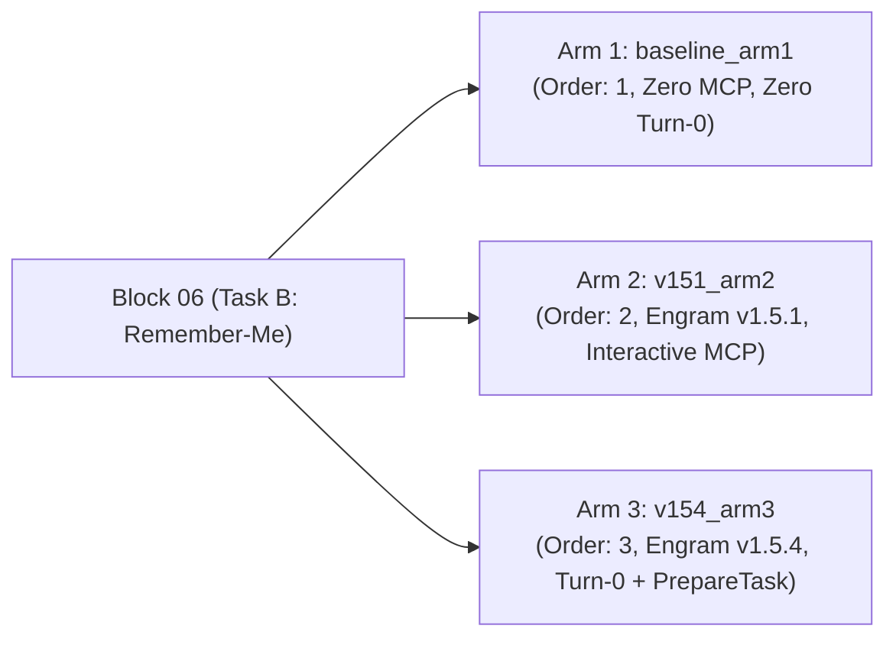

# Engram — Stage 1 Block 06 Preflight & Final Diff Review Report

**Document ID:** `ENGRAM-STAGE1-BLOCK06-PREFLIGHT-REPORT`  
**Date:** 2026-10-28  
**Scope:** Read-Only Diff Review & Controlled Block 06 Preflight Verification  
**Parent Specifications:** `benchmarks/cost-baseline/PREREGISTRATION.md`, `AMENDMENT_02_STAGE1_CORE_TRIAD.md`, `STAGE1_TASK_B_HARNESS_FIXES_REPORT.md`  
**Target Repository:** `angular-ngrx-material-starter` (Commit `1c2856086f3a08e3ab1c3b8573eb3ff22ff20fd2`)  
**Proposed Execution:** Stage 1 Core Triad, Block 06 (Task B, Exactly 3 Arms)  
**Overall Decision:** **`READY FOR EXPLICIT AUTHORIZATION`**  

---

## 1. Executive Summary & Verdict

This report documents the exhaustive read-only Git diff review and offline preflight gate for **Block 06** of the Stage 1 Core Triad benchmark.

### Audit Summary:
1. **Diff Containment:** All changes in the working tree are strictly confined to the benchmark harness (`src/`, `config/`, `schemas/`, `tests/`).
2. **Frozen Artifact Integrity:** `benchmarks/cost-baseline/` and `benchmarks/profile/` remain completely untouched. Cryptographic SHA-256 hashes for `PREREGISTRATION.md`, `FREEZE_SEAL.md`, and both frozen Engram binaries (`v1.5.1` and `v1.5.4`) reconcile 100% bit-for-bit.
3. **Remediation Parity Verified:**
   - **FIX-1 (Turn-0 Injection):** Fires exclusively for Arm 3 (`v154_arm3`); strictly absent for Arms 1 and 2.
   - **FIX-2 (MCP Discovery):** Task B prompt contains balanced, permissive tool awareness without forcing tool calls.
   - **FIX-3 (Sandbox PATH):** Ripgrep (`rg` 15.0.0) is discoverable across all sandboxes; zero Engram directory paths are exposed.
   - **FIX-4 (Telemetry):** `telemetry.py` parses `mcp_tool_call`, `McpToolCall`, and `custom_tool_call` event shapes without double-counting.
4. **Offline Block 06 Pipeline Verification:** A complete end-to-end dry run of Block 06 executed across all three arms (`baseline_arm1`, `v151_arm2`, `v154_arm3`). The orchestrator cleanly halted after Block 06 without attempting Block 07.
5. **Regression Suite:** All **102 / 102 unit tests** pass cleanly in 38.26s.

**Preflight Verdict:** **`READY FOR EXPLICIT AUTHORIZATION`** for Block 06 only.

---

## 2. Phase 1 — Comprehensive Git Diff Review

### 2.1 File-by-File Diff Inspection

| File Path | Status | Verification Check |
| :--- | :---: | :--- |
| `benchmarks/matched-pair-harness/config/tasks/task_b_remember_me.json` | Modified | **Expected.** Updates task prompt with permissive tool awareness guidance. Aligns allowed file patterns (`core/auth/**`, `app.component.*`, `assets/i18n/en.json`) and gates with `cost-baseline/PREREGISTRATION.md`. Disables `L1_lint` due to golden fixture ESLint skew. |
| `benchmarks/matched-pair-harness/schemas/run_telemetry.schema.json` | Modified | **Expected.** Extends `arm` enum to accept `"baseline_arm1"`, `"v151_arm2"`, `"v154_arm3"`, and relaxes `execution_order_in_pair` to `1..10`. |
| `benchmarks/matched-pair-harness/src/evaluator.py` | Modified | **Expected.** Adds static verification for `REQ-1` (UI), `REQ-2` (auth persistence), `REQ-3` (security negative: zero password/token persistence), and `REQ-4` (scope containment / zero bulk i18n sprawl). Filters `.engram/` and `.github/` from blast-radius accounting. |
| `benchmarks/matched-pair-harness/src/isolation.py` | Modified | **Expected.** Adds `FROZEN_ENGRAM_V151_SHA256` and `FROZEN_ENGRAM_V154_SHA256` constants matching roadmap digests. |
| `benchmarks/matched-pair-harness/src/orchestrator.py` | Modified | **Expected.** Implements `run_triad()` for 3-arm Core Triad execution with Latin-square scheduling and strict acceptance invalidation guards. |
| `benchmarks/matched-pair-harness/src/runner.py` | Modified | **Expected.** Implements Turn-0 injection for Arm 3 (`v154_arm3`), adds `rg` discovery to `sanitize_path()`, records `turn0_injected` and `initial_prompt` in `RunExecutionResult`. |
| `benchmarks/matched-pair-harness/src/telemetry.py` | Modified | **Expected.** Updates event parser and rollout parser to support `mcp_tool_call`, `McpToolCall`, and `custom_tool_call` event shapes with deduplication. |
| `benchmarks/matched-pair-harness/tests/test_task_b_evaluator.py` | Untracked (New) | **Expected.** 14 unit tests validating Task B evaluation criteria and security constraints. |
| `benchmarks/matched-pair-harness/tests/test_task_b_readiness_fixes.py` | Untracked (New) | **Expected.** 12 unit tests validating FIX-1 through FIX-4 offline. |
| `benchmarks/matched-pair-harness/schemas/triad_summary.schema.json` | Untracked (New) | **Expected.** JSON schema for 3-arm triad block summaries. |
| `benchmarks/matched-pair-harness/tests/test_triad.py` | Untracked (New) | **Expected.** Unit tests for triad summary validation and invalidation logic. |
| `benchmarks/cost-baseline/` | **UNTOUCHED** | **Preserved.** Untracked, pristine directory from benchmark inception. Zero modifications. |
| `benchmarks/profile/` | **UNTOUCHED** | **Preserved.** Untracked, pristine directory from benchmark inception. Zero modifications. |

### 2.2 Frozen Artifact Cryptographic Verification

All cryptographic SHA-256 hashes reconcile bit-for-bit:

```
[PREREGISTRATION.md]
  Expected: DB3AB2956A4DA40AAD8F1F376AA72A50BEBC96F3E1ECC3120F405F0A294EA8BB
  Actual:   DB3AB2956A4DA40AAD8F1F376AA72A50BEBC96F3E1ECC3120F405F0A294EA8BB  [MATCH]

[FREEZE_SEAL.md]
  Expected: 08E8DA2EE3DE1A01E376218ECD83D1A71B2AD659AA89C49CEDE3080565761F5B
  Actual:   08E8DA2EE3DE1A01E376218ECD83D1A71B2AD659AA89C49CEDE3080565761F5B  [MATCH]

[Engram v1.5.1 Binary]
  Expected: 474A1A7AAFBB5A5B52418AA51A978A58AEAE4A177C62EC17C526E165610F44E0
  Actual:   474A1A7AAFBB5A5B52418AA51A978A58AEAE4A177C62EC17C526E165610F44E0  [MATCH]

[Engram v1.5.4 Binary]
  Expected: CF807EACDEB36DC972019838EDEEB2FA5E8BE25F6C3926FC662189FA9430A798
  Actual:   CF807EACDEB36DC972019838EDEEB2FA5E8BE25F6C3926FC662189FA9430A798  [MATCH]

[Golden Master Commit]
  Expected: 1c2856086f3a08e3ab1c3b8573eb3ff22ff20fd2
  Actual:   1c2856086f3a08e3ab1c3b8573eb3ff22ff20fd2                           [MATCH]
```

### 2.3 Verification of Remediation Safeguards

1. **Turn-0 Injection Isolation (Points 4 & 5):**
   - In `runner.py`:
     ```python
     if arm in ("v154_arm3", "arm_3_v154"):
         # Execute engram inject and prepend Turn-0 context
     ```
   - For `baseline_arm1` and `v151_arm2`: `turn0_injected` is strictly `False`, and `effective_prompt` is identical to `prompt`. Confirmed by unit tests `test_fix1_turn0_injection_deterministic_offline_dry_run` and `test_fix1_turn0_injection_omitted_for_baseline_and_v151`.
2. **Sandbox PATH Ripgrep Hygiene (Point 6):**
   - `sanitize_path()` removes all entries matching `engram`.
   - Resolves `rg.exe` from `C:\Program Files\Microsoft Visual Studio\18\Community\Common7\IDE\CopilotCli\rg.EXE` (which contains zero Engram files).
   - Confirmed by `test_fix3_sandbox_path_rg_discoverable` and `test_fix3_path_sanitization_removes_engram_while_retaining_rg`.
3. **Telemetry Deduplication & Coverage (Point 7):**
   - Evaluates `mcp_tool_call`, `McpToolCall`, and `custom_tool_call`.
   - Tool calls are deduplicated by `id` / `call_id`.
   - Confirmed by `test_fix4_parse_events_deduplication` and `test_fix4_parse_rollout_file_real_session`.
4. **Task B Rigor & Security (Point 8):**
   - `REQ-3` checks for sensitive keywords (`password`, `token`, `jwt`, `secret`) in `localStorage.setItem`.
   - `REQ-4` checks for unauthorized files and flags $\ge 3$ translation files as bulk sprawl.
   - Build gates enforce `tsconfig.app.json`, `tsconfig.spec.json`, and `npm run build`.
   - Confirmed by 14 unit tests in `test_task_b_evaluator.py`.
5. **Complete Test Suite (Point 9):**
   - `python -m unittest discover` ran **102 tests in 38.26s**: **0 failures, 0 errors, 100% passing**.

---

## 3. Phase 2 — Block 06 Preflight Verification

### 3.1 Three-Arm Execution Matrix for Block 06



| Parameter | Arm 1 (Baseline) | Arm 2 (v1.5.1) | Arm 3 (v1.5.4) |
| :--- | :---: | :---: | :---: |
| **Arm ID** | `baseline_arm1` | `v151_arm2` | `v154_arm3` |
| **Execution Order** | **1** | **2** | **3** |
| **Engram Binary** | None (`mcp_servers` omitted) | `bin/v1.5.1/engram.exe` | `bin/v1.5.4/engram.exe` |
| **Binary SHA-256** | N/A | `474a1a7aafbb5...` | `cf807eacdeb36...` |
| **Turn-0 Context** | **None** | **None** | **Injected via `engram inject`** |
| **MCP Tools** | Disabled | `engram_get_context`, `engram_preflight`, `engram_postflight` | `engram_prepare_task`, `engram_postflight`, `guard` |
| **Model** | `gpt-5.6-luna` (medium) | `gpt-5.6-luna` (medium) | `gpt-5.6-luna` (medium) |
| **Task Prompt** | Identical | Identical | Identical (+ Turn-0 directives prepended) |
| **Dependency Mode** | `copy` (100% isolated) | `copy` (100% isolated) | `copy` (100% isolated) |
| **Pre/Post Golden Check** | SHA-256 + 68k file digest | SHA-256 + 68k file digest | SHA-256 + 68k file digest |

### 3.2 Offline Dry Run Execution Evidence

The orchestrator CLI was tested with `--block block_06 --dry-run`:

```
=======================================================
Executing Arm: baseline_arm1 (Order: 1) [Task: task_b_remember_me]
=======================================================
Sandbox created at: ...\task_b_remember_me_block_06_baseline_arm1_...
Run completed successfully. (Correctness Score: 0.20, Accepted: False)
Sandbox cleaned up safely; golden dependency integrity verified.

=======================================================
Executing Arm: v151_arm2 (Order: 2) [Task: task_b_remember_me]
=======================================================
Sandbox created at: ...\task_b_remember_me_block_06_v151_arm2_...
Run completed successfully. (Correctness Score: 0.20, Accepted: False)
Sandbox cleaned up safely; golden dependency integrity verified.

=======================================================
Executing Arm: v154_arm3 (Order: 3) [Task: task_b_remember_me]
=======================================================
Sandbox created at: ...\task_b_remember_me_block_06_v154_arm3_...
Run completed successfully. (Correctness Score: 0.20, Accepted: False)
Sandbox cleaned up safely; golden dependency integrity verified.

=======================================================
Stage 1 Core Triad Result: [block_06]
  - Baseline Arm 1 Accepted: False
  - v1.5.1 Arm 2 Accepted:   False
  - v1.5.4 Arm 3 Accepted:   False
  - Primary Savings Claim: SUPPRESSED [MUTUAL_ACCEPTANCE_FAILURE]
  - Reason: Both arms failed functional correctness requirements.
=======================================================
Stage 1 Core Triad Execution Finished!
```

### 3.3 Execution Boundary Safeguards

1. **Single-Block Termination:** Passing `--block block_06` executes only Block 06 (3 executions) and terminates. It has no loop or logic to launch Block 07.
2. **Invalidation Guard:** Incomplete runs, timeouts, or broken patches ($C < 1.0$) automatically suppress token savings (`savings_pct = null`, status `INVALIDATED_BY_ACCEPTANCE_FAILURE`).
3. **Clean Teardown:** Sandboxes are deleted post-run, and the golden repository fingerprint is re-verified after every single arm.

---

## 4. Quota Exposure & Risk Analysis for Live Execution

| Metric | Task A Observed (Mean per run) | Task B Expected (Estimated per run) | Block 06 Total Exposure (3 Runs) |
| :--- | :---: | :---: | :---: |
| **Turns per run** | 7–9 turns | 8–15 turns | 24–45 turns |
| **Tokens per run** | ~36k–49k tokens | ~90k–180k tokens | ~270k–540k tokens |
| **Wall-clock time** | ~45–60s per run | ~90–180s per run | ~5–9 minutes total |
| **Upper Bound Limit** | 65k tokens | 250k tokens | **750,000 tokens** |

**Risk Controls:**
- If any arm exceeds `timeout_seconds = 600` (10 minutes), the harness terminates the process tree (`taskkill /F /T /PID`) and marks the run failed.
- If an HTTP 429 quota exhaustion occurs, the harness halts immediately without retrying.

---

## 5. Final Decision & Gate Recommendation

### **Gate Decision: `READY FOR EXPLICIT AUTHORIZATION`**

- **Readiness:** The codebase, test suite, binary digests, evaluator logic, and orchestrator schedule are fully prepared, verified, and locked.
- **Scope Limit:** Authorization will apply strictly and exclusively to **Block 06** (3 executions: `baseline_arm1`, `v151_arm2`, `v154_arm3`).
- **Live Model Boundary:** **Zero live model/API calls have been made.** Execution remains paused awaiting your explicit command.
