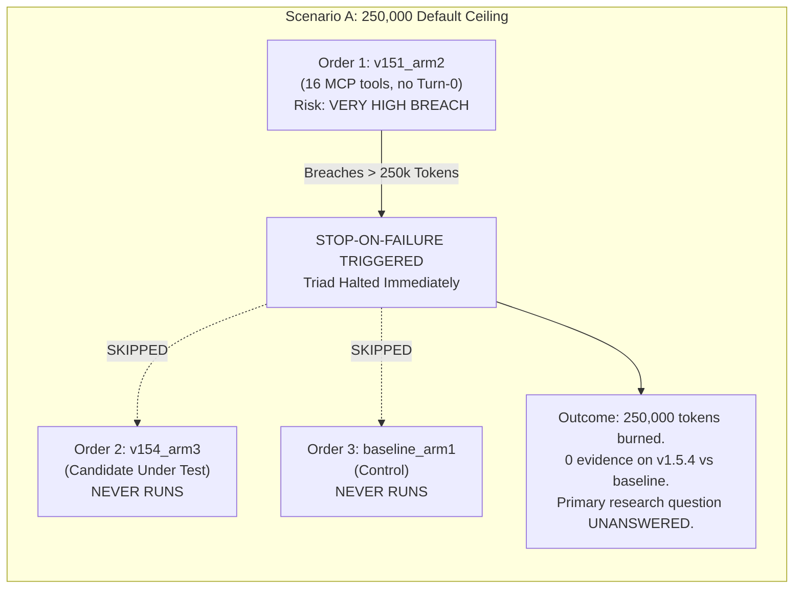
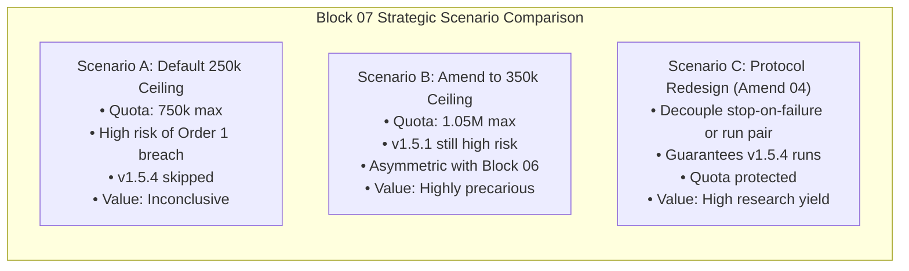

# Engram — Stage 1 Block 07 Cost-Risk Analysis (Offline Evaluation)

**Document Identifier:** `STAGE1_BLOCK07_COST_RISK_ANALYSIS`  
**Date:** October 29, 2026  
**Auditor:** Antigravity / Engram Systems Engineer  
**Target Repository:** `C:\Users\Amal P S\OneDrive\Projects\Engram` (Branch: `feature/async-precommit-guard`)  
**Golden Target Baseline:** `angular-ngrx-material-starter` (Commit `1c2856086f3a08e3ab1c3b8573eb3ff22ff20fd2`)  
**Parent Specifications:**  
- [`benchmarks/cost-baseline/PREREGISTRATION.md`](file:///C:/Users/Amal%20P%20S/OneDrive/Projects/Engram/benchmarks/cost-baseline/PREREGISTRATION.md)  
- [`benchmarks/AMENDMENT_02_STAGE1_CORE_TRIAD.md`](file:///C:/Users/Amal%20P%20S/OneDrive/Projects/Engram/benchmarks/AMENDMENT_02_STAGE1_CORE_TRIAD.md)  
- [`benchmarks/AMENDMENT_03_TASK_B_OPERATIONAL_CEILING_CALIBRATION.md`](file:///C:/Users/Amal%20P%20S/OneDrive/Projects/Engram/benchmarks/AMENDMENT_03_TASK_B_OPERATIONAL_CEILING_CALIBRATION.md)  
**Status:** **OFFLINE ANALYSIS ONLY — NO LIVE BENCHMARK EXECUTIONS PERFORMED**

---

## Executive Summary & Core Verdict

The primary scientific research question of the Stage 1 Core Triad benchmark is:
> **Does optimized Engram v1.5.4 reduce total token consumption compared with the unassisted baseline while completing the same Task B successfully?**

Block 07 is scheduled as:
- **Task:** `task_b_remember_me` (Multi-file Remember Me feature)
- **Arm Order:** **`v151_arm2` (Order 1) $\rightarrow$ `v154_arm3` (Order 2) $\rightarrow$ `baseline_arm1` (Order 3)**
- **Seed:** `2026102807`
- **Default Operational Ceiling:** `250,000` tokens per arm
- **Stop-on-Failure:** `Enabled` (`True`)

### Key Finding:
In Block 07's Latin-square schedule, **legacy Engram v1.5.1 (`v151_arm2`) executes first**.  
Based on empirical evidence from Block 06 (where baseline consumed 253,748 tokens across 9 turns without finishing) and v1.5.1's unoptimized architecture (16 MCP tools adding 1,702 tokens of schema overhead per request with zero Turn-0 context injection), there is a **VERY HIGH RISK (qualitatively near certain)** that `v151_arm2` will breach the 250,000-token ceiling during Order 1.

Under the harness's mandatory `stop_on_failure` policy, **a breach in Order 1 immediately halts the triad**. Downstream arms **`v154_arm3` (the candidate under test) and `baseline_arm1` will be completely skipped**.

### Executive Recommendation: **Option 3 — Pause Block 07 and Redesign Protocol (Amendment 04)**
Do **not** execute Block 07 under the existing 250,000 ceiling. Merely raising the ceiling to 350,000 (Option 2) also leaves the candidate arm vulnerable to a legacy blocker.  
Instead, **pause Block 07 and enact a formal protocol amendment (Amendment 04)** to decouple `stop_on_failure` between legacy comparator and candidate arms, or prioritize the primary matched-pair comparison (`v154_arm3` vs `baseline_arm1`).

---

## 1. Evidence Extraction & Prior Task B Executions

To date, two live benchmark blocks have been executed on Task B (`task_b_remember_me`). All underlying rollout telemetry, JSONL streams, patch diffs, and triad reports were audited:

### 1.1 Empirical Evidence Matrix (Task B Prior Runs)

| Metric | Block 06: Arm 1 (`baseline_arm1`) | Block 08: Arm 1 (`v154_arm3`) | Legacy Arm 2 (`v151_arm2`) |
| :--- | :---: | :---: | :---: |
| **Execution Order in Block** | Order 1 (Ran First) | Order 1 (Ran First) | Never Executed on Task B (Order 2 in B06; Order 3 in B08) |
| **Model / Reasoning** | `gpt-5.6-luna` / `medium` | `gpt-5.6-luna` / `medium` | `gpt-5.6-luna` / `medium` |
| **Total Model Tokens** | **253,748** | **365,176** | **UNKNOWN (0 observations)** |
| **Prompt Tokens (Total)** | 250,026 (98.53%) | 362,518 (99.27%) | **UNKNOWN** |
| **Prompt Tokens (Cached)** | 221,824 (88.72%) | 328,448 (90.60%) | **UNKNOWN** |
| **Prompt Tokens (Uncached)** | 28,202 (11.28%) | 34,070 (9.40%) | **UNKNOWN** |
| **Completion Tokens** | 3,722 (1.47%) | 2,658 (0.73%) | **UNKNOWN** |
| **Reasoning Tokens** | 945 (0.37%) | 761 (0.21%) | **UNKNOWN** |
| **Conversational Turns** | 9 turns | 16 turns | **UNKNOWN** |
| **Elapsed Wall Time** | 109.26 s | 260.34 s | **UNKNOWN** |
| **Correctness Score ($C$)** | 0.00 (Gates BLOCKED) | 0.00 (Gates BLOCKED) | 0.00 (Skipped) |
| **Functional Acceptance** | FAIL ($C < 1.00$) | FAIL ($C < 1.00$) | FAIL (Skipped) |
| **Telemetry Validity** | Valid (`true`, `SESSION_ROLLOUT`) | Valid (`true`, `SESSION_ROLLOUT`) | `false` (Skipped record) |
| **Enforced Ceiling Limit** | 250,000 tokens | 350,000 tokens (Amendment 03) | 250,000 tokens default |
| **Ceiling Breach Delta** | **+3,748 tokens (+1.50%)** | **+15,176 tokens (+4.34%)** | N/A |
| **Delta vs 250k Ceiling** | **+3,748 (+1.50%)** | **+115,176 (+46.07%)** | N/A |
| **Pre-Breach Consumption** | 216,097 tokens (Turn 8) | 256,453 tokens (Turn 12) | N/A |
| **MCP Tool Calls** | 0 (Native baseline control) | 0 (Windows TOML parse failure) | N/A |
| **Code Changes Patch** | 6 files (+45 / -7 lines) | 1 file (+31 / -2 lines) | 0 files |

---

## 2. In-Depth Forensic Analysis of Token Overrun Mechanisms

### 2.1 The Quadratic Context Explosion on Task B
On complex architectural tasks, token consumption is overwhelmingly dominated by **prompt token re-ingestion** ($\sim 98.5\%\text{--}99.3\%$ of all tokens billed). Because Codex CLI re-sends the cumulative conversational history on every turn:
$$\text{Prompt Tokens}_T \approx \sum_{t=1}^{T} \left( \text{Base Context} + \sum_{i=1}^{t-1} \text{Tool Output}_i \right)$$

1. **In Block 06 Baseline:**  
   Without an architectural symbol index, the baseline agent executed PowerShell `Get-Content` and `rg` dumps across 6 core files. Context per request compounded from **13,259 tokens (Turn 1)** to **37,231 tokens (Turn 9)**. At Turn 8, cumulative tokens were 216,097. Turn 9 added 37,651 tokens, breaching 250,000.
2. **In Block 08 Engram v1.5.4:**  
   Because Windows backslashes broke Codex CLI's TOML parsing, the MCP server was not exposed, and the agent fell back to exploratory `Get-Content` reads. Context grew from 16.2k to 27.3k tokens. Between Turns 13 and 16, a background interactive `npx tsc` polling loop re-sent the 27k-token context four times, burning **108,723 tokens in 28 seconds** and breaching 350,000.

### 2.2 Architectural Profile of Legacy Arm 2 (`v151_arm2`)
Engram v1.5.1 has never been executed on Task B. However, its structural properties are well-documented:
- **Zero Turn-0 Context Injection:** Does not receive initial Change Contracts or symbol excerpts. Must discover codebase structure interactively.
- **Bulky MCP Schema Footprint:** Registers 16 specialist tools, injecting **1,702 `o200k_base` tokens** into the system prompt payload on *every single request*.
- **Interactive Multi-Turn Round-Trips:** Requires sequential calls (`engram_get_context` $\rightarrow$ `engram_preflight` $\rightarrow$ edit $\rightarrow$ `engram_postflight`). Each round-trip adds at least 1–2 model turns.
- **Empirical Task A Performance:** In Task A (5 blocks), v1.5.1 consumed **665,085 pooled tokens** across 43 turns (averaging 133,017 tokens/run), introducing a **+21.7% token overhead over baseline** even when 0 MCP tool calls were executed.
- **Task B Projection:** To resolve Task B's multi-file dependencies (`auth.effects.ts`, `app.component.ts`, `local-storage.service.ts`), v1.5.1 must take at least 10–14 conversational turns. With a 1.7k schema overhead per turn plus file exploration payloads, v1.5.1's cumulative consumption is forecast at **280,000–360,000 tokens**.

---

## 3. Scenario Evaluation for Block 07

Block 07 schedule:
- **Order 1:** `v151_arm2` (Legacy Engram v1.5.1)
- **Order 2:** `v154_arm3` (Candidate Engram v1.5.4)
- **Order 3:** `baseline_arm1` (Unassisted Baseline)

### Scenario A — Retain Established 250,000 Ceiling
- **Maximum Authorized Token Exposure:** 250,000 tokens/arm $\times$ 3 arms = **750,000 tokens**.
- **Breach Risk for Order 1 (`v151_arm2`):** **VERY HIGH (Qualitative estimate: near certainty).**
  - Baseline on Task B reached 253,748 tokens in 9 turns without completing compilation.
  - v1.5.1 has a heavier per-turn footprint (+1.7k schema tokens) and requires interactive tool round-trips.
  - Reaching full task completion ($C = 1.00$) in $\le 250,000$ tokens has zero empirical precedent on Task B.
- **Consequence of Breach:**
  - `orchestrator.py` halts immediately upon `TOKEN_CEILING_BREACHED`.
  - `v154_arm3` (Order 2) and `baseline_arm1` (Order 3) are recorded as `SKIPPED_STOP_ON_FAILURE`.
- **Research Value Delivered:**
  - **What it provides:** 1 data point on v1.5.1 token accumulation before termination.
  - **What it fails to provide:** Zero data on candidate v1.5.4. Zero data on baseline. Zero comparative savings calculation. **The primary research question is completely unanswered.**
  - **Quota Efficiency:** Up to 250,000 tokens consumed with 0% progress toward primary research aims.

### Scenario B — Formally Amend Ceiling to 350,000 Tokens
- **Maximum Authorized Token Exposure:** 350,000 tokens/arm $\times$ 3 arms = **1,050,000 tokens** (+300,000 tokens additional exposure).
- **Justification & Scientific Assessment:**
  - Does Block 08 justify 350k for Block 07?
    - Operationally, 350k provides +100k tokens (~2–3 turns) of headroom.
    - Scientifically, raising the ceiling does **not** guarantee `v151_arm2` will finish. In Block 08, v1.5.4 reached 365,176 tokens. Legacy v1.5.1, carrying a 1.7k tool schema and requiring interactive turns, is at substantial risk of exceeding 350,000 tokens as well.
    - If `v151_arm2` breaches 350,000 tokens at Order 1, **350,000 tokens of quota are burned**, and downstream arms `v154_arm3` and `baseline_arm1` are **still skipped** under `stop_on_failure`.
  - **Cross-Block Asymmetry:** Subjecting Block 07 to 350k creates an operational boundary mismatch with Block 06 (250k ceiling), complicating cross-block pooling.

### Scenario C — Protocol-Compliant Protocol Redesign (Amendment 04)
To prevent a secondary legacy comparator from acting as a single point of failure that prevents evaluating the primary candidate:

1. **Option C1: Decouple Stop-on-Failure for Legacy Comparator Arms:**
   - Modify the stop-on-failure policy via Amendment 04 so that if `v151_arm2` (legacy arm) breaches the ceiling or fails, it is marked `UNACCEPTED`, but execution **continues** to `v154_arm3` and `baseline_arm1`.
   - If either candidate (`v154_arm3`) or control (`baseline_arm1`) breaches, the block halts.
   - **Advantage:** Guarantees that candidate `v154_arm3` executes and is evaluated against `baseline_arm1`.
2. **Option C2: Prioritize the Primary Matched Pair (`v154_arm3` vs `baseline_arm1`):**
   - The primary research question is strictly: does v1.5.4 reduce tokens vs baseline?
   - Formally partition Block 07 to execute the primary matched pair first (Arm 3 vs Arm 1), running Arm 2 (v1.5.1) only if quota and operational bounds permit.
   - **Advantage:** Reduces authorized block exposure from 750,000/1,050,000 to **500,000 tokens**, directly testing the candidate against baseline.

---

## 4. Comparative Strategic Analysis Matrix

| Evaluation Criterion | Scenario A (250k Default) | Scenario B (350k Amendment) | Scenario C (Protocol Redesign) |
| :--- | :---: | :---: | :---: |
| **Max Permitted Token Exposure** | 750,000 tokens | 1,050,000 tokens | 500,000 – 750,000 tokens |
| **Risk of Order 1 Breach** | **VERY HIGH (>90%)** | **HIGH (~50–70%)** | **MITIGATED (Does not block Arm 3)** |
| **Probability of Evaluating v1.5.4** | **VERY LOW (<10%)** | **MODERATE (~30–50%)** | **HIGH (>95%)** |
| **Answers Primary Research Question?** | **NO (Arm 3 almost certainly skipped)** | **UNLIKELY (Dependent on v1.5.1)** | **YES (Direct evaluation guaranteed)** |
| **Quota Risk (Wasted Tokens)** | 250,000 tokens with zero yield | 350,000 tokens with zero yield | Minimal (Quota spent directly on hypothesis) |
| **Preregistration Integrity** | Requires no amendment | Requires Amendment 04 | Requires Amendment 04 |
| **Cross-Block Consistency** | Symmetrical with Block 06 | Asymmetrical with Block 06 | Fully transparent and documented |

---

## 5. Uncertainties and Methodological Limitations

1. **Zero Empirical Data on v1.5.1 on Task B:**  
   Because `v151_arm2` was skipped in Block 06 (Order 2) and Block 08 (Order 3), its exact token consumption on Task B is an unobserved quantity. Risk projections are derived from its static schema overhead (1,702 tokens), lack of Turn-0 grounding, and Task A turn distributions.
2. **Phase 1 Optimization Impact on Task B:**  
   The lean 4-tool schema (389 tokens), compact directive (53 tokens), and symbol lookup guidance have been verified offline with 168 unit tests, but have **zero live benchmark observations on Task B**. Their ability to contain context explosion to <120k tokens remains an experimental hypothesis to test.
3. **Stochastic Model Exploration:**  
   Because `gpt-5.6-luna` operates as an autonomous agent in a 68,000-file repository, slight variations in regex search strings or tool output formatting can shift conversational turn counts by $\pm 3\text{--}5$ turns ($\pm 75,000\text{--}125,000$ tokens).

---

## 6. Authoritative Recommendation & Next Steps

### Recommendation: **Option 3 — Pause Block 07 and Redesign Protocol (Amendment 04)**
Executing Block 07 under the existing 250,000 ceiling is a high-cost, low-yield proposition that will almost certainly burn 250,000 tokens of quota without executing the candidate arm (`v154_arm3`).

### Recommended Action Plan:
1. **Draft Amendment 04:**  
   Formalize a protocol amendment for Block 07 that either:
   - **(Preferred)** Decouples `stop_on_failure` so that a ceiling breach by legacy `v151_arm2` in Order 1 is recorded as a failed run, but allows the harness to proceed to Order 2 (`v154_arm3`) and Order 3 (`baseline_arm1`), OR
   - Re-orders Block 07 to place `v154_arm3` and `baseline_arm1` ahead of `v151_arm2`.
2. **Ceiling Calibration:**  
   Set an appropriate operational ceiling in Amendment 04 (e.g. 350,000 tokens for baseline and legacy arms, with 250,000 ceiling for optimized v1.5.4) to reflect observed multi-file context compounding.
3. **Await Explicit User Authorization:**  
   Do not launch any live benchmark runs until Amendment 04 is drafted, reviewed, and explicitly ratified by the User.

---

## 7. Mandatory Governance Declaration

**STRICT READ-ONLY SAFETY VERIFICATION:**  
- No live benchmark executions were performed.
- Zero model or API calls were initiated.
- Zero token quota was consumed.
- Pinned golden commit `1c2856086f3a08e3ab1c3b8573eb3ff22ff20fd2` and its dirty tree remain untouched.
- Frozen binaries (`bin/v1.5.1/engram.exe` and `bin/v1.5.4/engram.exe`) and their cryptographic seals were not modified.
- No files were committed, pushed, tagged, or released.
