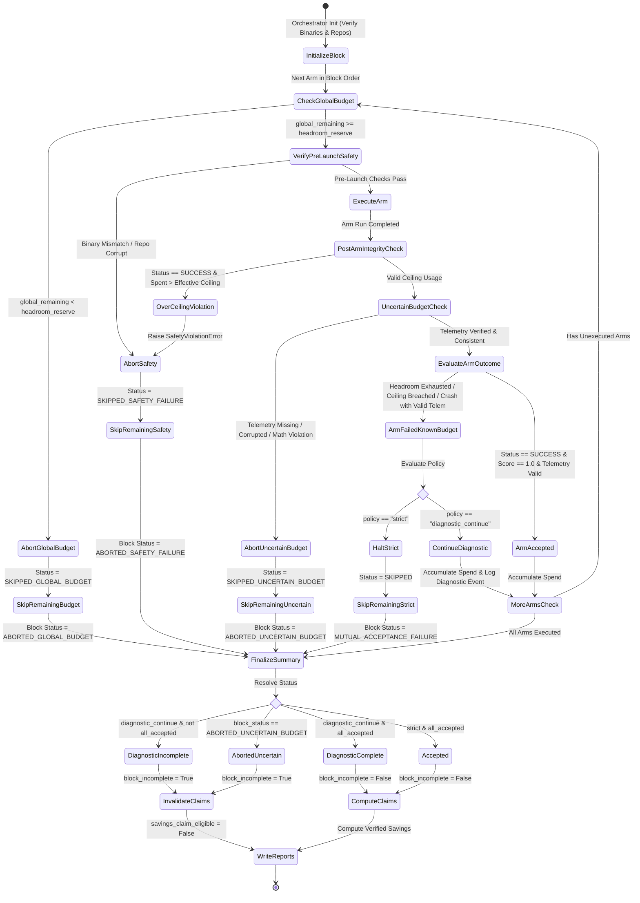

# Architecture Decision Record (ADR-005)
# Diagnostic Continuation Architecture & Global Budget Remediation for Matched-Pair and Tetrad Benchmarks

- **Status:** Accepted / Remediated (Phase 5.4.17)
- **Date:** 2026-11-19
- **Authors:** Engram Engineering Team
- **Context Phase:** Phase 5.4.15 & Phase 5.4.17 Remediation
- **Related ADRs / Documents:** Amendment 02, Amendment 04, ADR-001 through ADR-004, Phase 5.4.16 Adversarial Audit

---

## 1. Context & Problem Statement

In the Engram matched-pair and 4-arm tetrad benchmark harness (`benchmarks/matched-pair-harness`), the legacy default execution policy is strict fail-closed stopping (`stop_on_failure = True`). Under this policy, when any individual arm encounters an execution failure (such as pre-dispatch token headroom exhaustion, token ceiling breach, process crash, timeout, or invalid telemetry), the orchestrator immediately halts the entire block and marks all remaining arms as `SKIPPED`.

While this behavior is scientifically sound for strict comparative efficiency verification—preventing misleading comparisons and unnecessary model spend when mutual acceptance is already impossible—it severely hinders diagnostic and forensic visibility during exploratory research and developmental verification. Specifically:

1. **Diagnostic Blindness:** In multi-arm blocks (such as the 4-arm tetrad: Arm A Native, Arm B Candidate 3 Always-On, Arm C Candidate 4 Always-On, Arm D Candidate 4 Adaptive), an early failure in a legacy control/treatment arm (e.g., Candidate 3 budget exhaustion in Arm B) prevents subsequent arms (Arms C and D) from executing. Consequently, engineers cannot observe whether Candidate 4.2's engine remediation and adaptive routing would have succeeded or how they would have behaved under identical task conditions.
2. **All-or-Nothing Spending Risk:** Indiscriminately disabling stop-on-failure without safety rails risks runaway token consumption, execution across corrupted sandboxes, or false-positive comparative claims if acceptance checks are bypassed.
3. **Scientific Integrity Risk:** If subsequent arms execute after a failure, there is a risk that unprincipled downstream reports might calculate token efficiency gains against an unaccepted or incomplete block, violating Amendment 02 and Amendment 04 invariants.

### 1.1 Defects Identified in Phase 5.4.16 Forensic Audit

During the Phase 5.4.16 adversarial audit of the initial Phase 5.4.15 implementation, four critical engineering and integrity defects were identified:

1. **Global Budget Leakage on Missing/Invalid Telemetry:** When an arm produced missing, zero, or unparseable telemetry (`total_model_tokens` missing or `None`), the orchestrator defaulted to `0` and accumulated `0` into `cumulative_global_tokens`, allowing trailing diagnostic arms to launch without accounting for unmeasured model spend.
2. **Uncoupled Acceptance Gate:** The internal `_is_accepted` helper only checked functional score and requirements passing (`score == 1.0` and `passed_all_requirements == True`), omitting checks for `telemetry_valid == True` or `execution_status == "SUCCESS"`. Consequently, an arm with corrupted telemetry could be marked accepted, leading to block resolution of `DIAGNOSTIC_COMPLETE` or `ACCEPTED`.
3. **Test Fidelity Defect & Unchecked Over-Ceiling Execution:** `test_04_global_budget_exhaustion` used a test mock returning 120,000 tokens with `SUCCESS` despite an effective ceiling of 80,000, revealing that the orchestrator lacked an explicit over-ceiling safety detection check.
4. **CLI Flag Precedence Ambiguity:** The presence of both `--no-stop-on-failure` and `--execution-policy` allowed conflicting configurations (e.g., `--no-stop-on-failure` with `--execution-policy strict`) to execute without clear operational semantics.

---

## 2. Decision & Remediation Architecture

We implement a remediated, fail-closed **Diagnostic Continuation Architecture** within `orchestrator.py`, governed by an explicit opt-in policy flag, fail-closed budget accounting, coupled telemetry acceptance validation, safety overrides, and unconditional comparative claim invalidation.

### 2.1 Core Architectural Principles

1. **Strict Fail-Closed Default Preserved:**
   - The default execution policy remains `execution_policy = "strict"`.
   - In `strict` mode, any arm execution failure immediately halts block execution and marks remaining arms as `SKIPPED`.
   - Diagnostic continuation is strictly opt-in via `--execution-policy diagnostic_continue` (CLI) or `execution_policy="diagnostic_continue"` (API).

2. **CLI Policy Precedence & Deprecation Model:**
   - `--execution-policy` is the primary control flag (`strict` default, `diagnostic_continue`).
   - `--no-stop-on-failure` is a deprecated legacy alias that maps directly to `diagnostic_continue` with an explicit deprecation warning emitted to stderr.
   - Conflicting CLI options (passing `--no-stop-on-failure` and `--execution-policy strict` simultaneously) are strictly rejected with ArgumentParser exit code 2.

3. **Decoupled Failure Taxonomy (Safety vs Non-Safety vs Uncertain Budget):**
   - **Safety / Environmental Failures (Absolute Block Halts):** Candidate binary SHA-256 mismatch, candidate ledger validation failure, golden dependency manifest corruption, sandbox identity failure, global budget exhaustion, over-ceiling execution violation, and user cancellation (`KeyboardInterrupt`). These NEVER continue, even in diagnostic mode. They immediately abort the block (`ABORTED_SAFETY_FAILURE` / `ABORTED_GLOBAL_BUDGET` / `ABORTED_USER_CANCEL`).
   - **Budget-Uncertain Failures (Absolute Block Halts):** Missing final telemetry, malformed telemetry records, mathematically inconsistent token totals, negative token counts, zero-token anomalies on non-empty runs, and crashes/timeouts where final token usage cannot be verified. Because true spending is indeterminate, the orchestrator halts immediately with `ABORTED_UNCERTAIN_BUDGET` under both `strict` and `diagnostic_continue` modes, marks trailing arms `SKIPPED_UNCERTAIN_BUDGET`, and withholds unverified tokens from cumulative spending.
   - **Arm-Level Execution Failures with Verified Telemetry (Permitted Diagnostic Continuations):** Pre-dispatch headroom exhaustion (`PRE_DISPATCH_HEADROOM_EXHAUSTED`), per-arm token ceiling breach (`TOKEN_CEILING_BREACHED`), arm timeout (`TIMEOUT`) with valid telemetry, non-zero process exit (`FAILED`) with valid telemetry, and functional requirement failure. Under `diagnostic_continue`, these preserve their exact failure status, log a diagnostic continuation event, and permit subsequent arms to execute provided global budget limits are respected.

4. **Dual-Tier Token Budget Accounting & Fail-Closed Attribution:**
   - **Per-Arm Ceiling (`max_tokens_ceiling`):** Enforced per arm by `runner.py`'s streaming token tracker and pre-dispatch headroom guard.
   - **Global Block Ceiling (`global_tokens_ceiling`):** Tracks cumulative verified tokens spent across all arms in the block.
   - **Global Headroom Reserve Guard (`headroom_reserve`):** Before dispatching any arm, the orchestrator evaluates `global_remaining = global_tokens_ceiling - cumulative_global_tokens`. If `global_remaining < headroom_reserve`, arm dispatch is blocked, and all remaining arms are marked `SKIPPED_GLOBAL_BUDGET`.
   - **Dynamic Arm Capping:** The effective ceiling for an arm is computed as `effective_arm_ceiling = min(max_tokens_ceiling, global_remaining)`.
   - **Zero Budget Leakage Guarantee:** Cumulative global tokens accumulate ONLY verified, mathematically consistent positive token totals. If telemetry is missing, unparseable, or inconsistent, the orchestrator refuses to guess or accumulate unverified tokens and immediately aborts the block.

5. **Over-Ceiling Safety Violation Detection:**
   - If an arm reports `execution_status == "SUCCESS"` while token consumption exceeds the assigned `effective_arm_ceiling`, the orchestrator detects an unconstrained runner or mock bypass, raises `SafetyViolationError`, aborts the block immediately (`ABORTED_SAFETY_FAILURE`), and skips remaining arms (`SKIPPED_SAFETY_FAILURE`).

6. **Coupled Acceptance Gate (`Orchestrator.is_run_accepted`):**
   - Acceptance requires strict, multi-layer verification. An arm is accepted if and only if ALL six conditions hold:
     1. `execution_status == "SUCCESS"`
     2. `correctness.score == 1.0`
     3. `correctness.passed_all_requirements is True`
     4. Top-level `telemetry_valid is True`
     5. Payload `telemetry.telemetry_valid is True`
     6. Mathematical validation via `validate_telemetry_integrity(telem)` succeeds with `total_model_tokens > 0`.
   - A block with missing, invalid, or corrupted telemetry can NEVER achieve `ACCEPTED` or `DIAGNOSTIC_COMPLETE`.

7. **Unconditional Comparative Claim Invalidation:**
   - Under both `strict` and `diagnostic_continue` modes, if any arm in the block fails acceptance, `all_arms_accepted` is set to `False`.
   - The orchestrator passes `block_incomplete = not all_arms_accepted` to `compute_comparative_analysis`.
   - When `block_incomplete == True`, all pairwise comparative analyses unconditionally return:
     - `savings_claim_eligible: False`
     - `savings_claim_status: "INVALIDATED_BY_ACCEPTANCE_FAILURE"`
     - `verdict: "MUTUAL_ACCEPTANCE_FAILURE"`
     - All metric delta percentages replaced with `INVALIDATED_UNACCEPTED`.

8. **Deterministic Block Status Resolution:**
   - Completed strict block with all arms passing: `ACCEPTED`
   - Completed strict block with any failure: `MUTUAL_ACCEPTANCE_FAILURE`
   - Diagnostic block with all arms passing: `DIAGNOSTIC_COMPLETE`
   - Diagnostic block with any failed arm (known budget): `DIAGNOSTIC_INCOMPLETE`
   - Aborted due to uncertain or unverified token budget: `ABORTED_UNCERTAIN_BUDGET`
   - Aborted due to safety violation or over-ceiling breach: `ABORTED_SAFETY_FAILURE`
   - Aborted due to global budget exhaustion: `ABORTED_GLOBAL_BUDGET`
   - Aborted due to user interrupt: `ABORTED_USER_CANCEL`

---

## 3. State Machine & Execution Workflow

---

## 4. Failure Classification Matrix

| Failure Category | Specific Trigger | Strict Mode Action | Diagnostic Continue Action | Block Status | Remaining Arms Status |
| :--- | :--- | :--- | :--- | :--- | :--- |
| **Binary Integrity** | Binary missing or SHA-256 mismatch | Abort Block Immediately | **Abort Block Immediately (Safety Override)** | `ABORTED_SAFETY_FAILURE` | `SKIPPED_SAFETY_FAILURE` |
| **Repo Integrity** | Golden repo manifest hash mismatch | Abort Block Immediately | **Abort Block Immediately (Safety Override)** | `ABORTED_SAFETY_FAILURE` | `SKIPPED_SAFETY_FAILURE` |
| **Sandbox Integrity** | Sandbox dirty or baseline commit mismatch | Abort Block Immediately | **Abort Block Immediately (Safety Override)** | `ABORTED_SAFETY_FAILURE` | `SKIPPED_SAFETY_FAILURE` |
| **Over-Ceiling Violation** | Arm reports `SUCCESS` while tokens $> C_{\text{effective}}$ | Abort Block Immediately | **Abort Block Immediately (Safety Override)** | `ABORTED_SAFETY_FAILURE` | `SKIPPED_SAFETY_FAILURE` |
| **Global Budget** | `global_remaining < headroom_reserve` | Abort Block Immediately | **Abort Block Immediately (Safety Override)** | `ABORTED_GLOBAL_BUDGET` | `SKIPPED_GLOBAL_BUDGET` |
| **Cancellation** | User interrupt (`KeyboardInterrupt`) | Abort Block Immediately | **Abort Block Immediately (Safety Override)** | `ABORTED_USER_CANCEL` | `SKIPPED_USER_CANCEL` |
| **Uncertain Budget** | Telemetry missing, unparseable, or math violation | Abort Block Immediately | **Abort Block Immediately (Budget Guard)** | `ABORTED_UNCERTAIN_BUDGET` | `SKIPPED_UNCERTAIN_BUDGET` |
| **Zero-Token Anomaly** | 0 tokens reported on non-trivial arm execution | Abort Block Immediately | **Abort Block Immediately (Budget Guard)** | `ABORTED_UNCERTAIN_BUDGET` | `SKIPPED_UNCERTAIN_BUDGET` |
| **Headroom Guard** | Pre-dispatch headroom exhausted ($r < \hat{c}$) | Halt Block & Skip Remaining | **Record Failure & Continue to Next Arm** | `DIAGNOSTIC_INCOMPLETE` | Next Arm Evaluated |
| **Token Ceiling** | Streaming cumulative tokens $> C_{\text{max}}$ | Halt Block & Skip Remaining | **Record Failure & Continue to Next Arm** | `DIAGNOSTIC_INCOMPLETE` | Next Arm Evaluated |
| **Timeout (Valid Telem)** | Wall-clock execution exceeds timeout limit | Halt Block & Skip Remaining | **Terminate Tree, Clean Sandbox, Continue** | `DIAGNOSTIC_INCOMPLETE` | Next Arm Evaluated |
| **Process Crash (Valid Telem)** | Non-zero process exit code | Halt Block & Skip Remaining | **Record Failure & Continue to Next Arm** | `DIAGNOSTIC_INCOMPLETE` | Next Arm Evaluated |
| **Correctness Gate** | Automated gate failure or $C < 1.0$ | Complete block (no skip) | **Record Failure & Continue to Next Arm** | `DIAGNOSTIC_INCOMPLETE` | Next Arm Evaluated |

---

## 5. Budget Accounting Architecture

The harness models token budgets hierarchically:

$$\text{Global Remaining} = T_{\text{global\_ceiling}} - \sum_{i \in \text{Completed Arms}} \text{VerifiedTokens}_{\text{arm}_i}$$

Prior to dispatching arm $k+1$:
1. If $\text{Global Remaining} < R_{\text{headroom}}$, dispatch is forbidden. The orchestrator transitions directly to `ABORTED_GLOBAL_BUDGET` and sets arm $k+1$ through $N$ to `SKIPPED_GLOBAL_BUDGET`.
2. If dispatch is permitted, the per-arm ceiling for arm $k+1$ is bounded dynamically:

$$C_{\text{effective}}^{(k+1)} = \min\left(C_{\text{max\_per\_arm}}, \text{Global Remaining}\right)$$

### 5.1 Fail-Closed Uncertain Budget Invariant

If an arm's telemetry is invalid, corrupted, or unverified:

$$\text{TelemetryValid}_k = \text{False} \implies \text{True Spend is Indeterminate}$$

In this state:
- Cumulative spending does NOT accumulate speculative tokens ($\text{CumulativeTokens} \leftarrow \text{CumulativeTokens}$).
- Dispatching subsequent arms is strictly prohibited because remaining budget is mathematically unknowable.
- Block execution halts immediately with `ABORTED_UNCERTAIN_BUDGET`, and remaining arms are assigned `SKIPPED_UNCERTAIN_BUDGET`.

---

## 6. Acceptance & Comparative Invalidation Invariants

Under Section 6 of Amendment 02 and Amendment 04, and the Phase 5.4.17 unified acceptance gate:

- An individual arm is accepted if and only if all functional and telemetry criteria are met:

$$\text{RunAccepted}(r) \iff (S_r = \text{SUCCESS}) \land (C_r = 1.0) \land (\text{ReqsPass}_r = \text{True}) \land (\text{TelemetryValid}_r = \text{True}) \land (T_r > 0)$$

- A benchmark block achieves mutual acceptance if and only if **every** arm in the block is accepted:

$$\text{All Arms Accepted} \iff \bigwedge_{j \in \text{Block}} \text{RunAccepted}(r_j)$$

- When $\text{All Arms Accepted} = \text{False}$:
  - $\text{savings\_claim\_eligible} = \text{False}$
  - $\text{savings\_claim\_status} = \text{"INVALIDATED\_BY\_ACCEPTANCE\_FAILURE"}$
  - $\text{verdict} = \text{"MUTUAL\_ACCEPTANCE\_FAILURE"}$
  - No comparative token savings or quality-adjusted cost claims may be cited or reported as valid.

---

## 7. Consequences & Trade-Offs

### 7.1 Positive Consequences
- **Diagnostic Visibility:** Enables developmental benchmarking where experimental treatments (e.g., Candidate 4.2 adaptive routing) can be evaluated even if earlier baseline/legacy arms fail.
- **Fail-Closed Spend Protection:** Absolute budget fail-closed guarantees ensure that unmeasured, missing, or corrupted telemetry can never lead to unchecked model spending.
- **Over-Ceiling Safety Enforcement:** Unconstrained test mocks and harness ceiling bypasses are caught and rejected as explicit safety violations.
- **Clean CLI Semantics:** Clear precedence rules and deprecation warnings eliminate operator confusion between legacy and modern execution flags.
- **Scientific Gating Preserved:** Unified acceptance validation strictly prevents invalid telemetry from ever masquerading as a successful benchmark.
- **Backward Compatibility:** Historical telemetry records remain fully readable and parseable while failing closed against new acceptance requirements.

### 7.2 Negative Consequences & Mitigations
- **Higher Token Spend in Diagnostic Mode:** Allowing subsequent arms to run increases total API token spend compared to early halt.
  - *Mitigation:* Bounded by mandatory `global_tokens_ceiling` and per-arm `max_tokens_ceiling` with `headroom_reserve` checks.
- **Cognitive Overhead in Report Interpretation:** Readers might confuse diagnostic runs with accepted benchmarks.
  - *Mitigation:* Clear visual markdown alerts (`DIAGNOSTIC_INCOMPLETE` / `ABORTED_UNCERTAIN_BUDGET`) and schema-level `block_status` flags.
