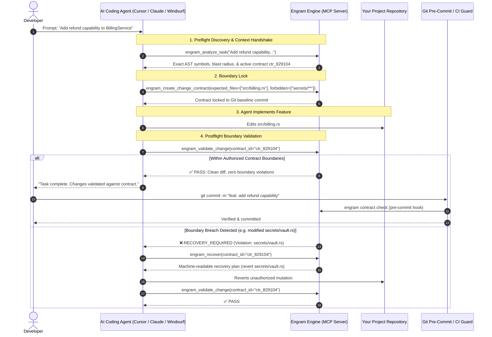

# Integrating Engram Into Your Project & AI Coding Agents

This guide explains step-by-step how to add Engram to your existing repository, configure your AI coding agent (Cursor, Claude, Windsurf, Cline, Roo Code), and establish an automated change-boundary loop.

---

## Architecture: The Developer & Agent Loop



---

## Part 1: Integrating Engram Into Your Project

### 1. Initialize Engram in Your Repository Root
Navigate to your existing project and run:

```bash
cd /path/to/your/project
engram init
engram .
```

This creates the following directory structure inside your project:

```text
your-project/
├── src/                          # Your existing source code
├── package.json (or Cargo.toml)  # Your existing manifest
├── .gitignore                    # Updated to ignore local index & cache
└── .engram/                      # Engram repository artifacts
    ├── constitution.yaml         # Team architectural rules & forbidden boundaries
    ├── memory.yaml               # Durable engineering decisions & rationale
    ├── index.db                  # Local SQLite WAL AST symbol graph (gitignored)
    └── events/                   # Append-only cryptographic audit logs (gitignored)
```

### 2. Configure Your Project Constitution (`.engram/constitution.yaml`)
Define your team's architectural constraints that override any agent request:

```yaml
schema_version: 1
architecture:
  pattern: modular-clean
rules:
  - id: RULE-001
    name: "Protect sensitive vault & secrets"
    description: "Agents may never modify vault credentials or auth signing keys"
    pattern: "src/secrets/**"
    severity: error
    action: forbid

  - id: RULE-002
    name: "No direct database access in UI layer"
    description: "UI components must invoke services, not raw query clients"
    pattern: "src/ui/**"
    forbidden_imports:
      - "src/db/**"
      - "@database/client"
    severity: error
    action: forbid
```

### 3. Install Git Pre-Commit Hook (Optional but Recommended)
Install Change Guard into `.git/hooks/pre-commit` to prevent committing unauthorized mutations:

```bash
engram contract install-hook
```

---

## Part 2: Integrating With Your AI Coding Agent

Engram runs as a background JSON-RPC 2.0 Model Context Protocol (MCP) server over `stdio`.

### 1-Click Automated Setup

Engram provides built-in 1-click configuration for popular AI coding environments:

```bash
# For Cursor IDE
engram setup cursor

# For Claude Desktop / Claude Code
engram setup claude

# For Windsurf IDE
engram setup windsurf
```

*Note: `engram setup` safely merges with existing MCP servers in your editor config without overwriting them.*

### Manual MCP Configuration

If you use VS Code (with Cline or Roo Code) or any standard MCP client, add the following to your MCP settings file:

#### For Cursor (`.cursor/mcp.json` or Global Settings):
```json
{
  "mcpServers": {
    "engram": {
      "command": "engram",
      "args": ["mcp"]
    }
  }
}
```

#### For Claude Desktop (`claude_desktop_config.json`):
```json
{
  "mcpServers": {
    "engram": {
      "command": "engram",
      "args": ["mcp"]
    }
  }
}
```

#### For Windsurf (`~/.codeium/windsurf/mcp_config.json`):
```json
{
  "mcpServers": {
    "engram": {
      "command": "engram",
      "args": ["mcp"]
    }
  }
}
```

---

## Part 3: Guiding the Agent (Prompt Rules)

To ensure your AI agent proactively uses Engram during coding sessions, add the following prompt rules to your editor's project instructions (e.g. `.cursorrules`, `.windsurfrules`, or `CLAUDE.md`):

```markdown
# AI Coding Protocol with Engram

Before modifying code in this repository:
1. **Discover Context:** Invoke `engram_analyze_task` or `engram_get_context` with your prompt to retrieve AST-grounded symbols, relevant caller graphs, and architectural rules.
2. **Lock Contract:** Declare your intended scope using `engram_create_change_contract` with `expected_files` and `forbidden` paths.
3. **Implement Changes:** Modify only files declared in your contract.
4. **Validate Diff:** Before completing the task, call `engram_validate_change`. If a boundary violation occurs, call `engram_recover` and follow the repair plan.
5. **Preserve Rationale:** When making durable architectural decisions, call `engram_record_decision`.
```

---

## Part 4: The MCP Tools Engram Exposes to the Agent

When connected via MCP, the AI agent has access to these tools:

| MCP Tool Name | Arguments | What the Agent Gets |
|---|---|---|
| `engram_analyze_task` | `task`, `token_budget` | Combined preflight analysis: AST symbols, relevant memories, and auto-generated contract ID. |
| `engram_get_context` | `task`, `token_budget` | BM25 lexical + AST graph ranked symbol snippets fitted strictly under the token limit. |
| `engram_create_change_contract` | `task`, `expected_files`, `forbidden` | Creates a baseline-anchored Change Contract enforcing boundaries for the session. |
| `engram_validate_change` | `contract_id` | Compares current Git working-tree diff against active contract. Returns pass or violation list. |
| `engram_get_impact` | `target` (symbol/file) | Calculates 7-hop blast radius across callers, interface implementations, and tests. |
| `engram_inspect_symbol` | `target`, `depth` | Deep inspection of a specific class or method with its downstream dependencies and memories. |
| `engram_get_memory` | `query`, `files` | Queries persistent team decisions and architectural rationale. |
| `engram_record_decision` | `title`, `rationale`, `files` | Submits a new architectural decision to Engineering Memory for review. |
| `engram_recover` | `contract_id` | Generates a structured, bounded repair plan (max 2 retries) if boundaries are breached. |

---

## Part 5: CI/CD Enforcement (GitHub Actions)

Add automated pull-request validation by creating `.github/workflows/engram-guard.yml`:

```yaml
name: Engram Change Guard
on: [pull_request]

jobs:
  change-guard:
    runs-on: ubuntu-latest
    steps:
      - name: Checkout repository
        uses: actions/checkout@v4
        with:
          fetch-depth: 0

      - name: Install Engram
        run: |
          curl -fsSL https://raw.githubusercontent.com/code-amalps/Engram/main/install.sh | sh

      - name: Run Change Guard PR Check
        run: |
          engram contract check --base ${{ github.event.pull_request.base.sha }} --check-provenance
```
