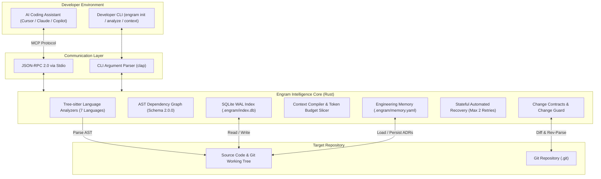

# Engram Technical Architecture

Engram is a local repository intelligence engine and change boundary system built in Rust. It runs locally as a standalone command-line tool or a JSON-RPC 2.0 Model Context Protocol (MCP) server for AI coding assistants.

---

## 1. System Overview & Agent-in-the-Loop Model

Engram operates as an intelligent intermediary between your local codebase and AI coding agents (such as Cursor, Claude Desktop, VS Code with Copilot or Cline, and Windsurf). Rather than feeding entire files or arbitrary text embeddings to an LLM, Engram provides structurally indexed, semantically linked AST context and enforces strict change boundaries.

---

## 2. Multi-Language Indexing Pipeline

Engram indexes code repositories by executing compiled Tree-sitter parsers locally. It extracts concrete syntax trees (CST) and transforms them into unified Abstract Syntax Tree (AST) symbol definitions and relationships.

### Supported Languages & Extensions (`src/analyzer.rs`)
Engram provides native AST extraction across 7 primary language families:
- **Rust (`.rs`):** structs, enums, traits, impl blocks, functions, macros, `use` declarations.
- **TypeScript (`.ts`, `.tsx`):** classes, interfaces, types, functions, arrow functions, methods, `import`/`export` bindings.
- **JavaScript (`.js`, `.jsx`, `.mjs`, `.cjs`):** classes, functions, arrow functions, methods, ES/CJS module imports.
- **Python (`.py`):** classes, methods, functions, decorators, `import` and `from ... import` statements.
- **Go (`.go`):** structs, interfaces, functions, methods, packages, package imports (via `go_parser.rs` structural interface resolution).
- **Java (`.java`):** classes, interfaces, records, methods, annotations, package imports (via `java_parser.rs`).
- **C# (`.cs`):** classes, interfaces, structs, records, methods, properties, `using` directives.

### Ingestion Stages
1. **File Discovery:** Scans directory tree respecting `.gitignore` and `.engramignore`. Skips symbolic links, binary files, and files exceeding size thresholds.
2. **Two-Tier Change Invalidation:** 
   - Tier 1: Filesystem modified time (`mtime`) check.
   - Tier 2: Cryptographic SHA-256 content hash comparison against `.engram/index.db`.
   Files whose content hash matches the index bypass parsing completely.
3. **AST Symbol Extraction:** Traverses Tree-sitter syntax nodes, resolving identifiers, enclosing scopes, declaration line bounds, and structural docstrings.
4. **Relationship Extraction:** Identifies cross-symbol references, type usages, and module imports to populate dependency edges.
5. **Secret Redaction:** Before persistence, raw source snippets are scanned for potential secrets, private keys, API credentials, and tokens using targeted regex patterns, replacing matches with `[REDACTED]`.

---

## 3. Storage Engine & SQLite WAL Schema

Engram persists all extracted symbols, relations, and file metadata into an embedded SQLite database (`.engram/index.db`) operated in Write-Ahead Logging (`PRAGMA journal_mode = WAL`) mode with `PRAGMA synchronous = NORMAL`.

### Core Schema Concepts
- `files`: Tracks relative file paths, language tags, mtime, and authoritative content hashes.
- `symbols`: Stores discrete AST symbols (functions, classes, structs, traits, interfaces) with line bounds, scope hierarchy, and signatures.
- `relations`: Records directional dependency edges between symbols or packages.
- `contracts`: Persists active change contracts and recorded violation events.

---

## 4. AST Dependency Graph & 7 Impact Categories

Engram's graph engine (`src/knowledge_graph.rs` & `src/impact.rs`) models code structure and evaluates change blast radius across **7 deterministic impact categories**:

| Impact Category | Description | Weight | Example |
|---|---|:---:|---|
| `DIRECT` | The target symbol or enclosing definition | 1.0 | `pub struct Storage` |
| `TEST` | Test suites asserting against the target | 0.95 | `tests/storage_test.rs` asserting `Storage` |
| `IMPLEMENTATION` | Struct ↔ Interface structural implementation | 0.95 | `impl StorageEngine for SqliteStorage` |
| `CALLER` | Functions or methods referencing or invoking the target | 0.85 | `compiler::compile_context` calls `storage.query` |
| `IMPORT_DEPENDENT` | Workspace packages importing the target package | 0.80 | `use crate::storage::Storage;` |
| `CONFIGURATION` | Manifests, environment, or ecosystem configurations | 0.70 | `Cargo.toml`, `.engram/config.yaml` |
| `HISTORICAL` | Statistically mined Git co-change coupling | 0.60 | Files frequently committed in tandem with target |

In addition, `src/knowledge_graph.rs` maintains fine-grained directional graph relation edges (`Contains`, `Imports`, `DependsOn`, `Calls`, `References`, `Implements`, `Inherits`, `Extends`, `Declares`, `Tests`, `GovernedBy`, `Documents`, `Configures`).

---

## 5. Context Compiler & Token Budget Slicing

The Context Compiler (`src/compiler.rs` & `src/budget.rs`) synthesizes retrieved AST symbols, architectural decisions, and blast-radius breadcrumbs into a single, structured markdown block formatted for AI coding prompts.

### Pipeline Stages
1. **Lexical Grounding (BM25):** Evaluates the task query against indexed symbol names, signatures, docstrings, and filenames to establish seed nodes.
2. **AST Graph Expansion:** Expands across high-confidence dependency edges to capture referenced interfaces and callers.
3. **Engineering Memory Inclusion:** Retrieves relevant Architectural Decision Records (ADRs) from `memory.yaml` matching query keywords or touched files.
4. **Token Budget Slicing:** Dynamically truncates low-priority context components to fit strictly within the specified token budget (default: 1,200 tokens).
5. **Boundary Armor:** Wraps compiled context in prompt-injection containment tags (`<engram_context>` / `</engram_context>`) to prevent untrusted repo strings from hijacking agent instructions.

---

## 6. Change Contracts & Change Guard

Change Contracts (`src/contract.rs`, `src/hook.rs`) enforce architectural boundaries during autonomous or assisted agent coding sessions.

### Lifecycle State Machine
- **Proposed:** Agent creates contract via `engram_preflight` with declared `planned_files` and `forbidden` boundaries.
- **Active:** Contract locked to current Git commit (`git rev-parse HEAD`).
- **Validated:** `engram_postflight` confirms working tree diff modifies only permitted files.
- **Violated:** Unapproved files edited; trips violation and triggers recovery.
- **Reverted:** Recovery recipe applied to reset unauthorized edits.

---

## 7. Stateful Automated Recovery

When an agent violates a Change Contract, Engram's recovery engine (`src/recovery.rs` / `engram_recover`) guides structured remediation without modifying files directly:
- **Bounded Retries:** Enforces a strict limit of **maximum 2 retry attempts** per task.
- **Diagnostic Generation:** Emits exact diff violations, forbidden files touched, and causal breadcrumbs.
- **Non-Destructive Guidance:** Emits Git-compatible revert recipes to reset unapproved edits while preserving valid progress.
