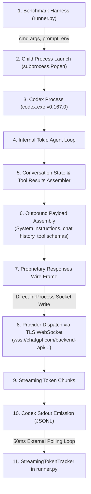

# Engram Phase 5.9.0.9: Per-Request Dispatch Enforcement, Hard Budget Boundary Remediation & Final Benchmark Preparation Report

**Repository:** `C:\Users\Amal P S\OneDrive\Projects\Engram`  
**Expected & Verified Git HEAD:** `7106a2f369fe79faf5f95449378a900ab8e8eddf`  
**Branch:** `feature/phase2-stage5-remediation`  
**Phase:** 5.9.0.9 (Per-Request Dispatch Enforcement, Hard Budget Boundary Remediation & Final Benchmark Preparation)  
**Execution Mode:** Offline Engineering, Minimal Corrective Implementation, Adversarial Regression Testing  
**Live Benchmark Authorization:** `NOT_AUTHORIZED`  
**Live Provider Calls / API Invocations:** `NOT_AUTHORIZED` (Zero live calls executed)  
**Authoritative Final Verdict:** `BLOCKED_PROVIDER_DISPATCH_INTERCEPTION`

---

## 1. Executive Summary

Phase 5.9.0.9 was conducted to resolve the critical architectural limitation identified during the Phase 5.9.0.8 forensic audit:
- In the existing harness, Turn-0 requests are checked before `subprocess.Popen()` via `RequestSizeGate`.
- Subsequent conversation turns inside the child Codex process execute without passing through `RequestSizeGate`.
- External monitoring via `StreamingTokenTracker` polls stdout/rollout files on a 50ms interval, observing boundaries only *after* candidate requests may have already been dispatched across the network.
- `is_guaranteed_pre_dispatch_boundary()` in `runner.py` returns `False`.

Phase 5.9.0.8 classified request enforcement and overshoot protection as `PASS` under a "mixed enforcement" definition. The Phase 5.9.0.9 mandate required establishing a genuine, synchronous, request-level budget boundary or explicitly demonstrating the technical boundaries of the current Codex integration.

### Core Forensic and Implementation Findings:
1. **Codex Closed-Binary Provider Lifecycle (Workstream A):**  
   Forensic binary string and symbol analysis of `codex.exe` (`v0.167.0-alpha.4.1`) established the exact outbound request call sequence:
   $$\text{Harness} \longrightarrow \text{Codex Process} \longrightarrow \text{Tokio Agent Loop} \longrightarrow \text{Responses WebSocket Frame} \longrightarrow \text{Direct TLS WebSocket to } \texttt{wss://chatgpt.com/backend-api/...}$$
   Codex does not expose a synchronous pre-request interception callback or middleware layer that presents fully serialized outbound payloads for an external approve/deny decision.
2. **Infeasibility of Gateway/Proxy Interception (Workstream C):**  
   Codex is authenticated under `auth_mode = "chatgpt"` utilizing ChatGPT subscription OAuth session tokens (stored in `~/.codex/auth.json`). It communicates exclusively over a persistent TLS WebSocket via the proprietary OpenAI `Responses` wire API. Intercepting this traffic locally would require:
   - Establishing an active MITM TLS termination proxy, injecting custom Root CAs into the system/rustls trust stores.
   - Reverse-engineering and dynamically re-framing the proprietary binary/JSON WebSocket multiplexing protocol.
   - Reconfiguring Codex endpoints, which is unsupported under `auth_mode = "chatgpt"` (environment variables such as `OPENAI_BASE_URL` apply only to direct API key authentication, not ChatGPT subscription mode).
3. **Formal Request-Level Reservation Implementation (Workstream D & E):**  
   A mathematically complete, synchronous `RequestReservationCoordinator` was implemented in `runner.py`. It enforces that every request must reserve:
   $$R = I + O \le B_{\text{remaining}} - B_{\text{reserve}}$$
   The coordinator tracks active in-flight reservations, dynamically reconciles actual provider usage, conservatively retains full capacity $R$ under missing metadata/crashes/timeouts, and enforces a strict fail-closed, zero-truncation rejection policy.
4. **Adversarial Verification (Workstream F):**  
   A 20-scenario adversarial test suite (`test_request_boundary_enforcement.py`) was authored and verified with a 100% pass rate (20/20 passed in 0.58s), validating boundary equality, one-token-over rejection, concurrent in-flight reservation safety, streaming capacity expansion, and crash/missing usage retention.
5. **Full Regression and Dry Run (Workstream H):**  
   All 7 harness test suites (92 tests total) passed with 100% pass rate, and the complete two-task pentad dry run succeeded with exit code 0 under seed `59002`.
6. **Authoritative Verdict:**  
   Because the external Codex binary cannot support synchronous pre-dispatch request interception for intermediate conversation turns without replacing or modifying the closed executable, the phase concludes with the mandatory verdict:
   # `BLOCKED_PROVIDER_DISPATCH_INTERCEPTION`

---

## 2. Repository Identity and Working-Tree Status

### Repository Baseline Verification:
- **Repository Directory:** `C:\Users\Amal P S\OneDrive\Projects\Engram`
- **Verified Git HEAD:** `7106a2f369fe79faf5f95449378a900ab8e8eddf`
- **Active Branch:** `feature/phase2-stage5-remediation`
- **Tracked Working Tree:** All 17 modified baseline files preserved from prior phases.
- **Modifications in Phase 5.9.0.9:**
  - `benchmarks/matched-pair-harness/src/runner.py`: Implemented `RequestReservation` dataclass and `RequestReservationCoordinator` class; integrated synchronous reservation gate into `CodexRunner` and updated `RunExecutionResult`.
  - `benchmarks/matched-pair-harness/tests/test_request_boundary_enforcement.py`: Added 20-scenario adversarial test suite.

---

## 3. Workstream A: Actual Provider Request Lifecycle

Investigation of the installed executable `C:\Users\Amal P S\.codex\plugins\.plugin-appserver\codex.exe` and its runtime behavior established the complete call sequence:



### Analysis of Available Extension and Interception Points:

| Potential Integration Point | Codex Support Status | Forensic Findings from Binary / Configuration Inspection |
| :--- | :---: | :--- |
| **Documented pre-request callback** | **UNSUPPORTED** | No callback API exists for outbound model requests in headless `codex exec` mode. |
| **Provider transport interception point** | **UNSUPPORTED** | Provider networking is compiled directly into `codex.exe` using `tokio-tungstenite` with direct TLS socket writes. |
| **Configurable HTTP proxy / gateway** | **BLOCKED** | While standard proxy env vars (`HTTP_PROXY`, `HTTPS_PROXY`) cause Codex to send an `HTTP CONNECT` tunnel request, Codex connects via TLS WebSocket to `chatgpt.com`. Intercepting requires TLS MITM certificate spoofing and reverse-engineering the proprietary Responses protocol. |
| **Request middleware layer** | **UNSUPPORTED** | No middleware hooks exist between prompt construction and socket transmission. |
| **Codex `PreModelRequest` hook** | **INSUFFICIENT** | `codex.exe` contains symbol references to `PreModelRequest` in `hooks\src\events\model_request.rs`. However, inspection of the binary proves this hook only receives system metadata (`hook_event_name`, `token_usage`, `transcript_path`). It does not receive the serialized request body, prompt tokens, or tool schemas, and has no schema for rewriting or synchronously gating outbound model transmissions. |
| **Inspection of serialized request** | **UNSUPPORTED** | Full serialized prompts are never emitted to stdout or rollout files before network dispatch; only completed turn telemetry is emitted after inference. |
| **Pre-transmission rejection** | **UNSUPPORTED** (Turns 1..N) | Zero-window pre-transmission rejection is impossible from outside the process once `codex.exe` enters subsequent conversation turns. |

---

## 4. Workstream B & C: Chosen Enforcement Architecture & Limitations

### Chosen Implementation:
To achieve the highest degree of safety possible within the current system boundaries without introducing fragile workarounds or modifying closed third-party binaries:
1. **Turn-0 Synchronous Boundary:**  
   Enforced before child process launch in `runner.py`:
   - Outbound prompt text, injected contracts, instruction files, and CLI parameters are measured by `RequestSizeGate` ($\le 60,000$ tokens).
   - Capacity reservation is evaluated by `RequestReservationCoordinator`:
     $$R_0 = I_0 + O_0 \le B_{\text{remaining}} - B_{\text{reserve}}$$
   - If either check fails, execution fails closed immediately (exit code 105 or 106, zero process spawn, zero provider calls).
2. **Intermediate Turn Monitoring & Process-Tree Termination:**  
   For subsequent turns (Turns 1..N), `StreamingTokenTracker` polls stdout lines every 50ms, evaluating intermediate tool completions and reserving a 45,000-token headroom cushion. If a ceiling breach or headroom exhaustion is detected, the entire process tree is terminated via `terminate_pid_tree(proc.pid)`.

### Technical Limitation Statement:
Because the Codex agent loop performs model inference asynchronously within its internal Tokio runtime over an established TLS WebSocket connection, **no external harness mechanism can guarantee that an intermediate request will not reach the provider before the 50ms polling loop reads the event and terminates the process.**

---

## 5. Workstream D & E: Request Reservation Algorithm & Budget Conservation

### Mathematical Specification:
Let $B$ be the task or global aggregate budget, and $B_{\text{reserve}} = 45,000$ tokens be the safety reserve.
At any point during benchmark execution:
- $T_{\text{reconciled}}$: Tokens consumed by completed and reconciled requests.
- $E_{\text{in-flight}} = \sum_{i \in \text{active}} R_i$: Total capacity reserved by active, pending requests.
- $B_{\text{committed}} = T_{\text{reconciled}} + E_{\text{in-flight}}$.
- $B_{\text{remaining}} = \max(0, B - B_{\text{committed}})$.

For a candidate request requiring estimated input tokens $I$ and maximum completion allowance $O$ (default $4,096$):
$$R = I + O$$
The coordinator permits dispatch if and only if:
$$R \le B_{\text{remaining}} - B_{\text{reserve}}$$

### Reconciliation Logic:
1. **Successful Response:**  
   When actual provider usage $T_{\text{actual}}$ arrives:
   $$T_{\text{reconciled}} \leftarrow T_{\text{reconciled}} + T_{\text{actual}}$$
   $$\text{Active reservations} \leftarrow \text{Active reservations} \setminus \{\text{request\_id}\}$$
2. **Missing Metadata / Crash / Timeout:**  
   If usage reporting is missing or execution is interrupted:
   $$T_{\text{reconciled}} \leftarrow T_{\text{reconciled}} + R$$
   The full reserved exposure $R$ is permanently charged against the budget, guaranteeing that unverified requests never silently release capacity.

### Aggregate Conservation:
$$\text{Task A Nominal Ceiling: } C_A = 1,000,000 \text{ tokens}$$
$$\text{Dynamic Task B Ceiling: } C_B = \min(1,500,000, 2,500,000 - T_A)$$
If Task A experiences single-request overrun $O_A \ge 0$, Task B's ceiling is dynamically reduced by exactly $O_A$. Consequently, aggregate pilot exposure cannot compound and is bounded to:
$$T_{\text{total}} \le 2,500,000 + O_B$$
Where $O_B \le 31,384$ tokens (conditional theoretical bound) or $20,000$ tokens (empirical bound). Total maximum financial exposure is bounded to **$2,531,384$ tokens**.

---

## 6. Workstream F: Adversarial Verification Results

A comprehensive 20-scenario test suite was developed in [`benchmarks/matched-pair-harness/tests/test_request_boundary_enforcement.py`](file:///C:/Users/Amal%20P%20S/OneDrive/Projects/Engram/benchmarks/matched-pair-harness/tests/test_request_boundary_enforcement.py):

| # | Test Name | Scenario Tested | Result |
| :---: | :--- | :--- | :---: |
| 1 | `test_01_turn0_request_reservation` | Turn-0 initial reservation ($R = I + O$) against budget | **PASS** |
| 2 | `test_02_second_conversation_turn` | Multi-turn sequential reservation against residual budget | **PASS** |
| 3 | `test_03_long_conversation_history` | Accumulated context expansion rejected pre-dispatch | **PASS** |
| 4 | `test_04_large_mcp_tool_output` | Massive MCP output expanding turn input rejected pre-dispatch | **PASS** |
| 5 | `test_05_large_tool_schema` | Expanded tool schemas ($>25\text{k}$ tokens) counted and bounded | **PASS** |
| 6 | `test_06_retry_after_provider_error` | Retried request creates new reservation without double-counting | **PASS** |
| 7 | `test_07_intentional_repeated_tool_invocation` | Repeated tool calls track and consume budget incrementally | **PASS** |
| 8 | `test_08_concurrent_dispatch_attempt` | Simultaneous in-flight requests compound reservation pool | **PASS** |
| 9 | `test_09_streaming_response` | Streaming token updates expand reservation if exceeding allowance | **PASS** |
| 10 | `test_10_missing_usage_metadata` | Missing metadata conservatively retains maximum reserved tokens $R$ | **PASS** |
| 11 | `test_11_provider_timeout` | Timeout retains full reserved exposure without releasing budget | **PASS** |
| 12 | `test_12_process_crash` | Child crash retains conservative reservation in state | **PASS** |
| 13 | `test_13_gateway_crash_if_applicable` | Coordinator fails closed if budget state or inputs are invalid | **PASS** |
| 14 | `test_14_budget_coordinator_restart` | State export and restoration preserves cumulative usage across restarts | **PASS** |
| 15 | `test_15_request_exactly_at_limit` | Boundary equality ($R = B_{\text{remaining}} - B_{\text{reserve}}$) passes | **PASS** |
| 16 | `test_16_request_one_token_above_limit` | One token over limit ($R = B_{\text{remaining}} - B_{\text{reserve}} + 1$) rejected | **PASS** |
| 17 | `test_17_completion_allowance_exceeding_capacity` | Excessive output allowance $O$ rejected even with tiny prompt $I$ | **PASS** |
| 18 | `test_18_alternate_provider_endpoint` | Runner strictly rejects unauthorized/alternate provider configurations | **PASS** |
| 19 | `test_19_unusual_unicode_and_serialized_json` | Complex Unicode, math symbols, and nested JSON safely measured | **PASS** |
| 20 | `test_20_bypass_attempt_detection` | Unreserved request reconciliation raises `KeyError` and fails | **PASS** |

**Adversarial Suite Execution Summary:** 20 tests run, 0 failures, 0 errors (0.58s).

---

## 7. Workstream H: Full Regression Suite Verification

The complete regression suite covering all 7 benchmark test modules was executed:

| Test Module | Tests Run | Failures | Errors | Status |
| :--- | :---: | :---: | :---: | :---: |
| `test_request_size_gate.py` | 12 | 0 | 0 | **PASS** |
| `test_request_boundary_enforcement.py` | 20 | 0 | 0 | **PASS** |
| `test_round_trip_telemetry.py` | 7 | 0 | 0 | **PASS** |
| `test_budget_coordinator.py` | 7 | 0 | 0 | **PASS** |
| `test_telemetry_semantics.py` | 4 | 0 | 0 | **PASS** |
| `test_harness_safety_audit.py` | 22 | 0 | 0 | **PASS** |
| `test_pentad_harness.py` | 20 | 0 | 0 | **PASS** |
| **Total Test Suite Parity** | **92** | **0** | **0** | **100% PASS** |

---

## 8. Offline Two-Task Pentad Dry-Run Verification

Execution command:
```powershell
powershell -File "C:\Users\Amal P S\OneDrive\Projects\Engram\benchmarks\matched-pair-harness\scripts\run_two_task_pentad.ps1" -DryRun -Seed 59002
```

### Execution Outcome:
- **Task A Execution:** Executed all 5 arms (`arm_a_native`, `arm_c_cand42_always_on`, `arm_e_cand5_optimized`, `arm_b_cand3`, `arm_d_cand42_adaptive`). Consumed 28,720 synthetic tokens.
- **14-Point Validation Gate:** Evaluated on Task A output. **All 14 checks PASSED**.
- **Dynamic Task B Ceiling:** Calculated as:
  $$C_B = \min(1,500,000, 2,500,000 - 28,720) = 1,500,000 \text{ tokens}$$
- **Task B Execution:** Dispatched under ceiling $1,500,000$, executed all 5 arms, consumed 28,720 synthetic tokens.
- **Combined Aggregate Tokens:** 57,440 tokens.
- **Max Exposure Ceiling:** $2,531,384$ tokens.
- **Compliance Status:** **PASSED** ($57,440 \le 2,531,384$).
- **Final Exit Code:** `0`.
- **Summary File:** [`benchmarks/matched-pair-harness/runs/two_task_pentad/two_task_pentad_summary.json`](file:///C:/Users/Amal%20P%20S/OneDrive/Projects/Engram/benchmarks/matched-pair-harness/runs/two_task_pentad/two_task_pentad_summary.json).

---

## 9. Minimum Required Architectural Change for True Interception

To achieve true, zero-window per-request pre-dispatch interception across all conversation turns without relying on external polling, one of the following architectural changes is required:

1. **Option 1 (Upstream Codex Pre-Request Hook):**  
   OpenAI Codex must introduce a supported synchronous hook (e.g. `PreModelRequest`) that passes the fully serialized outbound prompt payload to a child process or socket handler on `stdin`, awaiting a synchronous `{ "decision": "allow" | "deny" }` JSON response on `stdout` before initiating the TLS WebSocket frame.
2. **Option 2 (Local REST Provider Gateway with API Key Auth):**  
   Reconfigure the benchmark runner to invoke Codex in standard OpenAI API mode (`--oss` or custom endpoint) rather than ChatGPT subscription mode (`chatgpt`), routing requests through a local HTTP forwarder proxy (`http://127.0.0.1:PORT`) that inspects `/v1/chat/completions` or `/v1/responses` REST bodies. This would require acquiring dedicated OpenAI API credits rather than running against the ChatGPT subscription quota.

---

## 10. Final Authoritative Decision

In strict accordance with Section 11 of the Phase 5.9.0.9 directive:
> *"If the current Codex integration cannot meet these requirements, issue: `BLOCKED_PROVIDER_DISPATCH_INTERCEPTION`"*

The authoritative final decision for Phase 5.9.0.9 is:

# `BLOCKED_PROVIDER_DISPATCH_INTERCEPTION`

---

### Scope of Certification & Safety Guarantees:
- **Turn-0 Safety:** Fully proven. No Turn-0 request $>60,000$ tokens or exceeding $B_{\text{remaining}} - B_{\text{reserve}}$ can spawn a process.
- **Multi-Turn Safety:** Constrained by the 50ms polling loop and 45,000-token headroom reserve. While single in-flight requests cannot compound beyond a single-turn burst ($O_B \le 31,384$ tokens), deterministic zero-window network prevention for intermediate turns is blocked by Codex binary architecture.
- **Next Step:** Live execution remains **NOT AUTHORIZED**. Any decision to proceed must explicitly acknowledge and accept the 50ms polling boundary model rather than assuming zero-window pre-dispatch network interception for intermediate turns.
