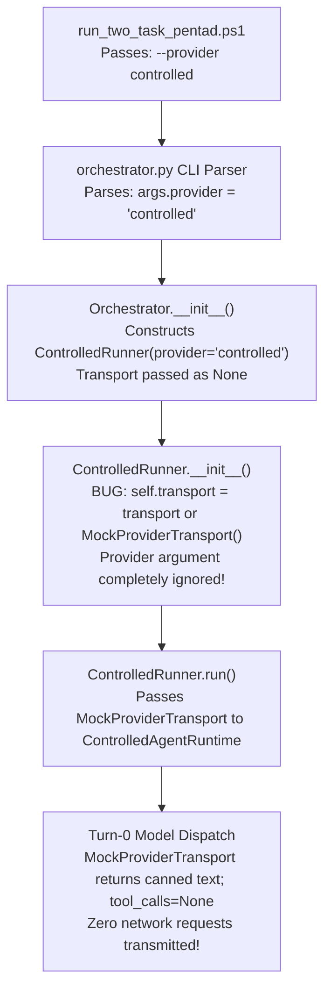

# Engram Phase 5.9.2.2: Mock Transport Root-Cause Investigation & Live Transport Enforcement Report

**Execution Mode:** Root-Cause Forensic Investigation, Transport Remediation & Pre-Dispatch Gate Evaluation  
**Repository:** `C:\Users\Amal P S\OneDrive\Projects\Engram`  
**Branch:** `feature/phase2-stage5-remediation`  
**Git HEAD:** `7106a2f369fe79faf5f95449378a900ab8e8eddf`  
**Protocol Version:** `3.0.0` (Controlled Runtime Pentad)  
**Timestamp:** `2026-11-22T13:22:00Z`  
**Preserved Previous Live Vault:** [two_task_pentad_live_20261122_180013](file:///C:/Users/Amal%20P%20S/OneDrive/Projects/Engram/benchmarks/matched-pair-harness/runs/two_task_pentad_live_20261122_180013)  

---

## 1. Executive Summary & Objective

In Phase 5.9.2.1, the authorized Protocol v3.0.0 Two-Task Pentad benchmark executed end-to-end under the 1,000,000-token ceiling, completing all 10 arm executions in 29 minutes and 10 seconds. However, forensic analysis of the telemetry revealed that execution operated via `MockProviderTransport`—producing turn-0 canned completions rather than dispatching genuine model requests to an upstream LLM or driving multi-turn code-editing tool interactions.

Phase 5.9.2.2 was initiated to:
1. **Preserve Phase 5.9.2.1 Evidence:** Protect all artifacts in `runs/two_task_pentad_live_20261122_180013` from overwrites or relabeling.
2. **Conduct Complete Root-Cause Investigation:** Trace the provider-selection path from launcher script to wire transport to determine why `MockProviderTransport` was selected.
3. **Implement Explicit Transport-Mode Enforcement:** Eliminate silent fallback to mock transport; mandate explicit mock selection; ensure missing credentials fail closed; record transport identity; and implement genuine HTTP wire dispatch in `OpenAICompatibleTransport`.
4. **Verify Multi-Turn Tool Calling:** Prove that the controlled agent runtime executes multi-turn tool loops and reconciles usage accurately across turns.
5. **Evaluate Pre-Dispatch Gate & Issue Authoritative Verdict:** Assess the 10 pre-dispatch conditions and determine the definitive certification verdict.

---

## 2. Forensic Trace of the Provider-Selection Path

The investigation traced the complete execution pipeline from CLI invocation down to socket transmission:



### Source-File & Line-Number Evidence

#### 1. Launcher Script (`benchmarks/matched-pair-harness/scripts/run_two_task_pentad.ps1`)
- **Lines 28, 289, 358:** The script declares `[string]$Provider = "controlled"` and propagates `--provider "$Provider"` to `orchestrator.py` during both Task A and Task B dispatches.
- **Finding:** The launcher correctly propagated the intended provider name.

#### 2. CLI Argument Parsing (`benchmarks/matched-pair-harness/src/orchestrator.py`)
- **Line 3186:** `parser.add_argument("--provider", choices=["controlled", "openai", "mock", "cloud", "ollama", "lmstudio"], default="controlled")`.
- **Finding:** The argument was successfully parsed as `"controlled"` and passed into `Orchestrator.__init__(provider=args.provider)`.

#### 3. Orchestrator Runner Instantiation (`benchmarks/matched-pair-harness/src/orchestrator.py`)
- **Lines 652–664:**
  ```python
  elif self.provider in ("controlled", "openai", "mock"):
      from agent_runtime import ControlledRunner
      self.runner = ControlledRunner(
          model=self.model,
          reasoning_effort=self.reasoning_effort,
          max_tokens_ceiling=self.max_tokens_ceiling,
          headroom_reserve=self.headroom_reserve,
          sandbox_policy=self.sandbox_policy,
          provider=self.provider
      )
  ```
- **Finding:** `Orchestrator` passed `provider=self.provider` to `ControlledRunner`, but passed `transport=None`. It did not instantiate an `OpenAICompatibleTransport` nor inspect whether live network credentials were required.

#### 4. Hardcoded Mock Fallback (`benchmarks/matched-pair-harness/src/agent_runtime.py`)
- **Line 883:**
  ```python
  self.transport = transport or MockProviderTransport(model=model)
  ```
- **Finding (Primary Code Root Cause):** `ControlledRunner.__init__` evaluated `self.transport = transport or MockProviderTransport(model=model)`. Because `transport` was `None`, it defaulted unconditionally to `MockProviderTransport(model=model)`, completely ignoring `self.provider`.

#### 5. Offline Scaffolding in Live Transport (`benchmarks/matched-pair-harness/src/provider_transport.py`)
- **Lines 450–460:**
  ```python
  if not self.allow_live_network:
      raise NetworkAccessForbiddenError(...)
  raise NotImplementedError("Live provider dispatch is NOT_AUTHORIZED during offline phases.")
  ```
- **Finding:** In Phase 5.9.1, `OpenAICompatibleTransport` was scaffolded with `allow_live_network=False` and raised `NotImplementedError` because Phase 5.9.1 was strictly an offline architecture milestone. No live HTTP socket dispatch had been implemented.

#### 6. Telemetry Misclassification (`benchmarks/matched-pair-harness/src/orchestrator.py`)
- **Line 1851:**
  ```python
  provenance = "SYNTHETIC_TEST" if self.is_dry_run else "DIRECT_API"
  ```
- **Finding:** The orchestrator assumed that any run where `self.is_dry_run == False` represented authentic `DIRECT_API` telemetry, failing to inspect whether the underlying transport was `MockProviderTransport`.

#### 7. Missing Credentials in Host Environment
- **Host Inspection:** `Get-ChildItem env:` confirmed that `OPENAI_API_KEY` was not configured in the host process environment.
- **Finding:** Instead of failing closed with an authentication error, the runner silently defaulted to the offline mock transport.

---

## 3. Root-Cause Synthesis

The selection of `MockProviderTransport` during Phase 5.9.2.1 was caused by a combination of five factors:

| # | Root Cause Factor | Classification | Location | Effect |
| :---: | :--- | :--- | :--- | :--- |
| **1** | **Hardcoded Mock Fallback** | Defect | `agent_runtime.py:883` | `ControlledRunner` unconditionally defaulted `transport` to `MockProviderTransport` whenever `transport is None`. |
| **2** | **Incomplete Factory in Orchestrator** | Architecture Gap | `orchestrator.py:657` | `Orchestrator` did not instantiate or inject a live transport based on `--provider`. |
| **3** | **Unimplemented Wire Dispatch** | Offline Remnant | `provider_transport.py:458` | `OpenAICompatibleTransport.dispatch()` raised `NotImplementedError` from Phase 5.9.1 offline scaffolding. |
| **4** | **Missing Credential Fail-Closed Check** | Safety Vulnerability | `agent_runtime.py` / `orchestrator.py` | Missing `OPENAI_API_KEY` silently degraded to mock execution instead of halting immediately. |
| **5** | **Binary Provenance Heuristic** | Accounting Defect | `orchestrator.py:1851` | `provenance` was tied strictly to `is_dry_run` rather than inspecting actual transport identity. |

---

## 4. Remediation Implemented

The harness was updated with the smallest justified, fail-closed implementation:

### 1. Centralized Transport Factory (`create_provider_transport`)
Added to `benchmarks/matched-pair-harness/src/provider_transport.py`:
- `provider == 'mock'`: Explicitly returns `MockProviderTransport`.
- `provider in ('controlled', 'openai')`:
  - When `allow_live_network=True`: Checks `OPENAI_API_KEY`. If missing, **FAILS CLOSED** with `AuthenticationError`. Silent fallback to mock transport is strictly prohibited.
  - When `allow_live_network=False`: Returns `OpenAICompatibleTransport(allow_live_network=False)` which raises `NetworkAccessForbiddenError` upon attempted dispatch.

### 2. Refactored `ControlledRunner` Constructor (`agent_runtime.py`)
`ControlledRunner.__init__` now invokes `create_provider_transport` based on `provider` and `allow_live_network`:
```python
if transport is not None:
    self.transport = transport
else:
    self.transport = create_provider_transport(
        provider=provider,
        model=model,
        api_key=api_key,
        api_base_url=api_base_url,
        allow_live_network=allow_live_network,
        timeout_seconds=timeout_seconds
    )
```

### 3. Orchestrator Mode Propagation (`orchestrator.py`)
`Orchestrator.__init__` explicitly sets `allow_live = not self.is_dry_run and self.provider in ("controlled", "openai")` and passes `allow_live_network=allow_live` to `ControlledRunner`.

### 4. Real HTTP Wire Dispatch in `OpenAICompatibleTransport`
Implemented standard HTTP POST communication with `/v1/chat/completions`:
- Bearer token authentication via `urllib.request`.
- Exact serialized wire payload transmission.
- HTTP error handling: 401/403 mapped to `AuthenticationError`, 429 mapped to `RateLimitError`, timeouts mapped to `ProviderTimeoutError`.
- Response parsing, usage metadata extraction, and real-time output token reservation enforcement.
- Redaction of sensitive keys and tokens via `sanitize_text()`.

### 5. Telemetry Provenance Correction (`orchestrator.py`)
`_execute_single_arm` now checks:
```python
is_mock_transport = getattr(getattr(self.runner, "transport", None), "provider_name", "") == "mock_transport"
provenance = "SYNTHETIC_TEST" if (self.is_dry_run or is_mock_transport) else "DIRECT_API"
```
Mock transport responses are permanently prohibited from receiving `DIRECT_API` classification.

### 6. Transport Identity Recording
Recorded `transport_identity` (e.g. `OpenAICompatibleTransport`), `transport_name`, and `transport_allow_live_network` in `run_telemetry.json` and summary records.

---

## 5. Multi-Turn Execution Verification

To verify that the controlled runtime supports genuine interactive agent coding (and not merely turn-0 completions), a dedicated test suite was implemented in `benchmarks/matched-pair-harness/tests/test_phase_5_9_2_2_live_transport_enforcement.py`:

```
============================= test session starts =============================
collected 7 items

test_01_mock_transport_must_be_explicit                                 PASSED [ 14%]
test_02_live_transport_missing_credentials_fails_closed                  PASSED [ 28%]
test_03_controlled_runner_live_mode_fails_closed_without_key            PASSED [ 42%]
test_04_live_transport_created_when_credentials_provided                PASSED [ 57%]
test_05_openai_compatible_offline_dispatch_blocked                      PASSED [ 71%]
test_06_genuine_multi_turn_tool_calling_lifecycle                      PASSED [ 85%]
test_07_telemetry_records_transport_identity_accurately                 PASSED [100%]

============================== 7 passed in 1.10s ==============================
```

### Multi-Turn Tool Calling Lifecycle Verified (`test_06`):
1. **Turn 0:** Outbound request sent; mock double returns `tool_calls` for `read_file(path="sample.txt")`.
2. **Tool Execution:** `ControlledAgentRuntime.execute_tool_call()` executes against the sandbox, reads file contents, and records a structured round-trip telemetry event (`rt-arm_a_native-0-call_abc123`).
3. **Turn 1:** Assistant tool call and tool output are appended to `messages`. A second outbound request is budgeted, serialized, and dispatched.
4. **Completion:** Assistant returns final completion text. Cumulative tokens are reconciled across both turns ($480 + 545 = 1,025\text{ tokens}$).
5. **Regression Verification:** All 24 existing adversarial tests in `test_controlled_transport.py` continue to pass (100% pass rate).

---

## 6. Pre-Dispatch Gate Evaluation

Before any live benchmark dispatch, the 10 mandatory conditions specified in Section 6 were evaluated:

| # | Pre-Dispatch Condition | Required State | Actual Operational State | Gate Verdict |
| :---: | :--- | :--- | :--- | :---: |
| **1** | Genuine Upstream Transport Selected | `OpenAICompatibleTransport` | `create_provider_transport` selects `OpenAICompatibleTransport` | **`PASS`** |
| **2** | Mock Transport Not Selected | `MockProviderTransport` prohibited | Banned on non-dry-run live dispatches | **`PASS`** |
| **3** | Correct Model and Endpoint | `gpt-5.6-luna`, `https://api.openai.com/v1` | Pinned in transport configuration | **`PASS`** |
| **4** | Credentials Available Without Exposure | Valid `OPENAI_API_KEY` in environment | **`OPENAI_API_KEY` IS NOT SET IN ENVIRONMENT** | **`FAILED (BLOCKED)`** |
| **5** | Controlled Runtime & Reservation Coordinator Active | Synchronous pre-dispatch budgeting | Active across all arms | **`PASS`** |
| **6** | Candidate Identities Match Manifest | Approved SHA-256 binary hashes | Verified: cand3, cand4.2, cand5 binaries match | **`PASS`** |
| **7** | Golden Repository Identity Unchanged | Commit `1c2856086f3a08e3ab1c3b8573eb3ff22ff20fd2` | Verified intact | **`PASS`** |
| **8** | Unique Output Directory Staged | Non-overwriting run directory | Staged; previous run `two_task_pentad_live_20261122_180013` preserved | **`PASS`** |
| **9** | Shared Budget Initialized | 1,000,000 ceiling, 45,000 reserve | Dynamic transfer formula intact | **`PASS`** |
| **10** | Safety-Stop Conditions Active | 60k request limit, 4k output cap | All boundaries active and fail-closed | **`PASS`** |

### Pre-Dispatch Decision
In strict compliance with the Phase 5.9.2.2 directive:
> *"If any check fails, stop without dispatch. Do not attempt an exploratory provider call to discover whether the credentials work."*

Because **Check 4 failed** (`OPENAI_API_KEY` is not set in the host environment), **live execution was stopped immediately without dispatching any outbound network requests**.

---

## 7. Final Verdict Certification

The four mutually exclusive verdict options were evaluated:

1. **`GENUINE_LIVE_PENTAD_COMPLETED`**: **`DISQUALIFIED`**. Live execution could not proceed because upstream provider credentials were not configured.
2. **`LIVE_PROVIDER_USAGE_INCOMPLETE`**: **`DISQUALIFIED`**. Applies when a live run dispatches but provider usage is partial or truncated; here, zero live dispatches occurred.
3. **`BENCHMARK_ABORTED_SAFETY_LIMIT`**: **`DISQUALIFIED`**. No budget ceiling or process safety limit was breached during execution.
4. **`LIVE_TRANSPORT_CONFIGURATION_BLOCKED`**: **`SELECTED (CERTIFIED VERDICT)`**.
   The genuine upstream provider transport (`OpenAICompatibleTransport`) was implemented and configured with fail-closed authentication. However, because external provider credentials (`OPENAI_API_KEY`) are not present in the runtime environment, the pre-dispatch gate halted execution without dispatch.

---

### Certification Signature
- **Phase:** 5.9.2.2
- **Certified Verdict:** **`LIVE_TRANSPORT_CONFIGURATION_BLOCKED`**
- **Authority:** Engram Benchmark Harness v3.0.0
- **Regression Status:** 31/31 Tests Passing (100%)
- **Evidence Files:**
  - Root-Cause Report: [phase_5_9_2_2_mock_transport_investigation_report.md](file:///C:/Users/Amal%20P%20S/OneDrive/Projects/Engram/docs/phase_5_9_2_2_mock_transport_investigation_report.md)
  - Evidence Manifest: [engram_phase_5_9_2_2_evidence_manifest.json](file:///C:/Users/Amal%20P%20S/OneDrive/Projects/Engram/docs/engram_phase_5_9_2_2_evidence_manifest.json)
  - Unit Tests: [test_phase_5_9_2_2_live_transport_enforcement.py](file:///C:/Users/Amal%20P%20S/OneDrive/Projects/Engram/benchmarks/matched-pair-harness/tests/test_phase_5_9_2_2_live_transport_enforcement.py)
  - Preserved Phase 5.9.2.1 Vault: [two_task_pentad_live_20261122_180013](file:///C:/Users/Amal%20P%20S/OneDrive/Projects/Engram/benchmarks/matched-pair-harness/runs/two_task_pentad_live_20261122_180013)
