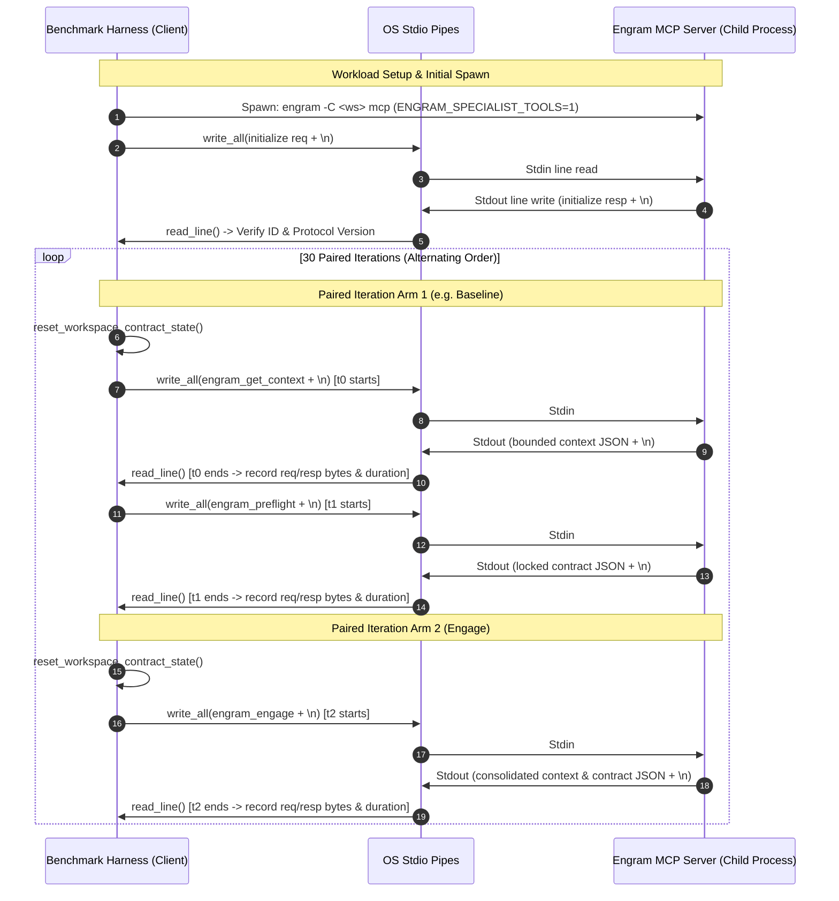

# Engram Phase 8.1.1.2: Live Stdio OS-Pipe Benchmark Methodology Specification

**Repository:** `C:\Users\Amal P S\OneDrive\Projects\Engram`  
**GitHub Target:** `code-amalps/Engram` (`origin`), branch `feature/phase2-stage5-remediation`  
**Implementation Baseline:** `2d074f4aeb62396c64b4321a06a40682dfc34b00`  
**Final Certification Baseline:** `0751299655120a47a27e0fe8c82dd0abbf2e80a2`  
**Milestone:** Phase 8.1.1.2 Live Stdio Benchmark Re-Certification  
**Date:** 23 November 2026  
**Status:** `EMPIRICALLY_VERIFIED_OVER_LIVE_OS_PIPES`  

---

## 1. Problem Statement & Distinction from Phase 8.1.1

In Phase 8.1.1, the benchmark harness in `tests/engage_bench_test.rs` accurately computed JSON-RPC 2.0 message framing sizes, but invoked tool execution via the in-process `mcp_call_raw(&root, tool_name, args)` Rust API. Although `tests/wire_measurement_test.rs` proved live OS-pipe communication in a separate integration test, the 150-run benchmark dataset itself was not recorded over live OS stdio pipes.

Phase 8.1.1.2 replaces all in-process invocations with **`LiveMcpWireClient`**, executing 100% of the benchmark tool calls through a real spawned child process (`engram mcp`) communicating exclusively over OS stdio pipes (`ChildStdin` and `ChildStdout`).

---

## 2. Mandatory Architectural Guarantees

1. **Child Process Execution:**
   The MCP server is spawned directly via `Command::new(env!("CARGO_BIN_EXE_engram"))` with arguments `-C <ws> mcp` and environment `ENGRAM_SPECIALIST_TOOLS=1`.
2. **Strict Protocol Framing:**
   Every request is serialized with `serde_json::to_string` and appended with a single trailing `\n`. Every response is read via `BufReader::read_line(&mut line)`.
3. **Exact UTF-8 Wire Byte Counting:**
   - Request bytes: `wire_req.as_bytes().len()` (including newline).
   - Response bytes: `line.as_bytes().len()` as returned by `read_line` (including newline).
   - No character counting; exact byte lengths over the wire.
4. **Transport & Client-Side Duration:**
   Timer `Instant::now()` begins immediately prior to `stdin.write_all` and stops immediately after `read_line` completes.
5. **Stream Isolation:**
   `stderr` is captured via `Stdio::piped()` and kept completely separate from `stdout`. No diagnostic logs pollute protocol measurements.
6. **Zero In-Process Fallback:**
   Neither `mcp_call_raw` nor `enforce_mcp_envelope_boundary` is imported or linked in `tests/engage_bench_test.rs`. If the child process terminates or returns EOF, the test panics immediately.
7. **Strict Response Validation:**
   - Response JSON must parse successfully.
   - `resp_val["jsonrpc"]` must be `"2.0"`.
   - `resp_val["id"]` must strictly match the monotonic request ID.
   - `resp_val["error"]` must be absent (`None`).
   - `resp_val["result"]` must be present.

---

## 3. Workload Definitions & Categories

| Workload ID | Category | Description | Baseline Workflow | Engage Workflow | Force Bypass Setting |
|---|---|---|---|---|:---:|
| **EQ-01** | `EQUIVALENT_WORK` | Single-File Refactor (`src/auth.rs`) | `engram_get_context` + `engram_preflight` | `engram_engage` | `no_bypass: true` |
| **EQ-02** | `EQUIVALENT_WORK` | Multi-File Feature (`src/auth.rs` + `src/user.rs`) | `engram_get_context` + `engram_preflight` | `engram_engage` | `no_bypass: true` |
| **EQ-03** | `EQUIVALENT_WORK` | Subsystem Query (`src/auth.rs`) | `engram_get_context` + `engram_preflight` | `engram_engage` | `no_bypass: true` |
| **EQ-04** | `EQUIVALENT_WORK` | Constitutional Violation (`config/secrets.json`) | `engram_get_context` + `engram_preflight` | `engram_engage` | `no_bypass: true` |
| **BYPASS-01**| `TRIVIAL_BYPASS` | Trivial Doc Leaf (`README.md`) | `engram_get_context` + `engram_preflight` | `engram_engage` | `no_bypass: false` |

---

## 4. Workload Isolation & Reset Protocol

- **Paired Runs:** 30 paired runs per workload (150 paired iterations = 300 total workflow executions).
- **Alternating Order:**
  - Odd iterations ($1, 3, \dots, 29$): Baseline workflow first, then Engage workflow.
  - Even iterations ($2, 4, \dots, 30$): Engage workflow first, then Baseline workflow.
- **State Purging:**
  - `reset_workspace_contract_state` removes and recreates `.engram/contracts` and `.engram/sessions` between baseline and engage runs.
  - Crucially, state is **never reset** between the two consecutive baseline calls (`engram_get_context` and `engram_preflight`), ensuring accurate multi-call state accumulation.
- **Persistent Server Instance:**
  - A single dedicated `LiveMcpWireClient` is maintained throughout each 30-iteration workload, mirroring the persistent daemon architecture of production IDE extensions (VS Code, Cursor).

---

## 5. Statistical Metric Definitions

To prevent ambiguity, two distinct savings quantities are computed and reported:

1. **Mean Paired Savings Percentage:**
   The average of the percentage savings computed individually for each paired run $i \in [1, 30]$:
   $$\text{Mean Paired Savings} = \frac{1}{N} \sum_{i=1}^N \left( \frac{\text{Baseline}_i - \text{Engage}_i}{\text{Baseline}_i} \times 100 \right)$$

2. **Aggregate-Mean Change Percentage:**
   The percentage change computed between the aggregate means:
   $$\text{Aggregate-Mean Change} = \left( \frac{\overline{\text{Baseline}} - \overline{\text{Engage}}}{\overline{\text{Baseline}}} \times 100 \right)$$
   where $\overline{\text{Baseline}} = \frac{1}{N}\sum_{i=1}^N \text{Baseline}_i$ and $\overline{\text{Engage}} = \frac{1}{N}\sum_{i=1}^N \text{Engage}_i$.
