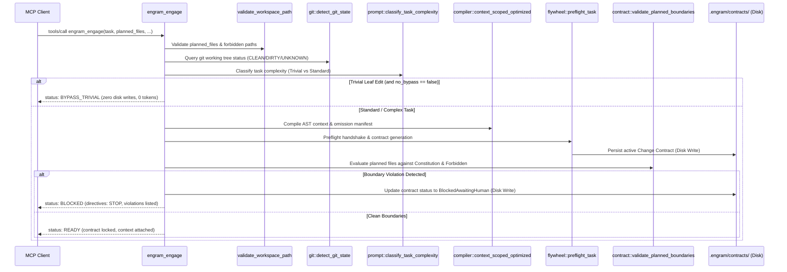

# Engram Phase 8.1.1: Validation Ownership Matrix & Architectural Analysis

**Execution Mode:** Architectural Review, De-duplication & Validation Ownership Certification  
**Repository:** `C:\Users\Amal P S\OneDrive\Projects\Engram`  
**Milestone:** Phase 8.1.1  
**Status:** `VALIDATION_OWNERSHIP_CERTIFIED`  
**Date:** 23 November 2026  

---

## 1. Executive Summary

During the Phase 8.1 architecture review, the relationship between `engram_engage`, `flywheel::preflight_task`, Constitution enforcement, forbidden-boundary validation, Change Contract creation, and workspace-path validation was forensically audited.

A key discrepancy was examined: `engram_engage` contained explicit forbidden-boundary and Project Constitution checks directly following the `preflight_task` invocation.

### 1.1 Forensic Findings
1. **Incremental Delta vs Fresh Contract Inconsistency in `preflight_task`:**
   In `src/flywheel.rs`, `preflight_task` checked boundary violations against active contracts during **incremental plan delta updates** (rejecting plan additions that breach boundaries), but did **not** evaluate planned files against `.engram/constitution.yaml` or explicit forbidden boundaries during **fresh contract creation**.
2. **Correctness Requirement in `engram_engage`:**
   Because `preflight_task` possessed this gap on fresh contract initialization, `execute_engage` had to evaluate boundaries explicitly to prevent locking and returning an authorized `READY` contract when the user planned to edit forbidden files (e.g. `secrets.json`, `.engram/constitution.yaml`).
3. **Consolidation & Shared Helper Solution:**
   Rather than maintaining duplicate loops across `flywheel.rs` and `engage.rs`, Phase 8.1.1 establishes `crate::contract::validate_planned_boundaries` as the single authoritative, shared boundary-validation helper. Both `preflight_task` and `execute_engage` now invoke this common implementation.

---

## 2. Validation Ownership Table

| Validation | Existing Owner | Engage Behavior | Final Owner | Reason |
|---|---|---|---|---|
| **Workspace Path Traversal** (`..`, null bytes, symlink/junction escapes) | `mcp::validate_workspace_path` | Reuses `validate_workspace_path` on each item in `planned_files` and `forbidden` | `mcp::validate_workspace_path` | Authoritative path containment check; defense-in-depth at API boundary before file system interaction. |
| **Task String Constraints** (non-empty, <= 4096 characters) | `mcp::mcp_call_raw` (per-tool parameter checks) | Evaluates task string length and non-emptiness upfront | `engage::execute_engage` | Input hygiene defense; fails fast before database or AST operations. |
| **Task Complexity & Adaptive Bypass** (Trivial vs Standard) | `prompt::classify_task_complexity` | Evaluates classification; bypasses contract/AST overhead for leaf tasks unless `no_bypass: true` | `prompt::classify_task_complexity` | Reused directly; ensures identical heuristic classification across CLI and MCP. |
| **AST Context Compilation** (file scoring, token budget, omission manifest) | `compiler::context_scoped_optimized` | Reused directly with budget clamping (100–32,000 tokens) | `compiler::context_scoped_optimized` | Reused directly; maintains single AST parser and token counter. |
| **Project Constitution Enforcement** (`.engram/constitution.yaml`) | `constitution::load_constitution` & `contract::matches_boundary` | Previously checked in `engage.rs` after `preflight_task` | `contract::validate_planned_boundaries` (shared) | Unified into authoritative shared helper; guarantees identical violation detection across preflight and engage. |
| **Explicit Forbidden Boundaries** (`opts.forbidden`) | `contract::matches_boundary` in `flywheel::preflight_task` | Previously checked in `engage.rs` after `preflight_task` | `contract::validate_planned_boundaries` (shared) | Unified into authoritative shared helper; guarantees identical forbidden matching. |
| **Change Contract Creation & Locking** (`.engram/contracts/`) | `flywheel::preflight_task` & `contract::save_contract` | Reuses `preflight_task` to generate or reuse contracts | `flywheel::preflight_task` | Reused directly; preserves contract schema version 1.1, fingerprints, and state transitions. |
| **Envelope Budget Boundary** (progressive condensation levels 1–6) | `mcp::enforce_mcp_envelope_boundary` | Reused directly on outer response and nested `context` sub-object | `mcp::enforce_mcp_envelope_boundary` | Single boundary enforcement ensuring all MCP responses respect wire size limits. |

---

## 3. Terminology & Architectural Classification Correction

### 3.1 Non-Atomic Clarification
Phase 8.1 previously used the phrase "atomic transaction" colloquially to describe collapsing a 2-call sequence into a single MCP request. 

This terminology is formally corrected in Phase 8.1.1:
- `engram_engage` is a **single-call consolidated workflow**, not an ACID transactional unit.
- If an intermediate stage fails (for instance, if AST compilation fails or a filesystem write fails), prior read-only operations have occurred, and state rollback depends on individual engine primitives rather than an overall two-phase commit.

### 3.2 Sequential Operations & Persisted State
The consolidated workflow executes sequentially in the following deterministic order:

### 3.3 Persisted State Summary
1. `.engram/contracts/active.json` & `.engram/contracts/{id}.json`: Active Change Contract written during preflight and updated if boundary defense transitions status to `BlockedAwaitingHuman`.
2. Workspace Agent Rules (`.cursorrules`, `.windsurfrules`, `CLAUDE.md`, etc.): Updated only when `inject_instructions: true`.
3. Telemetry Event Log: `PREFLIGHT_HANDSHAKE` event recorded locally in `.engram/telemetry.jsonl` (zero network egress).

---

## 4. Conclusion

Validation ownership is unambiguously delineated. Duplicated boundary-matching code has been extracted into the authoritative `crate::contract::validate_planned_boundaries` helper, and the endpoint is accurately certified as a deterministic **single-call consolidated workflow**.
