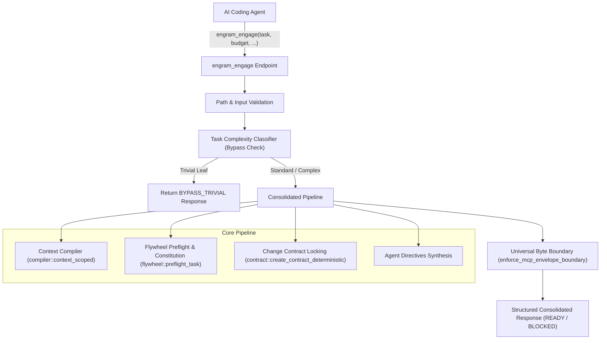

# Phase 8.1: Architecture Decision Record (ADR)
## Consolidated Engagement Endpoint (`engram_engage`)

**Document Identifier:** `ENGRAM-ADR-PHASE-8-1-ENGAGE-20261123`  
**Status:** `ACCEPTED_PROTOTYPE`  
**Date:** 2026-11-23  
**Authors:** Engram Architecture Team  
**Scope:** Model Context Protocol (MCP) Server & Agent Engagement Lifecycle  
**Governing Baseline:** Engram v1.5.4 Candidate 5 (`2df1cac`) / Remediated HEAD (`e0d1103`)  
**Legal Governance Posture:** `TECHNICAL_SOURCE_CORRESPONDENCE_VERIFIED_LEGAL_REVIEW_PENDING`  

---

## 1. Context & Problem Statement

In the published Engram v1.5.4 architecture, an AI coding agent interacting with a repository over the Model Context Protocol (MCP) typically follows a multi-step exploratory sequence before modifying code:

1. **Step 1 (Exploration):** The agent invokes `engram_get_context` to discover relevant files, AST symbols, co-change alerts, and durable architectural memories. (~3,300 bytes payload).
2. **Step 2 (Handshake & Guardrails):** The agent invokes `engram_preflight` to validate boundaries, evaluate Project Constitution rules, check blast-radius impact, and lock a Change Contract (`ctr_...`). (~1,060 bytes payload).
3. **Step 3 (Optional Symbol Inspection):** If context was condensed, the agent may invoke `engram_inspect_symbol` for specific deep caller/callee trees.

This workflow imposes what Engram benchmarks identify as the **"MCP Interaction Tax"**:
- **Conversational Latency:** Two to three sequential roundtrips before code generation begins.
- **Context Accumulation:** Because modern chat models re-read conversational history on every turn, the raw payloads from Turn 1 and Turn 2 remain in the model's context window across all subsequent turns.
- **Cognitive Dispersion:** Agents must manually correlate information across separate tool results (e.g. cross-referencing files from `engram_get_context` with expected files from `engram_preflight`).

While Phase 8.0 introduced **Turn-0 Static Context Injection** to export context into instruction files (`.github/copilot-instructions.md`, `.cursorrules`) out-of-band via CLI, conversational agents operating purely over MCP still require an interactive, single-entry engagement mechanism.

---

## 2. Decision: The `engram_engage` Consolidated Endpoint

We introduce **`engram_engage`** as the unified, first-class entry point for agents engaging with an Engram repository. 

Rather than creating a parallel context engine or duplicating instruction generators, `engram_engage` **consolidates existing internal primitives** into an atomic, coherent handshake.

---

## 3. Detailed Architectural Answers

### 3.1 What exactly does `engram_engage` consolidate?
`engram_engage` consolidates four previously distinct operational phases into a single atomic call:
1. **Repository Identity & Baseline Binding:** Canonical workspace root resolution, current git revision binding (`baseline_commit`), and repository status.
2. **Deterministic Task Classification:** Complexity analysis determining whether the task qualifies for an adaptive bypass (`BYPASS_TRIVIAL`), eliminating token waste on trivial leaf edits.
3. **AST-Grounded Context Compilation:** Multi-tier AST parsing across 7 languages, symbol excerpt generation, Project Constitution rule discovery, co-change alerts, and relevant architectural decisions.
4. **Change Contract Establishment:** Formal guardrail locking establishing authorized expected files, forbidden boundaries, and issue tracking.
5. **Agent Implementation Directives:** Synthesizing clear, unambiguous instructions for the agent's immediate next turn.

### 3.2 Which existing operations does it invoke?
`engram_engage` delegates strictly to established, audited internal engine functions:
- `crate::compiler::context_scoped_optimized` (or `context_scoped`): For AST context parsing, ranking, and memory discovery.
- `crate::flywheel::preflight_task` and `PreflightOptions`: For Project Constitution verification, blast radius impact checking, and contract locking.
- `crate::prompt::classify_task_complexity`: For deterministic task complexity classification.
- `crate::contract::get_active_contract`: For contract reuse and idempotency checks.
- `crate::mcp::validate_workspace_path`: For strict workspace root path containment.
- `crate::mcp::enforce_mcp_envelope_boundary`: For universal response byte ceiling enforcement (16KB default, configurable up to 64KB).

### 3.3 Which operations must remain independently available?
The existing lean four-tool MCP interface and specialist tools remain fully registered and independent:
- `engram_get_context`: Remains available for iterative subpath/symbol queries during implementation.
- `engram_inspect_symbol`: Remains available for on-demand deep caller/callee traversal.
- `engram_preflight`: Remains available for explicit preflight checks or re-locking if scope expands.
- `engram_postflight`: Remains the mandatory post-implementation verification gate before commit.
- `engram_recover`: Remains the stateful recovery engine for boundary violation repair.
- `engram_drift`, `engram_record_decision`, `engram_doctor`: Remain available for repository maintenance.

### 3.4 What data should the caller supply?
The request contract requires only `task` (the user prompt or goal), with optional tuning parameters:
- `task` (String, required): Goal or intent description.
- `token_budget` (Integer, optional, default: 1200): Maximum AST context token allocation.
- `planned_files` (Array<String>, optional): Explicit target files the agent intends to edit.
- `forbidden` (Array<String>, optional): Additional forbidden path patterns.
- `symbols` (Array<String>, optional): Targeted symbol filters.
- `detail_level` (String, optional: `"compact"`, `"standard"`, `"full"`, default: `"standard"`).
- `no_bypass` (Boolean, optional, default: false): Force contract locking even for trivial tasks.
- `inject_instructions` (Boolean, optional, default: false): Also inject into workspace instruction files.
- `max_bytes` (Integer, optional, 1024..=65536, default: 16384): Serialization size ceiling.

### 3.5 What does the response contain?
The response returns a strongly typed, structured object:
- `status`: `"READY"` (authorized to proceed), `"BYPASS_TRIVIAL"` (leaf edit, no contract needed), or `"BLOCKED"` (boundary/constitution conflict).
- `repository`: Workspace root, baseline git commit, branch name, and dirty status.
- `task`: Core normalized task, complexity tier, and bypass status.
- `contract`: Active `contract_id`, `contract_version`, and reuse flag.
- `boundaries`: `expected_files`, `expected_modules`, and `forbidden_boundaries`.
- `context`: Top ranked target files with scores, governing rules, co-change alerts, relevant architectural memories, and bounded omission manifests.
- `directives`: Prescribed implementation instructions.
- `blocking_violations`: Explicit gap descriptions if status is `BLOCKED`.
- `next_action`: Immediate single-sentence instruction for the model.

### 3.6 Which work must remain local and deterministic?
100% of operations in `engram_engage` remain local and deterministic:
- Tree-sitter AST parsing.
- Git rev-parse and status inspection.
- SQLite memory graph lookup.
- Project Constitution rule evaluation.
- SHA-256 contract hashing.
Zero remote provider calls, zero telemetry egress, and zero non-deterministic random IDs.

### 3.7 Which operations require additional user approval?
- Read & preflight consolidation: None. Operates read-only over repository AST and creates a local metadata ledger entry in `.engram/contracts/`.
- Instruction injection (`inject_instructions`): Modifies `.github/copilot-instructions.md`, etc. This is strictly opt-in (`false` by default) and non-destructive.
- Source code modification: `engram_engage` never mutates project code files.

### 3.8 How will compatibility be maintained?
- `engram_engage` is added to `core_tools_definitions()` and `all_tools_definitions()`.
- Existing tool definitions (`engram_get_context`, `engram_preflight`, etc.) remain completely unchanged in schemas, names, and behaviors.
- Existing CLI commands (`engram prepare`, `engram inject`, `engram contract`) remain untouched.
- Existing Turn-0 instruction lifecycles remain 100% backward compatible.

---

## 4. Consequences & Trade-Offs

### Positive Consequences
- **Reduced Roundtrip Overhead:** Eliminates 1 conversational turn and 1 MCP roundtrip at session start.
- **Unified Mental Model:** Agents receive context and guardrails in a single cohesive object.
- **Zero Engine Duplication:** Implemented via composition of existing, audited modules.
- **Robust Boundary Protection:** Wrapped in `enforce_mcp_envelope_boundary`, guaranteeing payloads never exceed configured byte limits.

### Trade-Offs & Mitigations
- **Payload Density:** Returning context and contract simultaneously could produce larger individual responses.  
  *Mitigation:* Wrapped in 7-level progressive response shedding (`enforce_mcp_envelope_boundary`) to guarantee responses fit within the 16KB budget.
- **Trivial Task Overhead:** Running AST context on single-line fixes wastes tokens.  
  *Mitigation:* Integrated deterministic task classifier (`classify_task_complexity`) provides instant `BYPASS_TRIVIAL` responses.
