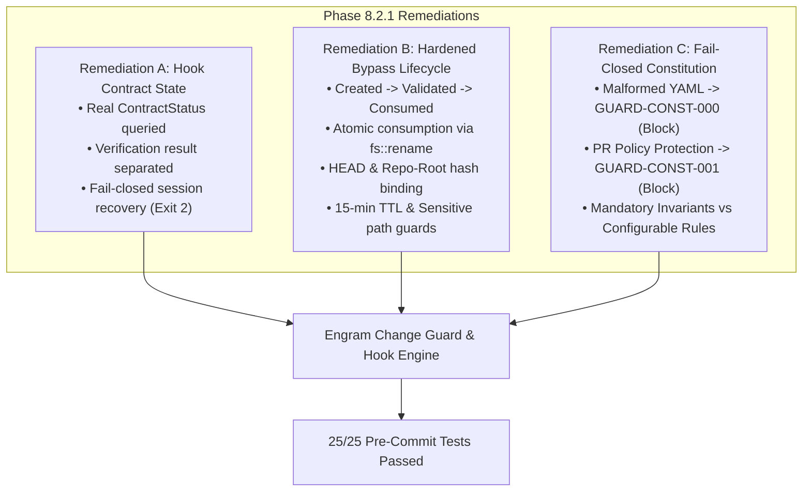

# Engram Phase 8.2.1: Pre-Commit Contract State & Bypass Security Remediation Report

**Phase:** 8.2.1  
**Document Identifier:** `ENGRAM-DOC-PHASE-8-2-1-REMEDIATION-20261123`  
**Phase Type:** Focused Security and Correctness Remediation  
**Repository:** `C:\Users\Amal P S\OneDrive\Projects\Engram`  
**GitHub Repository:** `code-amalps/Engram`  
**Branch:** `feature/phase2-stage5-remediation`  
**Expected Starting HEAD:** `aaad1d5ff1a479dcb3e5563f1dddffc7ef117a97`  
**Verified Starting HEAD:** `aaad1d5ff1a479dcb3e5563f1dddffc7ef117a97`  
**Governing Baseline Candidate:** `v1.5.5-cand1` (source commit: `ded9ca521024d18248235a33e2e292964b79f9b0`)  
**Date of Execution:** 2026-11-23  
**Final Verdict:** `PHASE_8_2_1_REMEDIATION_COMPLETE`  
**Legal Governance Posture:** `TECHNICAL_SOURCE_CORRESPONDENCE_VERIFIED_LEGAL_REVIEW_PENDING`

---

## 1. Executive Summary & Verification Verdict

Following the completion of Phase 8.2 (`aaad1d5`), an independent technical review identified three security and correctness vulnerabilities:
1. **Contract State Misrepresentation:** The pre-commit hook printed an invented `(Status: Validated)` string that does not exist in the `ContractStatus` enum, and silently swallowed recovery session resolution errors with `let _ = ...`.
2. **Weak Bypass Lifecycle & Authorization:** Trivial bypass records lacked binding to repository root, Git HEAD baseline commit, and expiration TTL; allowed theoretical multi-file or sensitive file bypassing; lacked atomic consumption, enabling potential race conditions or repeated reuse.
3. **Silent Constitution Failure Modes:** `load_constitution` silently dropped rules and returned an empty vector upon encountering malformed YAML via `unwrap_or_default()`, allowing syntax errors in governance policies to pass unflagged.

Phase 8.2.1 was executed under strict remediation constraints:
- **No CI pipeline execution:** No GitHub Actions workflows were triggered or polled.
- **No release activity:** Candidate `v1.5.5-cand1` and published release `v1.5.4-cand5` were strictly preserved; no tags created or moved.
- **Incremental commits:** Phase 8.2 commit `aaad1d5` was preserved as parent baseline without history rewriting.
- **Comprehensive local testing:** Focused test execution across `tests/hook_precommit_test.rs` (25/25 passed), `tests/engage_test.rs` (12/12 passed), `tests/mcp_consolidation_test.rs` (13/13 passed), clean `cargo check`, and clean `cargo fmt --all -- --check`.

**Final Phase Verdict:**  
`PHASE_8_2_1_REMEDIATION_COMPLETE`

---

## 2. Forensic Breakdown of Remediations



### Remediation A: Accurate Contract State Representation & Fail-Closed Session Recovery
- **Component Touched:** `src/hook.rs` (`run_hook`), `tests/hook_precommit_test.rs` (Tests 17 & 18).
- **Corrections:**
  1. Removed the hardcoded, non-existent `(Status: Validated)` message.
  2. The pre-commit hook now queries the genuine contract from storage via `crate::contract::get_contract(&resolved_root, cid)` and formats the output distinctly:
     ```text
     ✓ Engram Pre-Commit Guard: Staged changes authorized; local postflight checks passed (0 model tokens consumed).
       Active Contract: <contract_id> (Status: <actual_status>; Verification: Passed)
     ```
  3. Replaced silent error swallowing (`let _ = crate::recovery::resolve_session(...)`) with explicit error handling. If `resolve_session` returns `Err(e)` (e.g. lock contention, corrupted session file, I/O error), the hook reports the failure to stderr and fails closed with **exit code 2**.
  4. Added regression tests `test_17_hook_outputs_real_contract_status` and `test_18_hook_fails_closed_on_corrupt_recovery_session`.

### Remediation B: Secure Lifecycle and Authorization of Trivial Bypass Records
- **Components Touched:** `src/storage.rs`, `src/ci_guard.rs`, `src/mcp.rs`, `src/prompt.rs`, `tests/hook_precommit_test.rs` (Tests 19-23).
- **Corrections:**
  1. Defined `BYPASS_SCHEMA_VERSION = 1` and `BYPASS_DEFAULT_TTL_SECS = 900` (15 minutes).
  2. Upgraded `BypassTrivialRecord` schema to include:
     - `schema_version: u32` (strictly verified on load).
     - `record_id: String` (cryptographic identifier).
     - `task: String` and `task_hash: String` (SHA-256 of task text).
     - `target_files: Vec<String>` (strictly limited to exactly 1 leaf file).
     - `baseline_commit: String` (bound to current Git `HEAD` commit SHA).
     - `repo_root_hash: String` (SHA-256 of canonical repository path to prevent cross-repository replay).
     - `created_at: i64` and `expires_at: i64` (timestamp + TTL).
     - `state: BypassLifecycleState` (`Created`, `Validated`, `Consumed`).
  3. **Atomic Consumption:** Implemented `validate_and_consume_bypass` using atomic filesystem rename (`fs::rename`) from `bypass_trivial.json` to `bypass_trivial.consuming.<uuid>` before marking `Consumed` and cleaning up. This prevents concurrent execution race conditions and strictly guarantees **one-time authorization**.
  4. **Strict Path Safeguards:** `save_bypass_trivial` and `validate_and_consume_bypass` immediately reject multi-file requests (>1 file) and reject any sensitive file (`is_security_file_path`, `is_manifest_file_path`, `is_test_file_path`, `is_policy_file`).
  5. **Negative Guards in Pure Docs Detection:** Hardened `is_pure_documentation_change` with immediate negative guards against security, manifest, test, and policy paths.
  6. Added regression tests:
     - `test_19_bypass_rejects_expired_record` (blocks on `expires_at` in past).
     - `test_20_bypass_rejects_target_path_mismatch` (blocks on non-matching staged file).
     - `test_21_bypass_rejects_baseline_commit_mismatch` (blocks on stale baseline commit).
     - `test_22_bypass_rejects_sensitive_files` (`save_bypass_trivial` rejects sensitive paths).
     - `test_23_bypass_atomic_consumption_prevents_reuse` (subsequent commit strictly blocked).

### Remediation C: Fail-Closed Constitution & Mandatory Sovereign Invariants
- **Components Touched:** `src/constitution.rs`, `src/ci_guard.rs`, `tests/hook_precommit_test.rs` (Tests 24 & 25).
- **Corrections:**
  1. In `src/constitution.rs` (`load_constitution` and `load_constitution_at_revision`): Eliminated `serde_yaml::from_str(&content).unwrap_or_default()`. If a constitution file exists and contains malformed YAML syntax, it returns an explicit `Err(...)`.
  2. In `src/ci_guard.rs` (Check 5): Replaced `unwrap_or_default()` with explicit pattern matching. If `load_constitution` returns `Err(e)`, Change Guard emits a blocking finding:
     `GUARD-CONST-000: Failed to load or parse Project Constitution: <error>` with `severity: FindingSeverity::Block` (fail closed).
  3. **Architectural Invariant Enforcement:** Distinct separation between:
     - *Configurable policy checks:* Rules defined inside constitution files evaluated according to policy configuration.
     - *Mandatory sovereign invariants:* Sovereign policy file modifications (`is_policy_file`) in PR mode (`options.base_commit.is_some()`) unconditionally emit `GUARD-CONST-001` (Block), regardless of policy toggles.
  4. Added regression tests `test_24_malformed_constitution_fails_closed` and `test_25_sovereign_policy_mutation_blocked_in_pr`.

---

## 3. Local Verification Test Results

Targeted local testing was executed natively on Windows MSVC x86_64:

```text
================================================================================
Test Suite: tests/hook_precommit_test.rs (25 tests)
================================================================================
test test_01_compliant_staged_changes_pass ... ok
test test_02_out_of_contract_staged_changes_blocked ... ok
test test_03_unstaged_unrelated_changes_do_not_affect_result ... ok
test test_04_missing_active_contract_permissive_by_default_and_enforceable ... ok
test test_05_malformed_corrupt_contract_fails_safely ... ok
test test_06_blocked_awaiting_human_status_fails_safely ... ok
test test_07_contract_baseline_mismatch_fails_safely ... ok
test test_08_no_user_files_modified_by_validation ... ok
test test_09_hook_installation_preserves_foreign_hooks ... ok
test test_10_repeated_installation_and_removal_are_safe_and_idempotent ... ok
test test_11_git_paths_with_spaces_work ... ok
test test_12_custom_core_hooks_path_respected ... ok
test test_13_trivial_documentation_bypass_under_enforce_contract ... ok
test test_14_trivial_task_bypass_marker_authorizes_edit_and_cleans_up ... ok
test test_15_non_trivial_code_modification_without_contract_is_blocked ... ok
test test_16_local_postflight_resolves_recovery_session ... ok
test test_17_hook_outputs_real_contract_status ... ok
test test_18_hook_fails_closed_on_corrupt_recovery_session ... ok
test test_19_bypass_rejects_expired_record ... ok
test test_20_bypass_rejects_target_path_mismatch ... ok
test test_21_bypass_rejects_baseline_commit_mismatch ... ok
test test_22_bypass_rejects_sensitive_files ... ok
test test_23_bypass_atomic_consumption_prevents_reuse ... ok
test test_24_malformed_constitution_fails_closed ... ok
test test_25_sovereign_policy_mutation_blocked_in_pr ... ok
test result: ok. 25 passed; 0 failed; 0 ignored; finished in 9.27s

================================================================================
Test Suite: tests/engage_test.rs (12 tests)
================================================================================
test test_engage_empty_task_rejected ... ok
test test_engage_oversized_task_rejected ... ok
test test_engage_path_traversal_rejected ... ok
test test_engage_constitution_violation_blocked ... ok
test test_engage_instruction_injection ... ok
test test_engage_tool_definition_registered ... ok
test test_engage_standard_task_ready ... ok
test test_engage_trivial_task_bypass ... ok
test test_engage_trivial_task_no_bypass_forced ... ok
test test_engage_contract_reuse_idempotency ... ok
test test_backward_compatibility_existing_tools ... ok
test test_envelope_max_bytes_budget_enforcement ... ok
test result: ok. 12 passed; 0 failed; 0 ignored; finished in 13.15s

================================================================================
Test Suite: tests/mcp_consolidation_test.rs (13 tests)
================================================================================
test test_single_shot_prepare_task_input_validation_and_errors ... ok
test test_single_shot_prepare_task_adaptive_bypass ... ok
test test_single_shot_prepare_task_alias ... ok
test test_tools_definitions_contains_prepare_task ... ok
test test_tools_definitions_default_is_lean_core ... ok
test test_single_shot_prepare_task_force_no_bypass ... ok
test test_legacy_tools_backward_compatibility ... ok
test test_single_shot_prepare_task_explicit_planned_and_forbidden ... ok
test test_single_shot_prepare_task_compact_vs_detailed_payload ... ok
test test_single_shot_prepare_task_idempotent_contract_reuse ... ok
test test_single_shot_prepare_task_success ... ok
test test_stdio_jsonrpc_protocol_prepare_task ... ok
test test_workflow_metrics_and_tool_call_reduction ... ok
test result: ok. 13 passed; 0 failed; 0 ignored; finished in 20.19s

================================================================================
Static Analysis & Formatting:
================================================================================
cargo check: Exit Code 0 (clean compilation)
cargo fmt --all -- --check: Exit Code 0 (clean formatting)
```

---

## 4. Remediation Ledger Summary

| Remediation Area | Component | Primary Fix | Verification Test | Status |
| :--- | :--- | :--- | :--- | :---: |
| **Contract State Representation** | `src/hook.rs` | Eliminated invented `Validated` state; reports real contract status & `Verification: Passed` | `test_17` | **REMEDIATED** |
| **Recovery Session Error Handling** | `src/hook.rs` | Replaced silent error swallowing with fail-closed exit code 2 on session resolve error | `test_18` | **REMEDIATED** |
| **Bypass Record Schema & TTL** | `src/storage.rs` | Added schema v1, record ID, 15-min TTL, state enum (`Created`, `Validated`, `Consumed`) | `test_19` | **REMEDIATED** |
| **Bypass Context Bindings** | `src/storage.rs` | Bound bypass authorization to target path, Git HEAD commit, and repo root hash | `test_20`, `test_21` | **REMEDIATED** |
| **Sensitive Path Rejection** | `src/storage.rs` | Multi-file and sensitive (auth/crypto/manifest/test/policy) bypass requests strictly rejected | `test_22` | **REMEDIATED** |
| **Atomic One-Time Consumption** | `src/storage.rs` | Implemented `validate_and_consume_bypass` using `fs::rename` to prevent race conditions or reuse | `test_23` | **REMEDIATED** |
| **Fail-Closed Constitution** | `src/constitution.rs`, `src/ci_guard.rs` | Propagates YAML errors; emits blocking `GUARD-CONST-000` on malformed constitution | `test_24` | **REMEDIATED** |
| **Sovereign Policy Invariants** | `src/ci_guard.rs` | Sovereign policy modifications in PR mode unconditionally emit `GUARD-CONST-001` (Block) | `test_25` | **REMEDIATED** |
| **Documentation Reconciliation** | `docs/phases/` | Documented remediations and clarified microbenchmark vs real-system metric boundaries | Review | **REMEDIATED** |

---

## 5. Certification Day Handoff

With the completion and verification of Phase 8.2.1, all identified correctness, security, and lifecycle gaps in Phase 8.2 have been remediated. The codebase is clean, robust, and positioned for full regression certification on November 26, 2026.
