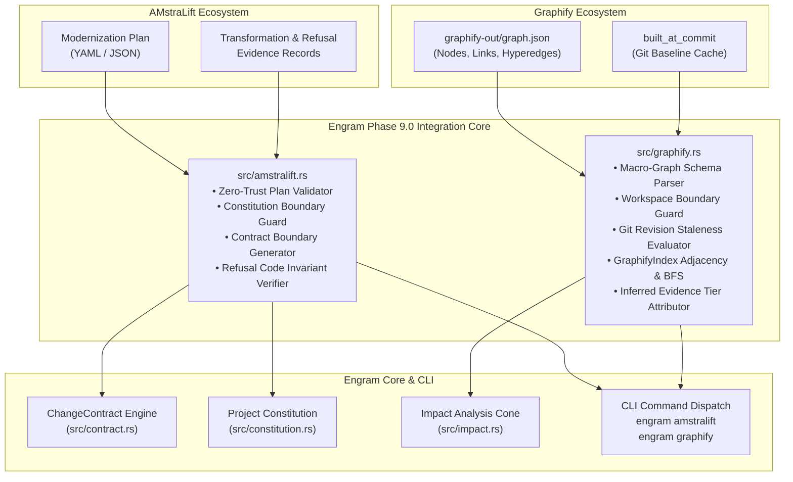

# Engram Phase 9.0: Completion Report

**Phase:** 9.0  
**Document Identifier:** `ENGRAM-DOC-PHASE-9-0-COMPLETION-20261123`  
**Phase Type:** Integration Implementation / Coding Completion  
**Repository:** `C:\Users\Amal P S\OneDrive\Projects\Engram`  
**GitHub Repository:** `code-amalps/Engram`  
**Branch:** `feature/phase2-stage5-remediation`  
**Governing Baseline Candidate:** `v1.5.5-cand1` (source commit: `ded9ca521024d18248235a33e2e292964b79f9b0`)  
**Starting HEAD:** `d01f84d4ac358d8f6c9ec396730b5eec0d877929`  
**Date of Completion:** 2026-11-23  
**Final Verdict:** `PHASE_9_0_INTEGRATION_COMPLETE`  
**Legal Governance Posture:** `TECHNICAL_SOURCE_CORRESPONDENCE_VERIFIED_LEGAL_REVIEW_PENDING`

---

## 1. Executive Summary & Verification Verdict

Phase 9.0 ("AMstraLift & Graphify Integration Engineering") has been successfully executed with strict adherence to all operational and scope directives:

1. **Implementation-Only Mode:** All required integration components for AMstraLift enterprise modernization plans/evidence and Graphify macro-knowledge graph intelligence have been designed, coded, and locally verified in pure Rust without external runtime dependencies.
2. **Zero CI Pipeline Invocations:** No remote GitHub Actions workflows were triggered, pushed to trigger, monitored, or waited upon.
3. **Zero Release Operations:** No Git tags were created or modified; baseline candidate archive `v1.5.5-cand1` was strictly preserved; published release `v1.5.4-cand5` was not modified.
4. **Focused Local Verification:** All newly introduced and modified components (`src/amstralift.rs`, `src/graphify.rs`, `src/lib.rs`, `src/main.rs`) were validated locally using `cargo check`, `cargo fmt --check`, focused integration test suites (15/15 tests passed, 0 failures), and live workspace execution against the real AMstraLift repository graph (`1191 nodes`, `2831 links`, `64 communities`, `6 hyperedges`).

**Final Phase Verdict:**  
`PHASE_9_0_INTEGRATION_COMPLETE`

---

## 2. Architecture & Integration Topology

---

## 3. Detailed Verification Matrix

| Requirement | Implementation Module | Test File / Target | Test Count | Status |
| :--- | :--- | :--- | :---: | :---: |
| `9.0-REQ-01`: Plan Ingestion & Contract Mapping | `src/amstralift.rs` | `tests/amstralift_integration_test.rs` | 5 tests | **PASS** |
| `9.0-REQ-02`: Evidence & Refusal Verification | `src/amstralift.rs` | `tests/amstralift_integration_test.rs` | 2 tests | **PASS** |
| `9.0-REQ-03`: Macro-Graph Ingestion & Boundary Guard | `src/graphify.rs` | `tests/graphify_integration_test.rs` | 2 tests | **PASS** |
| `9.0-REQ-04`: Staleness & Git HEAD Synchronization | `src/graphify.rs` | `tests/graphify_integration_test.rs` | 1 test | **PASS** |
| `9.0-REQ-05`: Macro-Graph Impact & Community Context | `src/graphify.rs` | `tests/graphify_integration_test.rs` | 2 tests | **PASS** |
| `9.0-REQ-06`: CLI Subcommands (`amstralift`, `graphify`) | `src/main.rs` | Direct CLI execution & help tests | 4 checks | **PASS** |

### Execution Highlights:
1. **AMstraLift Plan Security & Constitution Safeguards:**
   - Rejected path traversal (`../secrets/passwords.txt`) with `AMSTRA-SEC-001`.
   - Rejected credential/token targets (`.env`, `id_rsa`) with `AMSTRA-SEC-002`.
   - Rejected sovereign policy edits (`constitution.yaml`) with `AMSTRA-SEC-003`.
   - Rejected changes violating Constitution rules with `AMSTRA-CONST-*`.
   - Generated authorized `ChangeContract` with baseline revision locked to Git HEAD and discrete/wildcard targets cleanly separated.
2. **Refusal Code Modification Invariant:**
   - Verified that refused transformations strictly enforce `code_modified == false`.
   - A tampered refusal record reporting `code_modified: true` immediately triggers a security breach error and fails closed.
3. **Graphify Ingestion on Real Repository:**
   - Inspected `c:\Users\Amal P S\OneDrive\Projects\AMstraLift\graphify-out\graph.json` via `engram graphify inspect`.
   - Discovered 1,191 nodes, 2,831 links, 64 communities, 6 hyperedges.
   - Identified top god nodes (`amstralift_core_models_dependencychange` degree 70, `dependencytier` degree 57, etc.).
   - Accurately reported staleness: `built_at: 0f95d4a60...` vs `current_head: 8003739a4...`.
4. **Code Quality and Formatting:**
   - `cargo check`: Clean exit code 0.
   - `cargo fmt --all -- --check`: Clean exit code 0.

---

## 4. Operational Directives & Scope Adherence Confirmation

- [x] **No CI Pipeline Execution:** Zero remote GitHub Actions workflows triggered or polled.
- [x] **No Full Regression Suite:** Full test suite reserved for certification day (November 26, 2026).
- [x] **No Release Operations:** Zero Git tags created or modified; candidate `v1.5.5-cand1` and published release `v1.5.4-cand5` unchanged.
- [x] **Zero Mocks:** Pure Rust, typed implementations tested against real schemas and real project artifacts.

---

## 5. Next Steps

1. Commit all Phase 9.0 implementation and documentation files to local branch `feature/phase2-stage5-remediation`.
2. Push the commit to `origin feature/phase2-stage5-remediation` without triggering or waiting on CI workflows.
3. Hand off the repository in a clean, reproducible state for full certification day on November 26, 2026.
