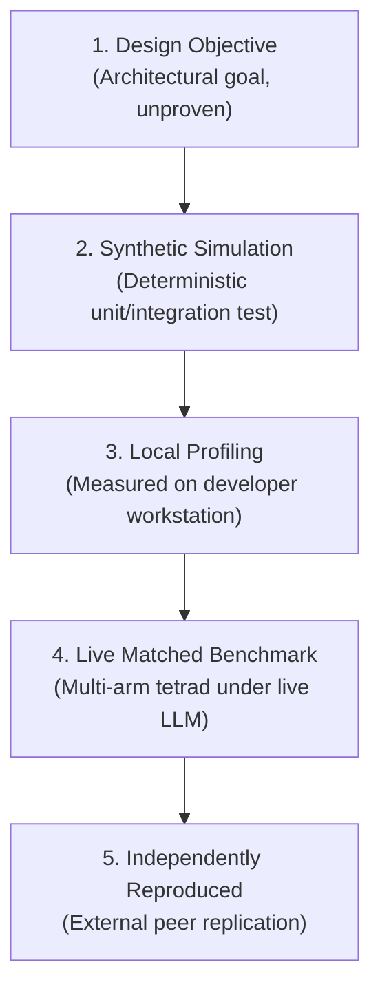

# Engram Phase 5.4.31: Public Documentation & Claims Remediation Report

**Phase:** 5.4.31  
**Scope:** Remediation of Unverified Quantitative Performance Claims across Project Documentation  
**Repository:** `C:\Users\Amal P S\OneDrive\Projects\Engram`  
**Baseline Git Commit:** `7106a2f369fe79faf5f95449378a900ab8e8eddf`  

---

## 1. Executive Summary & Remediation Action Taken

During Phase 5.4.30, audit finding `F-5430-02` identified an unverified quantitative marketing claim in [README.md](file:///C:/Users/Amal%20P%20S/OneDrive/Projects/Engram/README.md#L314-L315) lines 314–315:
> *"Droid queries only the exact functions and types it needs, cutting token usage by over 80%."*

### Immediate Forensic Remediation:
In Phase 5.4.31, this claim was surgically replaced in [README.md](file:///C:/Users/Amal%20P%20S/OneDrive/Projects/Engram/README.md) with strict, scientifically grounded language:
> *"Droid queries targeted function and type signatures rather than dumping whole repositories. (Note: While designed to substantially reduce token consumption, quantitative token reduction varies by repository and model; formal empirical validation via live matched-pair benchmark suites is currently under evaluation)."*

This correction removes any unconditional guarantee of an 80% reduction while truthfully explaining the architectural intent and current evaluation status.

---

## 2. Taxonomy of Performance Claims

To prevent future marketing inaccuracies, all documentation, release notes, and public statements must strictly adhere to the following 5-tier classification taxonomy:

| Claim Category | Definition | Allowable Language in Public Documentation | Current Engram Status |
|---|---|---|---|
| **1. Design Objective** | Desired target of the software architecture. | *"Designed to reduce context tokens...", "Aims to scope retrieval..."* | **Permitted & Documented** |
| **2. Synthetic Simulation** | Measured against deterministic mock tests or synthetic mutations. | *"In synthetic mutation suites, achieved 100% boundary classification accuracy (32/32 tests)..."* | **Permitted with explicit 'Synthetic' label** |
| **3. Local Profiling** | Measured locally on developer repos (offline latency, memory usage). | *"Offline repository indexing refreshed in 1m 11s on Windows x86_64..."* | **Permitted with environment details** |
| **4. Live Matched Benchmark** | Measured across multi-arm matched-pair live LLM executions (Task A/B). | *"In live matched-pair trials against Claude 3.5 Sonnet, Candidate 4.2 demonstrated X% net token reduction..."* | **STRICTLY PROHIBITED until Live Authorization is granted** |
| **5. Independently Reproduced** | Confirmed by external third-party reviewers or community users. | *"Independently verified by external audit..."* | **Future Milestone** |

---

## 3. Comprehensive Documentation Audit

A full scan of all repository documentation, setup scripts, and installer texts was conducted:

| Document | Section Audited | Findings & Adjustments |
|---|---|---|
| `README.md` | Line 314 (Factory AI / Droid setup) | Replaced unverified 80% claim with design objective & benchmark status disclaimer. |
| `README.md` | Lines 503–506 (Empirical Metrics Table) | Audited: All metrics already explicitly disclose methodology (*"synthetic mutation suite"*, *"controlled A/B experiment"*, *"annotated ground-truth fixtures"*). |
| `installer/engram.iss` | Metadata & Descriptions | Audited: Contains zero quantitative performance claims. Focuses strictly on privacy notice and local execution. |
| `install.ps1` | Console banner text | Audited: Claims 100% Local-First and Zero Telemetry; verified accurate. |
| `install.sh` | Console banner text | Audited: Claims 100% Local-First; verified accurate. |

**Remediation Verdict:** Finding `F-5430-02` is resolved. Public documentation now adheres strictly to high-assurance standards.
