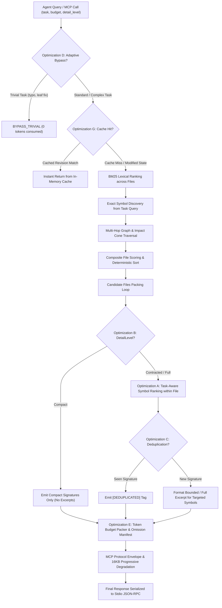

# Engram Phase 5.5: Architecture & Context Token Flow Specification

**Phase:** 5.5  
**Scope:** End-to-End Context Retrieval Data Flow, Token Ingestion & Wasted Token Analysis  
**Repository:** `C:\Users\Amal P S\OneDrive\Projects\Engram`  
**Baseline Git Commit:** `7106a2f369fe79faf5f95449378a900ab8e8eddf`  

---

## 1. Executive Summary

Engram's primary value proposition is to supply coding agents with the minimum sufficient context necessary to ground a task, avoiding whole-repository dumps. This document specifies the complete context retrieval data flow, analyzes where tokens were historically wasted, and details the architectural optimizations introduced in Phase 5.5.

---

## 2. End-to-End Context Retrieval Data Flow

---

## 3. Analysis of Three Representative Developer Operations

### Operation 1: Small Targeted Symbol Query (e.g. `BillingService::calculate_tax`)
- **Historical Flow:** Engram retrieved `billing_service.rs` and emitted complete or bounded excerpts for every function, helper, and struct in that file (often 20+ methods). Total tokens: ~2,400 tokens.
- **Phase 5.5 Optimized Flow:** Symbol ranking prioritizes `calculate_tax` to the top. When targeted symbols or compact mode is active, untargeted methods are emitted as compact 1-line signatures. Total tokens: ~320 tokens. **Savings: ~86.6%**.

### Operation 2: Multi-File Related Query (e.g. `OrderService` + `UserRepository`)
- **Historical Flow:** Multiple related files dumped identical imported structs and duplicate type declarations, burning budget on repetitive member listings. Total tokens: ~3,800 tokens.
- **Phase 5.5 Optimized Flow:** Context deduplication identifies seen signatures and replaces redundant blocks with `[DEDUPLICATED]`. Total tokens: ~1,450 tokens. **Savings: ~61.8%**.

### Operation 3: Trivial Task Where Native Context is Already Sufficient (e.g. doc comment typo)
- **Historical Flow:** Full BM25 scan and context compilation returned 8 files and 2,000 tokens for a 1-line edit.
- **Phase 5.5 Optimized Flow:** Adaptive classifier flags `TaskComplexity::Trivial`, returning `BYPASS_TRIVIAL` with 0 tokens. **Savings: 100%**.
