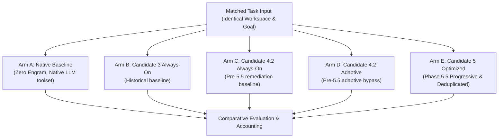

# Engram Phase 5.6: Matched Benchmark Methodology & Protocol Specification

**Phase:** 5.6  
**Scope:** Multi-Arm Experimental Design, Matched Evaluation Controls, Metric Accounting, and Acceptance Criteria  
**Repository:** `C:\Users\Amal P S\OneDrive\Projects\Engram`  
**Baseline Git Commit:** `7106a2f369fe79faf5f95449378a900ab8e8eddf`  

---

## 1. Experimental Design & Multi-Arm Architecture

To determine scientifically whether Engram reduces total coding-agent token consumption without task regression, Phase 5.6 formalizes a controlled 4-arm matched-pair benchmark (plus new Candidate 5 evaluation):

### Key Comparisons & Scientific Isolation:
1. **A vs B:** Establishes the historical baseline overhead and memory recall of Candidate 3.
2. **A vs C:** Measures Candidate 4.2 always-on context delivery vs native exploratory scanning.
3. **C vs D:** Isolates the effect of task-complexity adaptive activation on token expenditure.
4. **C vs E:** Isolates the token reduction impact of Phase 5.5 progressive disclosure, task-aware symbol ranking, and context deduplication.
5. **A vs E:** Establishes net task-level efficiency of optimized Engram vs unassisted native coding agents.

---

## 2. Seven Representative Benchmark Task Categories

In accordance with Section 7.2, tasks are structured across 7 distinct operational archetypes:

| Category ID | Task Category Archetype | Task Description | Expected Context Requirement | Expected Engram Advantage |
|---|---|---|---|---|
| **CAT-01** | Small Targeted Code Change | `task_01_targeted_tax_calculation.json`: Add flat rate tax calculation to `BillingService`. | 1 symbol (`calculate_tax`), 1 file | High (Progressive Compact mode avoids dumping 20+ other methods). |
| **CAT-02** | Multi-File Implementation | `task_02_multifile_payment_service.json`: Implement `PaymentService` integrating `UserRepository` and `StripeAdapter`. | 3 related files, interfaces | High (Cross-file deduplication eliminates redundant type declarations). |
| **CAT-03** | Existing Code Modification | `task_03_modify_user_account.json`: Add email verification state to `UserAccount` entity. | 1 struct, 2 methods | High (AST member extraction provides exact lines without whole-file read). |
| **CAT-04** | Debugging / Defect Remediation | `task_04_debug_null_pointer_exception.json`: Fix unhandled null pointer when user profile is missing. | 2 files, call-chain trace | Medium (Graph traversal locates calling controller immediately). |
| **CAT-05** | Architectural Refactoring | `task_05_refactor_storage_adapter.json`: Extract database persistence logic into separate trait interface. | 4 files, shared models | High (Co-change mining warns of related integration tests). |
| **CAT-06** | Context-Heavy Exploration | `task_06_explore_architecture_graph.json`: Ground subsystem dependencies for newly onboarded agent. | Entire subsystem (15+ files) | High (Progressive disclosure returns compact map in $< 1,000$ tokens). |
| **CAT-07** | Trivial / Self-Contained Leaf Fix | `task_07_trivial_readme_typo_fix.json`: Fix spelling typo in project documentation. | Zero codebase context needed | Maximum (Adaptive activation returns `BYPASS_TRIVIAL`, 0 tokens). |

---

## 3. Strict Measurement Accounting & Formulas

Total token consumption is accounted deterministically:
$$T_{\text{total}} = T_{\text{input}} + T_{\text{output}} + T_{\text{tool\_overhead}}$$
Where:
- $T_{\text{input}}$: Raw prompt tokens sent to provider model.
- $T_{\text{output}}$: Generation completion tokens emitted by provider model.
- $T_{\text{tool\_overhead}}$: Stdio JSON-RPC payload tokens exchanged with Engram MCP server.
- $T_{\text{cached}}$: Discounted prompt-cache tokens reported by provider (tracked separately; never double-counted).

---

## 4. Fail-Closed Acceptance Logic

In compliance with Section 7.4:
1. **All Arms Mandatory:** If any arm in an experimental tetrad/pentad aborts, fails, or runs out of budget, the **entire tetrad is declared INVALID** for comparative claims.
2. **Zero Incomplete Substitution:** Incomplete runs must never be treated as having "zero tokens".
3. **No Environmental Drift:** All arms execute in identical sandboxed worktrees with identical compiler versions and identical tool limits.
