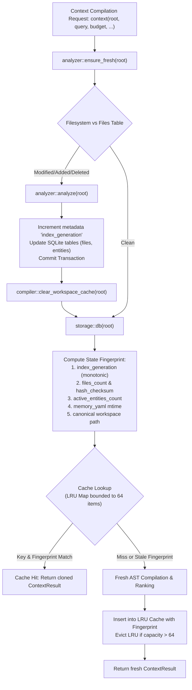

# Engram Phase 5.8.1: Cache Invalidation Design Specification

**Date:** 2026-11-22  
**Target Repository:** `C:\Users\Amal P S\OneDrive\Projects\Engram`  
**Component:** Context Compiler (`src/compiler.rs`), Database Storage (`src/storage.rs`), Analyzer (`src/analyzer.rs`)  
**Defect Addressed:** `DEFECT-5.8-01` (Stale Context Cache Reuse)  
**Status:** Approved Implementation Architecture  

---

## 1. Design Overview

To eliminate `DEFECT-5.8-01` without introducing superficial mtime-only fragility or unbounded memory growth, Phase 5.8.1 specifies a **three-tier invalidation and cache safety architecture**:



---

## 2. Invalidation Tier Architecture

### Tier 1: Authoritative Database Generation & Epoch Tracking
- In `src/storage.rs`, initialize the `metadata` table with `index_generation = '1'`.
- In `src/analyzer.rs`, inside `analyze(&root)`, upon committing any index transaction that modifies, adds, or deletes files or entities:
  - Increment `index_generation` monotonically:
    ```sql
    INSERT INTO metadata(key, value) VALUES('index_generation', '1')
    ON CONFLICT(key) DO UPDATE SET value = CAST(CAST(value AS INTEGER) + 1 AS TEXT);
    ```
  - Record canonical `'head_revision'` and `'last_analyzed_at'`.
- This ensures that within the database itself, the index has an authoritative monotonic epoch that advances on every update, completely independent of Git.

### Tier 2: Comprehensive Database & Workspace State Fingerprint
In `src/compiler.rs`, before querying `COMPILED_CONTEXT_CACHE`, the compiler computes a fast, deterministic **Cache Fingerprint**:
```rust
pub struct IndexStateFingerprint {
    pub workspace_canonical: PathBuf,
    pub index_generation: i64,
    pub files_count: i64,
    pub files_hash_sum: i64,
    pub active_entities_count: i64,
    pub memory_version: String,
    pub head_revision: String,
}
```
- **`workspace_canonical`**: Canonicalized root path to guarantee strict workspace isolation.
- **`index_generation`**: Monotonically increasing generation number from `metadata`.
- **`files_count` and `files_hash_sum`**: Instantaneous aggregation of active tracked files (`SELECT COUNT(*), COALESCE(SUM(LENGTH(content_hash)), 0) FROM files`).
- **`active_entities_count`**: Active entity count (`SELECT COUNT(*) FROM entity_versions WHERE invalidated_at_revision IS NULL`).
- **`memory_version`**: Filesystem modification timestamp of `.engram/memory.yaml`.
- **`head_revision`**: Value of `'head_revision'` from metadata (or Git commit hash).

A cache hit requires **both**:
1. Identical request parameters (query, token budget, subpath filter, language filter, detail level, target symbols).
2. Exactly matching `IndexStateFingerprint`. If any field differs, the cache entry is rejected as a cache miss.

### Tier 3: Active Filesystem Synchronization & Explicit Eviction
- `analyzer::ensure_fresh(&root)` is always invoked prior to cache lookup. If any source file on disk was modified, added, or deleted, `ensure_fresh` executes `analyze(&root)`.
- `analyze(&root)` increments `index_generation` and calls `compiler::clear_workspace_cache(&root)`.
- If an entity was deleted or modified in non-Git workspaces, `ensure_fresh` triggers `analyze`, invalidating the cache both explicitly in memory and via the incremented generation counter.

---

## 3. Resource Bounds & LRU Safety

- **Bounded Capacity:** The in-memory cache is bounded to a maximum of **64 entries** (configurable up to 128).
- **Eviction Policy:** Least-Recently-Used (LRU). When an insertion exceeds capacity, the entry with the oldest last-access timestamp is purged.
- **Thread Safety:** Protected by a non-poisoning standard `Mutex`. If the lock cannot be acquired or an error occurs during fingerprinting, the compiler falls back closed to a fresh, un-cached compilation. Stale data is never returned.

---

## 4. Addressing Edge Cases

1. **Non-Git Workspaces (`HEAD = "unknown"`):**  
   `index_generation` and `files_count`/`files_hash_sum` do not rely on Git. Any modification or deletion changes the fingerprint immediately.
2. **SQLite WAL Mode & Multi-Connection Visibility:**  
   Because the fingerprint is read directly from `conn: Connection` inside the current transaction boundary, WAL-committed changes are immediately visible.
3. **Database Rebuild / Replacement:**  
   If the database is deleted or replaced, a new database has a different `index_generation` and file count, causing immediate cache invalidation.
4. **File Deletion Without Content Hash Changes in Other Files:**  
   Deleting a file reduces `files_count` and removes entries from `files` and `entities`. The fingerprint mismatch invalidates the cached context immediately.
