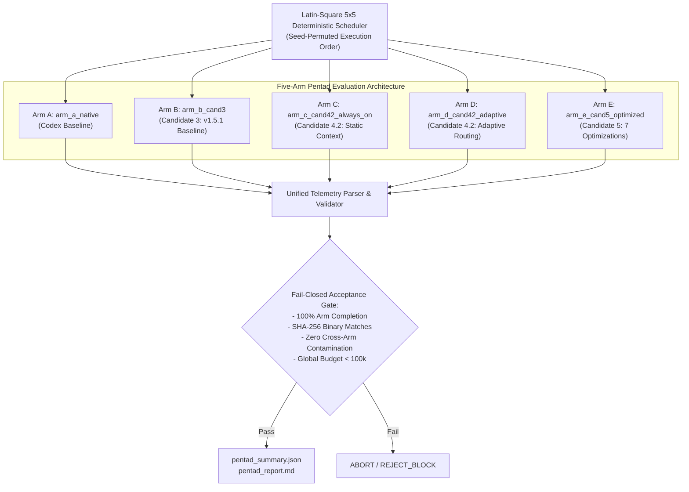

# Engram Phase 5.8.1: Five-Arm Pentad Architecture Specification

**Date:** 2026-11-22  
**Target Repository:** `C:\Users\Amal P S\OneDrive\Projects\Engram`  
**Harness Module:** `benchmarks/matched-pair-harness/src/orchestrator.py`  
**Status:** Approved Architectural Specification  

---

## 1. Executive Summary

Phase 5.8.1 integrates Candidate 5 as a genuine fifth arm into the matched-pair benchmarking harness, upgrading the evaluation framework from a 4-arm tetrad to a **Five-Arm Pentad**.

The Pentad architecture evaluates five generational iterations of coding-agent context injection:
1. **Arm A (`arm_a_native`):** Native Codex (Zero Engram, vanilla workspace baseline).
2. **Arm B (`arm_b_cand3`):** Candidate 3 Always-On (v1.5.1 baseline, flat context).
3. **Arm C (`arm_c_cand42_always_on`):** Candidate 4.2 Always-On (v1.5.4 engine without adaptive routing).
4. **Arm D (`arm_d_cand42_adaptive`):** Candidate 4.2 Adaptive (v1.5.4 engine with adaptive complexity gating).
5. **Arm E (`arm_e_cand5_optimized`):** Candidate 5 Optimized (v1.5.4 engine with Seven Token-Efficiency Optimizations).

The existing 4-arm tetrad interface (`run_tetrad`) and historical candidate assets are strictly preserved for backward compatibility and scientific continuity.

---

## 2. Canonical Arm Identities & Artifact Bindings

| Arm Identifier | Logical Arm ID | Target Binary Relative Path | Pre-Registered SHA-256 Hash | MCP Mode |
| :--- | :--- | :--- | :--- | :--- |
| **Arm A** | `arm_a_native` | *None (Native)* | `NONE` | Inactive |
| **Arm B** | `arm_b_cand3` | `bin/candidate-phase3/engram.exe` | `97C5EC47E3704E16F9046623C2034057708005C35460DEAA6829EA045A96A777` | Always-On |
| **Arm C** | `arm_c_cand42_always_on` | `bin/candidate-phase4.2/engram.exe` | `78B84880AB5E7124593FD21669F8A1EB46DC223686601F2142EF6125BA559DD2` | Always-On |
| **Arm D** | `arm_d_cand42_adaptive` | `bin/candidate-phase4.2/engram.exe` | `78B84880AB5E7124593FD21669F8A1EB46DC223686601F2142EF6125BA559DD2` | Adaptive Gating |
| **Arm E** | `arm_e_cand5_optimized` | `bin/candidate-phase5/engram.exe` | *Frozen Stage Hash* | Adaptive + 7 Opts |

---

## 3. Fail-Closed Validation Invariants

The pentad orchestrator enforces fail-closed execution at every phase boundary:

1. **Exact Set Equivalence:**  
   The execution order must be an exact permutation of `['arm_a_native', 'arm_b_cand3', 'arm_c_cand42_always_on', 'arm_d_cand42_adaptive', 'arm_e_cand5_optimized']`. Any missing arm, duplicate arm, or extraneous token throws `SafetyViolationError`.
2. **Pre-Dispatch Hash Verification:**  
   Before dispatching any arm, the candidate binary on disk is verified against its pre-registered SHA-256 hash. If `candidate-phase5/engram.exe` differs from the frozen ledger, dispatch halts immediately.
3. **Fixture Integrity:**  
   Benchmark task fixtures (`task_a_typo.json`, `task_b_remember_me.json`, etc.) are hashed and verified prior to sandbox initialization.
4. **Isolated Sandboxing:**  
   Each arm executes in a dedicated, freshly cloned sandbox directory (`sandbox_path`). Sandboxes are torn down and verified between arm executions.
5. **Global Token Ceiling & Budget Halting:**  
   If cumulative token consumption across completed arms exceeds `global_tokens_ceiling` (e.g. 100,000 tokens), remaining arms are immediately marked `DEFERRED` and the block status transitions to `HALTED_CEILING_BREACHED`.
6. **Telemetry Completeness:**  
   Every arm must produce a valid `run_telemetry.json` adhering to `run_telemetry.schema.json`.

---

## 4. Preservation of Tetrad Compatibility

- `Orchestrator.ALL_TETRAD_ARMS` and `Orchestrator.run_tetrad()` remain completely untouched and operational.
- Existing tetrad tests (`tests/test_tetrad_harness.py`) continue to pass without modification.
- Historical candidate directories (`candidate-phase1` through `candidate-phase4.2`) remain immutable.
