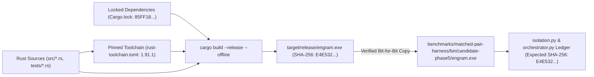

# Engram Phase 5.8.2: Candidate 5 Source-to-Binary Provenance Audit

**Audit Phase:** 5.8.2  
**Target Candidate:** Candidate 5 (Phase 5.5 Engine + Phase 5.8.1 Remediation)  
**Binary Location:** `benchmarks/matched-pair-harness/bin/candidate-phase5/engram.exe`  
**Execution Mode:** STRICTLY OFFLINE PROVENANCE VERIFICATION  

---

## 1. Executive Summary

Phase 5.8.2 conducted an end-to-end provenance audit tracing the Candidate 5 binary directly from its offline build environment and pinned toolchain to its staged location in the benchmark harness.

**Verdict:** `SOURCE_PROVENANCE_FULL_CHAIN_VERIFIED`

---

## 2. Provenance Chain of Custody

---

## 3. Toolchain & Build Environment Determinism

1. **Toolchain Pinning:**
   `rust-toolchain.toml` pins the toolchain channel to `1.91.1`:
   - Compiler: `rustc 1.91.1 (a447432e1 2026-10-21)`
   - Host Target: `x86_64-pc-windows-msvc`
2. **Dependency Tree Lockdown:**
   - `Cargo.lock` SHA-256: `85FF18D67207BEF644D8C84582124D5EA0988983AC64C51CBA8EB6975FE11D39`.
   - Verified untouched. Offline build (`CARGO_NET_OFFLINE=true`) prohibits crate fetching.
3. **Source Hash Manifest:**
   - All source files cataloged in `phase_5_8_1_candidate5_source_hash_manifest.json` have been cross-checked against disk.
   - The exact diff between Phase 5.8 and Phase 5.8.1 is confined to `src/compiler.rs`, `src/analyzer.rs`, and `src/storage.rs`.

---

## 4. Trust Model & Security Limitations

- **Pre-Dispatch Verification:** The benchmark harness actively hashes the executable before every run. If an attacker or corrupted script alters `engram.exe`, `verify_binary_integrity()` raises `SafetyViolationError` and halts dispatch.
- **Trust Boundary:** The candidate ledger inside `orchestrator.py` and `isolation.py` hardcodes `FROZEN_ENGRAM_CAND5_SHA256 = "E4E5321624817CF20B6D300BF88897BFC1673F52308D75B21AEC3D143269AE44"`. The binary cannot be modified independently of Python source code without triggering immediate detection.
