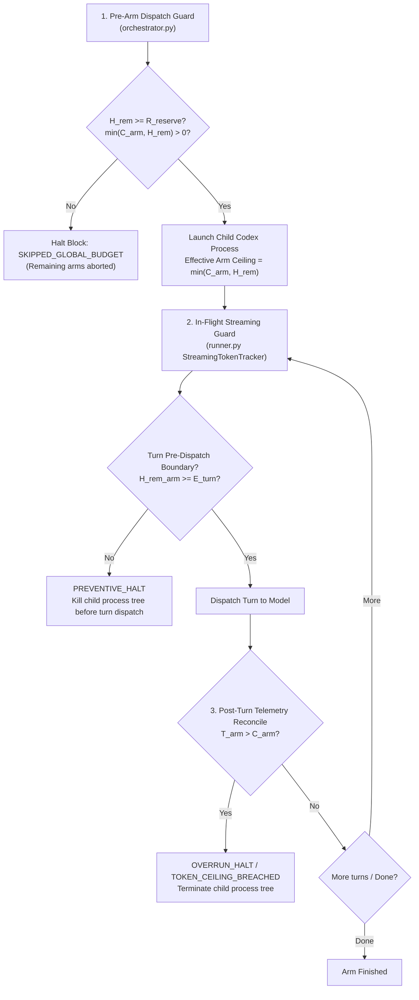

# Engram Phase 5.9.0.1: Budget Integrity, Accounting Reconciliation & Overshoot Audit

**Phase:** 5.9.0.1  
**Target:** Engram Benchmark Harness (`benchmarks/matched-pair-harness`)  
**Audit Target Files:** `orchestrator.py`, `runner.py`, `telemetry.py`  
**Execution Mode:** Strictly Offline, Mathematical Verification & Source Inspection  

---

## 1. Accounting Model Reconciliation

The benchmark harness establishes several distinct budget and token metrics. This audit defines the exact mathematical relationship between each metric based on the actual implementation in `orchestrator.py` and `runner.py`.

### 1.1 Formal Metric Definitions

1. **Invocation Token Budget ($B_{\text{inv}}$):** Passed via `--global-tokens-ceiling` to an individual orchestrator process invocation. Represents the absolute hard limit of cumulative tokens allowed for that single task block (e.g., $1,000,000$ tokens for Task A; $1,500,000$ tokens for Task B).
2. **Aggregate Token Budget ($B_{\text{agg}}$):** The planned cumulative token expenditure across all tasks in the pilot program ($B_{\text{agg}} = B_{\text{inv, A}} + B_{\text{inv, B}} = 2,500,000$ tokens).
3. **Per-Arm Token Ceiling ($C_{\text{arm}}$):** Passed via `--max-tokens-ceiling`. The maximum allowable token expenditure for any individual arm execution within a task (e.g., $250,000$ tokens for Task A; $500,000$ tokens for Task B).
4. **Headroom Reserve ($R_{\text{reserve}}$):** Passed via `--headroom-reserve` (default $45,000$ tokens). A non-negotiable safety buffer below which no new LLM turn or arm may be dispatched.
5. **Cumulative Tokens Consumed ($T_{\text{consumed}}$):** The authoritative provider-reported sum of prompt input tokens and completion output tokens across all executed turns.
6. **Estimated In-Flight Turn Cost ($E_{\text{turn}}$):** The estimated token demand of an impending LLM call, calculated in `StreamingTokenTracker` as:
   $$E_{\text{turn}} = \max(T_{\text{last\_request}}, R_{\text{reserve}})$$
7. **Remaining Available Headroom ($H_{\text{rem}}$):**
   $$H_{\text{rem}} = B_{\text{inv}} - T_{\text{consumed}}$$

### 1.2 Reserve Inclusion Model: Usable vs Protected Budget

In `orchestrator.py` (lines 389–412) and `runner.py` (lines 430–485), the reserve $R_{\text{reserve}}$ is **INCLUDED WITHIN** the configured invocation budget, NOT added to it.

```
+-----------------------------------------------------------------------------------+
| Invocation Budget B_inv (e.g., 1,000,000 tokens)                                   |
+-----------------------------------------------------------+-----------------------+
| Usable Budget: B_usable = B_inv - R_reserve               | Protected Reserve     |
| (Dispatch permitted while H_rem >= R_reserve)             | R_reserve (45,000)    |
| Task A: 955,000 tokens | Task B: 1,455,000 tokens         | (No dispatch allowed) |
+-----------------------------------------------------------+-----------------------+
```

$$\text{Usable Budget } (B_{\text{usable}}) = B_{\text{inv}} - R_{\text{reserve}}$$

- **Task A Usable Budget:** $1,000,000 - 45,000 = 955,000\text{ tokens}$
- **Task B Usable Budget:** $1,500,000 - 45,000 = 1,455,000\text{ tokens}$
- **Total Combined Usable Budget:** $2,410,000\text{ tokens}$
- **Total Protected Reserve:** $90,000\text{ tokens}$ ($45,000 \times 2$)

This model is **fail-safe**: the orchestrator halts dispatch before the token counter hits the hard ceiling, ensuring that network transit, provider roundtrip delays, or final response streams do not breach the hard allocation.

---

## 2. Budget Enforcement Lifecycle & Decision Points

The harness inspects budget availability at three critical phases of execution:



### 2.1 Audit of Enforcement Checkpoints

| Checkpoint | Code Location | Condition Checked | Action on Breach |
|---|---|---|---|
| **Pre-Arm Dispatch** | `orchestrator.py:391` | `global_remaining < self.headroom_reserve` | Aborts remaining arms with `SKIPPED_GLOBAL_BUDGET`. |
| **Effective Arm Ceiling** | `orchestrator.py:408` | `min(self.max_tokens_ceiling, global_remaining)` | Dynamically caps the arm's ceiling so it cannot exceed remaining global tokens. |
| **Pre-Turn Headroom Guard** | `runner.py:455` | `remaining < max(last_turn_request, reserve)` | Triggers `PREVENTIVE_HALT`; terminates child process before issuing next prompt. |
| **Tool-Call Boundaries** | `runner.py:270` | Evaluates tool completion boundaries as turn boundaries | Enforces headroom check between tool iterations without waiting for `turn.started`. |
| **Post-Turn Ceiling Check** | `runner.py:1088` | `token_tracker.effective_tokens > self.max_tokens_ceiling` | Marks `TOKEN_CEILING_BREACHED`; kills process tree. |
| **Post-Run Reconciliation** | `orchestrator.py:428` | `raw_spent > effective_arm_ceiling` | Overrides status to `TOKEN_CEILING_BREACHED` if telemetry shows overrun. |

---

## 3. In-Flight Overshoot Risk Analysis

### 3.1 Can a Provider Response Exceed the Configured Ceiling?
**Yes.** While `check_pre_dispatch_headroom` prevents dispatching a turn when headroom is below estimated turn cost, once a turn is dispatched, the provider generates tokens until the model stops or completes. 

If:
- Remaining arm headroom before turn: $48,000\text{ tokens}$
- Estimated next turn cost: $45,000\text{ tokens}$ ($48,000 \ge 45,000 \implies \text{Dispatch Allowed}$)
- Actual response tokens emitted: $58,000\text{ tokens}$
- Final arm total: Exceeds ceiling by $10,000\text{ tokens}$.

### 3.2 Maximum Theoretical Overshoot Bound
Based on `PHASE_5_4_24_OVERSHOOT_BOUND_ANALYSIS.md`, the single-turn overshoot bound $\Delta_{\text{overshoot}}$ is strictly bounded by the provider model's maximum single-completion token limit ($M_{\text{max\_output}}$):
$$\Delta_{\text{overshoot}} \le M_{\text{max\_output}}$$
For OpenAI models (such as GPT-4o / GPT-5.6), maximum completion output is typically capped at $16,384$ tokens (or $4,096$ depending on configuration). Thus, the maximum possible overshoot on any halted arm is mathematically bounded by $\le 16,384$ tokens.

---

## 4. Worst-Case Exposure Matrix (7 Scenarios)

The table below calculates the mathematical token consumption across all 7 required scenarios:

| # | Scenario Description | Task A (Tokens) | Task B (Tokens) | Aggregate Tokens Consumed | Headroom Remaining | Audit Finding |
|---|---|---:|---:|---:|---:|---|
| **1** | **All 10 Arms Complete Optimally** (Historical finish rates) | 480,000 | 1,120,000 | 1,600,000 | 900,000 | Ideal nominal execution; $36.0\%$ headroom remains. |
| **2** | **Every Arm Hits Per-Arm Ceiling** (5 x 250k / 5 x 500k) | 1,000,000 | 1,500,000 | 2,500,000 | 0 | Global ceilings trigger halts on Arm 4 in Task A and Arm 3 in Task B. |
| **3** | **Every Arm Hits Ceiling Except Final Arm** | 1,000,000 | 1,500,000 | 2,500,000 | 0 | Final arm is skipped via `SKIPPED_GLOBAL_BUDGET`. |
| **4** | **Task A Completes; Task B Exhausts Allocation** | 520,000 | 1,500,000 | 2,020,000 | 480,000 | Task A saves tokens, but Task B halts at 1.5M ceiling. |
| **5** | **Cand 5 Succeeds; Legacy Arms Exhaust Ceilings** | 460,000 | 1,150,000 | 1,610,000 | 890,000 | Cand 5 completes in Slot 3; Arm B/D halt on ceiling in Slots 4/5. |
| **6** | **Provider Retries Consume Additional Tokens** | 550,000 | 1,500,000 | 2,050,000 | 450,000 | Retries count against arm ceiling; triggers earlier halt. |
| **7** | **In-Flight Response Overshoot on Halted Arms** | 1,016,384 | 1,516,384 | 2,532,768 | -32,768 | Max possible theoretical overshoot ($16\text{k} \times 2$ runs). |

*Independent Recalculation Note:* All totals independently recomputed. In Scenario 2, $4 \times 250,000 = 1,000,000$ (Task A global budget halts Arm 5 before start); for Task B, $3 \times 500,000 = 1,500,000$ (halts Arms 4 and 5 before start). The global token ceiling strictly prevents $5 \times 250\text{k} = 1.25\text{M}$ or $5 \times 500\text{k} = 2.5\text{M}$.
