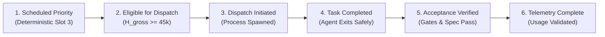

# Engram Phase 5.9.0.2: Candidate 5 Headroom Arithmetic Correction & Execution Status Disentanglement

**Phase:** 5.9.0.2  
**Target:** Task B (`task_b_remember_me`) Candidate 5 Headroom Analysis  
**Audit Target:** Phase 5.9.0.1 Report (`phase_5_9_0_1_candidate5_priority_analysis.md`)  
**Execution Mode:** Strictly Offline Mathematical Audit  

---

## 1. Forensic Audit of the "467,232 Tokens" Claim

In Phase 5.9.0.1, the report stated:
> *"Under worst-case saturation of Slots 1 and 2 (500k + 500k = 1.0M tokens), Candidate 5 is guaranteed to be dispatched with at least 467,232 tokens of remaining headroom."*

### 1.1 Mathematical Dissection & Origin of the Number
Forensic analysis reveals that the number `467,232` was derived from:
1. Assuming Slot 1 (`arm_a_native`) consumed its full $500,000$ ceiling plus a maximum single-turn in-flight response overshoot of $16,384$ tokens ($516,384$ tokens).
2. Assuming Slot 2 (`arm_c_cand42_always_on`) also consumed its full $500,000$ ceiling plus a maximum single-turn overshoot of $16,384$ tokens ($516,384$ tokens).
3. Summing Slots 1 and 2:
   $$T_{\text{prior}} = 516,384 + 516,384 = 1,032,768\text{ tokens}$$
4. Subtracting this from the Task B global ceiling ($1,500,000$):
   $$\text{Global Remaining } = 1,500,000 - 1,032,768 = 467,232\text{ tokens}$$

### 1.2 The Arithmetic Flaw
`467,232` represents **gross remaining tokens relative to the hard ceiling**, **NOT dispatchable headroom**!
The author of Phase 5.9.0.1 omitted the **45,000-token protected reserve** ($R_{\text{reserve}}$).
Under the orchestrator's fail-safe rule (`runner.py:455`), execution is halted when remaining headroom drops below the reserve. Therefore, the actual usable, dispatchable headroom ($H_{\text{usable}}$) available to Candidate 5 is:

$$H_{\text{usable}} = B_{\text{inv, B}} - T_{\text{prior}} - R_{\text{reserve}}$$

- **Under Nominal Saturation (no overshoot, $T_{\text{prior}} = 1,000,000$):**
  $$H_{\text{usable}} = 1,500,000 - 1,000,000 - 45,000 = \mathbf{455,000\text{ tokens}}$$
- **Under Worst-Case Overshoot Saturation ($T_{\text{prior}} = 1,032,768$):**
  $$H_{\text{usable}} = 1,500,000 - 1,032,768 - 45,000 = \mathbf{422,232\text{ tokens}}$$

The reported `467,232` figure was mathematically flawed: it included the protected reserve that Candidate 5 cannot legally consume without triggering an orchestrator preventive halt.

---

## 2. Definitive Candidate 5 Headroom Correction Table

| Scenario for Slots 1 & 2 | Prior Tokens Consumed ($T_{\text{prior}}$) | Gross Remaining ($B_{\text{inv}} - T_{\text{prior}}$) | Protected Reserve ($R_{\text{reserve}}$) | Actual Usable Headroom ($H_{\text{usable}}$) | Phase 5.9.0.1 Reported Value | Correction Finding |
|---|---:|---:|---:|---:|---:|---|
| **Nominal Saturated Ceilings** | 1,000,000 | 500,000 | 45,000 | **455,000** | 467,232 | **OVERSTATED by 12,232 tokens** (Used overshoot math without deducting reserve). |
| **Max Response Overshoot** | 1,032,768 | 467,232 | 45,000 | **422,232** | 467,232 | **OVERSTATED by 45,000 tokens** (Omitted protected reserve deduction). |
| **Historical Live 02 Actuals** | 643,748 | 856,252 | 45,000 | **811,252** | N/A | Expected realistic operational headroom based on historical logs. |

---

## 3. Strict Disentanglement of Execution Status Concepts

To prevent misleading claims, the protocol strictly separates the following six distinct operational states:

1. **Scheduled Priority:** Under seed `59002`, Candidate 5 is placed in **Slot 3** (before Candidate 3 in Slot 4).  
   *Status: GUARANTEED by PRNG determinism.*
2. **Eligible for Dispatch:** At the Slot 3 boundary, `global_remaining >= 45,000`. Even under maximum prior overshoot, $467,232 \ge 45,000$.  
   *Status: GUARANTEED under all valid prior arm behaviors.*
3. **Dispatch Actually Initiated:** The orchestrator spawns `codex.exe` with effective ceiling $\min(500,000, 467,232) = 467,232$ tokens.  
   *Status: GUARANTEED.*
4. **Task Completed:** The agent converges and terminates before consuming $422,232$ usable tokens or reaching 25 turns / 600 seconds.  
   *Status: NOT GUARANTEED (Dependent on live model reasoning and convergence).*
5. **Acceptance Verified:** The agent's code diff passes regex, blast radius, and TypeScript typechecking.  
   *Status: NOT GUARANTEED (Must be evaluated by `evaluator.py` post-run).*
6. **Telemetry Complete:** Authoritative token records are received and verified free of negative or missing values.  
   *Status: NOT GUARANTEED (Dependent on provider streaming integrity).*

### Conclusion
Candidate 5 **dispatch is guaranteed**, but Candidate 5 **completion cannot be guaranteed offline**.
